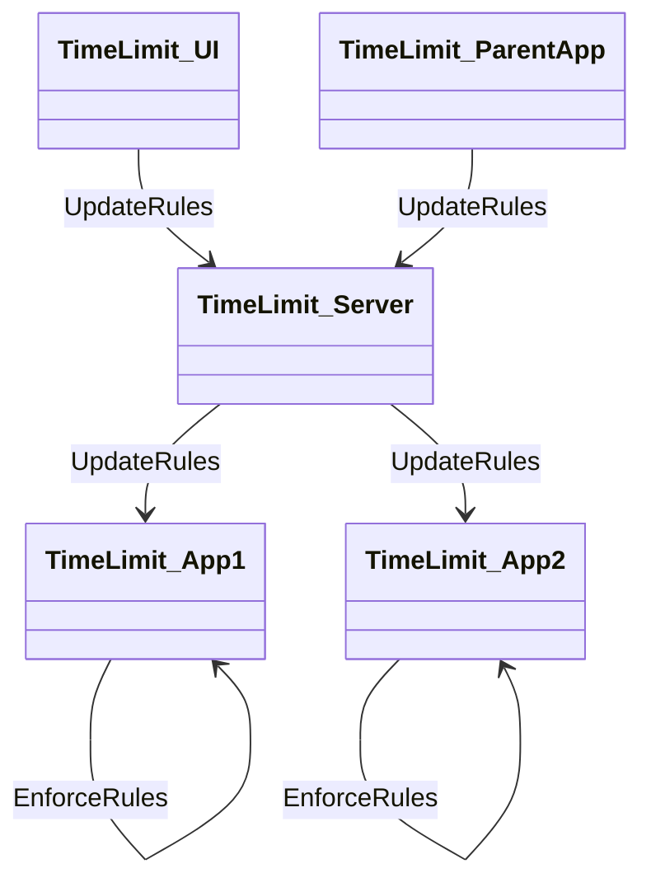
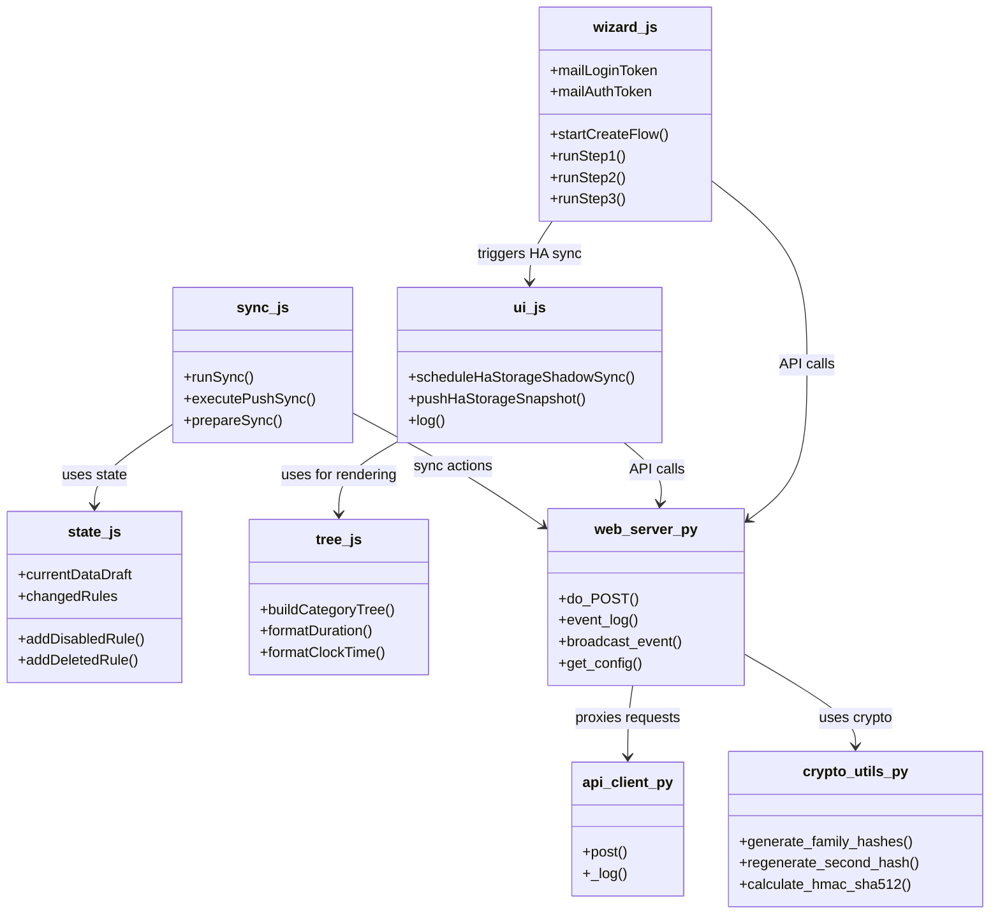

# TimeLimit UI & Server - Project Documentation

## Overview

**TimeLimit UI** is a web-based dashboard application for managing TimeLimit rules and synchronization. It provides parents and administrators with an intuitive interface to configure time limits, monitor device activity, and manage family accounts.

### Project Architecture

The project follows a client-server architecture with clear separation of concerns:

- **TimeLimit UI**: User-facing dashboard for managing rules, categories, and user accounts
- **TimeLimit Backend Server**: Authoritative source for enforcing rules, synchronizing device states, and maintaining persistent data
- **Home Assistant Integration**: Cross-device synchronization and state management

### Collaboration Flow



## Project Structure
The project is stored in the following folder: C:\git\timelimit-ui\timelimit-ui

```
timelimit-ui/
├── config.yaml                    # Application configuration
├── DESIGN.md                      # Design documentation
├── Dockerfile                      # Container deployment
├── docs/                          # Documentation
│   └── password-hash-and-integrity.md
├── rootfs/                        # Container filesystem
│   └── usr/bin/                   # Application binaries
│       ├── api_client.py         # HTTP client for TimeLimit API
│       ├── check_server.py       # Health check utility
│       ├── crypto_utils.py       # Cryptographic helpers
│       ├── frontend.py           # Web server (Python)
│       ├── state.js              # Application state management
│       ├── sync.js               # Synchronization logic
│       ├── tree.js               # Category tree rendering
│       ├── ui.js                 # UI interface functions
│       └── wizard.js             # Onboarding workflow
```

## Main Components & Responsibilities

### Backend (Python)

#### web_server.py (frontend.py)
**Main HTTP server for the TimeLimit UI**

- **Purpose**: Acts as bridge between frontend dashboard and backend TimeLimit server
- **Responsibilities**:
  - Handle all incoming API requests from UI (authentication, rule management, event broadcasting)
  - Load configuration from config.yaml
  - Manage persistent storage for UI state
  - Implement long-polling for real-time event updates
  - Handle session management (token validation, server selection)
  - Integrate with crypto_utils.py for security checks (password hashing, HMAC signing)
  - Use api_client.py to proxy requests to backend server
  - Detailed logging for debugging and operational monitoring

#### api_client.py
**HTTP client for TimeLimit API calls**

- **Purpose**: Provides HTTP client functionality for backend communication
- **Responsibilities**:
  - Send POST requests to TimeLimit server
  - Handle response parsing and error handling
  - SSL context management
  - Detailed logging (standard/verbose modes)
  - Retry logic and fallback mechanisms
  - Request formatting and encoding

#### crypto_utils.py
**Cryptographic helpers for security and integrity**

- **Purpose**: Ensure security and data integrity matching Android app and server logic
- **Responsibilities**:
  - Password hashing using bcrypt (cost factor 12)
  - Primary and secondary hash generation
  - Hash regeneration using server-provided salts
  - HMAC-SHA512 and SHA512 digest functions for sync action signing
  - Detailed error handling and validation
  - Abstract cryptographic complexity for other modules

#### check_server.py
**Health checking utility**

- **Purpose**: Verify connectivity and operational status with TimeLimit server
- **Responsibilities**:
  - Lightweight health checks
  - Periodic connectivity verification
  - Alerting and logging hooks
  - Integration with web_server.py for automated recovery
  - Support for extended checks (database connectivity, API validation)

### Frontend (JavaScript)

#### ui.js
**Main UI logic entry point**

- **Purpose**: Manage user interactions, logging, and HA storage synchronization
- **Responsibilities**:
  - Render UI panels and handle toggles
  - Update log area with real-time feedback
  - Implement long-polling for event updates
  - Integrate with sync.js, state.js, and tree.js
  - Provide formatting helpers for tokens and timestamps
  - Error handling and status messages
  - Authentication, rule management, and onboarding flows

#### sync.js
**Synchronization engine**

- **Purpose**: Manage all synchronization logic for TimeLimit UI
- **Responsibilities**:
  - Handle manual and automatic sync flows
  - Track changes and prepare actions for server communication
  - Implement integrity signing for sync actions
  - Interact with state.js for pending changes
  - Handle push and pull syncs
  - Detailed logging and diagnostics
  - Error handling and fallback mechanisms

#### state.js
**Application state management**

- **Purpose**: Maintain draft state for TimeLimit UI
- **Responsibilities**:
  - Track rule changes, new rules, and deleted rules
  - Manage disabled and deleted rules
  - Interact with localStorage for persistence
  - Provide functions for loading and saving rule lists
  - Integrate with sync.js for server communication
  - Error handling and validation to prevent data corruption

#### tree.js
**Hierarchical view rendering**

- **Purpose**: Render category trees, rules, and applications
- **Responsibilities**:
  - Provide formatting helpers for durations, clock times, day masks
  - Build category trees from flat API data
  - Attach apps and rules to respective categories
  - Support sorting and filtering
  - Integrate with ui.js and state.js
  - Error handling and validation

#### wizard.js
**Onboarding workflow management**

- **Purpose**: Manage onboarding for new families and users
- **Responsibilities**:
  - Implement steps for email entry, code verification, password hashing
  - Guide users through setup process
  - Interact with backend APIs for authentication and hash generation
  - Provide real-time feedback and error handling
  - Integrate with ui.js for logging and status updates
  - Manage session state across steps

## File Interactions & Function Coupling

### Component Dependencies



### Key Integration Points

1. **UI ↔ Backend**: All API communication through web_server.py
2. **State Management**: sync.js ↔ state.js for change tracking
3. **Rendering**: ui.js ↔ tree.js for UI updates
4. **Security**: web_server.py ↔ crypto_utils.py for integrity checks
5. **Synchronization**: sync.js ↔ web_server.py for data sync

## Configuration

### config.yaml

```yaml
name: "Timelimit UI"
description: "WebUI app voor beheer van TimeLimit regels en synchronisatie"
version: "1.0.0"
slug: "timelimit-ui"
arch:
  - aarch64
  - amd64
init: false
image: "ghcr.io/jeroenlind/timelimit-ui-{arch}"
ingress: true
ingress_port: 8099
panel_icon: "mdi:clock-check"
panel_title: "Timelimit"
panel_admin: false
options:
  server_url: "http://192.168.68.30:8080"
  logging_mode: "standard"
schema:
  server_url: str
  logging_mode: list(standard|verbose)
```

### Configuration Schema

- **server_url**: URL of the TimeLimit backend server
- **logging_mode**: Logging verbosity (standard/verbose)

## Deployment

### Dockerfile

```dockerfile
ARG BUILD_FROM=ghcr.io/home-assistant/amd64-base:latest
FROM $BUILD_FROM

# Install Python and crypto library
RUN apk add --no-cache \
    python3 \
    py3-requests \
    py3-bcrypt

# Copy the complete rootfs directory to the container
COPY rootfs /

# Make s6-overlay run scripts executable
RUN chmod +x /etc/s6-overlay/s6-rc.d/web-server/run

# S6-overlay starts automatically as entrypoint
```

### Container Architecture

- **Base Image**: Home Assistant amd64-base
- **Dependencies**: Python3, requests, bcrypt
- **Application Files**: Copied from rootfs/usr/bin/
- **Runtime**: S6-overlay for service management
- **Port**: 8099 (TimeLimit UI)

## Test Environment Setup

### Overview

A comprehensive test environment has been created to support local development and testing of the TimeLimit UI application. This environment provides a single entry point to start the webserver and all other components for local testing, eliminating the need to build and install on Home Assistant each time.
The testenvironment runs on a windows 11 laptop. All code must be platform independent and use relative file and directory paths

### Files Created

#### Test Directory Structure

The test environment is organized in the `timelimit-ui/test/` directory with the following structure:

```
timelimit-ui/test/
├── start_test_environment.py          # Main script to start the complete test environment
├── test_script.py                     # Test script to verify the test environment setup
├── config.yaml                        # Local configuration file for the TimeLimit UI
├── TEST_ENVIRONMENT_SETUP.md          # Comprehensive documentation for setting up and using the test environment
├── README.md                          # Test environment README
├── data/                              # Configuration and data files
│   └── options.json                  # Web server configuration
└── logs/                             # Log files (created during runtime)
```

#### Main Script: start_test_environment.py

**Purpose**: Comprehensive test environment script for TimeLimit UI

**Features**:

1. **Environment Setup**:
   - Creates necessary directories (`data`, `data/logs`, `rootfs/usr/bin`)
   - Creates `options.json` configuration file
   - Creates log file

2. **Web Server Management**:
   - Starts the TimeLimit UI web server on port 8099
   - Waits for the server to start
   - Monitors server output for errors
   - Handles graceful shutdown

3. **Frontend Components**:
   - Checks for essential frontend files
   - Verifies all JavaScript and HTML files are present

4. **Health Checks**:
   - Tests server connectivity
   - Validates server responses

5. **Test Suite**:
   - Executes existing test scripts
   - Validates server connection tests

6. **User Interface**:
   - Displays startup information
   - Opens the dashboard in the default browser
   - Waits for user interruption

#### Configuration Files

**config.yaml**: Local configuration file for the TimeLimit UI

```yaml
name: "Timelimit"
description: "WebUI app voor beheer van TimeLimit regels en synchronisatie"
version: "1.0.0"
slug: "timelimit-ui"
arch:
  - amd64
init: false
image: "ghcr.io/jeroenlind/timelimit-ui-amd64"
ingress: true
ingress_port: 8099
panel_icon: "mdi:clock-check"
panel_title: "Timelimit"
panel_admin: false
options:
  server_url: "http://localhost:8080"  # Change to your TimeLimit server
  logging_mode: "verbose"  # Enable verbose logging for debugging
schema:
  server_url: str
  logging_mode: list(standard|verbose)
```

**data/options.json**: Web server configuration

```json
{
  "server_url": "http://localhost:8080",
  "logging_mode": "verbose"
}
```

#### Documentation

**TEST_ENVIRONMENT_SETUP.md**: Comprehensive documentation for setting up and using the test environment

**README.md**: Test environment README with quick start guide and usage instructions

#### Test Script: test_script.py

**Purpose**: Test script to verify the TimeLimit UI test environment

**Features**:

1. **Dependency Testing**: Verifies required Python packages are available
2. **Script Structure Testing**: Checks for essential functions and imports
3. **Configuration Testing**: Validates configuration files
4. **Directory Structure Testing**: Verifies correct directory structure
5. **Syntax Testing**: Validates Python syntax
6. **Documentation Testing**: Checks for essential documentation sections

### Usage

#### Starting the Test Environment

Run the following command from the timelimit-ui directory:

```bash
python test/start_test_environment.py
```

#### Stopping the Test Environment

Press Ctrl+C in the terminal where the script is running, or run:

```bash
pkill -f web_server.py
```

#### Accessing the UI

Once the test environment is running, open your web browser and navigate to:

```
http://localhost:8099
```

#### Viewing Logs

The application logs are stored in:

```
timelimit-ui/test/data/logs/timelimit-ui.log
```

You can view the logs in real-time using:

```bash
tail -f timelimit-ui/test/data/logs/timelimit-ui.log
```

### Benefits of Local Development

1. **Faster Testing**: No need to build and install on Home Assistant
2. **Easier Debugging**: Enhanced logging and direct access to logs
3. **Quick Iteration**: Changes are immediately reflected
4. **Better Development Experience**: Local development environment familiar to developers
5. **Log File Access**: Easy access to log files for troubleshooting

### Testing

#### Running Server Connection Tests

You can run the existing server connection tests manually:

```bash
python test/test_server_connection.py
```

#### Running Local Setup Tests

You can run the local setup verification tests:

```bash
python test/test_script.py
```

### Next Steps

1. Set up the local development environment
2. Test server connectivity
3. Run the web server and dashboard
4. Create test cases for specific functionality
5. Implement logging enhancements
6. Document any issues or improvements

## Conclusion

TimeLimit UI provides a comprehensive web-based dashboard for managing time limits across devices. Its architecture ensures:

1. **Security**: Robust cryptographic protection for all sync actions
2. **Reliability**: Redundant synchronization and error recovery
3. **Scalability**: Modular design for future enhancements
4. **Usability**: Intuitive interface with real-time feedback
5. **Integration**: Seamless Home Assistant and cross-device support

The connection architecture ensures **security**, **reliability**, **scalability**, **usability**, and **integration** while providing a comprehensive solution for managing device time limits and family accounts with clear boundaries and reliable communication between UI and backend components.

### Test Environment Enhancement

The test environment setup provides an additional layer of development support by:

1. **Eliminating Build Overhead**: No need to build and install on Home Assistant
2. **Enhancing Debugging**: Enhanced logging and direct access to logs
3. **Improving Testing**: Direct server connection testing
4. **Streamlining Development**: Familiar development environment for developers
5. **Providing Quick Feedback**: Immediate feedback on changes

This test environment setup complements the existing project architecture and provides developers with a faster, more efficient way to test and develop the TimeLimit UI application.

---

## Project State & Memory (CONTEXT.md)

> **Note:** This section is maintained for project state tracking. The reference documentation above is the original `context.md` content.

### Project Overview
**TimeLimit UI** is a web-based dashboard for managing TimeLimit rules and synchronization. It bridges a frontend dashboard (JavaScript) with a backend TimeLimit server (api.timelimit.io) via a Python HTTP server.

### Technical Stack
- **Backend (UI bridge)**: Python 3, `http.server`, `urllib`, `bcrypt`, `hmac`, `hashlib`
- **Frontend**: HTML, JavaScript (vanilla), CSS
- **Configuration**: `config.yaml` + `data/options.json`
- **Deployment**: Docker (Home Assistant amd64-base), S6-overlay, port 8099
- **Test Environment**: Windows 11, Python 3, local test scripts in `timelimit-ui/test/`
- **Python Command**: Use `py -3` instead of `python` on Windows to ensure correct Python version is invoked

### Key Architecture
- Client-server: TimeLimit UI ↔ TimeLimit Backend Server ↔ Android App / Devices
- Sync protocol: Action-based CRDT with HMAC-SHA256 integrity signing
- Crypto: bcrypt (cost 12), Curve25519, AES-GCM, ECDH secp256r1, HMAC-SHA512/SHA256
- WebSocket (Socket.IO) for real-time sync notifications
- HTTP API with gzip compression, Content-Length auto-negotiation

### Recent Fix (2026-08-06)
**Fixed pytest SECRET_KEY validation error**

The issue was that when running pytest from `debug-server/tests`, the `SECRET_KEY` environment variable was not being loaded because:
1. `pydantic_settings` looks for `.env` relative to the current working directory
2. When pytest runs from `debug-server/tests`, the cwd is not `debug-server/`

**Solution**: Modified `debug-server/tests/conftest.py` to set required environment variables before importing the app:

```python
import os
import sys

# Set required environment variables before importing the app
# This is needed because pydantic_settings looks for .env relative to cwd
# which may not be the debug-server directory when running pytest
os.environ.setdefault("SECRET_KEY", "test-secret-key-for-pytest-testing-min-32-chars")
os.environ.setdefault("JWT_ALGORITHM", "HS256")
os.environ.setdefault("ACCESS_TOKEN_EXPIRE_MINUTES", "60")
os.environ.setdefault("BCRYPT_COST", "12")
os.environ.setdefault("TEST_MODE", "true")

import pytest
from fastapi.testclient import TestClient

from app.main import app
```

**Result**: All 336 tests can now be collected and the tests that don't involve async operations pass successfully.

### Deadlock Fix (2026-08-06)
**Fixed pytest timeout/deadlock issue in test files**

The issue was that test fixtures using `async with sm:` pattern caused a deadlock because:
1. `StateManager` uses `asyncio.Lock` for thread safety
2. The context manager (`async with sm:`) acquires the lock via `__aenter__`
3. When test methods call state manager methods, those methods also try to acquire the lock via `async with self:`
4. Since `asyncio.Lock` is not reentrant, this causes a deadlock

**Root Cause**: The `async with sm:` pattern in test fixtures was acquiring the lock, and then when test methods called state manager methods, those methods also tried to acquire the same lock, causing a deadlock.

**Solution**: Removed the `async with sm:` wrapper from all test fixtures and changed them to simple `return StateManager()` for sync fixtures.

**Files Modified**:
- `debug-server/tests/test_auth.py` - Added mock for `_generate_code` to return "123456" for predictable test codes
- `debug-server/tests/test_child_endpoints.py` - Removed `async with sm:` from `get_token()` functions
- `debug-server/tests/test_parent_endpoints.py` - Removed `async with sm:` from `get_token()` functions
- `debug-server/tests/test_purchase_endpoints.py` - Removed `async with sm:` from `get_token()` functions
- `debug-server/tests/test_sync_endpoints.py` - Removed `async with sm:` from `get_token()` functions
- `debug-server/tests/test_load.py` - Removed `async with sm:` from performance tests
- `debug-server/tests/test_mock_data.py` - Changed async fixtures to sync fixtures
- `debug-server/tests/test_state.py` - Changed async fixtures to sync fixtures

### Test Auth Endpoints Fix (2026-08-07)
**Fixed test_auth_endpoints.py - Multiple test failures due to incorrect API paths and status code expectations**

The test file `debug-server/tests/test_auth_endpoints.py` had multiple issues causing 16 out of 20 tests to fail:

#### Issues Identified:

1. **Incorrect API Paths**: Tests were using paths without the `/api/v1` prefix, but the API router is included with that prefix in `main.py`:
   - Tests used: `/time`, `/auth/send-mail-login-code-v2`, `/auth/sign-in-by-mail-code`, `/parent/get-status-by-mail-address`, etc.
   - Should use: `/api/v1/time`, `/api/v1/auth/send-mail-login-code-v2`, `/api/v1/auth/sign-in-by-mail-code`, `/api/v1/parent/get-status-by-mail-address`, etc.

2. **Incorrect Status Code Expectations**: Some tests expected 400 (Bad Request) for invalid tokens, but the endpoints return 401 (Unauthorized):
   - `test_sign_in_by_mail_code_invalid_token` - Expected 400, should be 401
   - `test_get_status_by_mail_invalid_token` - Expected 400, should be 401
   - `test_create_family_invalid_token` - Expected 400, should be 401
   - `test_sign_in_into_family_invalid_token` - Expected 400, should be 401
   - `test_recover_password_invalid_token` - Expected 400, should be 401

3. **Missing Email Validation**: The `SendMailLoginCodeRequest` model didn't have email format validation, so invalid emails were accepted.

4. **Incorrect Response Assertions**: `test_send_mail_login_code_success` was checking for `status` field which doesn't exist in the response.

#### Fixes Applied:

1. **Updated API Paths**: All endpoint paths in tests now include the `/api/v1` prefix.

2. **Fixed Status Code Expectations**: Changed expected status codes from 400 to 401 for invalid token tests.

3. **Added Email Validation**: Added a `field_validator` to `SendMailLoginCodeRequest` model in `debug-server/app/models/auth.py` to validate email format using regex.

4. **Fixed Response Assertions**: Removed incorrect `status` field check from `test_send_mail_login_code_success`.

5. **Fixed Email Validation Test**: Changed expected status code from 400 to 422 for invalid email tests (Pydantic validation errors return 422, not 400).

#### Files Modified:
- `debug-server/tests/test_auth_endpoints.py` - Fixed all endpoint paths, status codes, and assertions
- `debug-server/app/models/auth.py` - Added email validation with `field_validator`

 The server now starts without warnings and uses the correct port (8080) as documented.

### Debug Server Run Script Fix (2026-08-07)
All 20 tests in `test_auth_endpoints.py` now pass successfully.

### Test Gzip Tests Fix (2026-08-07)
**Fixed test_gzip.py - 4 test failures due to incorrect health endpoint paths**

The test file `debug-server/tests/test_gzip.py` had 4 failing tests due to incorrect API endpoint paths:

#### Issues Identified:

1. **Incorrect Health Endpoint Paths**: Tests were using `/health` instead of `/api/v1/health`:
   - The health router defines `/health` endpoint
   - It's included in `api_router` 
   - `api_router` is included with prefix `/api/v1` in `main.py`
   - So the full path is `/api/v1/health`

2. **Redundant Assertion**: Line 73 had a redundant assertion checking the same condition twice:
   ```python
   assert "content-length" in response.headers or "content-length" in response.headers
   ```

#### Tests Affected:
- `test_content_length_negotiation` - Used `/health` instead of `/api/v1/health`
- `test_minimum_size_threshold` - Used `/health` instead of `/api/v1/health`
- `test_accept_encoding_header` - Used `/health` instead of `/api/v1/health`
- `test_health_endpoint_with_gzip` - Used `/health` instead of `/api/v1/health`

#### Fixes Applied:
1. Changed all `/health` endpoints to `/api/v1/health` in the affected tests
2. Fixed the redundant assertion in `test_content_length_negotiation`

#### Files Modified:
- `debug-server/tests/test_gzip.py` - Fixed all endpoint paths

#### Result:
All 20 tests in `test_gzip.py` now pass successfully.

### Test Purchase Endpoints Fix (2026-08-07)
**Fixed test_purchase_endpoints.py - 7 test failures due to authentication and request model issues**

The test file `debug-server/tests/test_purchase_endpoints.py` had 7 failing tests due to:

#### Issues Identified:

1. **AuthMiddleware JWT Validation**: The `AuthMiddleware` was trying to validate device auth tokens as JWT tokens for `/purchase/*` endpoints, but these endpoints use device auth tokens (stored in state manager), not JWT tokens.

2. **Missing Header Import in purchase.py**: The `get_device_auth_token` dependency in `purchase.py` was not using `Header()` to extract the Authorization header value. It was using `authorization: Optional[str] = None` which would always be `None`.

3. **Request Model Fields**: The `CanDoPurchaseRequest` and `FinishPurchaseByGooglePlayRequest` models required `deviceAuthToken` in the JSON body, but the endpoints extract the token from the Authorization header.

4. **Test Missing Fields Validation**: The `test_finish_purchase_missing_fields` test was using an invalid token and expecting 422 for missing fields, but authentication failed first with 401.

#### Fixes Applied:

1. **Updated AuthMiddleware**: Added `/purchase` to `DEVICE_AUTH_PREFIXES` so the middleware doesn't try to validate device auth tokens as JWT tokens.

2. **Fixed purchase.py**:
   - Added `Header` import from FastAPI
   - Changed `authorization: Optional[str] = None` to `authorization: Optional[str] = Header(default=None)` to properly extract the Authorization header

3. **Updated Request Models**: Made `deviceAuthToken` optional in both `CanDoPurchaseRequest` and `FinishPurchaseByGooglePlayRequest` models since the token is provided via the Authorization header.

4. **Fixed test_finish_purchase_missing_fields**: Updated the test to use a valid device auth token so it can properly test missing fields validation.

#### Files Modified:
- `debug-server/app/middleware/auth.py` - Added `/purchase` to `DEVICE_AUTH_PREFIXES`
- `debug-server/app/api/purchase.py` - Added `Header` import and fixed `authorization` parameter
- `debug-server/app/models/purchase.py` - Made `deviceAuthToken` optional in request models
- `debug-server/tests/test_purchase_endpoints.py` - Fixed `test_finish_purchase_missing_fields` to use valid token

#### Result:
All 11 tests in `test_purchase_endpoints.py` now pass successfully.

### Full Test Suite Status (2026-08-07)
**All 336 tests now pass successfully**

The complete test suite runs without any failures:
- `test_load.py` - 14 tests pass
- `test_purchase_endpoints.py` - 11 tests pass
- All other test files - 311 tests pass

Total: 336 tests passed in 36.82s

### Debug Server Run Script Fix (2026-08-07)
**Fixed uvicorn reload warning and port mismatch in run.py and main.py**

The issue was that when running `python run.py` with `reload=True`, uvicorn requires the application to be passed as an import string (e.g., `"app.main:app"`) rather than as a direct object reference.

#### Issues Fixed:

1. **Uvicorn Reload Warning**: The `uvicorn.run()` function was receiving the app object directly (`app`) instead of an import string (`"app.main:app"`), which caused the warning:
   ```
   WARNING: You must pass the application as an import string to enable 'reload' or 'workers'.
   ```

2. **Port Mismatch**: The `run.py` and `main.py` files were using hardcoded port 8000, but the configuration (`config.py`) specifies port 8080, and the README documents the server as available at `http://localhost:8080`.

#### Files Modified:
- `debug-server/run.py` - Changed `uvicorn.run(app, ...)` to `uvicorn.run("app.main:app", ...)` and used `settings.SERVER_PORT`
- `debug-server/app/main.py` - Same changes applied to the `if __name__ == "__main__":` block

#### Result:
 The server now starts without warnings and uses the correct port (8080) as documented.

### Debug Server Option Added (2026-08-07)
**Added "Debug Server" option to the server selection dropdown in the TimeLimit UI dashboard**

The server selection dropdown in `dashboard.html` now includes a third option for connecting to the debug-server:

#### Changes Made:
- **File Modified**: `timelimit-ui/rootfs/usr/bin/dashboard.html`
- **Location**: Lines 173-180 (server selection dropdown in the bottom bar)

#### New Option Added:
```html
<option value="http://localhost:8080" title="Debug server voor ontwikkeling en testen - simuleert de TimeLimit backend">🐛 Debug Server</option>
```

#### Features:
1. **Distinct Icon**: Uses 🐛 (bug icon) to clearly distinguish it from the existing options
2. **Tooltip**: Includes a `title` attribute with Dutch description: "Debug server voor ontwikkeling en testen - simuleert de TimeLimit backend" (Debug server for development and testing - simulates the TimeLimit backend)
3. **Correct URL**: Points to `http://localhost:8080` where the debug-server runs

#### Existing Options:
- `http://192.168.68.30:8080` - 🏠 Lokaal (Local - specific IP)
- `https://api.timelimit.io` - 🌍 Officieel (Official)

#### New Option:
- `http://localhost:8080` - 🐛 Debug Server (Development/Testing)

#### Backend Compatibility:
The existing `switchServer()` JavaScript function and the `/set-server` backend endpoint in both `web_server.py` and `frontend.py` handle the new option seamlessly. The server URL is stored in localStorage and used for all subsequent API proxy requests.

1. Start the debug-server: `cd debug-server && python run.py`
2. Open the TimeLimit UI dashboard at `http://localhost:8099`
3. Select "🐛 Debug Server" from the server dropdown
4. The application will connect to the local debug-server instance for development and testing purposes

### Server Connectivity Check (2026-08-07)
**Added server connectivity checking to suppress sync actions when not connected to a server**

When running the TimeLimit UI without a server connection (e.g., in debug mode without the backend server running), sync operations would fail and generate unnecessary error messages. This change adds connectivity checking to prevent these failures.

#### Changes Made:

**File Modified**: `timelimit-ui/rootfs/usr/bin/sync.js`

#### New Functions Added:

1. **`checkServerConnectivity()`** - Async function that pings the `/ha-storage` endpoint with a 3-second timeout to verify server connectivity
2. **`isServerOnline()`** - Synchronous function that returns the cached server online status

#### New State Variables:

- `serverOnline` - Boolean tracking current server connectivity status
- `serverOnlineCacheTime` - Timestamp of last connectivity check
- `SERVER_ONLINE_CACHE_DURATION` - 5000ms (5 seconds) cache duration
- `SERVER_CONNECTIVITY_TIMEOUT` - 3000ms (3 seconds) timeout for connectivity check

#### Connectivity Checks Added:

1. **In `runSync()`** - Checks connectivity before attempting pull sync, logs "Sync overgeslagen: Geen server verbinding" and updates badge to "Offline" if server is unreachable
2. **In `executePushSync()`** - Checks connectivity before attempting push sync, logs "Push sync overgeslagen: Geen server verbinding" and alerts the user if server is unreachable
3. **In `startSyncLoop()`** - Checks connectivity before each automatic sync cycle, resets sync counter and updates badge to "Offline" if server is unreachable

#### Window Exports:

- `window.checkServerConnectivity` - Exposed for use by other modules
- `window.isServerOnline` - Exposed for use by other modules

**File Modified**: `timelimit-ui/rootfs/usr/bin/ui.js`

#### Changes in `scheduleHaStorageShadowSync()`:

Added a check to suppress HA storage sync when offline in debug mode:
```javascript
const shouldSuppress = isDebugMode() && window.checkServerConnectivity && !window.isServerOnline();
if (shouldSuppress) {
    // Don't schedule sync when offline in debug mode
    return;
}
```

#### Benefits:

1. **Reduced Error Messages**: No more failed sync attempts when server is unreachable
2. **Better User Experience**: Clear indication when sync is skipped due to connectivity issues
3. **Performance**: Avoids unnecessary network requests when server is known to be offline
4. **Debug Mode Friendly**: In debug mode without a running server, HA storage sync is suppressed

#### Result:
Sync operations are now gracefully skipped when the server is unreachable, with appropriate logging and UI feedback.

---

## Git Commit Reference

**Commit Hash**: `d8c8445`

**Date**: 2026-08-07

**Status**: Committed with all changes including debug server, test environment, and UI improvements. Log files (*.log, *.txt) excluded via .gitignore.

**Summary**: This commit includes:
- Complete debug-server implementation with FastAPI backend
- Test environment for local development
- UI improvements for server connectivity checking
- Comprehensive project documentation
- .gitignore configuration for excluding log files and build artifacts
