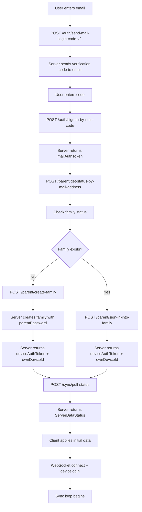
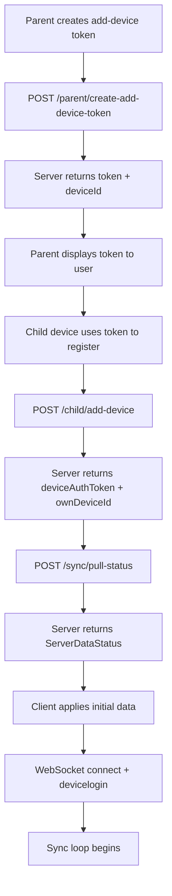
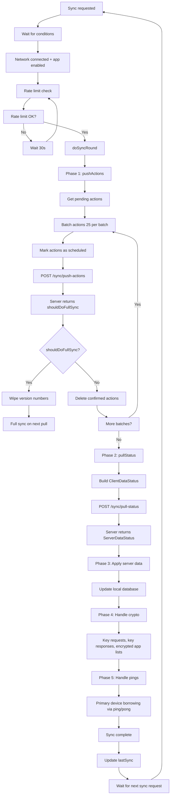
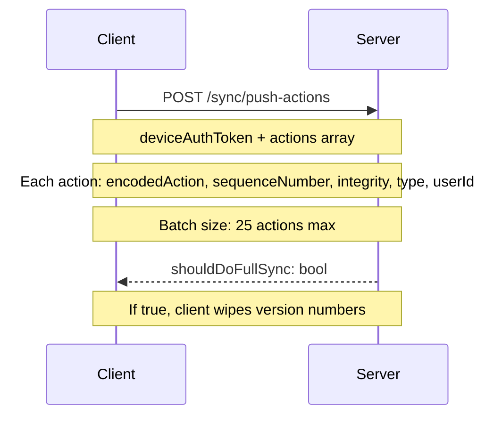
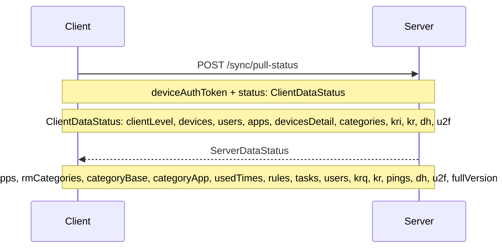
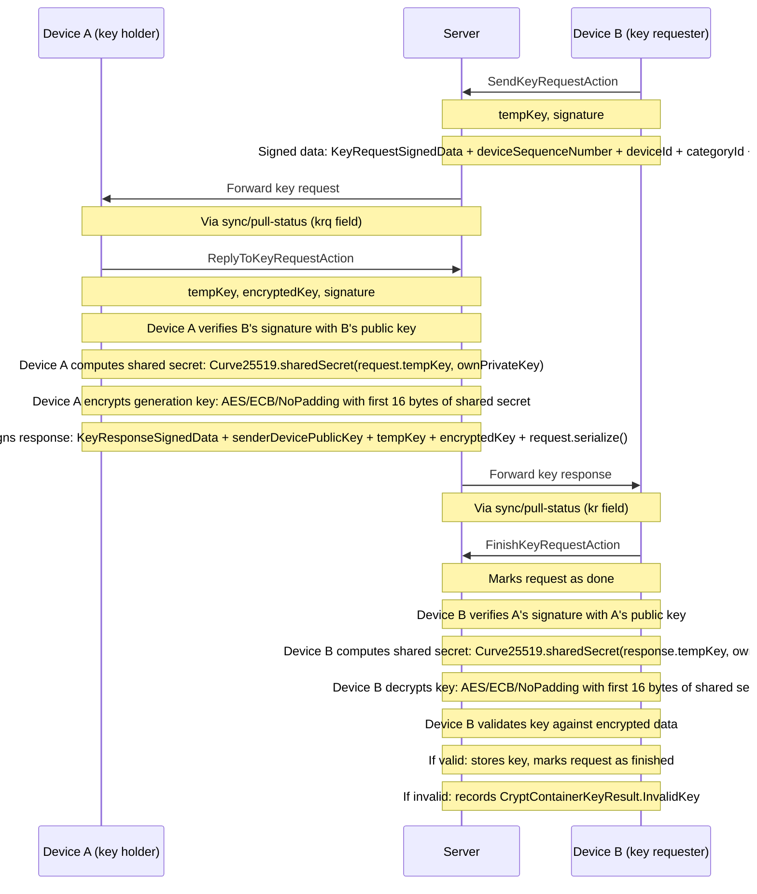
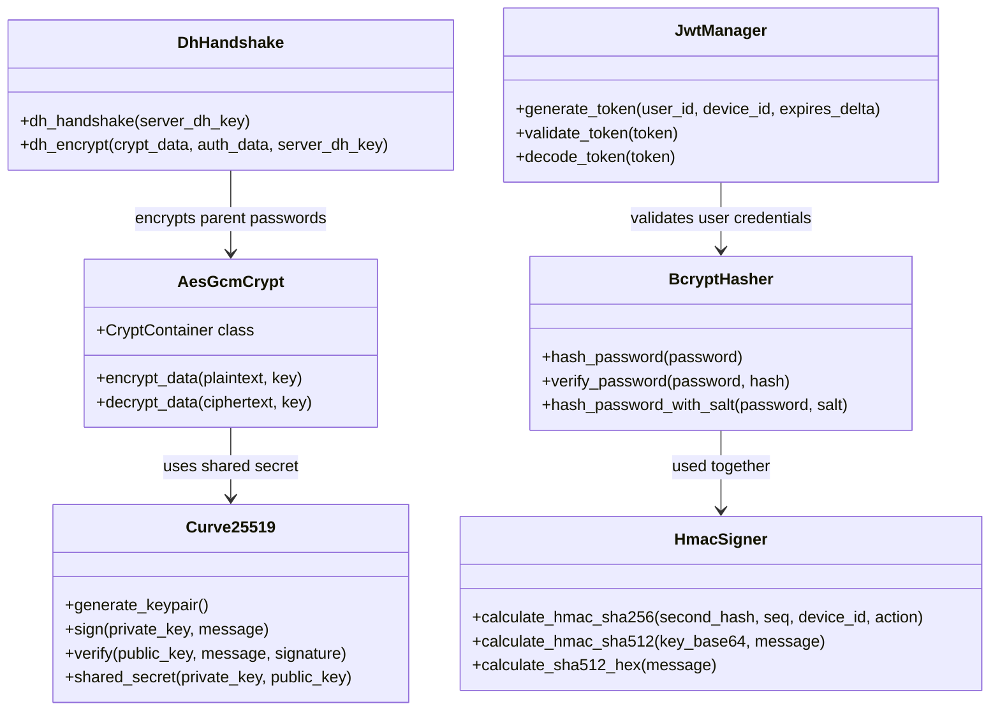
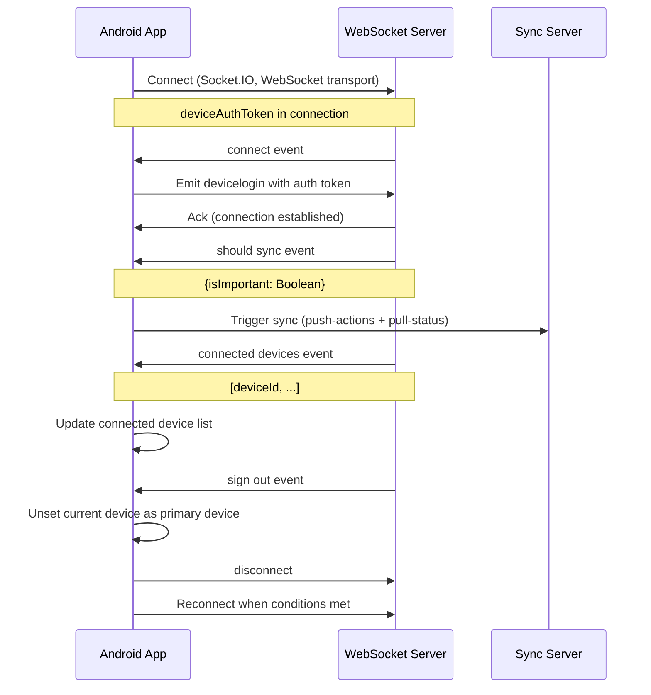
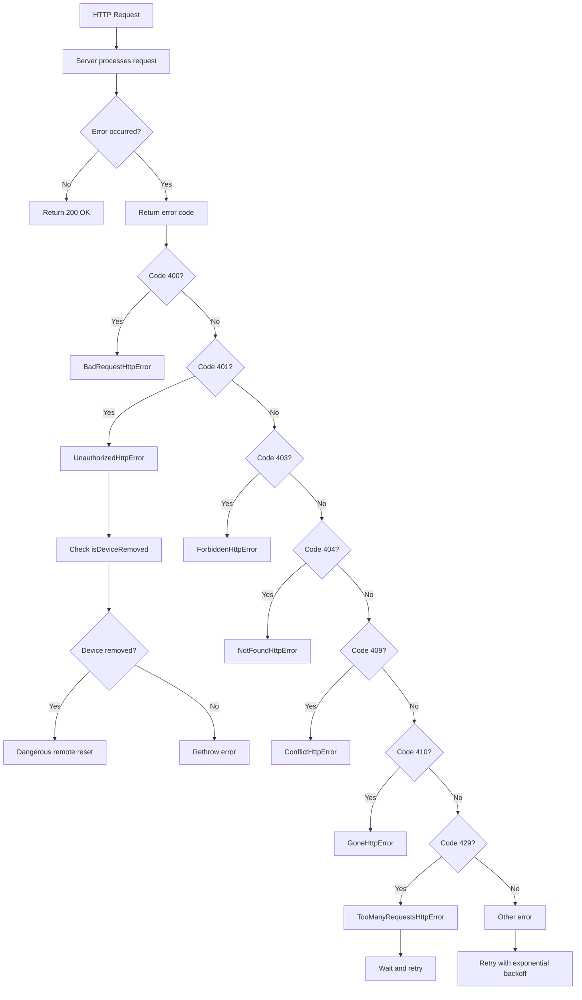

# Data Flow Diagrams

## Overview

This document contains Mermaid diagrams illustrating the key data flows in the TimeLimit system: authentication flow, sync protocol flow, and the key request/response protocol for encrypted app lists.

## 1. Authentication Flow

**Source**: `context.md` §333, `context_android_app.md` §3.7, §8.4

The authentication flow follows a multi-step process: email verification → code validation → family creation → device registration → initial data pull.

### Child Device Registration Flow

## 2. Sync Protocol Flow

**Source**: `context_android_app.md` §3.5, §8.9

The sync protocol uses an action-based CRDT approach. Actions are uploaded in batches of 25, then the client pulls the latest server status.

### Push-Actions Request/Response

### Pull-Status Request/Response

## 3. Key Request/Response Protocol

**Source**: `context_android_app.md` §3.6, §8.10

This is a multi-device key exchange protocol for sharing decryption keys for encrypted app lists. Device B (key requester) needs a decryption key that Device A (key holder) possesses.

## 4. Crypto System Overview

**Source**: `context.md` §338–344, `context_android_app.md` §3.6

## 5. WebSocket Connection Flow

**Source**: `context_android_app.md` §3.4

## 6. Error Handling Flow

**Source**: `context_android_app.md` §3.2, §8.14

