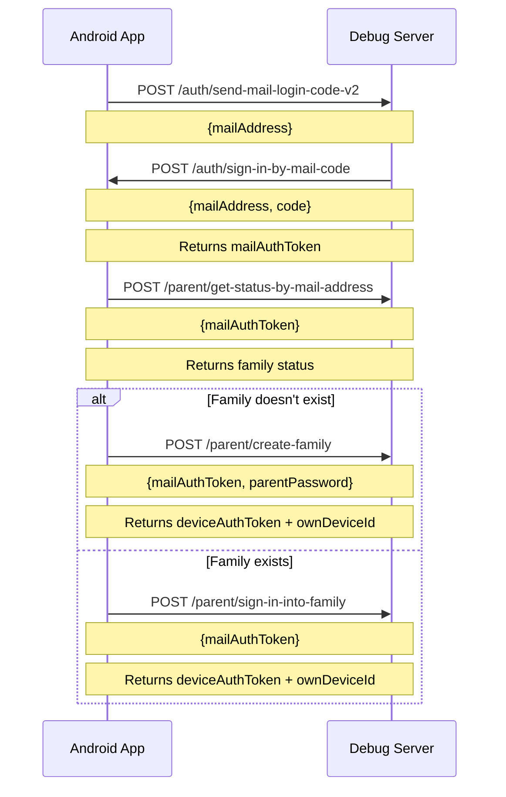

# API Documentation

## Overview

This document provides comprehensive documentation for the TimeLimit Debug Server API. The server simulates the TimeLimit backend API (`api.timelimit.io`) for development, testing, and debugging purposes.

**Base URL**: `http://localhost:8080` (configurable via `SERVER_HOST` and `SERVER_PORT`)

**API Version**: v1 (prefix: `/api/v1`)

**Protocol**: HTTP/1.1 with gzip compression support

---

## Authentication

### Overview

The TimeLimit API uses JWT (JSON Web Tokens) for authentication. Most endpoints require a valid JWT token in the `Authorization` header.

```
Authorization: Bearer <jwt_token>
```

### Token Types

| Token Type | Purpose | Endpoint |
|------------|---------|----------|
| `mailLoginToken` | Temporary token for email-based login | `/auth/send-mail-login-code-v2` |
| `mailAuthToken` | Authentication token after email verification | `/auth/sign-in-by-mail-code` |
| `deviceAuthToken` | Device-specific authentication token | `/parent/create-family`, `/parent/sign-in-into-family` |
| `addDeviceToken` | Token for adding new devices | `/parent/create-add-device-token` |

### Authentication Flow



---

## Endpoints

### Health Check Endpoints

#### GET /api/v1/health

Returns the health status of the server.

**Response**:
```json
{
  "status": "healthy"
}
```

**Status Code**: `200 OK`

#### GET /api/v1/ready

Returns the readiness status of the server.

**Response**:
```json
{
  "status": "ready"
}
```

**Status Code**: `200 OK`

---

### Time Endpoint

#### POST /api/v1/time

Returns the current server time in milliseconds.

**Request Body**: None

**Response**:
```json
{
  "time": 1699123456789
}
```

**Status Code**: `200 OK`

---

### Authentication Endpoints

#### POST /api/v1/auth/send-mail-login-code-v2

Sends a verification code to the specified email address.

**Request Body**:
```json
{
  "mailAddress": "user@example.com"
}
```

**Response**:
```json
{
  "status": 0,
  "data": {
    "mailLoginToken": "eyJhbGciOiJIUzI1NiIsInR5cCI6IkpXVCJ9..."
  }
}
```

**Status Code**: `200 OK`

#### POST /api/v1/auth/sign-in-by-mail-code

Verifies the code and returns a mail authentication token.

**Request Body**:
```json
{
  "mailAddress": "user@example.com",
  "code": "123456"
}
```

**Response**:
```json
{
  "status": 0,
  "data": {
    "mailAuthToken": "eyJhbGciOiJIUzI1NiIsInR5cCI6IkpXVCJ9..."
  }
}
```

**Status Code**: `200 OK`

#### POST /api/v1/parent/get-status-by-mail-address

Gets the status of a family by mail address.

**Request Body**:
```json
{
  "mailAuthToken": "eyJhbGciOiJIUzI1NiIsInR5cCI6IkpXVCJ9..."
}
```

**Response**:
```json
{
  "status": 0,
  "data": {
    "familyId": "family_123",
    "familyName": "My Family",
    "isParent": true
  }
}
```

**Status Code**: `200 OK`

#### POST /api/v1/parent/create-family

Creates a new family with the parent password.

**Request Body**:
```json
{
  "mailAuthToken": "eyJhbGciOiJIUzI1NiIsInR5cCI6IkpXVCJ9...",
  "parentPassword": "secure_password_123"
}
```

**Response**:
```json
{
  "status": 0,
  "data": {
    "deviceAuthToken": "eyJhbGciOiJIUzI1NiIsInR5cCI6IkpXVCJ9...",
    "ownDeviceId": "device_456"
  }
}
```

**Status Code**: `200 OK`

#### POST /api/v1/parent/sign-in-into-family

Signs in to an existing family.

**Request Body**:
```json
{
  "mailAuthToken": "eyJhbGciOiJIUzI1NiIsInR5cCI6IkpXVCJ9..."
}
```

**Response**:
```json
{
  "status": 0,
  "data": {
    "deviceAuthToken": "eyJhbGciOiJIUzI1NiIsInR5cCI6IkpXVCJ9...",
    "ownDeviceId": "device_456"
  }
}
```

**Status Code**: `200 OK`

#### POST /api/v1/parent/recover-parent-password

Recovers the parent password.

**Request Body**:
```json
{
  "mailAuthToken": "eyJhbGciOiJIUzI1NiIsInR5cCI6IkpXVCJ9..."
}
```

**Response**:
```json
{
  "status": 0,
  "data": {
    "parentPassword": "new_secure_password"
  }
}
```

**Status Code**: `200 OK`

---

### Sync Endpoints

All sync endpoints require authentication via `deviceAuthToken`.

#### POST /api/v1/sync/push-actions

Pushes pending actions to the server (batch of 25).

**Request Body**:
```json
{
  "deviceAuthToken": "eyJhbGciOiJIUzI1NiIsInR5cCI6IkpXVCJ9...",
  "actions": [
    {
      "seq": 1,
      "deviceId": "device_456",
      "action": {
        "type": "AddCategoryAction",
        "category": {
          "id": "cat_123",
          "name": "Games",
          "apps": ["com.game1", "com.game2"]
        }
      },
      "time": 1699123456789,
      "hmac": "a1b2c3d4e5f6..."
    }
  ]
}
```

**Response**:
```json
{
  "status": 0,
  "data": {
    "shouldDoFullSync": false
  }
}
```

**Status Code**: `200 OK`

#### POST /api/v1/sync/pull-status

Pulls the server status and returns data for the client.

**Request Body**:
```json
{
  "deviceAuthToken": "eyJhbGciOiJIUzI1NiIsInR5cCI6IkpXVCJ9...",
  "status": {
    "seq": 100,
    "deviceId": "device_456",
    "users": {
      "seq": 50,
      "ids": ["user_123"]
    },
    "devices": {
      "seq": 30,
      "ids": ["device_456", "device_789"]
    },
    "apps": {
      "seq": 20,
      "ids": ["com.app1", "com.app2"]
    },
    "categories": {
      "seq": 15,
      "ids": ["cat_123", "cat_456"]
    }
  }
}
```

**Response**:
```json
{
  "status": 0,
  "data": {
    "seq": 101,
    "users": {
      "seq": 51,
      "items": [
        {
          "id": "user_123",
          "name": "John Doe",
          "avatar": "avatar.png"
        }
      ]
    },
    "devices": {
      "seq": 31,
      "items": [
        {
          "id": "device_456",
          "name": "Phone",
          "type": "phone"
        }
      ]
    },
    "apps": {
      "seq": 21,
      "items": [
        {
          "id": "com.app1",
          "name": "App 1",
          "categoryId": "cat_123"
        }
      ]
    },
    "categories": {
      "seq": 16,
      "items": [
        {
          "id": "cat_123",
          "name": "Games",
          "apps": ["com.game1"],
          "rules": []
        }
      ]
    },
    "dh": {
      "publicKey": "base64_encoded_public_key"
    },
    "u2f": {
      "version": "U2F_V2",
      "keyHandle": "key_handle",
      "publicKey": "public_key"
    }
  }
}
```

**Status Code**: `200 OK`

#### POST /api/v1/sync/report-removed

Reports that a device has been removed.

**Request Body**:
```json
{
  "deviceAuthToken": "eyJhbGciOiJIUzI1NiIsInR5cCI6IkpXVCJ9...",
  "deviceId": "device_789"
}
```

**Response**:
```json
{
  "status": 0,
  "data": {}
}
```

**Status Code**: `200 OK`

#### POST /api/v1/sync/is-device-removed

Checks if a device has been removed.

**Request Body**:
```json
{
  "deviceAuthToken": "eyJhbGciOiJIUzI1NiIsInR5cCI6IkpXVCJ9...",
  "deviceId": "device_789"
}
```

**Response**:
```json
{
  "status": 0,
  "data": {
    "isRemoved": false
  }
}
```

**Status Code**: `200 OK`

---

### Parent Endpoints

#### POST /api/v1/parent/create-add-device-token

Creates a token for adding a new device.

**Request Body**:
```json
{
  "deviceAuthToken": "eyJhbGciOiJIUzI1NiIsInR5cCI6IkpXVCJ9...",
  "deviceName": "New Device"
}
```

**Response**:
```json
{
  "status": 0,
  "data": {
    "addDeviceToken": "eyJhbGciOiJIUzI1NiIsInR5cCI6IkpXVCJ9..."
  }
}
```

**Status Code**: `200 OK`

#### POST /api/v1/parent/remove-device

Removes a device from the family.

**Request Body**:
```json
{
  "deviceAuthToken": "eyJhbGciOiJIUzI1NiIsInR5cCI6IkpXVCJ9...",
  "deviceId": "device_789"
}
```

**Response**:
```json
{
  "status": 0,
  "data": {}
}
```

**Status Code**: `200 OK`

#### POST /api/v1/parent/link-mail-address

Links a mail address to the parent account.

**Request Body**:
```json
{
  "deviceAuthToken": "eyJhbGciOiJIUzI1NiIsInR5cCI6IkpXVCJ9...",
  "mailAddress": "parent@example.com"
}
```

**Response**:
```json
{
  "status": 0,
  "data": {}
}
```

**Status Code**: `200 OK`

#### POST /api/v1/parent/create-identity-token

Creates an identity token for the parent.

**Request Body**:
```json
{
  "deviceAuthToken": "eyJhbGciOiJIUzI1NiIsInR5cCI6IkpXVCJ9..."
}
```

**Response**:
```json
{
  "status": 0,
  "data": {
    "identityToken": "eyJhbGciOiJIUzI1NiIsInR5cCI6IkpXVCJ9..."
  }
}
```

**Status Code**: `200 OK`

#### POST /api/v1/parent/delete-account

Deletes the parent account.

**Request Body**:
```json
{
  "deviceAuthToken": "eyJhbGciOiJIUzI1NiIsInR5cCI6IkpXVCJ9..."
}
```

**Response**:
```json
{
  "status": 0,
  "data": {}
}
```

**Status Code**: `200 OK`

---

### Child Endpoints

#### POST /api/v1/child/add-device

Adds a new device to the family.

**Request Body**:
```json
{
  "addDeviceToken": "eyJhbGciOiJIUzI1NiIsInR5cCI6IkpXVCJ9...",
  "deviceName": "Child Device",
  "deviceType": "phone"
}
```

**Response**:
```json
{
  "status": 0,
  "data": {
    "deviceAuthToken": "eyJhbGciOiJIUzI1NiIsInR5cCI6IkpXVCJ9...",
    "ownDeviceId": "device_abc"
  }
}
```

**Status Code**: `200 OK`

#### POST /api/v1/child/update-primary-device

Updates the primary device for the child.

**Request Body**:
```json
{
  "deviceAuthToken": "eyJhbGciOiJIUzI1NiIsInR5cCI6IkpXVCJ9...",
  "deviceId": "device_xyz"
}
```

**Response**:
```json
{
  "status": 0,
  "data": {}
}
```

**Status Code**: `200 OK`

#### POST /api/v1/child/logout-at-primary-device

Logs out at the primary device.

**Request Body**:
```json
{
  "deviceAuthToken": "eyJhbGciOiJIUzI1NiIsInR5cCI6IkpXVCJ9..."
}
```

**Response**:
```json
{
  "status": 0,
  "data": {}
}
```

**Status Code**: `200 OK`

---

### Purchase Endpoints

#### POST /api/v1/purchase/can-do-purchase

Checks if the family can make a purchase.

**Request Body**:
```json
{
  "deviceAuthToken": "eyJhbGciOiJIUzI1NiIsInR5cCI6IkpXVCJ9..."
}
```

**Response**:
```json
{
  "status": 0,
  "data": {
    "canDoPurchase": true
  }
}
```

**Status Code**: `200 OK`

#### POST /api/v1/purchase/finish-purchase-by-google-play

Finishes a Google Play purchase.

**Request Body**:
```json
{
  "deviceAuthToken": "eyJhbGciOiJIUzI1NiIsInR5cCI6IkpXVCJ9...",
  "purchaseToken": "purchase_token_123"
}
```

**Response**:
```json
{
  "status": 0,
  "data": {
    "fullVersionUntil": "2025-08-06T19:34:40Z"
  }
}
```

**Status Code**: `200 OK`

---

### User Endpoints (Legacy)

#### GET /api/v1/users/{user_id}

Gets a user by ID.

**Response**:
```json
{
  "id": 1,
  "email": "user@example.com",
  "hashed_password": "$2b$12$..."
}
```

**Status Code**: `200 OK`

#### GET /api/v1/users/email/{email}

Gets a user by email.

**Response**:
```json
{
  "id": 1,
  "email": "user@example.com",
  "hashed_password": "$2b$12$..."
}
```

**Status Code**: `200 OK`

---

## WebSocket API

The server supports Socket.IO for real-time notifications.

### Connection

```javascript
const socket = io('http://localhost:8080', {
  transports: ['websocket'],
  auth: {
    token: 'deviceAuthToken'
  }
});
```

### Events

| Event | Direction | Payload | Description |
|-------|-----------|---------|-------------|
| `connect` | Server → Client | — | Connection established |
| `devicelogin` | Client → Server | `{authToken}` | Authenticate WebSocket connection |
| `disconnect` | Server → Client | — | Connection lost |
| `should sync` | Server → Client | `{isImportant: boolean}` | Request sync from server |
| `connected devices` | Server → Client | `[deviceId, ...]` | List of connected devices |
| `sign out` | Server → Client | — | Sign out request |

---

## Error Responses

All error responses follow a standardized format:

```json
{
  "status": <http_status_code>,
  "error": {
    "code": "<error_code>",
    "message": "<error_message>",
    "details": "<additional_details>"
  }
}
```

### Common Error Codes

| Code | HTTP Status | Description |
|------|-------------|-------------|
| `UNAUTHORIZED` | 401 | Invalid or missing authentication token |
| `FORBIDDEN` | 403 | Access denied to resource |
| `NOT_FOUND` | 404 | Resource not found |
| `CONFLICT` | 409 | Conflict (e.g., duplicate resource) |
| `RATE_LIMITED` | 429 | Rate limit exceeded |
| `BAD_REQUEST` | 400 | Invalid request format |
| `VALIDATION_ERROR` | 400 | Input validation failure |
| `INTERNAL_ERROR` | 500 | Internal server error |

---

## Request/Response Format

### Standardized Response Format

All API responses follow this format:

```json
{
  "status": 0,
  "data": { ... }
}
```

- `status`: 0 for success, non-zero for errors
- `data`: Response payload (empty object for some endpoints)

### Gzip Compression

The server supports gzip compression for request bodies and responses:

- **Request**: Send `Content-Encoding: gzip` header with compressed JSON body
- **Response**: Server returns `Content-Encoding: gzip` header for responses > 1000 bytes

---

## Rate Limiting

Rate limiting is enabled by default for authentication endpoints:

- **Limit**: 60 requests per minute (configurable via `RATE_LIMIT_REQUESTS_PER_MINUTE`)
- **Endpoints**: `/auth/*` endpoints

When rate limit is exceeded, the server returns:
- HTTP Status: `429 Too Many Requests`
- Response: `{"status": 429, "error": {...}}`

---

## Testing the API

### Using curl

```bash
# Health check
curl http://localhost:8080/api/v1/health

# Get server time
curl -X POST http://localhost:8080/api/v1/time

# Send mail login code
curl -X POST http://localhost:8080/api/v1/auth/send-mail-login-code-v2 \
  -H "Content-Type: application/json" \
  -d '{"mailAddress": "test@example.com"}'
```

### Using the Python Test Client

```python
from tests.client import TestClient

client = TestClient(base_url="http://localhost:8080")

# Health check
response = client.get_health()
print(response)

# Send mail login code
response = client.send_mail_login_code("test@example.com")
print(response)
```

---

## API Versioning

The API uses URL-based versioning:

- Current version: `/api/v1/`
- Future versions will be available at `/api/v2/`, etc.

---

## OpenAPI Documentation

When the server is running, the OpenAPI specification is available at:

- **OpenAPI JSON**: `http://localhost:8000/api/v1/openapi.json`
- **Swagger UI**: `http://localhost:8000/api/v1/docs`