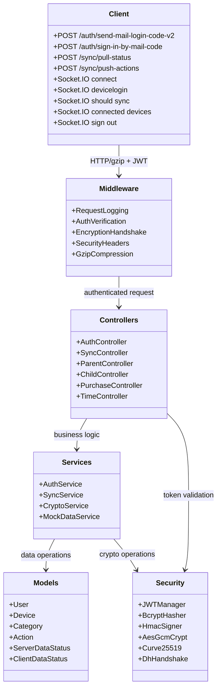
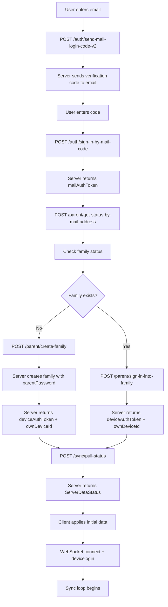
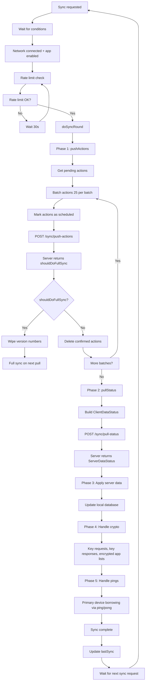
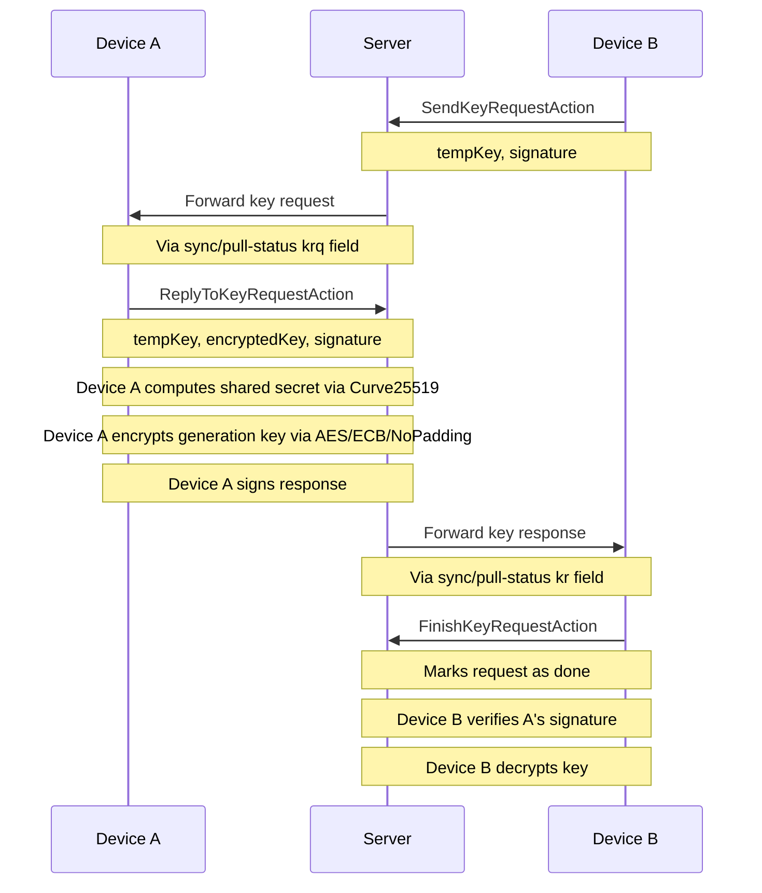
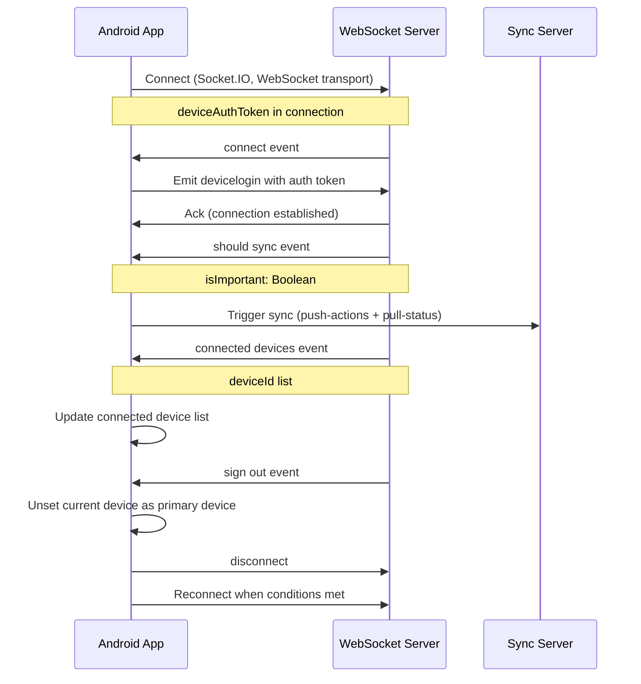
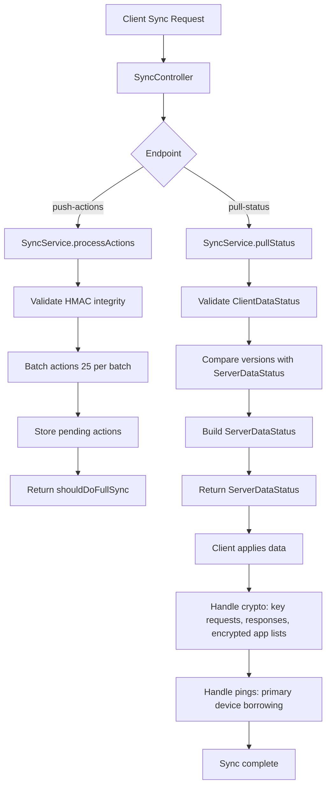
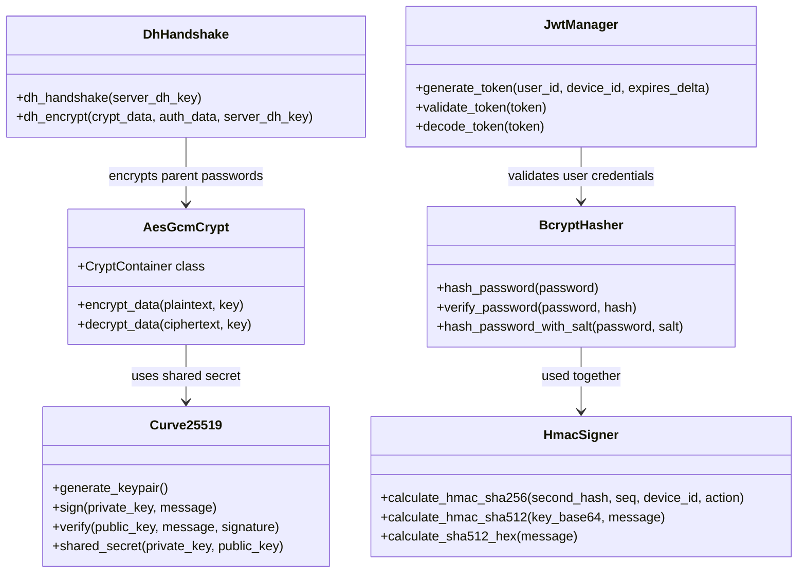
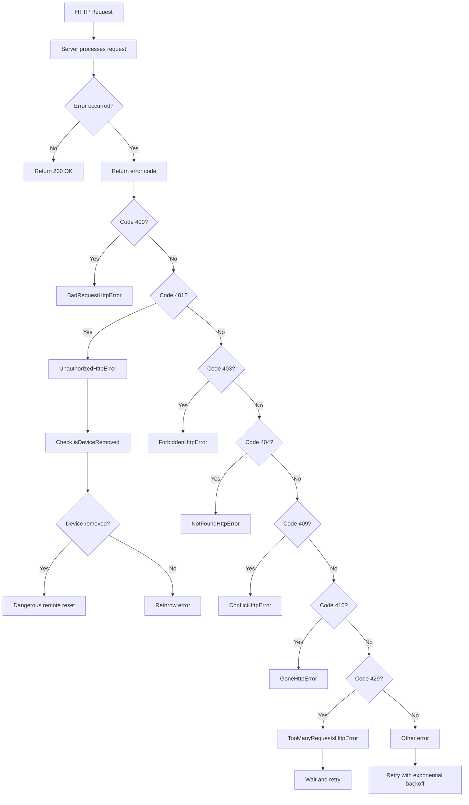

# Architecture Documentation

## Overview

This document describes the architecture of the TimeLimit backend API simulator (debug server). The server simulates the TimeLimit backend API (`api.timelimit.io`) for development, testing, and debugging purposes. It implements all 21 backend API endpoints, the sync protocol, the crypto system, WebSocket support, and mock data generation.

The architecture follows a layered design with clear separation of concerns: Client → Middleware → Controllers → Services → Models → Security. Each layer has distinct responsibilities and communicates only with adjacent layers.

**Reference Documentation:**
- `docs/analysis/endpoint-mapping.md` — Complete endpoint mapping (UI routes → backend API paths)
- `docs/analysis/security-requirements.md` — Security requirements and crypto specifications
- `docs/analysis/data-models.md` — Data model specifications
- `docs/analysis/data-flow-diagrams.md` — Data flow diagrams (Mermaid)
- `context.md` — TimeLimit UI project documentation
- `context_android_app.md` — Android app architecture and backend API specifications

---

## 1. High-Level Architecture

The server follows a layered architecture with six distinct layers. Each layer encapsulates specific responsibilities and communicates through well-defined interfaces.

```
┌─────────────────────────────────────────────────────────┐
│                    Client (Android App / UI)             │
│  HTTP/gzip + Socket.IO + JWT + HMAC integrity            │
├─────────────────────────────────────────────────────────┤
│              API Gateway / Middleware Layer              │
│  Logging, Auth, Encryption, CORS, Security Headers       │
├─────────────────────────────────────────────────────────┤
│              Controller / Router Layer                   │
│  Auth Routes, Sync Routes, Parent Routes, Child Routes   │
├─────────────────────────────────────────────────────────┤
│              Service / Business Logic Layer              │
│  AuthService, SyncService, CryptoService, MockDataService │
├─────────────────────────────────────────────────────────┤
│              Data / Model Layer                          │
│  Pydantic Models, Mock Data Store, State Manager         │
├─────────────────────────────────────────────────────────┤
│              Security / Crypto Layer                     │
│  JWT, bcrypt, HMAC-SHA256, AES-GCM, Curve25519, DH       │
└─────────────────────────────────────────────────────────┘
```

### Layer Descriptions

| Layer | Responsibility | Key Components |
|-------|---------------|----------------|
| **Client** | Sends HTTP/gzip requests with JWT tokens and HMAC-signed actions; connects via Socket.IO for real-time events | Android App, TimeLimit UI |
| **Middleware** | Cross-cutting concerns: request/response logging, JWT authentication, encryption handshake monitoring, security headers, gzip compression | LoggingMiddleware, AuthMiddleware, EncryptionMiddleware, SecurityHeadersMiddleware, GzipMiddleware |
| **Controllers** | Route HTTP requests to appropriate services; validate request bodies with Pydantic models; format responses | AuthController, SyncController, ParentController, ChildController, PurchaseController, TimeController |
| **Services** | Business logic: authentication flows, sync protocol, crypto operations, mock data generation | AuthService, SyncService, CryptoService, MockDataService |
| **Models** | Data structures: Pydantic models for requests/responses, in-memory state store | ServerDataStatus, ClientDataStatus, ServerUserData, ServerDeviceData, ActionUploadItem, ParentPassword |
| **Security** | Cryptographic primitives: JWT, bcrypt, HMAC, AES-GCM, Curve25519, DH key exchange | JWTManager, BcryptHasher, HmacSigner, AesGcmCrypt, Curve25519, DhHandshake |

---

## 2. Component Interaction Diagram

The following class diagram shows the relationships between all major components in the system.



### Component Responsibilities

#### Middleware Layer

- **LoggingMiddleware** (`app/middleware/logging.py`): Logs incoming requests (method, path, headers sanitized, body size, client IP) and outgoing responses (status code, response size, duration). Generates a UUID request ID for correlation. Sanitizes sensitive data (passwords, tokens, secondHash).
- **AuthMiddleware** (`app/middleware/auth.py`): Intercepts requests to protected endpoints (`/sync/*`, `/parent/*`, `/child/*`, `/purchase/*`). Extracts JWT from `Authorization: Bearer <token>` header, validates signature and expiration, attaches user/device info to request state. Returns 401 if token is missing or invalid.
- **EncryptionMiddleware** (`app/middleware/encryption.py`): Monitors encryption handshake for WebSocket connections. Logs DH key exchange, key request/response protocol steps, AES-GCM operations, and Curve25519 signing/verification. Tracks encryption state per session.
- **SecurityHeadersMiddleware** (`app/middleware/security_headers.py`): Injects security headers: `X-Content-Type-Options: nosniff`, `X-Frame-Options: DENY`, `Content-Security-Policy: default-src 'none'`, `Strict-Transport-Security` (if HTTPS enabled), `X-XSS-Protection: 1; mode=block`.
- **GzipMiddleware** (`app/middleware/gzip.py`): Decompresses incoming gzip request bodies, compresses outgoing gzip response bodies. Handles `Content-Encoding: gzip` header and `Content-Length` auto-negotiation (411 retry simulation).

#### Controller Layer

- **AuthController** (`app/api/auth.py`): Handles authentication endpoints: `POST /time`, `POST /auth/send-mail-login-code-v2`, `POST /auth/sign-in-by-mail-code`, `POST /parent/get-status-by-mail-address`, `POST /parent/create-family`, `POST /parent/sign-in-into-family`, `POST /parent/recover-parent-password`.
- **SyncController** (`app/api/sync.py`): Handles sync protocol endpoints: `POST /sync/push-actions`, `POST /sync/pull-status`, `POST /sync/report-removed`, `POST /sync/is-device-removed`.
- **ParentController** (`app/api/parent.py`): Handles parent management endpoints: `POST /parent/create-add-device-token`, `POST /parent/remove-device`, `POST /parent/link-mail-address`, `POST /parent/create-identity-token`, `POST /parent/delete-account`.
- **ChildController** (`app/api/child.py`): Handles child device endpoints: `POST /child/add-device`, `POST /child/update-primary-device`, `POST /child/logout-at-primary-device`.
- **PurchaseController** (`app/api/purchase.py`): Handles purchase endpoints: `POST /purchase/can-do-purchase`, `POST /purchase/finish-purchase-by-google-play`.
- **TimeController** (`app/api/time.py`): Handles `POST /time` — returns server time in milliseconds.

#### Service Layer

- **AuthService** (`app/services/auth_service.py`): Implements authentication logic: email code generation, mailAuthToken creation, family creation, device registration, session management. Integrates with state management and crypto service.
- **SyncService** (`app/services/sync_service.py`): Implements sync protocol logic: action-based CRDT, batch processing (25 actions per batch), ClientDataStatus → ServerDataStatus transformation, version tracking.
- **CryptoService** (`app/services/crypto_service.py`): Wrapper around security primitives. Provides unified interface for password hashing, HMAC signing, AES-GCM encryption, Curve25519 operations, and DH key exchange.
- **MockDataService** (`app/services/mock_data.py`): Generates seed-based reproducible mock data: families, users, devices, categories, apps, time limit rules, used time items, child tasks, crypto keys, U2F data.

#### Model Layer

- **Pydantic Models** (`app/models/`): Request/response models for all endpoints. Includes `ServerDataStatus`, `ClientDataStatus`, `ServerUserData`, `ServerDeviceData`, `ServerUpdatedCategoryBaseData`, `ActionUploadItem`, `ParentPassword`, and standardized response wrapper.
- **StateManager** (`app/core/state.py`): In-memory state store for families, users, devices, categories, auth tokens, add-device tokens, pending actions, and sync versions. Thread-safe access using `asyncio.Lock`. State reset capability for testing.

#### Security Layer

- **JWTManager** (`app/core/security.py`): JWT token generation (`generate_token()` with claims: `sub`, `device_id`, `exp`, `iat`, `jti`) and validation (`validate_token()`, `decode_token()`). Uses HS256 algorithm.
- **BcryptHasher** (`app/core/security.py`): Password hashing with cost factor 12 (`hash_password()`, `verify_password()`, `hash_password_with_salt()`).
- **HmacSigner** (`app/core/security.py`): HMAC-SHA256 binary format for sync action integrity (`calculate_hmac_sha256()`), HMAC-SHA512 (`calculate_hmac_sha512()`), SHA512 hex (`calculate_sha512_hex()`).
- **AesGcmCrypt** (`app/core/security.py`): AES-GCM encryption/decryption with CryptContainer class supporting format versions: `FORMAT_LEGACY (0)`, `FORMAT_APP_LIST_V2 (1)`, `FORMAT_APP_DIFF_V2 (2)`.
- **Curve25519** (`app/core/security.py`): Key pair generation, signing, verification, and ECDH shared secret computation.
- **DhHandshake** (`app/core/security.py`): ECDH key exchange with secp256r1 curve for parent password encryption.

---

## 3. Data Flow Diagrams

The following diagrams illustrate the key data flows in the TimeLimit system. Detailed diagrams are available in `docs/analysis/data-flow-diagrams.md`.

### 3.1 Authentication Flow



### 3.2 Sync Protocol Flow



### 3.3 Key Request/Response Protocol



### 3.4 WebSocket Connection Flow



---

## 4. Technology Stack

### Framework & Server

| Component | Technology | Version | Rationale |
|-----------|-----------|---------|-----------|
| HTTP Framework | FastAPI | >=0.115.0 | Async support, automatic OpenAPI docs, Pydantic validation, dependency injection |
| ASGI Server | Uvicorn | >=0.30.0 | High-performance ASGI server, standard for FastAPI |
| WebSocket | python-socketio[asyncio] | >=5.11.0 | Socket.IO protocol support for real-time sync notifications |
| Gzip | Starlette GzipMiddleware | (bundled) | Transparent gzip compression/decompression |

### Security & Crypto

| Component | Technology | Version | Rationale |
|-----------|-----------|---------|-----------|
| JWT | python-jose[cryptography] | >=3.3.0 | JWT token generation and validation with HS256 |
| Password Hashing | bcrypt | >=4.2.0 | bcrypt with cost factor 12, two salts |
| Crypto Primitives | cryptography | >=43.0.0 | AES-GCM, ECDH secp256r1, X.509 encoding |
| Curve25519 | PyNaCl (pynacl) | >=1.5.0 | Curve25519 key pairs, signing, ECDH shared secrets |
| HMAC | hmac + hashlib | (stdlib) | HMAC-SHA256 binary, HMAC-SHA512, SHA512 hex |
| Random Generation | secrets | (stdlib) | Secure random for JWT secret key, tokens |

### Data & Models

| Component | Technology | Version | Rationale |
|-----------|-----------|---------|-----------|
| Data Validation | Pydantic | >=2.9.0 | Request/response model validation |
| Configuration | pydantic-settings | >=2.5.0 | Environment variable-based configuration |
| State Store | In-memory (dict) | N/A | Sufficient for test server; state resets on restart |

### Logging

| Component | Technology | Version | Rationale |
|-----------|-----------|---------|-----------|
| Structured Logging | structlog | >=24.2.0 | JSON structured logging for easy parsing and analysis |
| Log Rotation | logging.handlers.RotatingFileHandler | (stdlib) | Max 10MB per file, 5 backup files |

### Testing

| Component | Technology | Version | Rationale |
|-----------|-----------|---------|-----------|
| Test Framework | pytest | >=8.3.0 | Python testing framework |
| Async Tests | pytest-asyncio | >=0.24.0 | Async test support |
| Coverage | pytest-cov | >=5.0.0 | Code coverage reporting |
| HTTP Client | httpx | >=0.27.0 | Async HTTP client for integration tests |
| Socket.IO Tests | pytest-socketio | >=0.0.1 | Socket.IO test support |

### Development

| Component | Technology | Version | Rationale |
|-----------|-----------|---------|-----------|
| Python | Python | >=3.11 | typing improvements, tomllib, better async support |
| Package Management | pip | (bundled) | Standard Python package manager |
| Virtual Environment | venv | (stdlib) | Isolated development environment |

---

## 5. Design Decisions and Rationale

### 5.1 Framework Choice: FastAPI over Flask

**Decision**: Use FastAPI as the HTTP framework.

**Rationale**:
- **Async support**: FastAPI's async/await support enables non-blocking I/O for concurrent request handling, which is important for a test server that may handle multiple simultaneous sync operations.
- **Automatic OpenAPI docs**: FastAPI generates Swagger UI and OpenAPI JSON automatically, providing immediate API documentation for all endpoints.
- **Pydantic validation**: Built-in request/response validation with Pydantic models ensures data integrity and reduces boilerplate validation code.
- **Dependency injection**: FastAPI's dependency injection system simplifies auth middleware, database connections, and configuration management.
- **Type hints**: Native support for Python type hints improves code quality and IDE support.

### 5.2 In-Memory State Store

**Decision**: Use an in-memory state store (Python dict) instead of a database.

**Rationale**:
- **Simplicity**: No database setup or migration required. The test server is designed for development and testing, not production data persistence.
- **Speed**: In-memory access is faster than database queries, which is important for sync operations that may involve many entities.
- **State reset**: Easy to reset state for testing by clearing the in-memory store.
- **Thread safety**: `asyncio.Lock` provides thread-safe access for concurrent operations.
- **Trade-off**: State is lost on server restart. This is acceptable for a test server.

### 5.3 JWT for Session Management

**Decision**: Use JWT tokens for session management.

**Rationale**:
- **Stateless**: JWT tokens are self-contained, eliminating the need for server-side session storage.
- **Expiration**: Built-in expiration (`exp` claim) supports token rotation and security.
- **Claims**: Custom claims (`device_id`, `jti`) provide device-level authentication context.
- **Easy validation**: Middleware can validate tokens without database lookups.
- **Standard**: JWT is a widely adopted standard with good library support.

### 5.4 Structured Logging with structlog

**Decision**: Use structlog for structured JSON logging.

**Rationale**:
- **Parseability**: JSON-formatted logs are easily parsed by log analysis tools.
- **Correlation**: Request IDs (UUID per request) enable correlation of related log entries.
- **Sanitization**: Structured logging makes it easier to sanitize sensitive fields (passwords, tokens, secondHash).
- **Flexibility**: structlog processors allow flexible log formatting (JSON for production, console for development).
- **Rotation**: RotatingFileHandler provides automatic log rotation (10MB max, 5 backups).

### 5.5 Gzip Middleware

**Decision**: Implement transparent gzip compression/decompression middleware.

**Rationale**:
- **Protocol compliance**: The TimeLimit Android app sends gzip-compressed request bodies (`Content-Encoding: gzip`). The server must decompress these to process the JSON payload.
- **Content-Length auto-negotiation**: The Android app first sends requests without `Content-Length`; if the server returns HTTP 411 (Length Required), the app retries with the header. The middleware simulates this behavior.
- **Response compression**: Compressing responses reduces bandwidth for large `ServerDataStatus` payloads.

### 5.6 Modular Project Structure

**Decision**: Organize code into clear layers: `api/` (controllers), `core/` (security, state, exceptions), `models/` (data models), `services/` (business logic), `middleware/` (cross-cutting concerns), `websocket/` (Socket.IO).

**Rationale**:
- **Separation of concerns**: Each layer has a single responsibility, making the codebase easier to understand and maintain.
- **Testability**: Modular structure enables unit testing of individual components without dependencies on other layers.
- **Extensibility**: New endpoints can be added by creating a new controller and registering its router.
- **Maintainability**: Clear boundaries between layers reduce the impact of changes.

### 5.7 Configurable Endpoints

**Decision**: Make all endpoints and behavior configurable via environment variables.

**Rationale**:
- **Testing flexibility**: Different test scenarios may require different configurations (e.g., `TEST_MODE` for bypassing auth, `MOCK_DATA_SEED` for reproducible data).
- **Environment adaptation**: Configuration can be adjusted for different environments (development, testing, CI/CD).
- **Security**: Sensitive values (JWT secret key) are loaded from environment, not hardcoded.

### 5.8 Standardized Response Format

**Decision**: Wrap all API responses in a standard format: `{status, data, error}`.

**Rationale**:
- **Consistency**: All endpoints return responses in the same format, simplifying client-side parsing.
- **Error handling**: Errors include error code, message, and details for debugging.
- **Automated testing**: Standardized format enables automated test assertions.
- **Protocol compliance**: Sync endpoints return protocol-specific formats (ServerDataStatus, ActionUploadResponse) as per the TimeLimit protocol, while auth endpoints return protocol-specific formats (mailLoginToken, mailAuthToken, deviceAuthToken).

### 5.9 Cross-Platform Compatibility

**Decision**: Use `pathlib.Path` for all file operations, avoid Unix-specific utilities.

**Rationale**:
- **Windows compatibility**: The test server runs on Windows 11. Using `pathlib` ensures path operations work correctly on Windows.
- **No shell dependencies**: Avoiding Unix-specific utilities (sed, grep, awk) ensures the server works without Unix tools.
- **Python 3.11+**: Using modern Python features (tomllib, typing improvements) for better code quality.

### 5.10 Security First

**Decision**: Implement comprehensive security measures: bcrypt password hashing, HMAC integrity signing, AES-GCM encryption, Curve25519 device signing, DH key exchange, JWT authentication, security headers, rate limiting.

**Rationale**:
- **Data integrity**: HMAC-SHA256 signing prevents tampering with sync actions.
- **Password security**: bcrypt with cost factor 12 provides strong password hashing.
- **Encrypted data**: AES-GCM provides authenticated encryption for sensitive data (app lists, parent passwords).
- **Device authentication**: Curve25519 signing keys and DH key exchange provide device-level security.
- **Session security**: JWT tokens with expiration and validation middleware prevent unauthorized access.
- **Defense in depth**: Security headers, rate limiting, and HTTPS enforcement provide multiple layers of protection.

---

## 6. Project Structure

The debug server is organized in the `debug-server/` directory at the project root. The structure follows the architecture layers described above.

```
debug-server/
├── app/
│   ├── __init__.py
│   ├── __main__.py              # Module entry point (python -m app)
│   ├── main.py                  # FastAPI application factory, middleware registration
│   ├── config.py                # Configuration management (Pydantic settings)
│   ├── api/
│   │   ├── __init__.py          # Router registration
│   │   ├── deps.py              # Dependency injection (auth, db, config)
│   │   ├── auth.py              # Auth controller (login, family, device)
│   │   ├── sync.py              # Sync controller (push-actions, pull-status)
│   │   ├── parent.py            # Parent management controller
│   │   ├── child.py             # Child device controller
│   │   ├── purchase.py          # Purchase controller
│   │   ├── time.py              # Server time endpoint
│   │   ├── health.py            # Health check and metrics endpoints
│   │   └── users.py             # User management endpoints (legacy)
│   ├── core/
│   │   ├── __init__.py
│   │   ├── config.py            # Pydantic settings (Settings class)
│   │   ├── logging.py           # Logging setup (setup_logging)
│   │   ├── security.py          # JWT, bcrypt, HMAC, AES-GCM, Curve25519, DH
│   │   ├── auth.py              # Authentication logic, session management
│   │   ├── state.py             # In-memory state management
│   │   ├── exceptions.py        # Custom exception classes
│   │   └── deps.py              # Dependency injection
│   ├── models/
│   │   ├── __init__.py
│   │   ├── user.py              # User data models (ServerUserData)
│   │   ├── device.py            # Device data models (ServerDeviceData)
│   │   ├── category.py          # Category data models
│   │   ├── action.py            # Action data models (ActionUploadItem)
│   │   ├── sync.py              # ServerDataStatus, ClientDataStatus
│   │   └── response.py          # Standardized API response wrapper
│   ├── services/
│   │   ├── __init__.py
│   │   ├── mock_data.py         # Mock data generator
│   │   ├── sync_service.py      # Sync protocol logic
│   │   ├── auth_service.py      # Authentication service
│   │   ├── crypto_service.py    # Crypto service wrapper
│   │   ├── security.py          # Password hashing and JWT (legacy)
│   │   └── user.py              # User service (legacy)
│   ├── middleware/
│   │   ├── __init__.py
│   │   ├── logging.py           # Structured request/response logging
│   │   ├── auth.py              # JWT authentication middleware
│   │   ├── encryption.py        # Encryption handshake monitoring
│   │   ├── security_headers.py  # Security header injection
│   │   └── gzip.py              # Gzip compression/decompression
│   ├── websocket/
│   │   ├── __init__.py
│   │   ├── manager.py           # Socket.IO connection management
│   │   └── handlers.py          # Socket.IO event handlers
│   └── utils/
│       ├── __init__.py
│       ├── logger.py            # Structured logging setup (structlog)
│       ├── gzip_utils.py        # Gzip compression/decompression utilities
│       └── helpers.py           # Utility functions
├── tests/
│   ├── __init__.py
│   ├── conftest.py              # Pytest fixtures
│   ├── test_auth.py             # Authentication tests
│   ├── test_sync.py             # Sync protocol tests
│   ├── test_crypto.py           # Crypto tests
│   ├── test_endpoints.py        # Endpoint integration tests
│   ├── test_websocket.py        # WebSocket tests
│   ├── test_config.py           # Configuration tests
│   ├── test_logging.py          # Logging tests
│   ├── test_security.py         # Security service tests
│   ├── test_user_service.py     # User service tests
│   ├── test_api.py              # API integration tests
│   ├── test_mock_data.py        # Mock data generation tests
│   ├── test_state.py            # State management tests
│   ├── test_gzip.py             # Gzip middleware tests
│   ├── test_response.py         # Response format tests
│   ├── test_auth_endpoints.py   # Auth endpoint integration tests
│   ├── test_sync_endpoints.py   # Sync endpoint integration tests
│   ├── test_parent_endpoints.py # Parent endpoint integration tests
│   ├── test_child_endpoints.py  # Child endpoint integration tests
│   ├── test_purchase_endpoints.py # Purchase endpoint integration tests
│   ├── test_load.py             # Load testing
│   ├── client.py                # Python test client
│   ├── config.py                # Test configuration
│   ├── scenarios/               # Test scenario definitions
│   │   ├── auth_flow.json
│   │   ├── sync_flow.json
│   │   ├── crypto_flow.json
│   │   └── error_scenarios.json
│   └── fixtures/                # Pre-generated test fixtures
├── docs/
│   ├── architecture.md          # This file
│   ├── api.md                   # API documentation
│   ├── security.md              # Security implementation guide
│   ├── deployment.md            # Deployment instructions
│   ├── maintenance.md           # Maintenance procedures
│   ├── implementation.md        # Implementation process documentation
│   ├── logging.md               # Logging architecture and analysis
│   ├── testing.md               # Testing integration documentation
│   ├── testing-results.md       # Test results documentation
│   └── analysis/                # Step 1 deliverables
│       ├── endpoint-mapping.md
│       ├── security-requirements.md
│       ├── data-models.md
│       ├── data-flow-diagrams.md
│       └── mock-data-structure.md
├── scripts/
│   └── analyze_logs.py          # Log analysis script
├── requirements.txt             # Production dependencies
├── requirements-dev.txt         # Development dependencies
├── Dockerfile                   # Docker configuration
├── .env.example                 # Environment variable template
├── .env                         # Environment configuration
├── .python-version              # Python version pin
├── pyproject.toml               # Python project configuration
├── pytest.ini                   # Pytest configuration
├── run.py                       # Entry point script
└── README.md                    # Project README
```

### Directory Descriptions

| Directory | Purpose |
|-----------|---------|
| `app/` | Main application source code |
| `app/api/` | API route definitions (controllers) — one file per resource type |
| `app/core/` | Core infrastructure: security, state management, exceptions, configuration |
| `app/models/` | Pydantic data models for requests, responses, and domain entities |
| `app/services/` | Business logic services: auth, sync, crypto, mock data |
| `app/middleware/` | Cross-cutting middleware: logging, auth, encryption, security headers, gzip |
| `app/websocket/` | Socket.IO connection management and event handlers |
| `app/utils/` | Utility functions: structured logging, gzip helpers, general helpers |
| `tests/` | Test suite: unit tests, integration tests, load tests, test client |
| `tests/scenarios/` | JSON test scenario definitions for automated testing |
| `tests/fixtures/` | Pre-generated test data fixtures |
| `docs/` | Comprehensive documentation |
| `docs/analysis/` | Step 1 analysis deliverables (endpoint mapping, security, data models, data flows) |
| `scripts/` | Utility scripts (log analysis, etc.) |

---

## 7. Request/Response Lifecycle

The following diagram illustrates the complete request/response lifecycle through all middleware and controller layers.

```mermaid
flowchart LR
    A[Client Request] --> B[GzipMiddleware]
    B --> C[LoggingMiddleware]
    C --> D[SecurityHeadersMiddleware]
    D --> E[AuthMiddleware]
    E --> F{Protected Endpoint?}
    F -->|Yes| G[Validate JWT]
    G --> H{Valid Token?}
    H -->|No| I[401 Unauthorized]
    H -->|Yes| J[Attach User/Device to State]
    F -->|No| J
    J --> K[Controller]
    K --> L[Service]
    L --> M[Security Layer]
    M --> N[Model/State]
    N --> O[Response]
    O --> P[SecurityHeadersMiddleware]
    P --> Q[LoggingMiddleware]
    Q --> R[GzipMiddleware]
    R --> S[Client Response]
```



### Middleware Ordering

Middleware is applied in a specific order to ensure correct behavior:

1. **GzipMiddleware** (outermost): Decompresses incoming request bodies first, so other middleware can read the JSON payload. Compresses outgoing responses last.
2. **LoggingMiddleware**: Logs the request after decompression, capturing the actual request body size and content.
3. **SecurityHeadersMiddleware**: Adds security headers to all responses.
4. **AuthMiddleware** (innermost): Validates JWT tokens for protected endpoints. Only applies to `/sync/*`, `/parent/*`, `/child/*`, `/purchase/*` routes.

---

## 8. Sync Protocol Architecture

The sync protocol uses an action-based CRDT (Conflict-free Replicated Data Type) approach. The following diagram shows the sync protocol flow within the server.



### Sync Versioning

The sync protocol uses version strings to track changes:

- **ClientDataStatus**: Client sends version numbers for each entity type (devices, users, apps, categories, etc.)
- **ServerDataStatus**: Server returns full data with version numbers for each entity type
- **Incremental sync**: Server only returns data that has changed since the client's version
- **Full sync**: If `shouldDoFullSync` is true, client wipes version numbers and requests full data

---

## 9. Crypto System Architecture

The crypto system provides multiple layers of security. The following diagram shows the crypto component relationships.



### Crypto Usage Summary

| Crypto System | Used For | Endpoints |
|--------------|----------|-----------|
| **bcrypt** | Parent password hashing (two salts) | `/parent/create-family`, `/parent/sign-in-into-family`, `/parent/recover-parent-password` |
| **HMAC-SHA256** | Sync action integrity verification | `/sync/push-actions` |
| **HMAC-SHA512** | Legacy sync action signing | `/sync/push-actions` (legacy) |
| **SHA512 hex** | Legacy integrity verification | `/sync/push-actions` (legacy) |
| **AES-GCM** | Encrypted app lists, parent password encryption | `/sync/pull-status`, `/parent/create-family` |
| **Curve25519** | Device signing keys, key request/response protocol | `/sync/pull-status`, `/sync/push-actions` |
| **DH (secp256r1)** | Parent password encryption during family creation | `/parent/create-family` |
| **JWT** | Session management, device authentication | All protected endpoints |

---

## 10. WebSocket Architecture

The WebSocket (Socket.IO) server provides real-time sync notifications. The following diagram shows the WebSocket connection flow.


### WebSocket Events

| Event | Direction | Payload | Handler |
|-------|-----------|---------|---------|
| `connect` | Server → Client | — | Client emits `devicelogin` with auth token |
| `devicelogin` | Client → Server | auth token (ack) | `onConnectionEstablished()` |
| `disconnect` | Server → Client | — | `onConnectionLost()` |
| `should sync` | Server → Client | `{isImportant: Boolean}` | `onSyncRequestedByServer(important)` |
| `connected devices` | Server → Client | `[deviceId, ...]` | `onGotConnectedDeviceList(ids)` |
| `sign out` | Server → Client | — | `onGotSignOutRequest()` |

---

## 11. Error Handling Architecture

The server maps errors to HTTP status codes and custom exception classes. The following diagram shows the error handling flow.



### Custom Exception Classes

| Exception | HTTP Code | Description |
|-----------|-----------|-------------|
| `AuthenticationError` | 401 | Token is missing or invalid |
| `AuthorizationError` | 403 | Access denied to resource |
| `NotFoundError` | 404 | Resource not found |
| `ConflictError` | 409 | Conflict (e.g., duplicate resource) |
| `GoneError` | 410 | Resource no longer available |
| `RateLimitError` | 429 | Rate limit exceeded |
| `BadRequestError` | 400 | Invalid request format |
| `CryptoError` | 500 | Encryption/decryption failure |
| `ValidationError` | 400 | Input validation failure |

---

## 12. Configuration

The server is configured via environment variables loaded from a `.env` file. The `Settings` class in `app/core/config.py` uses `pydantic-settings` to manage configuration.

### Configuration Variables

| Variable | Type | Default | Description |
|----------|------|---------|-------------|
| `PROJECT_NAME` | str | "Debug Server" | Project name |
| `API_V1_STR` | str | "/api/v1" | API version prefix |
| `SECRET_KEY` | str | (required) | Secret key for JWT token signing |
| `ACCESS_TOKEN_EXPIRE_MINUTES` | int | 60 | JWT token expiration time in minutes |
| `JWT_ALGORITHM` | str | "HS256" | JWT signing algorithm |
| `BCRYPT_COST` | int | 12 | Bcrypt hashing cost factor |
| `LOG_LEVEL` | str | "INFO" | Logging level |
| `LOG_FILE_PATH` | str | "logs/debug-server.log" | Path to log file |
| `ENABLE_HTTPS` | bool | false | Enable HTTPS (for local testing) |
| `SERVER_HOST` | str | "0.0.0.0" | Server host |
| `SERVER_PORT` | int | 8080 | Server port |
| `MOCK_DATA_SEED` | int | 42 | Seed for reproducible mock data |
| `ENABLE_WEBSOCKET` | bool | true | Enable WebSocket support |
| `LONGPOLL_TIMEOUT_SECONDS` | int | 25 | Long-poll timeout |
| `RATE_LIMIT_ENABLED` | bool | true | Enable rate limiting |
| `RATE_LIMIT_REQUESTS_PER_MINUTE` | int | 60 | Rate limit threshold |
| `LOG_MAX_BYTES` | int | 10485760 | Log file max size (10MB) |
| `LOG_BACKUP_COUNT` | int | 5 | Number of backup log files |
| `LOG_FORMAT` | str | "json" | Log format (json or console) |
| `TEST_MODE` | bool | false | When true, returns dummy data without real auth |
| `MOCK_FAMILY_COUNT` | int | 1 | Number of families to generate |
| `MOCK_CHILD_COUNT` | int | 2 | Number of child users per family |
| `MOCK_DEVICE_COUNT` | int | 3 | Number of devices per family |
| `MOCK_CATEGORY_COUNT` | int | 3 | Number of categories per child |
| `MOCK_APP_COUNT` | int | 10 | Number of apps per device |

---

## 13. Deployment

The server is designed to run on Windows 11 with Python 3.11+. See `docs/deployment.md` for detailed deployment instructions.

### Quick Start

```bash
# Navigate to debug-server directory
cd debug-server

# Create and activate virtual environment
python -m venv .venv
.venv\Scripts\activate

# Install dependencies
pip install -r requirements.txt

# Configure environment
copy .env.example .env
# Edit .env with your configuration

# Start the server
python run.py
```

The server will be available at `http://localhost:8080`.

### Docker Deployment

A `Dockerfile` is provided for containerized deployment. See `docs/deployment.md` for details.

---

## 14. Testing Strategy

The test suite covers unit tests, integration tests, security validation, and load testing. See `docs/testing.md` for detailed testing documentation.

### Test Categories

| Category | Description | Test Files |
|----------|-------------|------------|
| **Unit Tests** | Test individual components (crypto, auth, mock data, state, gzip, response) | `test_crypto.py`, `test_auth.py`, `test_mock_data.py`, `test_state.py`, `test_gzip.py`, `test_response.py` |
| **Integration Tests** | Test API endpoints end-to-end | `test_auth_endpoints.py`, `test_sync_endpoints.py`, `test_parent_endpoints.py`, `test_child_endpoints.py`, `test_purchase_endpoints.py` |
| **Security Validation** | JWT expiration, token rejection, rate limiting, HMAC, encryption round-trip, bcrypt, security headers | `test_crypto.py`, `test_auth.py` |
| **Authentication Flow** | Complete auth flow, login-before-data-retrieval | `test_auth_endpoints.py` |
| **Encryption Handshake** | DH, key request/response, AES-GCM, Curve25519, CryptContainer | `test_crypto.py` |
| **Load Tests** | Concurrent requests, sync protocol under load | `test_load.py` |
| **WebSocket Tests** | Socket.IO events | `test_websocket.py` |

---

## 15. Maintenance

See `docs/maintenance.md` for detailed maintenance procedures.

### Adding New Endpoints

1. Create a new controller file in `app/api/` (e.g., `app/api/new_resource.py`)
2. Define Pydantic request/response models in `app/models/`
3. Implement business logic in `app/services/`
4. Register the router in `app/api/__init__.py`
5. Add the route to the endpoint mapping in `docs/analysis/endpoint-mapping.md`
6. Add tests in `tests/test_new_resource_endpoints.py`
7. Update `docs/api.md` with the new endpoint documentation

### Updating Mock Data

1. Modify the `MockDataGenerator` class in `app/services/mock_data.py`
2. Update data models in `app/models/` if structure changes
3. Update `docs/analysis/mock-data-structure.md` with new structure
4. Run mock data tests to verify reproducibility

### Updating Crypto Algorithms

1. Modify functions in `app/core/security.py`
2. Update `docs/analysis/security-requirements.md` with new specifications
3. Update `docs/security.md` with implementation details
4. Run crypto tests to verify correctness
5. Update threat model if security properties change

### Log Rotation and Management

- Log files are stored in `logs/debug-server.log`
- Maximum file size: 10MB (configurable via `LOG_MAX_BYTES`)
- Backup count: 5 files (configurable via `LOG_BACKUP_COUNT`)
- Use `scripts/analyze_logs.py` for log analysis
- See `docs/logging.md` for detailed logging architecture

---

## 16. Future Improvements

1. **Database persistence**: Replace in-memory state store with SQLite or PostgreSQL for data persistence across restarts
2. **Rate limiting**: Implement token bucket or sliding window rate limiting for auth endpoints
3. **HTTPS support**: Add TLS/SSL certificate support for local HTTPS testing
4. **Docker Compose**: Add docker-compose.yml for multi-container deployment with reverse proxy
5. **OpenAPI generation**: Auto-generate API documentation from Pydantic models
6. **Performance monitoring**: Add Prometheus metrics endpoint with detailed performance counters
7. **Configuration UI**: Web-based configuration interface for mock data parameters
8. **Scenario runner**: Automated test scenario runner that executes JSON-defined test scenarios
