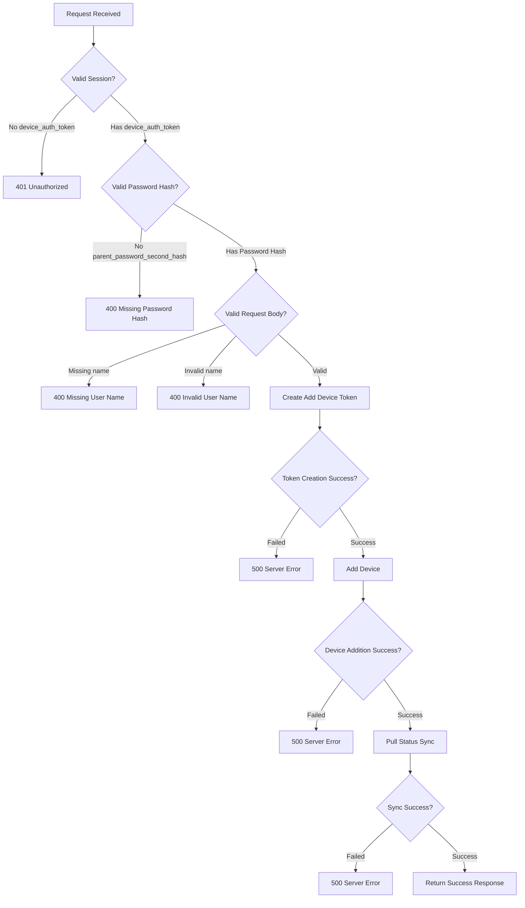
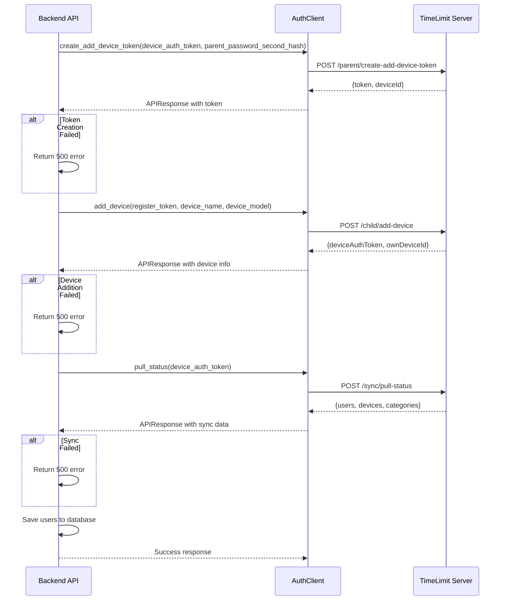

# Add User to Family - API Endpoint Design Document

## Overview

This document specifies the design for the `POST /api/dashboard/users/add` API endpoint, which allows authenticated parents to add a new child user to their family through the TimeLimit Dashboard V2.

---

## 1. API Endpoint Specification

### Endpoint Details

| Property | Value |
|----------|-------|
| **Method** | POST |
| **Path** | `/api/dashboard/users/add` |
| **Content-Type** | application/json |
| **Authentication** | Session-based (requires `device_auth_token` in session) |
| **Authorization** | Requires `parent_password_second_hash` in session |

### Endpoint Purpose

This endpoint orchestrates the add-device flow to register a new child device and user to the parent's family. The flow involves:

1. Creating an add-device token on the server
2. Registering the new device using that token
3. Syncing the new user data to the local database

---

## 2. Request/Response Schemas

### Request Body Schema

```json
{
  "name": "string (required)",
  "deviceName": "string (optional)",
  "deviceModel": "string (optional)"
}
```

| Field | Type | Required | Description |
|-------|------|----------|-------------|
| `name` | string | Yes | Child's display name (1-100 characters) |
| `deviceName` | string | No | Name for the child's device (1-100 characters) |
| `deviceModel` | string | No | Model of the child's device (1-100 characters) |

### Success Response Schema

```json
{
  "status": "ok",
  "userId": "string",
  "deviceAuthToken": "string",
  "ownDeviceId": "string"
}
```

| Field | Type | Description |
|-------|------|-------------|
| `status` | string | Response status ("ok") |
| `userId` | string | New child user's unique identifier |
| `deviceAuthToken` | string | New child device's authentication token |
| `ownDeviceId` | string | New child device's unique identifier |

### Error Response Schemas

#### 401 Unauthorized

```json
{
  "status": "error",
  "error": "Not authenticated",
  "error_code": "unauthorized"
}
```

#### 400 Bad Request - Missing Fields

```json
{
  "status": "error",
  "error": "Missing device_auth_token",
  "error_code": "validation"
}
```

```json
{
  "status": "error",
  "error": "Missing parent_password_second_hash",
  "error_code": "validation"
}
```

```json
{
  "status": "error",
  "error": "Missing user name",
  "error_code": "validation"
}
```

#### 500 Server Error

```json
{
  "status": "error",
  "error": "Failed to add user to family",
  "error_code": "server_error",
  "technical_detail": "string (optional, for debugging)"
}
```

---

## 3. Error Handling Strategy

### Error Classification

| Error Type | HTTP Status | Error Code | Description |
|------------|-------------|------------|-------------|
| Not Authenticated | 401 | `unauthorized` | User not logged in (no `device_auth_token` in session) |
| Missing Device Token | 400 | `validation` | Session missing `device_auth_token` |
| Missing Password Hash | 400 | `validation` | Session missing `parent_password_second_hash` |
| Missing User Name | 400 | `validation` | Request body missing `name` field |
| Invalid User Name | 400 | `validation` | User name is empty or whitespace only |
| Server API Failure | 500 | `server_error` | Auth client API call failed |
| Sync Failure | 500 | `server_error` | Unable to sync user to local database |

### Error Handling Flow



### Error Response Format

All error responses follow a consistent format:

```json
{
  "status": "error",
  "error": "Human-readable error message",
  "error_code": "machine-readable error code (optional)",
  "technical_detail": "Additional debugging information (optional, only in development)"
}
```

---

## 4. Integration with auth_client

### Required AuthClient Methods

The endpoint integrates with the following `auth_client.py` methods:

#### 4.1 `create_add_device_token()`

**Location:** `auth_client.py:885-934`

**Purpose:** Creates a temporary token for registering a new child device.

**Request:**
```python
client.create_add_device_token(
    device_auth_token=str,      # Parent's device auth token
    parent_password_second_hash=str  # Parent's second password hash
)
```

**Response:**
```python
APIResponse(
    success=True/False,
    status_code=200/400/401/500,
    data={
        "token": "register_token_xyz789",
        "deviceId": "device_id_123"
    }
)
```

#### 4.2 `add_device()`

**Location:** `auth_client.py:940-994`

**Purpose:** Registers a new child device using the token from step 4.1.

**Request:**
```python
client.add_device(
    register_token=str,           # Token from create_add_device_token
    device_name=str,            # Child's device name
    device_model=str,           # Child's device model
    client_level=7              # Matches Android app's CLIENT_LEVEL_VALUE
)
```

**Response:**
```python
APIResponse(
    success=True/False,
    status_code=200/400/401/500,
    data={
        "deviceAuthToken": "child_device_token_abc123",
        "ownDeviceId": "child_device_id_xyz789"
    }
)
```

#### 4.3 `pull_status()`

**Location:** `auth_client.py:1073-1154`

**Purpose:** Syncs the new user data to the local database.

**Request:**
```python
client.pull_status(
    device_auth_token=str,      # New child's device auth token
    client_data_status=None     # Empty status for initial full sync
)
```

**Response:**
```python
APIResponse(
    success=True/False,
    status_code=200/400/401/500,
    data={
        "users": {"data": [...]},
        "devices": {"data": [...]},
        "categories": {...}
    }
)
```

### Integration Flow



---

## 5. Database Update Strategy

### User Data Flow

Users are **synced from the server**, not created directly in the local database. The database update strategy is:

1. **No Direct User Creation**: The `users` table is populated via `save_users()` function
2. **Sync-Based Updates**: After device registration, `pull_status()` fetches the complete user list
3. **Local Storage**: The `save_users()` function in `database.py:1286-1338` handles the database insert/update

### Database Functions Used

#### `save_users()` - `database.py:1286-1338`

```python
def save_users(
    db: Database,
    device_auth_token: str,
    users_data: List[Dict[str, Any]]
) -> None:
    """Save users from ServerDataStatus to the database."""
    # Uses INSERT OR REPLACE to upsert user records
    # Updates last_updated timestamp on each save
```

#### `get_users_by_device_auth_token()` - `database.py:1341-1356`

```python
def get_users_by_device_auth_token(
    db: Database,
    device_auth_token: str
) -> List[Dict[str, Any]]:
    """Get all users for a device auth token."""
```

#### `get_parent_user_id()` - `database.py:1359-1385`

```python
def get_parent_user_id(
    db: Database,
    device_auth_token: str
) -> Optional[str]:
    """Get the parent user ID for a device auth token."""
    # First checks families table
    # Falls back to users table (type='parent')
```

### Database Update Sequence

```mermaid
flowchart LR
    A[API Endpoint] --> B[pull_status Response]
    B --> C[Extract users.data]
    C --> D[save_users() call]
    D --> E[INSERT OR REPLACE users]
    E --> F[Local database updated]
```

### Extracting User ID from Sync Response

After `pull_status()` succeeds, the new user's ID is extracted from the response:

```python
# Response structure from pull_status
response_data = {
    "users": {
        "data": [
            {"id": "parent_user_id", "name": "Parent", "type": "parent", ...},
            {"id": "child_user_id", "name": "Child Name", "type": "child", ...}
        ]
    }
}

# Find the newly added user (by matching the device name or by being the only new user)
users = response_data.get("users", {}).get("data", [])
new_user = next((u for u in users if u.get("name") == request_name), None)
user_id = new_user.get("id") if new_user else None
```

---

## 6. Audit Logging Requirements

### Audit Log Functions

The endpoint requires two audit logging functions to be added to `utils/audit_log.py`:

#### 6.1 `log_add_user_request()`

```python
def log_add_user_request(
    device_auth_token: str,
    parent_user_id: str,
    user_name: str,
    device_name: Optional[str],
    device_model: Optional[str],
    request_id: Optional[str] = None,
    server_url: Optional[str] = None,
    audit_log_path: Optional[str] = None
) -> None:
    """Log an add user request with complete fidelity."""
```

**Log Fields:**
- `event`: "add_user_request"
- `timestamp`: ISO 8601 timestamp
- `timestamp_unix_ms`: Unix timestamp in milliseconds
- `device_auth_token`: Parent's device auth token
- `parent_user_id`: Parent's user ID
- `user_name`: Child's display name
- `device_name`: Child's device name (optional)
- `device_model`: Child's device model (optional)
- `request_id`: Request correlation ID
- `server_url`: Target server URL

#### 6.2 `log_add_user_response()`

```python
def log_add_user_response(
    device_auth_token: str,
    parent_user_id: str,
    user_id: str,
    device_auth_token: str,
    own_device_id: str,
    request_id: Optional[str] = None,
    success: bool = True,
    status_code: Optional[int] = None,
    response_data: Optional[Dict[str, Any]] = None,
    error_code: Optional[str] = None,
    error_message: Optional[str] = None,
    audit_log_path: Optional[str] = None
) -> None:
    """Log an add user response with complete fidelity."""
```

**Log Fields:**
- `event`: "add_user_response"
- `timestamp`: ISO 8601 timestamp
- `timestamp_unix_ms`: Unix timestamp in milliseconds
- `device_auth_token`: Parent's device auth token
- `parent_user_id`: Parent's user ID
- `user_id`: New child user's ID
- `child_device_auth_token`: New child device's auth token
- `own_device_id`: New child device's ID
- `request_id`: Request correlation ID
- `success`: Whether the operation succeeded
- `status_code`: HTTP status code
- `response_data`: Full response data
- `error_code`: Error code if failed
- `error_message`: Error message if failed

### Audit Log Example Entries

#### Request Log Entry

```json
{
  "event": "add_user_request",
  "timestamp": "2026-09-11T12:00:00.000000Z",
  "timestamp_unix_ms": 1726041600000,
  "device_auth_token": "parent_token_abc123",
  "parent_user_id": "user_parent_456",
  "user_name": "Child Name",
  "device_name": "Child's Phone",
  "device_model": "Pixel 6",
  "request_id": "req_789xyz",
  "server_url": "https://api.timelimit.io"
}
```

#### Success Response Log Entry

```json
{
  "event": "add_user_response",
  "timestamp": "2026-09-11T12:00:05.123456Z",
  "timestamp_unix_ms": 1726041605123,
  "device_auth_token": "parent_token_abc123",
  "parent_user_id": "user_parent_456",
  "user_id": "user_child_789",
  "child_device_auth_token": "child_token_def456",
  "own_device_id": "device_child_ghi789",
  "request_id": "req_789xyz",
  "success": true,
  "status_code": 200,
  "response_data": {
    "status": "ok",
    "userId": "user_child_789",
    "deviceAuthToken": "child_token_def456",
    "ownDeviceId": "device_child_ghi789"
  }
}
```

#### Failure Response Log Entry

```json
{
  "event": "add_user_response",
  "timestamp": "2026-09-11T12:00:05.123456Z",
  "timestamp_unix_ms": 1726041605123,
  "device_auth_token": "parent_token_abc123",
  "parent_user_id": "user_parent_456",
  "user_id": null,
  "child_device_auth_token": null,
  "own_device_id": null,
  "request_id": "req_789xyz",
  "success": false,
  "status_code": 500,
  "response_data": null,
  "error_code": "server_error",
  "error_message": "Failed to create add device token"
}
```

---

## 7. Implementation Code

### Flask Route Implementation

```python
@app.route('/api/dashboard/users/add', methods=['POST'])
def api_add_user_to_family():
    """Add a new user (child) to the family.
    
    This endpoint orchestrates the add-device flow to register a new child
    device and user to the parent's family.
    
    Expects JSON body with:
        - name: Child's display name (required)
        - deviceName: Name for the child's device (optional)
        - deviceModel: Model of the child's device (optional)
    
    Returns:
        JSON response with status, userId, deviceAuthToken, and ownDeviceId.
    """
    start_time = time.time()
    request_id = get_request_id()
    data = request.get_json() or {}
    
    # Extract request data
    user_name = data.get('name', '').strip()
    device_name = data.get('deviceName', '').strip() or None
    device_model = data.get('deviceModel', '').strip() or None
    
    # Validate user name
    if not user_name:
        logger.error(
            "Add user failed: missing user name",
            request_id=request_id
        )
        return jsonify({
            'status': 'error',
            'error': 'Missing user name',
            'error_code': 'validation'
        }), 400
    
    # Get session data
    device_auth_token = session.get('device_auth_token')
    parent_password_second_hash = session.get('parent_password_second_hash')
    server_url = get_current_server_url()
    
    # Validate authentication
    if not device_auth_token:
        logger.warning(
            "Add user failed: not authenticated",
            request_id=request_id
        )
        return jsonify({
            'status': 'error',
            'error': 'Not authenticated',
            'error_code': 'unauthorized'
        }), 401
    
    if not parent_password_second_hash:
        logger.warning(
            "Add user failed: missing parent password hash",
            request_id=request_id
        )
        return jsonify({
            'status': 'error',
            'error': 'Missing parent_password_second_hash',
            'error_code': 'validation'
        }), 400
    
    # Get parent user ID
    db = get_database()
    parent_user_id = get_parent_user_id(db, device_auth_token)
    
    if not parent_user_id:
        logger.error(
            "Add user failed: parent user ID not found",
            device_auth_token=device_auth_token[:8] + '...',
            request_id=request_id
        )
        return jsonify({
            'status': 'error',
            'error': 'Parent user ID not found',
            'error_code': 'server_error'
        }), 500
    
    # Log request to audit log
    log_add_user_request(
        device_auth_token=device_auth_token,
        parent_user_id=parent_user_id,
        user_name=user_name,
        device_name=device_name,
        device_model=device_model,
        request_id=request_id,
        server_url=server_url
    )
    
    logger.info(
        "Add user request",
        server_url=server_url,
        user_name=user_name,
        device_name=device_name,
        device_model=device_model,
        request_id=request_id
    )
    
    # Create AuthClient
    client = AuthClient(base_url=server_url)
    
    # Step 1: Create add device token
    token_response = client.create_add_device_token(
        device_auth_token=device_auth_token,
        parent_password_second_hash=parent_password_second_hash
    )
    
    if not token_response.success:
        logger.error(
            "Add user failed: token creation error",
            error_code=token_response.error_code,
            error_message=token_response.error_message,
            request_id=request_id
        )
        log_add_user_response(
            device_auth_token=device_auth_token,
            parent_user_id=parent_user_id,
            user_id=None,
            child_device_auth_token=None,
            own_device_id=None,
            request_id=request_id,
            success=False,
            status_code=token_response.status_code,
            error_code=token_response.error_code,
            error_message=token_response.error_message
        )
        return jsonify({
            'status': 'error',
            'error': token_response.error_message or 'Failed to create add device token',
            'error_code': token_response.error_code
        }), 500
    
    register_token = token_response.data.get('token')
    device_id = token_response.data.get('deviceId')
    
    # Step 2: Add device
    add_device_response = client.add_device(
        register_token=register_token,
        device_name=device_name,
        device_model=device_model,
        client_level=7
    )
    
    if not add_device_response.success:
        logger.error(
            "Add user failed: device addition error",
            error_code=add_device_response.error_code,
            error_message=add_device_response.error_message,
            request_id=request_id
        )
        log_add_user_response(
            device_auth_token=device_auth_token,
            parent_user_id=parent_user_id,
            user_id=None,
            child_device_auth_token=None,
            own_device_id=None,
            request_id=request_id,
            success=False,
            status_code=add_device_response.status_code,
            error_code=add_device_response.error_code,
            error_message=add_device_response.error_message
        )
        return jsonify({
            'status': 'error',
            'error': add_device_response.error_message or 'Failed to add device',
            'error_code': add_device_response.error_code
        }), 500
    
    child_device_auth_token = add_device_response.data.get('deviceAuthToken')
    own_device_id = add_device_response.data.get('ownDeviceId')
    
    # Step 3: Pull status to sync user
    sync_response = client.pull_status(
        device_auth_token=child_device_auth_token
    )
    
    if not sync_response.success:
        logger.error(
            "Add user failed: sync error",
            error_code=sync_response.error_code,
            error_message=sync_response.error_message,
            request_id=request_id
        )
        log_add_user_response(
            device_auth_token=device_auth_token,
            parent_user_id=parent_user_id,
            user_id=None,
            child_device_auth_token=child_device_auth_token,
            own_device_id=own_device_id,
            request_id=request_id,
            success=False,
            status_code=sync_response.status_code,
            error_code=sync_response.error_code,
            error_message=sync_response.error_message
        )
        return jsonify({
            'status': 'error',
            'error': sync_response.error_message or 'Failed to sync user',
            'error_code': sync_response.error_code
        }), 500
    
    # Extract user ID from sync response
    users_data = sync_response.data.get('users', {}).get('data', [])
    new_user = next((u for u in users_data if u.get('name') == user_name), None)
    user_id = new_user.get('id') if new_user else None
    
    # Save users to database
    if users_data:
        save_users(db, child_device_auth_token, users_data)
    
    duration_ms = int((time.time() - start_time) * 1000)
    
    logger.info(
        "Add user successful",
        server_url=server_url,
        user_name=user_name,
        user_id=user_id,
        device_auth_token=child_device_auth_token[:8] + '...',
        own_device_id=own_device_id,
        duration_ms=duration_ms,
        request_id=request_id
    )
    
    # Log success response
    log_add_user_response(
        device_auth_token=device_auth_token,
        parent_user_id=parent_user_id,
        user_id=user_id,
        child_device_auth_token=child_device_auth_token,
        own_device_id=own_device_id,
        request_id=request_id,
        success=True,
        status_code=200
    )
    
    return jsonify({
        'status': 'ok',
        'userId': user_id,
        'deviceAuthToken': child_device_auth_token,
        'ownDeviceId': own_device_id
    })
```

---

## 8. Test Strategy

### Test Cases

| Test Case | Description | Expected Result |
|-----------|-------------|-----------------|
| `test_add_user_unauthenticated` | Request without session | 401 Unauthorized |
| `test_add_user_no_device_auth_token` | Session without device_auth_token | 401 Unauthorized |
| `test_add_user_no_parent_password_hash` | Session without parent_password_second_hash | 400 Bad Request |
| `test_add_user_missing_name` | Request body missing name | 400 Bad Request |
| `test_add_user_empty_name` | Request body with empty name | 400 Bad Request |
| `test_add_user_token_creation_failure` | Server API failure in token creation | 500 Server Error |
| `test_add_user_device_addition_failure` | Server API failure in device addition | 500 Server Error |
| `test_add_user_sync_failure` | Server API failure in sync | 500 Server Error |
| `test_add_user_success` | Complete successful flow | 200 OK with user info |

### Test File Location

`timelimit-ui/rootfs/usr/bin/dashboardV2/tests/test_dashboard_api.py`

---

## 9. Summary

This design document specifies the complete API endpoint for adding a user to a family in the TimeLimit Dashboard V2. The endpoint:

1. **Validates authentication** - Requires both `device_auth_token` and `parent_password_second_hash` in session
2. **Validates input** - Requires non-empty user name
3. **Orchestrates the add-device flow** - Creates token, adds device, syncs user
4. **Returns user information** - Provides `userId`, `deviceAuthToken`, and `ownDeviceId`
5. **Handles errors appropriately** - Returns proper HTTP status codes and error messages
6. **Logs audit events** - Records request and response for security and debugging

The implementation follows existing patterns in the codebase for consistency and maintainability.