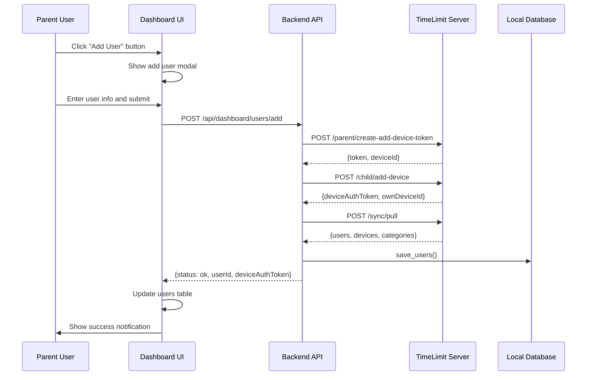

# Add User to Family Feature - Implementation Plan

## Overview

This plan outlines the implementation of a feature to add an additional user (child) to a family using the TimeLimit Dashboard V2. The feature allows parents to add new child users directly from the dashboard interface.

## Architecture Context

### Current System State
- **Backend**: Flask application (`app.py`) with SQLite database (`database.py`)
- **Frontend**: Vanilla JavaScript (`dashboardV2.js`) with server-rendered templates
- **Authentication**: Device auth token as primary session identifier
- **User Model**: Users are synced from server via sync protocol, stored in `users` table with `type` field (parent/child)
- **Device Model**: Devices are registered via `/parent/create-add-device-token` and `/child/add-device` endpoints

### Existing Related Flows
1. **Create Family Flow** (3 steps): Email → Code Verification → Password + Device Info
2. **Login as Parent Flow** (4 steps): Email → Code Verification → Password Entry → Set Password
3. **Device Removal Flow**: REST API endpoint `/api/dashboard/devices/remove`

### Key Files
- `app.py` - Flask routes and session management
- `auth_client.py` - HTTP client for server API communication
- `database.py` - SQLite database operations
- `dashboardV2.js` - Frontend JavaScript
- `dashboardV2.html` - Dashboard template
- `templates/create_family.html` - Family creation template (reference for multi-step flow)

---

## Phase 1: Investigation

### Step 1.1: Analyze Existing Add-Device Flow
- [ ] Review `auth_client.py` `create_add_device_token()` method (lines 885-934)
- [ ] Review `auth_client.py` `add_device()` method (lines 940-994)
- [ ] Review `app.py` `api_create_add_device_token()` route (lines 2246-2308)
- [ ] Review `app.py` `api_add_device()` route (lines 2311-2376)
- [ ] Document the complete flow and data structures

### Step 1.2: Analyze User Data Model
- [ ] Review `database.py` `save_users()` function (lines 1286-1338)
- [ ] Review `database.py` `get_users_by_device_auth_token()` function (lines 1341-1356)
- [ ] Review `database.py` `get_parent_user_id()` function (lines 1359-1385)
- [ ] Document user fields: id, device_auth_token, name, type, mail, time_zone, etc.

### Step 1.3: Analyze Testing Patterns
- [ ] Review `test_dashboard_api.py` test patterns for device removal (lines 1877-2026)
- [ ] Review `test_dashboard_api.py` auth_session fixture (lines 162-199)
- [ ] Review `test_auth_client.py` for add_device tests
- [ ] Document test patterns and mocking strategies

### Step 1.4: Analyze UI Patterns
- [ ] Review `dashboardV2.html` Users table structure (lines 781-805)
- [ ] Review `dashboardV2.js` `loadUsers()` and `renderUsersTable()` functions (lines 931-1004)
- [ ] Review `dashboardV2.js` `refreshUsers()` function (lines 1009-1034)
- [ ] Document UI component structure and event handling

### Step 1.5: Document Findings
- [ ] Create investigation summary with key findings
- [ ] Identify gaps in current implementation
- [ ] Define requirements for add user feature

---

## Phase 2: Implementation

### Step 2.1: Design Backend API Endpoint
- [ ] Design `POST /api/dashboard/users/add` endpoint in `app.py`
- [ ] Define request body: `{ "name": "Child Name", "deviceName": "Child's Phone", "deviceModel": "Device Model" }`
- [ ] Define response: `{ "status": "ok", "userId": "user_id", "deviceAuthToken": "token", "ownDeviceId": "device_id" }`
- [ ] Define error responses for validation failures

### Step 2.2: Implement Backend API Endpoint
- [ ] Add `api_add_user_to_family()` function in `app.py`
- [ ] Validate session has `device_auth_token`
- [ ] Validate session has `parent_password_second_hash`
- [ ] Get `parent_user_id` from session or database
- [ ] Call `auth_client.create_add_device_token()` with parent credentials
- [ ] Call `auth_client.add_device()` with the token and device info
- [ ] Call `auth_client.pull_status()` to sync new user to local database
- [ ] Return success response with user/device info

### Step 2.3: Add Auth Client Method (if needed)
- [ ] Review existing `auth_client.py` methods
- [ ] Add any missing helper methods if required
- [ ] Ensure proper error handling and logging

### Step 2.4: Add Database Helper Functions (if needed)
- [ ] Review existing database functions
- [ ] Add any missing helper functions if required
- [ ] Ensure proper transaction handling

### Step 2.5: Implement Audit Logging
- [ ] Add audit log function for add user request
- [ ] Add audit log function for add user response
- [ ] Log all relevant data for debugging

---

## Phase 3: UI Updates

### Step 3.1: Design User Interface
- [ ] Design modal dialog for adding user
- [ ] Define form fields: User Name, Device Name, Device Model
- [ ] Define action buttons: Add, Cancel
- [ ] Define validation messages and error handling

### Step 3.2: Update Dashboard Template
- [ ] Add "Add User" button to Users section in `dashboardV2.html`
- [ ] Add modal dialog HTML structure
- [ ] Add CSS styles for modal and form elements
- [ ] Ensure responsive design for mobile and desktop

### Step 3.3: Implement Frontend JavaScript
- [ ] Add `addUserToFamily()` function in `dashboardV2.js`
- [ ] Add `showAddUserModal()` function
- [ ] Add `hideAddUserModal()` function
- [ ] Add `submitAddUserForm()` function
- [ ] Add `confirmAddUser()` function with validation
- [ ] Update `refreshUsers()` to handle new user

### Step 3.4: Add User Feedback
- [ ] Add loading states during API calls
- [ ] Add success/error toast notifications
- [ ] Add form validation feedback
- [ ] Add parent password hash requirement warning

---

## Phase 4: Unit Test Updates

### Step 4.1: Write Backend API Tests
- [ ] Add `TestApiAddUserToFamily` class to `test_dashboard_api.py`
- [ ] Test unauthenticated request (401 response)
- [ ] Test missing device_auth_token (400 response)
- [ ] Test missing parent_password_second_hash (400 response)
- [ ] Test missing user name (400 response)
- [ ] Test successful user addition with mocked auth client
- [ ] Test auth client failure handling
- [ ] Test sync failure handling

### Step 4.2: Write Auth Client Tests
- [ ] Add tests for `create_add_device_token()` method
- [ ] Add tests for `add_device()` method
- [ ] Test successful responses
- [ ] Test error responses
- [ ] Test request formatting

### Step 4.3: Write Database Tests
- [ ] Add tests for user creation in database
- [ ] Add tests for user retrieval
- [ ] Test user type validation
- [ ] Test device association

### Step 4.4: Write Integration Tests
- [ ] Add end-to-end test for add user flow
- [ ] Test complete flow from UI to database
- [ ] Test error scenarios
- [ ] Test edge cases

### Step 4.5: Run All Tests
- [ ] Run full test suite
- [ ] Verify all existing tests still pass
- [ ] Verify new tests pass
- [ ] Document test results

---

## Phase 5: Documentation Updates

### Step 5.1: Update API Documentation
- [ ] Add `POST /api/dashboard/users/add` endpoint to `ServerAPI.md`
- [ ] Document request/response formats
- [ ] Document error responses
- [ ] Add usage examples

### Step 5.2: Update User Guide
- [ ] Add section on adding users to family
- [ ] Document the workflow
- [ ] Add screenshots or UI descriptions
- [ ] Add troubleshooting section

### Step 5.3: Update Implementation Documentation
- [ ] Update `dashboardV2-implementation.md` with new route
- [ ] Update database schema documentation if needed
- [ ] Update auth client documentation

### Step 5.4: Update Audit Log Documentation
- [ ] Document new audit log events
- [ ] Add log format examples
- [ ] Document log fields

### Step 5.5: Update Context.md
- [ ] Add implementation summary to CONTEXT.md
- [ ] Add test results
- [ ] Add any relevant notes

---

## Implementation Flow Diagram

```mermaid
flowchart TD
    A[User clicks "Add User" button] --> B[Show add user modal]
    B --> C[User enters user name, device name, device model]
    C --> D[User clicks "Add" button]
    D --> E[Validate parent password hash is set]
    E --> F[Call API: POST /api/dashboard/users/add]
    F --> G[Backend: Create add-device token]
    G --> H[Backend: Add device via server API]
    H --> I[Backend: Pull status to sync user]
    I --> J[Backend: Return success response]
    J --> K[Frontend: Update users table]
    K --> L[Show success notification]
    L --> M[Hide modal]
```

## Data Flow Diagram



## Error Handling

### Expected Error Scenarios
1. **Not authenticated** - User not logged in
2. **Missing parent password hash** - Parent password not set
3. **Invalid user name** - Empty or invalid name
4. **Server API failure** - Server unreachable or error
5. **Sync failure** - Unable to sync user to local database

### Error Response Format
```json
{
    "status": "error",
    "error": "Human-readable error message",
    "error_code": "optional_error_code"
}
```

## Testing Strategy

### Test Categories
1. **Unit Tests** - Test individual functions in isolation
2. **Integration Tests** - Test complete flow with mocked dependencies
3. **End-to-End Tests** - Test complete flow with real dependencies

### Test Data
- Use unique suffixes for test data to avoid conflicts
- Mock external API calls to TimeLimit server
- Use in-memory SQLite database for tests

### Test Coverage
- Happy path (successful user addition)
- Error paths (validation failures, API failures)
- Edge cases (missing fields, invalid data)

## Deployment Considerations

### Backward Compatibility
- New endpoint is additive, no breaking changes
- Existing flows remain unchanged

### Security Considerations
- Parent password hash required for device operations
- Input validation on all user inputs
- Proper authentication checks

### Performance Considerations
- Sync operation may take a few seconds
- Show loading indicator during sync
- Consider timeout handling

## Rollback Plan
- If issues arise, the new endpoint can be disabled
- No database schema changes required
- Existing functionality unaffected