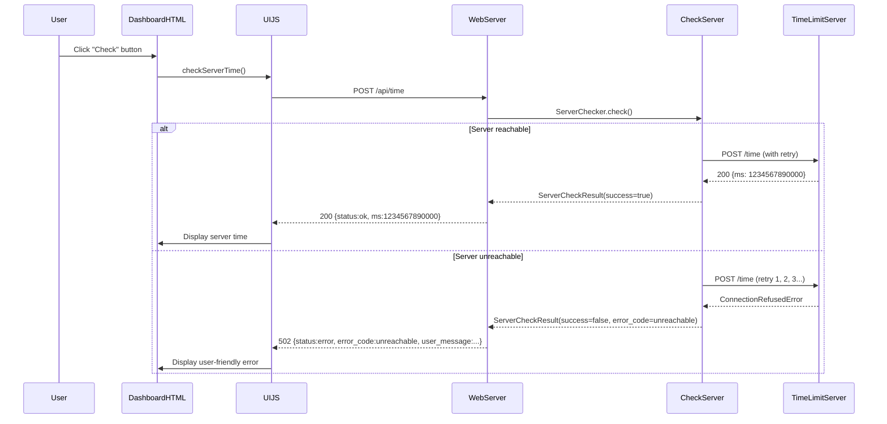

# Check Button Implementation Plan

## Overview

This plan covers creating comprehensive unit tests for the "Check" button functionality in the TimeLimit UI dashboard, implementing robust error handling for server connection failures, and adding logging — all within the `timelimit-ui` project (not the debug-server).

## Current Architecture

The "Check" button flow:
1. User clicks "Check" button in `dashboard.html` (line 197) → calls `checkServerTime()`
2. `checkServerTime()` in `ui.js` (line 2317) POSTs to `/api/time` with empty JSON body `{}`
3. `web_server.py` (line 287) routes `/api/time` → proxies to `/time` on the TimeLimit server
4. `api_client.py` (line 35) makes the POST request with 10-second timeout via `urllib.request`
5. Response is returned to the frontend

### Current Issues
- No retry mechanism in `api_client.py`
- No structured error responses (just returns `(500, str(e).encode())`)
- Frontend shows generic "❌ Error" with no user-friendly messaging
- No distinction between error types (timeout vs. unreachable vs. invalid response)
- No dedicated logging for the check functionality

## Implementation Plan

### Step 1: Create `check_server.py` Module

**File:** `timelimit-ui/rootfs/usr/bin/check_server.py`

A new Python module that provides robust server connection checking:

- **`ServerCheckResult` dataclass**: Encapsulates check results with fields:
  - `success: bool`
  - `error_code: Optional[str]` (e.g., "timeout", "unreachable", "invalid_response", "server_error")
  - `user_message: Optional[str]` (user-friendly message for the frontend)
  - `technical_detail: Optional[str]` (technical details for debugging)
  - `server_time: Optional[int]` (server time in ms if successful)
  - `attempts: int` (number of attempts made)
  - `server_url: Optional[str]`

- **`ServerChecker` class**:
  - Configurable `timeout`, `max_retries`, `retry_delay`
  - `check()` method that:
    - Makes POST request to `/time` endpoint on the TimeLimit server
    - Handles different error types: `socket.timeout`, `ConnectionRefusedError`, `urllib.error.URLError`, `urllib.error.HTTPError`, JSON decode errors, missing fields
    - Implements retry with exponential backoff (retry_delay * 2^attempt)
    - Returns structured `ServerCheckResult`
  - Detailed logging using Python's `logging` module

### Step 2: Integrate with `web_server.py`

**File:** `timelimit-ui/rootfs/usr/bin/web_server.py`

- Add a dedicated `/api/time` handler (before the generic proxy routing) that:
  - Uses `ServerChecker` to check server connectivity
  - Returns structured JSON response with `status`, `error_code`, `user_message`, `technical_detail`, and `time` fields
  - Logs check results (success/failure, attempts, error details)
- The existing generic proxy route for `/api/time` → `/time` will be replaced by this dedicated handler

### Step 3: Create Unit Tests

**File:** `timelimit-ui/test/test_check_server.py`

Comprehensive unit tests using `unittest.mock` to mock `urllib.request.urlopen`:

- **Successful connection**: Mock returns 200 with valid `{"ms": 1234567890000}`
- **Network timeout**: Mock raises `socket.timeout`
- **Unreachable server**: Mock raises `ConnectionRefusedError` / `URLError`
- **Invalid server response**: Mock returns 200 with invalid JSON or missing `time` field
- **Server error**: Mock returns 500 status
- **Retry logic**: First attempt fails, second succeeds
- **All retries fail**: All attempts fail with timeout
- **Error response structure**: Verify `ServerCheckResult` fields are correct
- **Exponential backoff**: Verify retry delays increase

### Step 4: Update `ui.js` `checkServerTime()`

**File:** `timelimit-ui/rootfs/usr/bin/ui.js`

- Parse structured error responses from the backend
- Display user-friendly error messages based on `error_code`:
  - `timeout` → "Server did not respond. Please check your network connection."
  - `unreachable` → "Cannot reach the TimeLimit server. Verify the server URL."
  - `invalid_response` → "Server returned an unexpected response."
  - `server_error` → "Server error. Please try again later."
- Log technical details to the log area for debugging
- Update the status badge to reflect connection state

### Step 5: Add Logging

- **`check_server.py`**: Log each check attempt, retry, and error with technical details
- **`web_server.py`**: Log `/api/time` check results (success/failure, attempts, error codes)
- **`ui.js`**: Log check attempts and results to the log area

## File Changes Summary

| File | Action | Description |
|------|--------|-------------|
| `timelimit-ui/rootfs/usr/bin/check_server.py` | **Create** | New module with `ServerChecker` class and `ServerCheckResult` dataclass |
| `timelimit-ui/rootfs/usr/bin/web_server.py` | **Modify** | Add dedicated `/api/time` handler using `ServerChecker` |
| `timelimit-ui/rootfs/usr/bin/ui.js` | **Modify** | Update `checkServerTime()` to handle structured error responses |
| `timelimit-ui/test/test_check_server.py` | **Create** | Comprehensive unit tests with mocking |
| `timelimit-ui/test/conftest.py` | **Create** | Pytest fixtures for test environment |
| `timelimit-ui/test/pytest.ini` | **Create** | Pytest configuration |

## Test Execution

```bash
cd c:/git/timelimit-ui
python -m pytest timelimit-ui/test/test_check_server.py -v
```

## Mermaid Diagram


