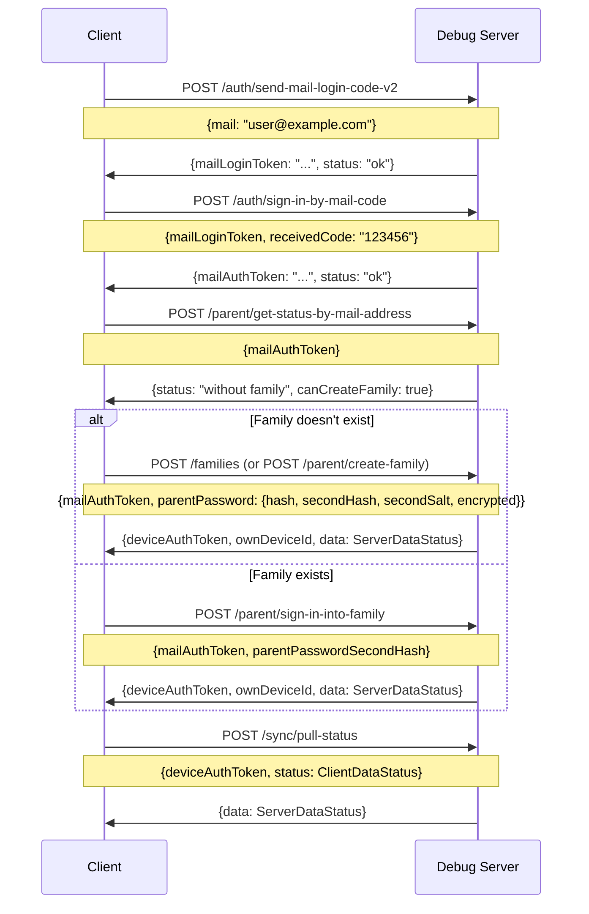

# Design Document: `POST /families` Endpoint — "Create Family" Flow

## 1. Overview

This document specifies the design for a new `POST /families` endpoint in the debug-server FastAPI application. The endpoint creates a new family (parent account + device) in the TimeLimit system, serving as a RESTful alias for the existing `POST /parent/create-family` endpoint.

### 1.1 Context

The debug-server (`debug-server/`) is a FastAPI application that simulates the TimeLimit backend API (`api.timelimit.io`). It uses an in-memory `StateManager` for data persistence and follows the TimeLimit API specification documented in `context_android_app.md`.

The existing `POST /parent/create-family` endpoint is implemented in [`debug-server/app/api/auth.py`](debug-server/app/api/auth.py:273) and uses models from [`debug-server/app/models/auth.py`](debug-server/app/models/auth.py:117).

### 1.2 Key Finding: Discrepancy Between API Endpoint and AuthService

During analysis, a significant discrepancy was discovered:

- **API endpoint** (`auth.py:273`): Creates only the family record and device auth token. Does **not** create a parent user record or a device record. Returns minimal server data with empty `devices` and `users` lists.
- **AuthService method** (`auth_service.py:256`): Creates the family record, a parent user record, a device record, and a device auth token. Returns more complete server data via `_generate_server_data()`.

The test helper `create_device_token()` in [`test_parent_endpoints.py`](debug-server/tests/test_parent_endpoints.py:20) uses `AuthService.create_family()`, which creates the full data set. This means tests that rely on the API endpoint's behavior may not match the service method's behavior.

**Recommendation**: The `POST /families` endpoint should delegate to `AuthService.create_family()` to ensure consistency with the service layer and the actual TimeLimit API behavior (where parent user and device records are created during family creation).

---

## 2. Endpoint Specification

### 2.1 Endpoint

```
POST /families
```

### 2.2 Relationship to `POST /parent/create-family`

**Decision: `POST /families` is a new endpoint that is an alias for `POST /parent/create-family`.**

Rationale:
- The existing `POST /parent/create-family` endpoint is part of the official TimeLimit API specification (see `context_android_app.md` line 131). It must be preserved for backward compatibility with the Android app and existing clients.
- `POST /families` provides a more RESTful, resource-oriented interface that aligns with modern API design conventions.
- Both endpoints share the same request/response schemas, validation logic, and state mutations.
- The `POST /families` endpoint will delegate to the same underlying logic (the `AuthService.create_family()` method), ensuring identical behavior.

### 2.3 Request Schema

The `POST /families` endpoint uses the same `CreateFamilyRequest` model as `POST /parent/create-family`, defined in [`debug-server/app/models/auth.py`](debug-server/app/models/auth.py:117):

```python
class ParentPassword(BaseModel):
    """Model for parent password data."""
    hash: str = Field(..., description="Bcrypt hash of password")
    secondHash: str = Field(..., description="Second bcrypt hash with separate salt")
    secondSalt: str = Field(..., description="Salt for second hash")
    encrypted: bool = Field(default=False, description="Whether secondHash is DH-encrypted")

class CreateFamilyRequest(BaseModel):
    """Request model for creating a family."""
    mailAuthToken: str = Field(..., description="Mail auth token from sign-in")
    parentPassword: ParentPassword = Field(..., description="Parent password data")
    locale: Optional[str] = Field(None, description="Locale string")
    deviceName: Optional[str] = Field(None, description="Device name")
    deviceModel: Optional[str] = Field(None, description="Device model")
```

**Request body example:**

```json
{
  "mailAuthToken": "eyJhbGciOiJIUzI1NiIsInR5cCI6IkpXVCJ9...",
  "parentPassword": {
    "hash": "$2b$12$...",
    "secondHash": "$2b$12$...",
    "secondSalt": "salt_value",
    "encrypted": false
  },
  "locale": "en",
  "deviceName": "Parent Device",
  "deviceModel": "Pixel 7"
}
```

### 2.4 Response Schema

The `POST /families` endpoint uses the same `CreateFamilyResponse` model, defined in [`debug-server/app/models/auth.py`](debug-server/app/models/auth.py:127):

```python
class CreateFamilyResponse(BaseModel):
    """Response model for create family endpoint."""
    status: str = Field(default="ok", description="Status of the operation")
    deviceAuthToken: str = Field(..., description="Device auth token for subsequent requests")
    ownDeviceId: str = Field(..., description="This device's ID")
    data: Optional[dict] = Field(None, description="Server data status (ServerDataStatus)")
```

**Response body example (200 OK):**

```json
{
  "status": "ok",
  "deviceAuthToken": "eyJhbGciOiJIUzI1NiIsInR5cCI6IkpXVCJ9...",
  "ownDeviceId": "device_abc123",
  "data": {
    "devices": {"v": "1", "data": []},
    "users": {"v": "1", "data": []},
    "apps": [],
    "rmCategories": [],
    "categoryBase": [],
    "categoryApp": [],
    "usedTimes": [],
    "rules": [],
    "tasks": [],
    "krq": [],
    "kr": [],
    "pings": [],
    "dh": {"v": "1", "k": ""},
    "u2f": {"v": "1", "d": []},
    "fullVersion": 0,
    "message": "",
    "apiLevel": 1
  }
}
```

---

## 3. Validation Rules

### 3.1 Required Fields

| Field | Type | Required | Validation |
|-------|------|----------|------------|
| `mailAuthToken` | `str` | Yes | Must be a non-empty string; must correspond to a valid, non-expired mail auth token in state |
| `parentPassword` | `ParentPassword` | Yes | Must be a valid object with all required sub-fields |
| `parentPassword.hash` | `str` | Yes | Must be a non-empty string (bcrypt hash) |
| `parentPassword.secondHash` | `str` | Yes | Must be a non-empty string (bcrypt hash) |
| `parentPassword.secondSalt` | `str` | Yes | Must be a non-empty string |
| `parentPassword.encrypted` | `bool` | No | Defaults to `false` |
| `locale` | `str` | No | Optional locale string (e.g., "en", "de") |
| `deviceName` | `str` | No | Optional device name; defaults to "Parent Device" if not provided |
| `deviceModel` | `str` | No | Optional device model; defaults to "Pixel 7" if not provided |

### 3.2 Business Logic Validation

1. **Mail auth token validity**: The `mailAuthToken` must exist in the state manager's `_mail_auth_tokens` store. If not found, return 401.
2. **Family existence check**: The email associated with the mail auth token must not already have a family. If a family exists, return 400 with "Family already exists for this email".
3. **Password hash format**: The `parentPassword.hash` and `parentPassword.secondHash` should be valid bcrypt hashes. The server does not validate the format strictly (it trusts the client to provide properly hashed passwords), but the `hash_password()` and `hash_password_with_salt()` functions are used to re-hash the password for storage.

### 3.3 Pydantic Validation (422)

FastAPI automatically returns 422 for:
- Missing required fields
- Invalid field types (e.g., `parentPassword` is not an object)
- Missing sub-fields in `parentPassword`

---

## 4. Database / State Model

### 4.1 StateManager Data Structures

The `StateManager` in [`debug-server/app/core/state.py`](debug-server/app/core/state.py) uses in-memory dictionaries protected by an `asyncio.Lock`:

| Store | Key | Value |
|-------|-----|-------|
| `_families` | `family_id` (str) | Family data dict |
| `_users` | `user_id` (str) | User data dict |
| `_devices` | `device_id` (str) | Device data dict |
| `_mail_auth_tokens` | `token` (str) | `{mail, family_id, created_at}` |
| `_device_auth_tokens` | `token` (str) | `{device_id, family_id, created_at}` |
| `_add_device_tokens` | `token` (str) | `{device_id, parent_id, created_at, expires_at}` |

### 4.2 Family Data Structure (Created by `POST /families`)

When a family is created, the following data structures are created in the `StateManager`:

#### Family Record (`_families[family_id]`)

```python
{
    "family_id": "family_<random>",
    "mail": "<email from mail auth token>",
    "parent_id": "user_<random>",
    "parent_password_second_hash": "<bcrypt hash with second salt>",
    "created_at": "<ISO 8601 timestamp>",
}
```

**Note**: The API endpoint in `auth.py` stores additional fields (`parent_password_hash`, `parent_password_second_salt`, `parent_password_encrypted`). The `AuthService.create_family()` method stores a simpler set. The `POST /families` endpoint should store all fields for completeness.

#### Parent User Record (`_users[parent_id]`)

```python
{
    "id": "user_<random>",
    "name": "Parent_<random>",
    "password": "<bcrypt hash>",
    "secondPasswordSalt": "<salt>",
    "type": "parent",
    "timeZone": "Europe/Amsterdam",
    "disableLimitsUntil": 0,
    "mail": "<email>",
    "currentDevice": "device_<random>",
    "categoryForNotAssignedApps": "",
    "relaxPrimaryDevice": True,
    "flags": 0,
    "limitLoginCategory": None,
    "preBlockDuration": 0,
    "family_id": "family_<random>",
    "created_at": "<ISO 8601 timestamp>",
}
```

#### Device Record (`_devices[device_id]`)

```python
{
    "deviceId": "device_<random>",
    "name": "<deviceName or 'Parent Device'>",
    "model": "<deviceModel or 'Pixel 7'>",
    "addedAt": <timestamp_ms>,
    "currentUserId": "user_<random>",
    "currentProtectionLevel": "none",
    "highestProtectionLevel": "none",
    "currentAppVersion": 1,
    "highestAppVersion": 1,
    "publicKey": "",
    "platformType": "android",
    "platformLevel": 30,
    "familyId": "family_<random>",
}
```

#### Device Auth Token (`_device_auth_tokens[token]`)

```python
{
    "device_id": "device_<random>",
    "family_id": "family_<random>",
    "created_at": "<ISO 8601 timestamp>",
}
```

#### Mail Auth Token Update (`_mail_auth_tokens[mailAuthToken]`)

The existing mail auth token is updated to include the `family_id`:

```python
{
    "mail": "<email>",
    "family_id": "family_<random>",
    "created_at": "<ISO 8601 timestamp>",
}
```

### 4.3 ID Generation

All IDs are generated using `secrets.token_urlsafe(16)` or `secrets.token_hex(8)`:

| Entity | Format | Generation |
|--------|--------|------------|
| `family_id` | `family_<token>` | `f"family_{secrets.token_urlsafe(16)}"` |
| `parent_id` | `user_<token>` | `f"user_{secrets.token_urlsafe(16)}"` |
| `device_id` | `device_<token>` | `f"device_{secrets.token_urlsafe(16)}"` |
| `device_auth_token` | `<token>` | `secrets.token_urlsafe(32)` |

### 4.4 Server Data Status (Returned in Response)

The `data` field in the response contains a `ServerDataStatus` object. Two implementations exist:

1. **API endpoint** (`auth.py:358`): Returns minimal server data with empty `devices` and `users` lists.
2. **AuthService** (`auth_service.py:540`): Returns complete server data via `_generate_server_data()`, which queries the state manager for all family entities.

**Recommendation**: The `POST /families` endpoint should use the `AuthService._generate_server_data()` method to return complete server data, including the newly created parent user and device.

---

## 5. Authentication Requirements

### 5.1 No JWT Authentication Required

The `POST /families` endpoint does **not** require JWT authentication. It uses the `mailAuthToken` (a temporary token obtained from the `POST /auth/sign-in-by-mail-code` endpoint) as its authentication mechanism.

### 5.2 Auth Middleware

The `AuthMiddleware` in [`debug-server/app/middleware/auth.py`](debug-server/app/middleware/auth.py) has `JWT_PROTECTED_PREFIXES = []` (empty list), meaning no endpoints are protected by JWT at the middleware level. The `/parent/*` and `/child/*` endpoints use their own device auth token mechanism.

Since `POST /families` is at the root level (not under `/parent/` or `/child/`), it will not be intercepted by the auth middleware. The endpoint validates the `mailAuthToken` directly via the `StateManager`.

### 5.3 Auth Flow Integration

The `POST /families` endpoint is the third step in the mail-based authentication flow:



---

## 6. Error Handling

### 6.1 Error Response Format

All error responses follow the standardized format defined in [`debug-server/app/core/exceptions.py`](debug-server/app/core/exceptions.py):

```json
{
  "status": "error",
  "error": "<error message>"
}
```

Custom exception classes are available:
- `AuthenticationError` → 401
- `AuthorizationError` → 403
- `NotFoundError` → 404
- `ConflictError` → 409
- `BadRequestError` → 400
- `ValidationError` → 400
- `RateLimitError` → 429

### 6.2 Possible Error Responses

| HTTP Status | Condition | Error Message | Exception Class |
|-------------|-----------|---------------|-----------------|
| 400 | Family already exists for this email | "Family already exists for this email" | `HTTPException` (inline) |
| 401 | Invalid or expired mail auth token | "Invalid mail auth token" | `HTTPException` (inline) |
| 422 | Missing required fields or invalid types | FastAPI auto-generated validation error | Pydantic validation |
| 500 | Internal server error (unexpected) | "Internal server error" | `InternalServerError` |

### 6.3 Error Handling Implementation

The endpoint should use the same error handling pattern as the existing `POST /parent/create-family` endpoint:

```python
# Invalid mail auth token
if token_data is None:
    raise HTTPException(
        status_code=status.HTTP_401_UNAUTHORIZED,
        detail="Invalid mail auth token",
    )

# Family already exists
existing_family = await state.get_family_by_mail(mail)
if existing_family is not None:
    raise HTTPException(
        status_code=status.HTTP_400_BAD_REQUEST,
        detail="Family already exists for this email",
    )
```

**Recommendation**: Use the custom exception classes (`AuthenticationError`, `ConflictError`) instead of inline `HTTPException` for consistency with the exception handling pattern. However, since the existing `POST /parent/create-family` endpoint uses inline `HTTPException`, the `POST /families` endpoint should match the existing pattern for consistency within the auth module.

---

## 7. Implementation Design

### 7.1 File Structure

The `POST /families` endpoint should be added to the existing auth router in [`debug-server/app/api/auth.py`](debug-server/app/api/auth.py), alongside the existing `POST /parent/create-family` endpoint. This keeps all family-related endpoints in one place.

### 7.2 Endpoint Implementation

```python
@router.post("/families", response_model=CreateFamilyResponse)
async def create_family_alias(
    request: CreateFamilyRequest,
    state = Depends(get_state_manager),
) -> CreateFamilyResponse:
    """Create a new family (RESTful alias for POST /parent/create-family).

    This endpoint is a RESTful alternative to POST /parent/create-family.
    It accepts the same request body and returns the same response.

    Auth flow:
    1. POST /auth/send-mail-login-code-v2 → mailLoginToken
    2. POST /auth/sign-in-by-mail-code → mailAuthToken
    3. POST /families → deviceAuthToken + ownDeviceId + ServerDataStatus

    Args:
        request: The create family request containing mailAuthToken and parent password.
        state: The state manager for token storage.

    Returns:
        CreateFamilyResponse: Contains deviceAuthToken, ownDeviceId, and server data.

    Raises:
        HTTPException: 401 if the mail auth token is invalid.
        HTTPException: 400 if family already exists.
    """
    # Delegate to AuthService for consistent behavior
    auth_service = AuthService(state=state)
    result = await auth_service.create_family(
        mail_auth_token=request.mailAuthToken,
        parent_password={
            "hash": request.parentPassword.hash,
            "secondHash": request.parentPassword.secondHash,
            "secondSalt": request.parentPassword.secondSalt,
            "encrypted": request.parentPassword.encrypted,
        },
        device_name=request.deviceName or "Parent Device",
        device_model=request.deviceModel or "Pixel 7",
    )

    return CreateFamilyResponse(
        deviceAuthToken=result["deviceAuthToken"],
        ownDeviceId=result["ownDeviceId"],
        data=result["data"],
    )
```

### 7.3 Delegation to AuthService

The `POST /families` endpoint should delegate to `AuthService.create_family()` rather than duplicating the inline logic from the existing `POST /parent/create-family` endpoint. This ensures:

1. **Consistency**: Both endpoints produce the same family/user/device records.
2. **Completeness**: The parent user and device records are created (matching the actual TimeLimit API behavior).
3. **Maintainability**: Logic is centralized in the service layer.

**Note**: The `AuthService.create_family()` method raises `ValueError` for invalid tokens, while the API endpoint raises `HTTPException`. The `POST /families` endpoint should catch `ValueError` and convert it to the appropriate `HTTPException`.

### 7.4 Server Data Generation

The `AuthService._generate_server_data()` method generates a complete `ServerDataStatus` object by querying the state manager for all family entities (devices, users, categories, apps). This is more complete than the inline server data in the existing API endpoint.

The `POST /families` endpoint should use this method to return complete server data, allowing the client to immediately sync without a separate `pull-status` call.

---

## 8. Integration with Existing Flow

### 8.1 Auth Flow

The `POST /families` endpoint fits into the existing authentication flow as an alternative to `POST /parent/create-family`:

```
1. POST /auth/send-mail-login-code-v2
   → Returns: mailLoginToken

2. POST /auth/sign-in-by-mail-code
   → Returns: mailAuthToken

3. POST /parent/get-status-by-mail-address
   → Returns: {status: "without family", canCreateFamily: true}

4. POST /families  (or POST /parent/create-family)
   → Returns: {deviceAuthToken, ownDeviceId, data: ServerDataStatus}

5. POST /sync/pull-status
   → Returns: {data: ServerDataStatus}
```

### 8.2 Post-Creation Flow

After `POST /families` returns a `deviceAuthToken`, the client can:

1. Use the `deviceAuthToken` for all subsequent authenticated requests (sync, parent management, etc.)
2. Call `POST /sync/pull-status` to get the complete family state
3. Connect via WebSocket (Socket.IO) for real-time sync notifications

### 8.3 Backward Compatibility

The existing `POST /parent/create-family` endpoint remains unchanged. The `POST /families` endpoint is purely additive.

---

## 9. Testing Strategy

### 9.1 Test File

Tests should be added to [`debug-server/tests/test_auth_endpoints.py`](debug-server/tests/test_auth_endpoints.py) in a new `TestCreateFamilyRest` test class, following the existing test patterns.

### 9.2 Test Cases

#### 9.2.1 Success Cases

| Test | Description | Expected Status |
|------|-------------|-----------------|
| `test_create_family_rest_success` | Valid mail auth token + valid parent password → family created | 200 |
| `test_create_family_rest_returns_device_auth_token` | Response contains `deviceAuthToken` | 200 |
| `test_create_family_rest_returns_own_device_id` | Response contains `ownDeviceId` | 200 |
| `test_create_family_rest_returns_server_data` | Response contains `data` with ServerDataStatus | 200 |
| `test_create_family_rest_with_device_name` | Custom device name is used | 200 |
| `test_create_family_rest_with_device_model` | Custom device model is used | 200 |
| `test_create_family_rest_with_locale` | Locale is accepted | 200 |

#### 9.2.2 Authentication Error Cases

| Test | Description | Expected Status |
|------|-------------|-----------------|
| `test_create_family_rest_invalid_token` | Invalid mail auth token | 401 |
| `test_create_family_rest_missing_token` | Missing mailAuthToken field | 422 |
| `test_create_family_rest_empty_token` | Empty mailAuthToken string | 401 |

#### 9.2.3 Validation Error Cases

| Test | Description | Expected Status |
|------|-------------|-----------------|
| `test_create_family_rest_missing_parent_password` | Missing `parentPassword` field | 422 |
| `test_create_family_rest_missing_password_hash` | Missing `parentPassword.hash` | 422 |
| `test_create_family_rest_missing_password_second_hash` | Missing `parentPassword.secondHash` | 422 |
| `test_create_family_rest_missing_password_second_salt` | Missing `parentPassword.secondSalt` | 422 |
| `test_create_family_rest_invalid_json` | Invalid JSON body | 400 or 422 |

#### 9.2.4 Conflict Cases

| Test | Description | Expected Status |
|------|-------------|-----------------|
| `test_create_family_rest_already_exists` | Family already exists for email | 400 |

#### 9.2.5 Integration / Flow Tests

| Test | Description | Expected Status |
|------|-------------|-----------------|
| `test_create_family_rest_full_flow` | Complete flow: send code → sign in → create family | 200 |
| `test_create_family_rest_then_pull_status` | Create family → pull status with returned token | 200 |
| `test_create_family_rest_then_sign_in` | Create family → sign in to family with second hash | 200 |

#### 9.2.6 Security Tests

| Test | Description | Expected Status |
|------|-------------|-----------------|
| `test_create_family_rest_no_password_in_response` | Password hashes not returned in response | 200 (verify response) |
| `test_create_family_rest_token_not_leaked_in_error` | Tokens not leaked in error responses | 401/400 (verify response) |

### 9.3 Test Helper

A test helper function should be created to obtain a valid `mailAuthToken` for testing:

```python
def get_mail_auth_token(email: str = None) -> str:
    """Get a valid mail auth token for testing."""
    import asyncio
    from app.services.auth_service import AuthService
    from app.core.state import state_manager

    if email is None:
        email = f"test_{uuid.uuid4().hex[:8]}@example.com"

    async def get_token():
        auth = AuthService()
        auth.state = state_manager
        auth._generate_code = lambda: "123456"
        send_result = await auth.send_mail_login_code(email)
        sign_in_result = await auth.sign_in_by_mail_code(
            send_result["mailLoginToken"], "123456"
        )
        return sign_in_result["mailAuthToken"]

    return asyncio.run(get_token())
```

### 9.4 Test Scenario File

A test scenario should be added to [`debug-server/tests/scenarios/auth_flow.json`](debug-server/tests/scenarios/auth_flow.json) documenting the `POST /families` endpoint as an alternative to `POST /parent/create-family`.

---

## 10. Summary of Design Decisions

| Decision | Choice | Rationale |
|----------|--------|-----------|
| Endpoint path | `POST /families` | RESTful, resource-oriented |
| Relationship to `/parent/create-family` | Alias | Backward compatibility + RESTful alternative |
| Request/Response schemas | Reuse `CreateFamilyRequest`/`CreateFamilyResponse` | Consistency with existing endpoint |
| Implementation | Delegate to `AuthService.create_family()` | Centralized logic, complete data creation |
| Authentication | `mailAuthToken` (no JWT) | Matches existing flow, no auth middleware needed |
| Error handling | Same as `POST /parent/create-family` | Consistency |
| Router | Add to existing `auth_router` in `auth.py` | Keeps family endpoints together |
| Server data | Use `AuthService._generate_server_data()` | Complete data, matches actual API behavior |

---

## 11. Files to be Modified (Implementation Phase)

| File | Change |
|------|--------|
| [`debug-server/app/api/auth.py`](debug-server/app/api/auth.py) | Add `POST /families` endpoint |
| [`debug-server/tests/test_auth_endpoints.py`](debug-server/tests/test_auth_endpoints.py) | Add `TestCreateFamilyRest` test class |
| [`debug-server/tests/scenarios/auth_flow.json`](debug-server/tests/scenarios/auth_flow.json) | Add `POST /families` scenario |
| [`debug-server/docs/api.md`](debug-server/docs/api.md) | Document `POST /families` endpoint |

No new model files are needed — the existing `CreateFamilyRequest` and `CreateFamilyResponse` models in [`debug-server/app/models/auth.py`](debug-server/app/models/auth.py) are reused.

No new service files are needed — the existing `AuthService.create_family()` method in [`debug-server/app/services/auth_service.py`](debug-server/app/services/auth_service.py) is reused.

No new state manager methods are needed — all required methods already exist in [`debug-server/app/core/state.py`](debug-server/app/core/state.py).
