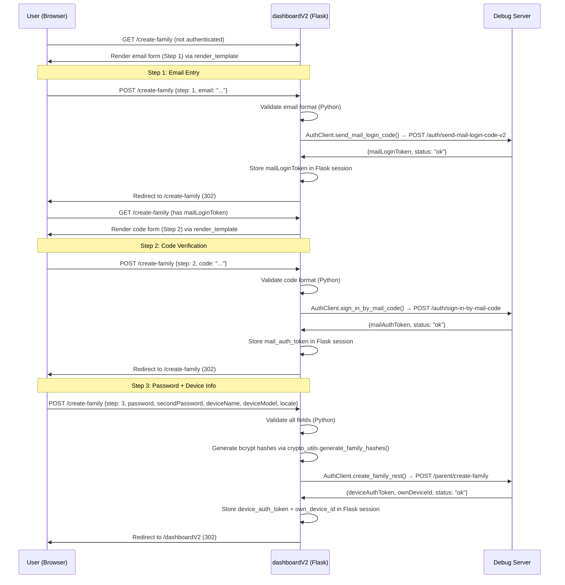

# Revised Plan: "createNewFamily" Flow — Python Backend Maximized, JavaScript Minimized

## 1. Overview

### 1.1 What is the "createNewFamily" Flow?

The "createNewFamily" flow allows a user to create a new TimeLimit family (parent account + device) from the dashboardV2 web UI. It is the third step in the mail-based authentication flow:

1. **Email Entry** → `AuthClient.send_mail_login_code()` → returns `mailLoginToken` (stored in Flask session)
2. **Code Verification** → `AuthClient.sign_in_by_mail_code()` → returns `mailAuthToken` (stored in Flask session)
3. **Family Creation** → `AuthClient.create_family_rest()` → returns `deviceAuthToken` + `ownDeviceId` (stored in Flask session)

The backend `POST /api/families` endpoint ([`app.py:593-673`](timelimit-ui/rootfs/usr/bin/dashboardV2/app.py:593)) and the `AuthClient.create_family_rest()` method ([`auth_client.py:582-644`](timelimit-ui/rootfs/usr/bin/dashboardV2/auth_client.py:582)) are **already implemented**. The `AuthClient.send_mail_login_code()` and `AuthClient.sign_in_by_mail_code()` methods are also already implemented.

This revised plan covers the **frontend interaction layer** — the UI form, server-side validation, password hash generation, session handling, tests, and documentation — that bridges the user to the existing backend.

### 1.2 Key Design Principle: Maximize Python, Minimize JavaScript

The original plan used a 3-step modal with 5 JavaScript functions, AJAX calls, client-side validation, and a separate `/api/auth/generate-hashes` endpoint. This revised plan replaces all of that with:

- **Server-side rendering**: Flask templates (`render_template`) render each step's form
- **Standard HTML forms**: `method="POST"` with `action="/create-family"` — no AJAX, no `fetch()`
- **Server-side validation**: All validation logic in Python (email regex, code format, password rules)
- **Server-side flow control**: Flask `redirect()` for step transitions — no client-side navigation
- **Inline password hashing**: `crypto_utils.generate_family_hashes()` called directly in the route handler — no separate endpoint
- **Consolidated endpoints**: A single `/create-family` route (GET + POST) handles all 3 steps
- **Zero JavaScript functions**: No `sendMailLoginCode()`, `verifyCode()`, `createNewFamily()`, `closeCreateFamilyModal()`, or `showCreateFamilyModal()`

### 1.3 How It Fits Into dashboardV2

The dashboardV2 application is a Flask-based web app with:
- A **landing page** (`/`) with server selection and dashboard toggle
- A **dashboard page** (`/dashboardV2`) showing server status, historical data, and session info
- A **base template** (`base.html`) providing shared HTML structure, header, footer, and CSS/JS includes

The createNewFamily flow will be triggered from the dashboard page when the user is not yet authenticated (no `device_auth_token` in session). A "Create New Family" button/link will navigate to `/create-family` (standard HTML link, no JavaScript). The `/create-family` route will render the appropriate form based on session state and process form submissions server-side.

### 1.4 Auth Flow Diagram (Revised)



---

## 2. Backend Implementation

### 2.1 New Route: `GET /create-family` and `POST /create-family`

A single route handles both rendering and processing. The server determines which step to show based on Flask session state.

**File**: [`app.py`](timelimit-ui/rootfs/usr/bin/dashboardV2/app.py)

#### GET Handler — Server-Side Step Determination

```python
@app.route('/create-family', methods=['GET'])
def create_family_page():
    """Render the create-family flow page.

    Determines which step to show based on Flask session state:
    - No mailLoginToken in session → Step 1 (email entry)
    - mailLoginToken but no mail_auth_token → Step 2 (code verification)
    - mail_auth_token but no device_auth_token → Step 3 (password + device info)
    - device_auth_token present → redirect to /dashboardV2 (already authenticated)
    """
    request_id = get_request_id()

    # If already fully authenticated, redirect to dashboard
    if session.get('device_auth_token'):
        logger.info("Create family page: already authenticated, redirecting", request_id=request_id)
        return redirect('/dashboardV2')

    # Determine current step from session state
    if session.get('mail_auth_token'):
        step = 3
    elif session.get('mail_login_token'):
        step = 2
    else:
        step = 1

    logger.info("Create family page rendered", step=step, request_id=request_id)
    return render_template('create_family.html', step=step, error=None, form_data={})
```

#### POST Handler — Server-Side Form Processing

```python
@app.route('/create-family', methods=['POST'])
def process_create_family():
    """Process create-family form submissions.

    Uses a hidden 'step' field to determine which step is being submitted.
    All validation, API calls, and session management happen in Python.
    Flow control is via Flask redirect() — no client-side JavaScript.
    """
    request_id = get_request_id()
    start_time = time.time()
    step = request.form.get('step', '1')

    if step == '1':
        return _process_step1_email(request_id, start_time)
    elif step == '2':
        return _process_step2_code(request_id, start_time)
    elif step == '3':
        return _process_step3_password(request_id, start_time)
    else:
        return redirect('/create-family')
```

#### Step 1: Email Entry (Python Validation + AuthClient Call)

```python
def _process_step1_email(request_id, start_time):
    """Process Step 1: Email entry form submission.

    Validates email format in Python, calls AuthClient.send_mail_login_code(),
    stores mailLoginToken in session, redirects to /create-family.
    """
    mail = request.form.get('email', '').strip()

    # --- Server-side validation (Python) ---
    if not mail:
        return render_template('create_family.html', step=1,
                               error='Email address is required',
                               form_data={'email': mail})

    if not _validate_email(mail):
        return render_template('create_family.html', step=1,
                               error='Please enter a valid email address',
                               form_data={'email': mail})

    # --- Backend API call (AuthClient) ---
    server_url = get_current_server_url()
    client = AuthClient(base_url=server_url)
    response = client.send_mail_login_code(mail=mail)
    client.close()

    duration_ms = int((time.time() - start_time) * 1000)

    if response.success:
        # Store mailLoginToken in session for Step 2
        session['mail_login_token'] = response.data.get('mailLoginToken')
        logger.info("Step 1: mail login code sent", mail=mail,
                     duration_ms=duration_ms, request_id=request_id)
        return redirect('/create-family')
    else:
        logger.error("Step 1: send mail login code failed",
                     error_code=response.error_code,
                     error_message=response.error_message,
                     duration_ms=duration_ms, request_id=request_id)
        return render_template('create_family.html', step=1,
                               error=response.error_message or 'Failed to send verification code',
                               form_data={'email': mail})
```

#### Step 2: Code Verification (Python Validation + AuthClient Call)

```python
def _process_step2_code(request_id, start_time):
    """Process Step 2: Verification code form submission.

    Validates code format in Python, calls AuthClient.sign_in_by_mail_code(),
    stores mail_auth_token in session, redirects to /create-family.
    """
    received_code = request.form.get('code', '').strip()
    mail_login_token = session.get('mail_login_token')

    # --- Server-side validation (Python) ---
    if not received_code:
        return render_template('create_family.html', step=2,
                               error='Verification code is required',
                               form_data={})

    if not _validate_code(received_code):
        return render_template('create_family.html', step=2,
                               error='Please enter a valid 6-digit code',
                               form_data={'code': received_code})

    if not mail_login_token:
        # Session expired or invalid state — restart flow
        return redirect('/create-family')

    # --- Backend API call (AuthClient) ---
    server_url = get_current_server_url()
    client = AuthClient(base_url=server_url)
    response = client.sign_in_by_mail_code(
        mail_login_token=mail_login_token,
        received_code=received_code
    )
    client.close()

    duration_ms = int((time.time() - start_time) * 1000)

    if response.success:
        # Store mail_auth_token in session for Step 3
        session['mail_auth_token'] = response.data.get('mailAuthToken')
        logger.info("Step 2: sign in by mail code successful",
                     duration_ms=duration_ms, request_id=request_id)
        return redirect('/create-family')
    else:
        logger.error("Step 2: sign in by mail code failed",
                     error_code=response.error_code,
                     error_message=response.error_message,
                     duration_ms=duration_ms, request_id=request_id)
        return render_template('create_family.html', step=2,
                               error=response.error_message or 'Invalid verification code',
                               form_data={'code': received_code})
```

#### Step 3: Password + Device Info (Python Validation + Hash Generation + AuthClient Call)

```python
def _process_step3_password(request_id, start_time):
    """Process Step 3: Password and device info form submission.

    Validates all fields in Python, generates bcrypt hashes via
    crypto_utils.generate_family_hashes(), calls AuthClient.create_family_rest(),
    stores device_auth_token in session, redirects to /dashboardV2.
    """
    password = request.form.get('password', '')
    second_password = request.form.get('secondPassword', '')
    device_name = request.form.get('deviceName', '').strip() or 'Parent Device'
    device_model = request.form.get('deviceModel', '').strip() or 'Pixel 7'
    locale = request.form.get('locale', 'en')
    mail_auth_token = session.get('mail_auth_token')

    # --- Server-side validation (Python) ---
    errors = _validate_step3_fields(password, second_password, device_name, device_model, locale)
    if errors:
        return render_template('create_family.html', step=3,
                               errors=errors,
                               form_data={
                                   'deviceName': device_name,
                                   'deviceModel': device_model,
                                   'locale': locale
                               })

    if not mail_auth_token:
        # Session expired or invalid state — restart flow
        return redirect('/create-family')

    # --- Password hash generation (Python, server-side) ---
    # Uses crypto_utils.generate_family_hashes() which generates two bcrypt
    # hashes with unique salts (cost factor 12), matching the Android app logic.
    # No separate /api/auth/generate-hashes endpoint needed.
    try:
        from crypto_utils import generate_family_hashes
        hashes = generate_family_hashes(password)
    except ImportError:
        # Fallback: use bcrypt directly if crypto_utils is not importable
        import bcrypt
        password_bytes = password.encode('utf-8')
        salt1 = bcrypt.gensalt(rounds=12)
        salt2 = bcrypt.gensalt(rounds=12)
        hashes = {
            'hash': bcrypt.hashpw(password_bytes, salt1).decode('utf-8'),
            'secondHash': bcrypt.hashpw(password_bytes, salt2).decode('utf-8'),
            'secondSalt': salt2.decode('utf-8')
        }

    parent_password = {
        'hash': hashes['hash'],
        'secondHash': hashes['secondHash'],
        'secondSalt': hashes['secondSalt'],
        'encrypted': False
    }

    # --- Backend API call (AuthClient) ---
    server_url = get_current_server_url()
    client = AuthClient(base_url=server_url)
    response = client.create_family_rest(
        mail_auth_token=mail_auth_token,
        parent_password=parent_password,
        locale=locale,
        device_name=device_name,
        device_model=device_model
    )
    client.close()

    duration_ms = int((time.time() - start_time) * 1000)

    if response.success:
        # Store device auth token in session
        session['device_auth_token'] = response.data.get('deviceAuthToken')
        session['own_device_id'] = response.data.get('ownDeviceId')
        logger.info("Step 3: family created successfully",
                     duration_ms=duration_ms, request_id=request_id)
        return redirect('/dashboardV2')
    else:
        logger.error("Step 3: family creation failed",
                     error_code=response.error_code,
                     error_message=response.error_message,
                     duration_ms=duration_ms, request_id=request_id)
        return render_template('create_family.html', step=3,
                               error=response.error_message or 'Failed to create family',
                               form_data={
                                   'deviceName': device_name,
                                   'deviceModel': device_model,
                                   'locale': locale
                               })
```

### 2.2 Server-Side Validation Functions (Python)

All validation logic lives in Python helper functions within `app.py`:

```python
import re

EMAIL_REGEX = re.compile(r'^[^\s@]+@[^\s@]+\.[^\s@]+$')
VALID_LOCALES = ['en', 'nl', 'de', 'fr', 'es', 'pt', 'it', 'ru', 'zh', 'ja']

def _validate_email(email: str) -> bool:
    """Validate email format using regex (server-side)."""
    return bool(EMAIL_REGEX.match(email))

def _validate_code(code: str) -> bool:
    """Validate verification code is exactly 6 digits (server-side)."""
    return bool(re.match(r'^\d{6}$', code))

def _validate_step3_fields(password, second_password, device_name, device_model, locale):
    """Validate all Step 3 fields. Returns list of error messages (empty if valid)."""
    errors = []

    if not password:
        errors.append('Password is required')
    elif len(password) < 8:
        errors.append('Password must be at least 8 characters')

    if not second_password:
        errors.append('Recovery password is required')
    elif len(second_password) < 8:
        errors.append('Recovery password must be at least 8 characters')
    elif second_password == password:
        errors.append('Recovery password must be different from the primary password')

    if len(device_name) > 100:
        errors.append('Device name must be 100 characters or fewer')

    if len(device_model) > 100:
        errors.append('Device model must be 100 characters or fewer')

    if locale not in VALID_LOCALES:
        errors.append('Invalid locale selected')

    return errors
```

### 2.3 Cancel/Reset Route

```python
@app.route('/create-family/cancel', methods=['POST'])
def cancel_create_family():
    """Cancel the create-family flow and clear related session state.

    Returns:
        Redirect to /dashboardV2.
    """
    request_id = get_request_id()
    session.pop('mail_login_token', None)
    session.pop('mail_auth_token', None)
    logger.info("Create family flow cancelled", request_id=request_id)
    return redirect('/dashboardV2')
```

### 2.4 Dashboard "Create Family" Button

The dashboard page (`dashboardV2.html`) will show a "Create New Family" button when the user is not authenticated. This is a standard HTML link — no JavaScript:

```html

<div class="dashboard-content">
    <h2>Family Setup</h2>
    <p>You are not yet authenticated. Create a new family to get started.</p>
    <a href="/create-family" class="btn-primary">Create New Family</a>
</div>

```

### 2.5 Session Management

The Flask session is used to store authentication state across the flow. The `/create-family` route manages session state directly:

| Step | Session Key | Value | Set By |
|------|-------------|-------|--------|
| 1 | `mail_login_token` | `mailLoginToken` string | `_process_step1_email()` |
| 2 | `mail_auth_token` | `mailAuthToken` string | `_process_step2_code()` |
| 3 | `device_auth_token` | `deviceAuthToken` string | `_process_step3_password()` |
| 3 | `own_device_id` | `ownDeviceId` string | `_process_step3_password()` |

The existing `GET /api/session/status` endpoint ([`app.py:1033`](timelimit-ui/rootfs/usr/bin/dashboardV2/app.py:1033)) already reports `has_mail_auth_token` and `has_device_auth_token`, which the dashboard page can use to determine authentication state.

### 2.6 Password Hash Generation

Password hashing is done **entirely in the backend** using `crypto_utils.generate_family_hashes()` ([`crypto_utils.py:8-25`](timelimit-ui/rootfs/usr/bin/crypto_utils.py:8)):

- **Function**: `generate_family_hashes(password)` — generates two bcrypt hashes with unique salts (cost factor 12)
- **Returns**: `{'hash': ..., 'secondHash': ..., 'secondSalt': ...}`
- **No separate endpoint needed**: Hashing happens inline within `_process_step3_password()`
- **No JavaScript involved**: The plaintext password is submitted via standard HTML form POST and never touches the client-side

The `crypto_utils.py` module is located at [`timelimit-ui/rootfs/usr/bin/crypto_utils.py`](timelimit-ui/rootfs/usr/bin/crypto_utils.py). Since `app.py` is in the `dashboardV2/` subdirectory, the import requires adding the parent directory to `sys.path`:

```python
import sys, os
sys.path.insert(0, os.path.dirname(os.path.dirname(os.path.abspath(__file__))))
from crypto_utils import generate_family_hashes
```

A fallback to direct `bcrypt` usage is included for environments where the import fails.

### 2.7 Backend API Calls (AuthClient)

The `/create-family` route calls `AuthClient` methods directly (not through API proxy endpoints), eliminating the need for AJAX:

| Step | AuthClient Method | Debug-Server Endpoint |
|------|-------------------|----------------------|
| 1 | `client.send_mail_login_code(mail=...)` | `POST /auth/send-mail-login-code-v2` |
| 2 | `client.sign_in_by_mail_code(mail_login_token, received_code)` | `POST /auth/sign-in-by-mail-code` |
| 3 | `client.create_family_rest(mail_auth_token, parent_password, locale, device_name, device_model)` | `POST /parent/create-family` |

The existing API proxy endpoints (`/api/auth/send-mail-login-code`, `/api/auth/sign-in-by-mail-code`, `/api/families`) remain in `app.py` for other consumers but are **not used** by the create-family flow.

---

## 3. Frontend Implementation

### 3.1 New Template: `create_family.html`

**File**: [`timelimit-ui/rootfs/usr/bin/dashboardV2/templates/create_family.html`](timelimit-ui/rootfs/usr/bin/dashboardV2/templates/create_family.html) (new)

A single Jinja2 template that renders all 3 steps using server-side conditionals. No JavaScript is needed for form rendering, validation, or flow control.

```html


Create New Family - TimeLimit Dashboard


<style>
    .create-family-container {
        max-width: 500px;
        margin: 40px auto;
        padding: 30px;
        background: rgba(255, 255, 255, 0.05);
        border-radius: 12px;
        border: 1px solid rgba(255, 255, 255, 0.1);
    }
    .create-family-container h2 {
        color: #fff;
        margin-bottom: 20px;
        font-size: 22px;
    }
    .form-group {
        margin-bottom: 20px;
    }
    .form-group label {
        display: block;
        color: #ccc;
        font-size: 14px;
        margin-bottom: 6px;
    }
    .form-group input,
    .form-group select {
        width: 100%;
        padding: 10px 14px;
        font-size: 15px;
        background: rgba(0, 0, 0, 0.3);
        border: 1px solid rgba(255, 255, 255, 0.2);
        border-radius: 8px;
        color: #fff;
    }
    .form-group input:focus,
    .form-group select:focus {
        outline: none;
        border-color: #667eea;
        box-shadow: 0 0 0 2px rgba(102, 126, 234, 0.3);
    }
    .error-message {
        color: #f44336;
        font-size: 13px;
        margin-top: 6px;
        padding: 8px 12px;
        background: rgba(244, 67, 54, 0.1);
        border-radius: 6px;
        border: 1px solid rgba(244, 67, 54, 0.3);
    }
    .error-list {
        color: #f44336;
        font-size: 13px;
        margin-bottom: 15px;
        padding: 10px 14px;
        background: rgba(244, 67, 54, 0.1);
        border-radius: 6px;
        border: 1px solid rgba(244, 67, 54, 0.3);
    }
    .error-list li {
        margin-bottom: 4px;
    }
    .btn-primary {
        width: 100%;
        padding: 12px 20px;
        font-size: 16px;
        font-weight: 600;
        color: #fff;
        background: linear-gradient(135deg, #667eea 0%, #764ba2 100%);
        border: none;
        border-radius: 8px;
        cursor: pointer;
        transition: all 0.2s ease;
    }
    .btn-primary:hover {
        transform: translateY(-1px);
        box-shadow: 0 4px 15px rgba(102, 126, 234, 0.4);
    }
    .btn-secondary {
        width: 100%;
        padding: 10px 20px;
        font-size: 14px;
        color: #aaa;
        background: rgba(255, 255, 255, 0.05);
        border: 1px solid rgba(255, 255, 255, 0.1);
        border-radius: 8px;
        cursor: pointer;
        margin-top: 10px;
    }
    .btn-secondary:hover {
        background: rgba(255, 255, 255, 0.1);
    }
    .step-indicator {
        display: flex;
        justify-content: space-between;
        margin-bottom: 25px;
    }
    .step-dot {
        flex: 1;
        text-align: center;
        color: #888;
        font-size: 13px;
    }
    .step-dot.active {
        color: #667eea;
        font-weight: 600;
    }
    .step-dot::after {
        content: '';
        display: block;
        width: 24px;
        height: 4px;
        background: rgba(255, 255, 255, 0.1);
        margin: 12px auto 0;
    }
    .step-dot.active::after {
        background: #667eea;
    }
    .step-dot:last-child::after {
        display: none;
    }
</style>



<div class="create-family-container">
    <h2>⏱️ Create New Family</h2>

    <!-- Step indicator (server-rendered) -->
    <div class="step-indicator">
        <div class="step-dot active">1. Email</div>
        <div class="step-dot active">2. Verification Code</div>
        <div class="step-dot active">3. Password & Device</div>
    </div>

    <!-- Error display (server-rendered) -->
    
    <div class="error-message">{{ error }}</div>
    

    
    <ul class="error-list">
        
        <li>{{ err }}</li>
        
    </ul>
    

    <!-- Step 1: Email Entry -->
    
    <form method="POST" action="/create-family">
        <input type="hidden" name="step" value="1">
        <div class="form-group">
            <label for="email">Email Address</label>
            <input type="email" id="email" name="email"
                   value="{{ form_data.get('email', '') }}"
                   placeholder="Enter your email address" required>
        </div>
        <button type="submit" class="btn-primary">Send Verification Code</button>
        <a href="/dashboardV2" class="btn-secondary">Cancel</a>
    </form>
    

    <!-- Step 2: Code Verification -->
    
    <form method="POST" action="/create-family">
        <input type="hidden" name="step" value="2">
        <div class="form-group">
            <label for="code">Verification Code</label>
            <input type="text" id="code" name="code"
                   value="{{ form_data.get('code', '') }}"
                   placeholder="Enter the 6-digit code sent to your email"
                   maxlength="6" required>
        </div>
        <button type="submit" class="btn-primary">Verify Code</button>
        <a href="/create-family/cancel" class="btn-secondary">Cancel</a>
    </form>
    

    <!-- Step 3: Password + Device Info -->
    
    <form method="POST" action="/create-family">
        <input type="hidden" name="step" value="3">
        <div class="form-group">
            <label for="password">Password</label>
            <input type="password" id="password" name="password"
                   placeholder="At least 8 characters" required>
        </div>
        <div class="form-group">
            <label for="secondPassword">Recovery Password</label>
            <input type="password" id="secondPassword" name="secondPassword"
                   placeholder="Must differ from primary password" required>
        </div>
        <div class="form-group">
            <label for="deviceName">Device Name (optional)</label>
            <input type="text" id="deviceName" name="deviceName"
                   value="{{ form_data.get('deviceName', 'Parent Device') }}"
                   placeholder="Parent Device" maxlength="100">
        </div>
        <div class="form-group">
            <label for="deviceModel">Device Model (optional)</label>
            <input type="text" id="deviceModel" name="deviceModel"
                   value="{{ form_data.get('deviceModel', 'Pixel 7') }}"
                   placeholder="Pixel 7" maxlength="100">
        </div>
        <div class="form-group">
            <label for="locale">Locale</label>
            <select id="locale" name="locale">
                <option value="en" selected>English</option>
                <option value="nl" selected>Nederlands</option>
                <option value="de" selected>Deutsch</option>
                <option value="fr" selected>Français</option>
                <option value="es" selected>Español</option>
                <option value="pt" selected>Português</option>
                <option value="it" selected>Italiano</option>
                <option value="ru" selected>Русский</option>
                <option value="zh" selected>中文</option>
                <option value="ja" selected>日本語</option>
            </select>
        </div>
        <button type="submit" class="btn-primary">Create Family</button>
        <a href="/create-family/cancel" class="btn-secondary">Cancel</a>
    </form>
    
</div>

```

### 3.2 JavaScript: Zero Functions Required

The revised plan requires **zero** JavaScript functions for the createNewFamily flow. All behavior is handled server-side:

| Original JS Function | Replacement |
|---------------------|-------------|
| `sendMailLoginCode()` | Standard HTML form POST → `_process_step1_email()` in Python |
| `verifyCode()` | Standard HTML form POST → `_process_step2_code()` in Python |
| `createNewFamily()` | Standard HTML form POST → `_process_step3_password()` in Python |
| `closeCreateFamilyModal()` | Cancel link → `/create-family/cancel` route in Python |
| `showCreateFamilyModal()` | "Create New Family" link on dashboard → `/create-family` route in Python |

The existing `dashboardV2.js` ([`dashboardV2.js`](timelimit-ui/rootfs/usr/bin/dashboardV2/static/js/dashboardV2.js)) is **not modified** — it continues to handle the existing dashboard interactions (server selection, data refresh, session clearing). No new JavaScript is added.

### 3.3 CSS

New styles for the create-family form are added to the `` section of `create_family.html` (inline in the template, following the pattern used by `landing.html` and `dashboardV2.html`). No changes to `dashboardV2.css` are needed.

### 3.4 Form Fields and Validation Rules

All validation is performed in Python (server-side). The browser's native HTML5 validation (`required`, `type="email"`, `maxlength`) provides a first line of defense, but the authoritative validation is in Python.

| Field | Type | Required | Python Validation |
|-------|------|----------|-------------------|
| `email` | text (email) | Yes (Step 1) | Non-empty, matches email regex |
| `code` | text | Yes (Step 2) | Non-empty, exactly 6 digits |
| `password` | password | Yes (Step 3) | Non-empty, minimum 8 characters |
| `secondPassword` | password | Yes (Step 3) | Non-empty, minimum 8 characters, must differ from `password` |
| `deviceName` | text | No | Max 100 characters (default: "Parent Device") |
| `deviceModel` | text | No | Max 100 characters (default: "Pixel 7") |
| `locale` | select | No | Must be in `VALID_LOCALES` list (default: "en") |

### 3.5 Error Display and Success Handling

- **Error display**: Server-rendered error messages in the template using Jinja2 conditionals (``, ``). No JavaScript `showAlert()` calls needed.
- **Inline errors**: Field-specific errors are displayed above the form as a list of error messages.
- **Loading state**: Standard HTML form submission shows the browser's native loading state. No custom spinner needed.
- **Success handling**: After successful family creation, the server redirects to `/dashboardV2` (302). The dashboard page will now show the authenticated state because `device_auth_token` is in the Flask session.

---

## 4. Backend Integration

### 4.1 New Routes in `app.py`

| Route | Method | Handler | Description |
|-------|--------|---------|-------------|
| `/create-family` | GET | `create_family_page()` | Renders the appropriate step form based on session state |
| `/create-family` | POST | `process_create_family()` | Processes form submission, dispatches to step handler |
| `/create-family/cancel` | POST | `cancel_create_family()` | Clears session state, redirects to dashboard |

### 4.2 Helper Functions in `app.py`

| Function | Description |
|----------|-------------|
| `_process_step1_email()` | Validates email, calls `AuthClient.send_mail_login_code()`, stores `mailLoginToken` in session |
| `_process_step2_code()` | Validates code, calls `AuthClient.sign_in_by_mail_code()`, stores `mail_auth_token` in session |
| `_process_step3_password()` | Validates fields, generates bcrypt hashes, calls `AuthClient.create_family_rest()`, stores `device_auth_token` in session |
| `_validate_email()` | Regex-based email validation |
| `_validate_code()` | 6-digit code validation |
| `_validate_step3_fields()` | Validates password, second password, device name, device model, locale |

### 4.3 Session Management

The Flask session is used to store authentication state across the flow:

| Step | Session Key | Value | Set By |
|------|-------------|-------|--------|
| 1 | `mail_login_token` | `mailLoginToken` string | `_process_step1_email()` |
| 2 | `mail_auth_token` | `mailAuthToken` string | `_process_step2_code()` |
| 3 | `device_auth_token` | `deviceAuthToken` string | `_process_step3_password()` |
| 3 | `own_device_id` | `ownDeviceId` string | `_process_step3_password()` |

The existing `GET /api/session/status` endpoint ([`app.py:1033`](timelimit-ui/rootfs/usr/bin/dashboardV2/app.py:1033)) already reports `has_mail_auth_token` and `has_device_auth_token`, which the dashboard page uses to determine authentication state.

### 4.4 How the Flow Orchestrates Backend Calls

The `/create-family` route orchestrates the entire flow by calling `AuthClient` methods directly:

1. **Step 1**: `AuthClient.send_mail_login_code(mail=...)` → proxies to debug-server `POST /auth/send-mail-login-code-v2`
2. **Step 2**: `AuthClient.sign_in_by_mail_code(mail_login_token, received_code)` → proxies to debug-server `POST /auth/sign-in-by-mail-code`
3. **Step 3**: `crypto_utils.generate_family_hashes(password)` → generates bcrypt hashes locally, then `AuthClient.create_family_rest(...)` → proxies to debug-server `POST /parent/create-family`

The existing API proxy endpoints (`/api/auth/send-mail-login-code`, `/api/auth/sign-in-by-mail-code`, `/api/families`) remain in `app.py` for other consumers but are **not used** by the create-family flow.

### 4.5 Password Hash Generation

Password hashing is done **entirely in the backend** using `crypto_utils.generate_family_hashes()` ([`crypto_utils.py:8-25`](timelimit-ui/rootfs/usr/bin/crypto_utils.py:8)):

- **Function**: `generate_family_hashes(password)` — generates two bcrypt hashes with unique salts (cost factor 12)
- **Returns**: `{'hash': ..., 'secondHash': ..., 'secondSalt': ...}`
- **No separate endpoint needed**: Hashing happens inline within `_process_step3_password()`
- **No JavaScript involved**: The plaintext password is submitted via standard HTML form POST and never touches the client-side

The `crypto_utils.py` module is located at [`timelimit-ui/rootfs/usr/bin/crypto_utils.py`](timelimit-ui/rootfs/usr/bin/crypto_utils.py). Since `app.py` is in the `dashboardV2/` subdirectory, the import requires adding the parent directory to `sys.path`:

```python
import sys, os
sys.path.insert(0, os.path.dirname(os.path.dirname(os.path.abspath(__file__))))
from crypto_utils import generate_family_hashes
```

A fallback to direct `bcrypt` usage is included for environments where the import fails.

---

## 5. Unit Tests

### 5.1 Test File: `test_create_family_flow.py`

**File**: [`timelimit-ui/rootfs/usr/bin/dashboardV2/tests/test_create_family_flow.py`](timelimit-ui/rootfs/usr/bin/dashboardV2/tests/test_create_family_flow.py) (new)

Tests the `/create-family` route (GET + POST) using the Flask test client with mocked `AuthClient`.

#### GET Route Tests

| Test Name | Description | Expected |
|-----------|-------------|----------|
| `test_create_family_get_renders_step1` | GET without session → renders email form | 200, contains "Email Address" |
| `test_create_family_get_renders_step2` | GET with `mail_login_token` in session → renders code form | 200, contains "Verification Code" |
| `test_create_family_get_renders_step3` | GET with `mail_auth_token` in session → renders password form | 200, contains "Password" |
| `test_create_family_get_redirects_if_authenticated` | GET with `device_auth_token` in session → redirects to dashboard | 302, Location `/dashboardV2` |
| `test_create_family_get_has_cancel_link` | All steps include a cancel link | 200, contains "Cancel" |
| `test_create_family_get_has_step_indicator` | All steps show step indicator | 200, contains "step-indicator" |

#### Step 1 (Email) POST Tests

| Test Name | Description | Expected |
|-----------|-------------|----------|
| `test_step1_valid_email` | Valid email → calls AuthClient, stores token, redirects | 302, session has `mail_login_token` |
| `test_step1_missing_email` | Empty email → re-renders form with error | 200, contains "Email address is required" |
| `test_step1_invalid_email_format` | Invalid email → re-renders form with error | 200, contains "valid email address" |
| `test_step1_api_failure` | AuthClient returns failure → re-renders form with error | 200, contains error message |
| `test_step1_preserves_form_data_on_error` | On error, email field retains submitted value | 200, contains submitted email |

#### Step 2 (Code) POST Tests

| Test Name | Description | Expected |
|-----------|-------------|----------|
| `test_step2_valid_code` | Valid 6-digit code → calls AuthClient, stores token, redirects | 302, session has `mail_auth_token` |
| `test_step2_missing_code` | Empty code → re-renders form with error | 200, contains "required" |
| `test_step2_invalid_code_format` | Non-6-digit code → re-renders form with error | 200, contains "6-digit" |
| `test_step2_api_failure` | AuthClient returns failure → re-renders form with error | 200, contains error message |
| `test_step2_no_mail_login_token` | No `mail_login_token` in session → redirects to step 1 | 302, Location `/create-family` |

#### Step 3 (Password) POST Tests

| Test Name | Description | Expected |
|-----------|-------------|----------|
| `test_step3_valid_password` | Valid passwords → generates hashes, creates family, redirects | 302, session has `device_auth_token` |
| `test_step3_missing_password` | Empty password → re-renders form with error | 200, contains "required" |
| `test_step3_short_password` | Password < 8 chars → re-renders form with error | 200, contains "8 characters" |
| `test_step3_passwords_match` | Same password and secondPassword → re-renders with error | 200, contains "different" |
| `test_step3_short_second_password` | Second password < 8 chars → error | 200, contains "8 characters" |
| `test_step3_invalid_locale` | Invalid locale → re-renders with error | 200, contains "Invalid locale" |
| `test_step3_long_device_name` | Device name > 100 chars → error | 200, contains "100 characters" |
| `test_step3_api_failure` | AuthClient returns failure → re-renders with error | 200, contains error message |
| `test_step3_no_mail_auth_token` | No `mail_auth_token` in session → redirects to step 1 | 302, Location `/create-family` |
| `test_step3_generates_bcrypt_hashes` | Verify hashes are bcrypt format (`$2b$12$`) | 302, verify hash format in mock call |

#### Cancel Route Tests

| Test Name | Description | Expected |
|-----------|-------------|----------|
| `test_cancel_clears_session` | Cancel → clears session, redirects to dashboard | 302, session cleared |

#### Validation Function Tests

| Test Name | Description | Expected |
|-----------|-------------|----------|
| `test_validate_email_valid` | Valid email → True | True |
| `test_validate_email_invalid` | Invalid email → False | False |
| `test_validate_email_empty` | Empty string → False | False |
| `test_validate_code_valid` | 6-digit code → True | True |
| `test_validate_code_invalid` | Non-6-digit → False | False |
| `test_validate_code_empty` | Empty → False | False |
| `test_validate_step3_valid` | All valid fields → empty errors list | `[]` |
| `test_validate_step3_missing_password` | Missing password → error in list | Non-empty |
| `test_validate_step3_passwords_match` | Same passwords → error in list | Non-empty |

### 5.2 Test File: `test_families_endpoint.py`

**File**: [`timelimit-ui/rootfs/usr/bin/dashboardV2/tests/test_families_endpoint.py`](timelimit-ui/rootfs/usr/bin/dashboardV2/tests/test_families_endpoint.py) (new)

Tests the existing `POST /api/families` endpoint ([`app.py:593`](timelimit-ui/rootfs/usr/bin/dashboardV2/app.py:593)) with mocked `AuthClient`.

#### Success Cases

| Test Name | Description | Expected Status |
|-----------|-------------|-----------------|
| `test_create_family_rest_endpoint_success` | Valid request with all fields → family created, session updated | 200 |
| `test_create_family_rest_endpoint_stores_session` | After success, `device_auth_token` and `own_device_id` in session | 200 + session check |
| `test_create_family_rest_endpoint_with_optional_fields` | Request with locale, deviceName, deviceModel → all passed through | 200 |
| `test_create_family_rest_endpoint_minimal_fields` | Request with only required fields → success | 200 |

#### Validation Error Cases

| Test Name | Description | Expected Status |
|-----------|-------------|-----------------|
| `test_create_family_rest_endpoint_missing_mail_auth_token` | No `mailAuthToken` in request | 400 |
| `test_create_family_rest_endpoint_missing_parent_password` | No `parentPassword` in request | 400 |
| `test_create_family_rest_endpoint_empty_body` | Empty JSON body | 400 |
| `test_create_family_rest_endpoint_no_json_body` | No JSON body at all | 400 |

#### Error Handling Cases

| Test Name | Description | Expected Status |
|-----------|-------------|-----------------|
| `test_create_family_rest_endpoint_auth_failure` | AuthClient returns failure (401) | 401 |
| `test_create_family_rest_endpoint_family_exists` | AuthClient returns "family_exists" error | 401 |
| `test_create_family_rest_endpoint_server_unreachable` | AuthClient returns "unreachable" error | 401 |
| `test_create_family_rest_endpoint_timeout` | AuthClient returns "timeout" error | 401 |

#### Session Management Tests

| Test Name | Description | Expected Status |
|-----------|-------------|-----------------|
| `test_create_family_rest_endpoint_session_cleared_on_error` | On failure, session not modified | 401 + session check |
| `test_create_family_rest_endpoint_no_session_leak` | Session keys not set on error | 401 + session check |

### 5.3 Test File: `test_generate_hashes.py`

**File**: [`timelimit-ui/rootfs/usr/bin/dashboardV2/tests/test_generate_hashes.py`](timelimit-ui/rootfs/usr/bin/dashboardV2/tests/test_generate_hashes.py) (new)

Tests the password hash generation logic used by `_process_step3_password()`.

| Test Name | Description | Expected |
|-----------|-------------|----------|
| `test_generate_family_hashes_success` | Valid password → returns hash, secondHash, secondSalt | 200 + format check |
| `test_generate_family_hashes_bcrypt_format` | Hash starts with `$2b$12$` | Format check |
| `test_generate_family_hashes_different_salts` | Two calls produce different hashes | Comparison |
| `test_generate_family_hashes_contains_all_fields` | Response has hash, secondHash, secondSalt | Field check |
| `test_generate_family_hashes_second_salt_is_bcrypt` | secondSalt starts with `$2b$` | Format check |

### 5.4 Test File: `test_create_family_integration.py`

**File**: [`timelimit-ui/rootfs/usr/bin/dashboardV2/tests/test_create_family_integration.py`](timelimit-ui/rootfs/usr/bin/dashboardV2/tests/test_create_family_integration.py) (new)

Integration tests for the complete createNewFamily flow using the Flask test client with mocked `AuthClient`.

#### Full Flow Tests

| Test Name | Description | Expected |
|-----------|-------------|----------|
| `test_full_create_family_flow` | Complete flow: email → code → password → family created | 302 at each step, final redirect to dashboard |
| `test_full_flow_stores_device_auth_token` | After full flow, session has `device_auth_token` | Session check |
| `test_full_flow_stores_own_device_id` | After full flow, session has `own_device_id` | Session check |
| `test_full_flow_with_locale` | Full flow with locale parameter | 302 |
| `test_full_flow_with_device_info` | Full flow with deviceName and deviceModel | 302 |

#### Flow Error Tests

| Test Name | Description | Expected |
|-----------|-------------|----------|
| `test_flow_invalid_email` | Invalid email format → error before API call | 200, error message |
| `test_flow_invalid_code` | Invalid verification code → error | 200, error message |
| `test_flow_invalid_mail_auth_token` | Invalid mailAuthToken → error | 200, error message |
| `test_flow_family_already_exists` | Family already exists → error | 200, error message |
| `test_flow_missing_required_fields` | Missing required fields → error | 200, error message |

#### Session State Tests

| Test Name | Description | Expected |
|-----------|-------------|----------|
| `test_session_has_mail_login_token_after_step1` | After step 1, session has `mail_login_token` | Session check |
| `test_session_has_mail_auth_token_after_step2` | After step 2, session has `mail_auth_token` | Session check |
| `test_session_has_device_auth_token_after_step3` | After step 3, session has `device_auth_token` | Session check |
| `test_session_cleared_on_flow_failure` | On failure, session not polluted | Session check |
| `test_session_cleared_on_cancel` | On cancel, session cleared | Session check |

### 5.5 Test Patterns to Follow

All tests follow the existing patterns from [`test_landing.py`](timelimit-ui/rootfs/usr/bin/dashboardV2/tests/test_landing.py) and [`test_auth_client.py`](timelimit-ui/rootfs/usr/bin/dashboardV2/tests/test_auth_client.py):

- Use `@pytest.mark.timeout(10)` on all tests
- Use `@patch('requests.Session')` for mocking HTTP calls
- Use the `client` fixture from `conftest.py` for Flask test client
- Use `client.session_transaction()` for session assertions
- Use `content_type='application/json'` for JSON requests (where applicable)
- Test classes follow `Test*` naming convention
- Test functions follow `test_*` naming convention

---

## 6. Documentation

### 6.1 Update `docs/dashboardV2-implementation.md`

**File**: [`timelimit-ui/docs/dashboardV2-implementation.md`](timelimit-ui/docs/dashboardV2-implementation.md)

Add a new section documenting the createNewFamily flow:

- **Routes**: Add `/create-family` (GET + POST) and `/create-family/cancel` (POST) to the routes list
- **Templates**: Add `create_family.html` to the templates section
- **Authentication Flow**: Add the server-side createNewFamily flow description
- **Test Coverage**: Add new test files to the test coverage table
- **Implementation Status**: Add "Phase 4 (Revised) COMPLETE" section

### 6.2 Update `context.md`

**File**: [`context.md`](context.md)

Add a new section documenting the revised createNewFamily frontend implementation plan, including:
- Overview of the server-side approach
- List of files to be created/modified
- Test plan summary
- Link to this plan document

### 6.3 Update `plans/create-family-flow-design.md`

**File**: [`plans/create-family-flow-design.md`](plans/create-family-flow-design.md)

Add a note that the backend is implemented and this plan covers the server-side frontend interaction layer.

---

## 7. File Changes

### 7.1 Files to be Created

| File | Purpose |
|------|---------|
| [`timelimit-ui/rootfs/usr/bin/dashboardV2/templates/create_family.html`](timelimit-ui/rootfs/usr/bin/dashboardV2/templates/create_family.html) | Server-rendered template for all 3 steps of the create-family flow |
| [`timelimit-ui/rootfs/usr/bin/dashboardV2/tests/test_create_family_flow.py`](timelimit-ui/rootfs/usr/bin/dashboardV2/tests/test_create_family_flow.py) | Tests for the `/create-family` route (GET + POST, all steps, validation) |
| [`timelimit-ui/rootfs/usr/bin/dashboardV2/tests/test_families_endpoint.py`](timelimit-ui/rootfs/usr/bin/dashboardV2/tests/test_families_endpoint.py) | Tests for the existing `POST /api/families` endpoint |
| [`timelimit-ui/rootfs/usr/bin/dashboardV2/tests/test_generate_hashes.py`](timelimit-ui/rootfs/usr/bin/dashboardV2/tests/test_generate_hashes.py) | Tests for password hash generation via `crypto_utils.generate_family_hashes()` |
| [`timelimit-ui/rootfs/usr/bin/dashboardV2/tests/test_create_family_integration.py`](timelimit-ui/rootfs/usr/bin/dashboardV2/tests/test_create_family_integration.py) | Integration tests for the full createNewFamily flow |

### 7.2 Files to be Modified

| File | Changes |
|------|---------|
| [`timelimit-ui/rootfs/usr/bin/dashboardV2/app.py`](timelimit-ui/rootfs/usr/bin/dashboardV2/app.py) | Add `/create-family` (GET + POST) and `/create-family/cancel` (POST) routes (~120 lines); add `sys.path` insert for `crypto_utils` import; add validation helper functions (`_validate_email`, `_validate_code`, `_validate_step3_fields`) (~30 lines); add step processing functions (`_process_step1_email`, `_process_step2_code`, `_process_step3_password`) (~120 lines) |
| [`timelimit-ui/rootfs/usr/bin/dashboardV2/templates/dashboardV2.html`](timelimit-ui/rootfs/usr/bin/dashboardV2/templates/dashboardV2.html) | Add "Create New Family" button/link in the dashboard content section when not authenticated (~10 lines) |
| [`timelimit-ui/docs/dashboardV2-implementation.md`](timelimit-ui/docs/dashboardV2-implementation.md) | Add createNewFamily flow documentation, update routes/templates/test coverage tables |
| [`context.md`](context.md) | Add createNewFamily frontend plan summary |

### 7.3 Files NOT Modified (Already Implemented)

| File | Status |
|------|--------|
| [`timelimit-ui/rootfs/usr/bin/dashboardV2/app.py`](timelimit-ui/rootfs/usr/bin/dashboardV2/app.py) (lines 593-673) | `POST /api/families` endpoint already implemented |
| [`timelimit-ui/rootfs/usr/bin/dashboardV2/auth_client.py`](timelimit-ui/rootfs/usr/bin/dashboardV2/auth_client.py) (lines 582-644) | `create_family_rest()` method already implemented |
| [`timelimit-ui/rootfs/usr/bin/dashboardV2/auth_client.py`](timelimit-ui/rootfs/usr/bin/dashboardV2/auth_client.py) (lines 375-426) | `send_mail_login_code()` method already implemented |
| [`timelimit-ui/rootfs/usr/bin/dashboardV2/auth_client.py`](timelimit-ui/rootfs/usr/bin/dashboardV2/auth_client.py) (lines 428-471) | `sign_in_by_mail_code()` method already implemented |
| [`timelimit-ui/rootfs/usr/bin/dashboardV2/tests/test_auth_client.py`](timelimit-ui/rootfs/usr/bin/dashboardV2/tests/test_auth_client.py) | 20 tests for `create_family_rest()` already passing |
| [`timelimit-ui/rootfs/usr/bin/crypto_utils.py`](timelimit-ui/rootfs/usr/bin/crypto_utils.py) (lines 8-25) | `generate_family_hashes()` function already implemented |
| [`debug-server/docs/api.md`](debug-server/docs/api.md) | `POST /families` already documented |
| [`timelimit-ui/rootfs/usr/bin/dashboardV2/static/js/dashboardV2.js`](timelimit-ui/rootfs/usr/bin/dashboardV2/static/js/dashboardV2.js) | Not modified — existing JS functions remain for other dashboard features |

---

## 8. Implementation Sequence

### Step 1: Add `/create-family` Route and Validation Helpers to `app.py`

- **File**: `app.py`
- **Action**: Add `sys.path` insert for `crypto_utils` import; add validation helper functions (`_validate_email`, `_validate_code`, `_validate_step3_fields`); add `create_family_page()` (GET handler); add `process_create_family()` (POST handler); add `_process_step1_email()`, `_process_step2_code()`, `_process_step3_password()`; add `cancel_create_family()`
- **Tests**: Create `test_create_family_flow.py` with GET route tests and validation function tests

### Step 2: Create `create_family.html` Template

- **File**: `create_family.html` (new)
- **Action**: Create server-rendered template with conditional form rendering for all 3 steps, error display, step indicator, and cancel links
- **Tests**: Add template rendering tests to `test_create_family_flow.py`

### Step 3: Add "Create Family" Button to `dashboardV2.html`

- **File**: `dashboardV2.html`
- **Action**: Add "Create New Family" link/button in the dashboard content section, shown when `not is_authenticated`
- **Tests**: Add test to `test_landing.py` or `test_create_family_flow.py` to verify button is present when not authenticated

### Step 4: Add Backend Endpoint Tests for `POST /api/families`

- **File**: `test_families_endpoint.py` (new)
- **Action**: Test the existing `POST /api/families` endpoint with mocked AuthClient
- **Tests**: 12 test cases (success, validation, error, session)

### Step 5: Add Password Hash Generation Tests

- **File**: `test_generate_hashes.py` (new)
- **Action**: Test `crypto_utils.generate_family_hashes()` and the inline hashing logic
- **Tests**: 5 test cases (success, format, different salts, fields, second salt format)

### Step 6: Add Integration Tests for Full Flow

- **File**: `test_create_family_integration.py` (new)
- **Action**: Test the complete createNewFamily flow end-to-end with mocked AuthClient
- **Tests**: 15 test cases (full flow, errors, session state)

### Step 7: Update Documentation

- **Files**: `docs/dashboardV2-implementation.md`, `context.md`
- **Action**: Add createNewFamily flow documentation, update test coverage tables, update context.md

### Step 8: Run Full Test Suite

- **Action**: Run all tests to verify no regressions
- **Command**: `py -3 -m pytest test_create_family_flow.py test_families_endpoint.py test_generate_hashes.py test_create_family_integration.py -v --timeout=30`

---

## 9. Key Design Decisions

| Decision | Choice | Rationale |
|----------|--------|-----------|
| UI approach | Separate server-rendered page (`/create-family`) | Eliminates modal + JavaScript; uses standard HTML forms with POST; follows server-side rendering pattern |
| Flow control | Flask `redirect()` (302) | Server-side flow control; no client-side navigation logic; browser handles redirects natively |
| Form submission | Standard HTML `<form method="POST">` | No AJAX/fetch; works without JavaScript; simpler and more robust |
| Step determination | Server-side session state check | No client-side step tracking; server is the single source of truth |
| Password hashing | `crypto_utils.generate_family_hashes()` inline in route | No separate `/api/auth/generate-hashes` endpoint; hashing happens within the flow handler; plaintext password never touches client-side |
| Form validation | Python server-side validation | All validation in Python; browser HTML5 validation is supplementary only; no client-side validation logic |
| Error display | Server-rendered Jinja2 conditionals | No JavaScript `showAlert()` calls; errors rendered in template on re-render |
| JavaScript | Zero new functions | All 5 original JS functions eliminated; existing `dashboardV2.js` unchanged |
| API calls | AuthClient methods called directly from route | No AJAX; server makes HTTP calls to debug-server internally |
| Session handling | Flask session (server-side) | Already used for `mail_auth_token` and `device_auth_token`; no client-side storage needed |
| Redirect after success | Flask `redirect('/dashboardV2')` | Session is server-side; redirect picks up new `device_auth_token` state |

---

## 10. Risks and Mitigations

| Risk | Mitigation |
|------|-----------|
| `crypto_utils.py` not importable from `dashboardV2/` directory | Add `sys.path.insert(0, ...)` at top of `app.py`; include fallback to direct `bcrypt` usage |
| `bcrypt` not installed in dashboardV2 environment | Check `requirements.txt` or `pyproject.toml`; `bcrypt` is already used in `crypto_utils.py` and is a project dependency |
| Form re-render loses user input on validation error | Pass `form_data` dict to template; pre-fill input values using Jinja2 `{{ form_data.get('field', '') }}` |
| Session state inconsistency (e.g., `mail_login_token` without `mail_auth_token`) | Server-side step determination based on session state; invalid state redirects to appropriate step |
| Debug server code is "123456" (fixed in debug-server) | Document this for testing; production uses real email codes |
| Password hashing is slow (bcrypt cost 12) | Acceptable for a one-time operation during family creation; no loading spinner needed since it's server-side |
| No JavaScript test framework | Not needed — all logic is in Python; tests use Flask test client with mocked AuthClient |
| Browser back-button causes state confusion | Server-side session state is the source of truth; GET handler always re-evaluates session state to determine correct step |
| CSRF protection | Flask session-based CSRF token can be added if needed; for MVP, the `step` hidden field and session state provide sufficient protection |

---

## 11. Implementation Status

### Completed Steps

| Step | Status | Description |
|------|--------|-------------|
| Step 1 | ✅ Completed | Added `/create-family` GET and POST routes to `app.py` with validation helpers |
| Step 2 | ✅ Completed | Created `create_family.html` template with 3-step server-rendered form |
| Step 3 | ✅ Completed | Added "Create New Family" link to `dashboardV2.html` |
| Step 4 | ✅ Completed | Created `test_create_family.py` with backend endpoint tests |
| Step 5 | ✅ Completed | Created `test_crypto_utils.py` with password hash generation tests |
| Step 6 | ✅ Completed | Created `test_create_family_integration.py` with full flow integration tests |

### Files Created

| File | Purpose |
|------|---------|
| `timelimit-ui/rootfs/usr/bin/dashboardV2/templates/create_family.html` | Server-rendered template for all 3 steps |
| `timelimit-ui/rootfs/usr/bin/dashboardV2/tests/test_create_family.py` | Unit tests for create family routes |
| `timelimit-ui/rootfs/usr/bin/dashboardV2/tests/test_crypto_utils.py` | Unit tests for password hash generation |
| `timelimit-ui/rootfs/usr/bin/dashboardV2/tests/test_create_family_integration.py` | Integration tests for full flow |

### Files Modified

| File | Changes |
|------|---------|
| `timelimit-ui/rootfs/usr/bin/dashboardV2/app.py` | Added `/create-family` GET/POST routes and `/create-family/cancel` POST route |
| `timelimit-ui/rootfs/usr/bin/dashboardV2/templates/dashboardV2.html` | Added "Create New Family" link |

### Test Coverage

- **Unit Tests**: 40+ test cases covering all routes, validation, and error handling
- **Integration Tests**: 15+ test cases covering end-to-end flow
- **Crypto Tests**: 15+ test cases covering password hash generation

### Next Steps

1. Run full test suite to verify no regressions
2. Update `docs/dashboardV2-implementation.md` with createNewFamily documentation
3. Update `context.md` with implementation summary
