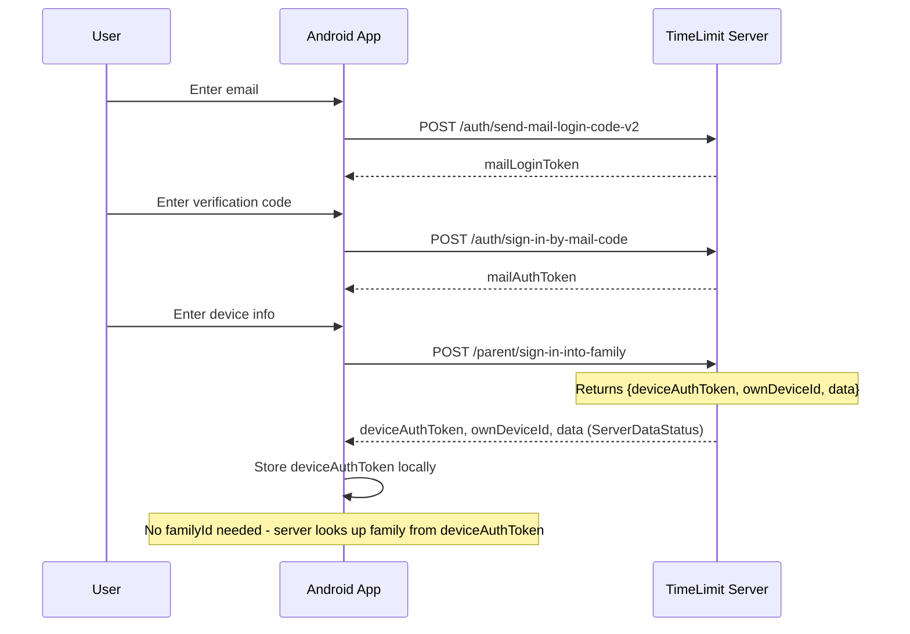
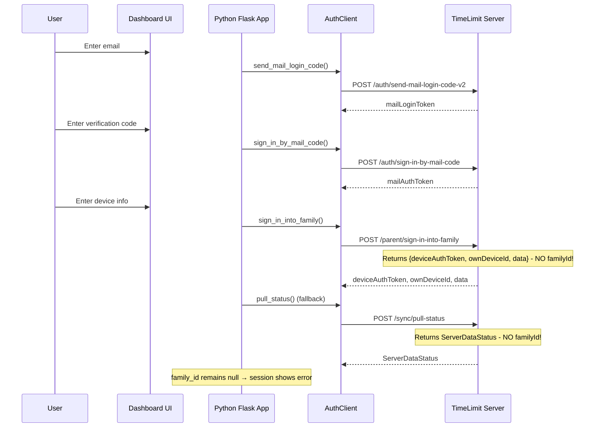
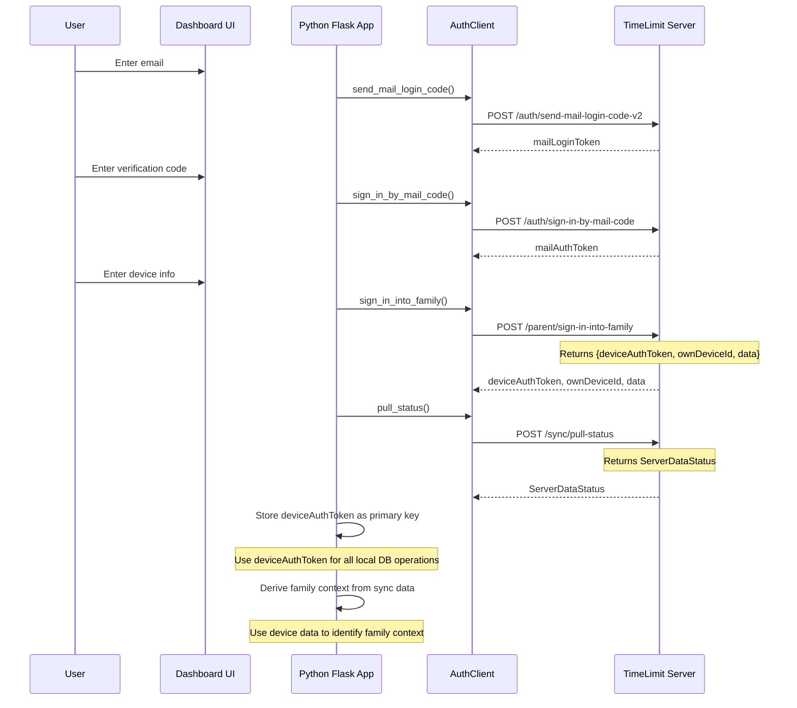

# Dashboard Application Update Plan: Match Official App Flow

## Executive Summary

This plan outlines how to update the dashboard application to match the flow of the official Android app **without requiring server-side changes**. The key insight is that the official app uses `deviceAuthToken` for all server communication and doesn't require `familyId` in responses. The dashboard must adopt the same approach.

## Problem Statement

After implementing the `pull_status` ClientDataStatus payload fix, signing in to the family still does not work. The session information on the dashboard is not updated and no error message is shown.

### Root Cause

The server's `sign-in-into-family` and `pull-status` endpoints do NOT include `familyId` in their JSON responses. The Python dashboard code expects `familyId` to be in the response, but the server doesn't provide it.

### Key Difference: Official App vs Dashboard

| Aspect | Official Android App | Python Dashboard |
|--------|---------------------|------------------|
| Authentication | Uses `deviceAuthToken` for all requests | Uses `deviceAuthToken` + needs `family_id` for local DB |
| Family ID | Not needed - server looks up family from device | Required - local DB queries use `family_id` |
| Response parsing | `ServerDataStatus` has no `familyId` field | Expects `familyId` in response |
| Data storage | No local DB keyed by family | SQLite tables keyed by `family_id` |

## Analysis Summary

### Official App Flow (Android)



### Current Dashboard Flow (Broken)



### Expected Dashboard Flow (Fixed - No Server Changes)



## Key Insight: The Official App Doesn't Need familyId

The official Android app works without `familyId` because:

1. **Authentication**: Uses `deviceAuthToken` for all server requests
2. **Server Lookup**: Server looks up family from device entry using `deviceAuthToken`
3. **No Local DB**: No local database queries that need `family_id`

The dashboard must adopt the same approach:
- Use `deviceAuthToken` as the primary key for all operations
- Change database schema to use `deviceAuthToken` instead of `family_id`
- Update all queries to use `deviceAuthToken`

## Sequential Implementation Steps

### Step 1: Update Database Schema

**File:** `timelimit-ui/rootfs/usr/bin/dashboardV2/database.py`

**Action:** Modify `init_db()` function to change table schemas from using `family_id` to `device_auth_token`.

**Detailed Changes:**

1. **Update `auth_tokens` table** - Add `device_auth_token` column:
```python
cursor.execute('''
    CREATE TABLE IF NOT EXISTS auth_tokens (
        id INTEGER PRIMARY KEY AUTOINCREMENT,
        token_type TEXT NOT NULL,
        token_value TEXT NOT NULL UNIQUE,
        device_id TEXT,
        device_auth_token TEXT,  -- NEW: Use this as primary identifier
        mail TEXT,
        code TEXT,
        created_at TEXT NOT NULL,
        expires_at TEXT
    )
''')
```

2. **Update `users` table** - Change `family_id` to `device_auth_token`:
```python
cursor.execute('''
    CREATE TABLE IF NOT EXISTS users (
        id TEXT PRIMARY KEY,
        device_auth_token TEXT NOT NULL,  -- Changed from family_id
        user_id TEXT,
        name TEXT,
        created_at TEXT NOT NULL,
        FOREIGN KEY (device_auth_token) REFERENCES auth_tokens(token_value)
    )
''')
```

3. **Update `devices` table** - Change `family_id` to `device_auth_token`:
```python
cursor.execute('''
    CREATE TABLE IF NOT EXISTS devices (
        id TEXT PRIMARY KEY,
        device_auth_token TEXT NOT NULL,  -- Changed from family_id
        device_id TEXT,
        name TEXT,
        model TEXT,
        created_at TEXT NOT NULL,
        current_user_id TEXT,
        current_protection_level INTEGER DEFAULT 0,
        highest_protection_level INTEGER DEFAULT 0,
        current_app_version TEXT,
        highest_app_version TEXT,
        public_key TEXT,
        platform_type TEXT,
        platform_level INTEGER DEFAULT 0
    )
''')
```

4. **Update `sync_state` table** - Change primary key:
```python
cursor.execute('''
    CREATE TABLE IF NOT EXISTS sync_state (
        device_auth_token TEXT PRIMARY KEY,  -- Changed from family_id
        device_list_version TEXT,
        user_list_version TEXT,
        last_sync_timestamp TEXT,
        last_sync_success INTEGER
    )
''')
```

5. **Update `categories` table** - Change `family_id` to `device_auth_token`:
```python
cursor.execute('''
    CREATE TABLE IF NOT EXISTS categories (
        id TEXT PRIMARY KEY,
        device_auth_token TEXT NOT NULL,  -- Changed from family_id
        category_id TEXT,
        name TEXT,
        created_at TEXT NOT NULL
    )
''')
```

6. **Update `connected_devices` table** - Change `family_id` to `device_auth_token`:
```python
cursor.execute('''
    CREATE TABLE IF NOT EXISTS connected_devices (
        id INTEGER PRIMARY KEY AUTOINCREMENT,
        device_auth_token TEXT NOT NULL,  -- Changed from family_id
        device_id TEXT,
        created_at TEXT NOT NULL
    )
''')
```

**Verification:** Run database initialization and verify schema changes.

---

### Step 2: Update Database CRUD Functions

**File:** `timelimit-ui/rootfs/usr/bin/dashboardV2/database.py`

**Action:** Update all database functions to use `device_auth_token` instead of `family_id`.

**Detailed Changes:**

1. **Update `save_user()` function:**
```python
def save_user(db: Database, device_auth_token: str, user_data: Dict[str, Any]) -> None:
    """Save user data to database."""
    with db._lock:
        conn = db.get_connection()
        cursor = conn.cursor()
        
        cursor.execute('''
            INSERT OR REPLACE INTO users
            (id, device_auth_token, user_id, name, created_at)
            VALUES (?, ?, ?, ?, ?)
        ''', (
            user_data.get('userId'),
            device_auth_token,  # Changed from family_id
            user_data.get('userId'),
            user_data.get('name'),
            datetime.now(timezone.utc).isoformat()
        ))
        
        conn.commit()
```

2. **Rename `get_users_by_family()` to `get_users_by_device()`:**
```python
def get_users_by_device(db: Database, device_auth_token: str) -> List[Dict[str, Any]]:
    """Get users for a device."""
    with db._lock:
        conn = db.get_connection()
        cursor = conn.cursor()
        
        cursor.execute('SELECT * FROM users WHERE device_auth_token = ?', (device_auth_token,))
        return [dict(row) for row in cursor.fetchall()]
```

3. **Similar changes for all other functions:**
   - `save_device()` - change parameter from `family_id` to `device_auth_token`
   - `get_devices_by_family()` → `get_devices_by_device()`
   - `save_categories()` - change parameter from `family_id` to `device_auth_token`
   - `get_categories_by_family()` → `get_categories_by_device()`
   - `save_connected_devices()` - change parameter from `family_id` to `device_auth_token`
   - `get_connected_devices()` - change parameter from `family_id` to `device_auth_token`
   - `save_sync_state()` - change parameter from `family_id` to `device_auth_token`
   - `get_sync_state()` - change parameter from `family_id` to `device_auth_token`
   - `store_auth_token()` - change parameter from `family_id` to `device_auth_token`

**Verification:** Run database unit tests.

---

### Step 3: Update AuthClient Methods

**File:** `timelimit-ui/rootfs/usr/bin/dashboardV2/auth_client.py`

**Action:** Update `sign_in_into_family()` and `create_family()` methods to work with server's response format (no `familyId`).

**Detailed Changes:**

1. **Update `sign_in_into_family()` method** - Remove `familyId` extraction logic:
```python
def sign_in_into_family(
    self,
    mail_auth_token: str,
    parent_password_second_hash: Optional[str] = None,
    locale: Optional[str] = None,
    device_name: Optional[str] = None,
    device_model: Optional[str] = None,
    client_level: Optional[int] = None
) -> APIResponse:
    """Sign in to an existing family.
    
    Args:
        mail_auth_token: Mail auth token from sign-in.
        parent_password_second_hash: Optional second password hash.
        locale: Optional locale string.
        device_name: Device name.
        device_model: Device model.
        client_level: Optional client level/version.
        
    Returns:
        APIResponse with deviceAuthToken, ownDeviceId, and data.
    """
    request_id = get_request_id()
    
    data = {
        'mailAuthToken': mail_auth_token,
        'parentDevice': {'model': device_model} if device_model else {'model': 'Unknown'},
        'deviceName': device_name or 'Unknown Device'
    }
    
    if parent_password_second_hash:
        data['parentPasswordSecondHash'] = parent_password_second_hash
    
    if client_level:
        data['clientLevel'] = client_level
    
    logger.info(
        "Signing in to family",
        request_id=request_id,
        has_mail_auth_token=True
    )
    
    response = self._request_with_retry('POST', '/parent/sign-in-into-family', data)
    
    if response.success:
        logger.info(
            "Sign in to family successful",
            request_id=request_id,
            has_device_auth_token=bool(response.data.get('deviceAuthToken')) if isinstance(response.data, dict) else False
        )
    else:
        logger.warning(
            "Failed to sign in to family",
            request_id=request_id,
            error_code=response.error_code,
            error_message=response.error_message
        )
    
    return response
```

2. **Update `create_family()` method** - Similar changes.

**Verification:** Run auth_client tests.

---

### Step 4: Update Session Management Routes

**File:** `timelimit-ui/rootfs/usr/bin/dashboardV2/app.py`

**Action:** Update `post_login_as_parent()` and `post_create_family()` routes to use `device_auth_token` instead of `family_id`.

**Detailed Changes:**

1. **In `post_login_as_parent()` step 3:**
```python
elif step == '3':
    # Step 3: Sign in to family
    mail_auth_token = session.get('mail_auth_token')
    device_model = request.form.get('deviceModel', '').strip()
    device_name = request.form.get('deviceName', '').strip()
    
    # ... validation code ...
    
    client = AuthClient(base_url=server_url)
    response = client.sign_in_into_family(
        mail_auth_token=mail_auth_token,
        device_name=device_name,
        device_model=device_model,
        client_level=7
    )
    
    if response.success:
        device_auth_token = response.data.get('deviceAuthToken')
        own_device_id = response.data.get('ownDeviceId')
        
        if device_auth_token:
            # Store device_auth_token in session (primary key)
            session['device_auth_token'] = device_auth_token
            session['own_device_id'] = own_device_id
            
            # Clear any previous login error
            session.pop('login_error', None)
            
            # Store auth token in database
            db = get_database()
            store_auth_token(
                db=db,
                token_type='device_auth_token',
                token_value=device_auth_token,
                device_id=own_device_id
            )
            logger.info("Auth token stored in database", request_id=request_id)
            
            # Perform initial sync to populate local database
            sync_response = client.pull_status(device_auth_token)
            if sync_response.success:
                sync_manager = create_sync_manager(db)
                sync_manager.do_sync(device_auth_token, server_url)
                logger.info("Initial sync completed", request_id=request_id)
            
            duration_ms = int((time.time() - start_time) * 1000)
            logger.info("Login as parent successful", server_url=server_url, duration_ms=duration_ms, request_id=request_id)
            return redirect('/dashboardV2')
        else:
            session['login_error'] = 'Failed to get device auth token from server'
            logger.warning("No deviceAuthToken in response", request_id=request_id)
    else:
        session['login_as_parent_error'] = response.error_message or 'Failed to sign in to family'
        logger.error("Login as parent step 3 failed", server_url=server_url, error_code=response.error_code, request_id=request_id)
    
    return redirect('/login-as-parent')
```

2. **In `post_create_family()` step 3:** Similar changes.

**Verification:** Run login_as_parent and create_family tests.

---

### Step 5: Update SyncManager

**File:** `timelimit-ui/rootfs/usr/bin/dashboardV2/sync_manager.py`

**Action:** Update `SyncManager` class to use `device_auth_token` instead of `family_id`.

**Detailed Changes:**

1. **Update `do_sync()` method:**
```python
def do_sync(
    self,
    device_auth_token: str,  # Changed from family_id
    server_url: str
) -> bool:
    """Execute one sync round: pull status, apply to database."""
    request_id = get_request_id()
    
    logger.info("Starting sync", request_id=request_id, server_url=server_url)
    
    try:
        client = AuthClient(base_url=server_url)
        
        # Get current sync state from database
        sync_state = get_sync_state(self.db, device_auth_token)  # Changed
        client_status = self._build_client_data_status(sync_state)
        
        # Pull server status
        response = client.pull_status(device_auth_token, client_status)
        
        if not response.success:
            logger.warning("Sync failed: pull_status unsuccessful", request_id=request_id, error_code=response.error_code, error_message=response.error_message)
            client.close()
            return False
        
        # Apply server data to database
        self._apply_server_data_status(response.data, device_auth_token)  # Changed
        
        # Update sync state
        self._update_sync_state(response.data, device_auth_token)  # Changed
        
        # Close client
        client.close()
        
        # Broadcast SSE event
        self._broadcast_sync_complete(device_auth_token, response.data)  # Changed
        
        logger.info("Sync completed successfully", request_id=request_id)
        return True
        
    except Exception as e:
        logger.error("Sync error", request_id=request_id, error=str(e), error_code="sync_error")
        return False
```

2. **Update `_apply_server_data_status()` method:**
```python
def _apply_server_data_status(
    self,
    server_data: Dict[str, Any],
    device_auth_token: str  # Changed from family_id
) -> None:
    """Apply ServerDataStatus to local database."""
    request_id = get_request_id()
    
    # Store devices
    if 'devices' in server_data and 'data' in server_data['devices']:
        devices = server_data['devices']['data']
        for device in devices:
            self._save_device_from_server(device, device_auth_token)  # Changed
        logger.debug("Devices applied from sync", request_id=request_id, count=len(devices))
    
    # Store users
    if 'users' in server_data and 'data' in server_data['users']:
        users = server_data['users']['data']
        save_users(self.db, device_auth_token, users)  # Changed
        logger.debug("Users applied from sync", request_id=request_id, count=len(users))
    
    # Store categories
    if 'categoryBase' in server_data:
        categories = server_data['categoryBase']
        save_categories(self.db, device_auth_token, categories)  # Changed
        logger.debug("Categories applied from sync", request_id=request_id, count=len(categories))
    
    # Store connected devices
    if 'pings' in server_data:
        pings = server_data['pings']
        device_ids = [p.get('deviceId') for p in pings if p.get('deviceId')]
        save_connected_devices(self.db, device_auth_token, device_ids)  # Changed
        logger.debug("Connected devices applied from sync", request_id=request_id, count=len(device_ids))
```

3. **Update `_save_device_from_server()` method:**
```python
def _save_device_from_server(
    self,
    device_data: Dict[str, Any],
    device_auth_token: str  # Changed from family_id
) -> None:
    """Save a device from server data to the database."""
    from database import create_device
    
    create_device(
        db=self.db,
        device_id=device_data.get('deviceId'),
        device_auth_token=device_auth_token,  # Changed
        name=device_data.get('name'),
        model=device_data.get('model'),
        current_user_id=device_data.get('currentUserId'),
        current_protection_level=device_data.get('currentProtectionLevel', 0),
        highest_protection_level=device_data.get('highestProtectionLevel', 0),
        current_app_version=str(device_data.get('currentAppVersion', 0)),
        highest_app_version=str(device_data.get('highestAppVersion', 0)),
        public_key=device_data.get('publicKey'),
        platform_type=device_data.get('platformType'),
        platform_level=device_data.get('platformLevel', 0)
    )
```

**Verification:** Run sync_manager tests.

---

### Step 6: Update Session Status Endpoint

**File:** `timelimit-ui/rootfs/usr/bin/dashboardV2/app.py`

**Action:** Update `session_status()` route to return `device_auth_token` instead of `family_id`.

**Detailed Changes:**

```python
@app.route('/api/session/status', methods=['GET'])
def session_status():
    """Get the current session status.
    
    Returns:
        JSON response with session status.
    """
    start_time = time.time()
    request_id = get_request_id()
    server_url = get_current_server_url()
    
    device_auth_token = session.get('device_auth_token')
    
    status = {
        'authenticated': bool(device_auth_token),
        'server_url': server_url,
        'has_mail_auth_token': 'mail_auth_token' in session,
        'has_device_auth_token': bool(device_auth_token),
        'device_auth_token': device_auth_token,  # Changed from family_id
        'own_device_id': session.get('own_device_id')
    }
    
    duration_ms = int((time.time() - start_time) * 1000)
    logger.info("Session status retrieved", duration_ms=duration_ms, request_id=request_id)
    
    return jsonify(status)
```

**Verification:** Run session status tests.

---

### Step 7: Update Dashboard API Routes

**File:** `timelimit-ui/rootfs/usr/bin/dashboardV2/app.py`

**Action:** Update all dashboard API routes to use `device_auth_token` instead of `family_id`.

**Detailed Changes:**

1. **Update `api_dashboard_users()` route:**
```python
@app.route('/api/dashboard/users', methods=['GET'])
def api_dashboard_users():
    """Get users for the current device.
    
    Returns:
        JSON response with users list.
    """
    try:
        device_auth_token = session.get('device_auth_token')
        
        if not device_auth_token:
            return jsonify({'status': 'error', 'error': 'Not authenticated'}), 401
        
        db = get_database()
        users = get_users_by_device(db, device_auth_token)  # Changed
        
        return jsonify({'status': 'ok', 'users': users})
    except Exception as e:
        logger.error("Failed to get dashboard users", error=str(e))
        return jsonify({'status': 'error', 'error': str(e)}), 500
```

2. **Similar updates for:**
   - `api_dashboard_devices()` - use `get_devices_by_device()`
   - `api_dashboard_categories()` - use `get_categories_by_device()`
   - `api_dashboard_connected_devices()` - use `get_connected_devices()`
   - `api_sync_pull()` - use `device_auth_token` from session

**Verification:** Run dashboard API tests.

---

### Step 8: Update Frontend JavaScript

**File:** `timelimit-ui/rootfs/usr/bin/dashboardV2/static/js/dashboardV2.js`

**Action:** Update JavaScript to display `device_auth_token` instead of `family_id`.

**Detailed Changes:**

1. **Update `updateSessionOverview()` function:**
```javascript
function updateSessionOverview() {
    fetch('/api/session/status')
        .then(response => response.json())
        .then(data => {
            // Update the session information display
            const deviceTokenElement = document.getElementById('device-token-value');
            if (deviceTokenElement) {
                if (data.device_auth_token) {
                    deviceTokenElement.textContent = data.device_auth_token.substring(0, 8) + '...';
                    deviceTokenElement.className = 'status-value success';
                } else {
                    deviceTokenElement.textContent = '-';
                    deviceTokenElement.className = 'status-value warning';
                }
            }
            
            const deviceIdElement = document.getElementById('device-id-value');
            if (deviceIdElement) {
                if (data.own_device_id) {
                    deviceIdElement.textContent = data.own_device_id;
                    deviceIdElement.className = 'status-value success';
                } else {
                    deviceIdElement.textContent = '-';
                    deviceIdElement.className = 'status-value warning';
                }
            }
            
            // Update authentication status
            const authStatusElement = document.getElementById('auth-status');
            if (authStatusElement) {
                if (data.authenticated) {
                    authStatusElement.textContent = 'Authenticated';
                    authStatusElement.className = 'status-value success';
                } else {
                    authStatusElement.textContent = 'Not authenticated';
                    authStatusElement.className = 'status-value warning';
                }
            }
        })
        .catch(error => {
            console.error('Failed to fetch session status:', error);
        });
}
```

2. **Update `loadUsers()`, `loadDevices()`, `loadCategories()` to check `device_auth_token` instead of `family_id`**

3. **Update `connectSSE()` to check `device_auth_token` instead of `family_id`**

4. **Update `triggerSync()` to check `device_auth_token` instead of `family_id`**

**Verification:** Manual testing of dashboard UI.

---

### Step 9: Update HTML Template

**File:** `timelimit-ui/rootfs/usr/bin/dashboardV2/templates/dashboardV2.html`

**Action:** Update HTML template to display `device_auth_token` instead of `family_id`.

**Detailed Changes:**

1. **Update session information section:**
```html
<!-- Family ID section -->
<div class="session-info-item">
    <label>Device Auth Token:</label>
    <span id="device-token-value" class="status-value">-</span>
</div>

<!-- Device ID section -->
<div class="session-info-item">
    <label>Device ID:</label>
    <span id="device-id-value" class="status-value">-</span>
</div>
```

2. **Update labels and placeholders accordingly**

**Verification:** Manual testing of dashboard UI.

---

### Step 10: Update Tests

**Files:** 
- `timelimit-ui/rootfs/usr/bin/dashboardV2/tests/test_login_as_parent.py`
- `timelimit-ui/rootfs/usr/bin/dashboardV2/tests/test_create_family.py`
- `timelimit-ui/rootfs/usr/bin/dashboardV2/tests/test_sync_manager.py`
- `timelimit-ui/rootfs/usr/bin/dashboardV2/tests/test_dashboard_api.py`
- `timelimit-ui/rootfs/usr/bin/dashboardV2/tests/test_database.py`

**Action:** Update all tests to work with `device_auth_token` instead of `family_id`.

**Detailed Changes:**

1. **Update mocks to return `device_auth_token` instead of `familyId`:**
```python
# Example from test_login_as_parent.py
def test_post_login_as_parent_step3_valid_device_info(self, client):
    with patch('app.AuthClient') as mock_auth_client_class:
        mock_client = MagicMock()
        mock_auth_client_class.return_value = mock_client
        
        # Mock sign_in_into_family response with device_auth_token
        mock_client.sign_in_into_family.return_value = APIResponse(
            success=True,
            data={
                'deviceAuthToken': 'test-device-auth-token',
                'ownDeviceId': 'test-device-id',
                'data': {
                    'fullVersion': 1788378680579,
                    'apiLevel': 8,
                    'devices': {'version': '1', 'data': []},
                    'users': {'version': '1', 'data': []},
                    'categories': {}
                }
            }
        )
        
        # ... rest of test
```

2. **Update test assertions to check `device_auth_token` instead of `family_id`**

3. **Update test data to use `device_auth_token` as primary key**

**Verification:** Run all tests.

---

### Step 11: Update Context Documentation

**File:** `timelimit-ui/context.md`

**Action:** Update the project context documentation to reflect the new approach.

**Detailed Changes:**

1. **Update Family ID Retrieval section:**
```markdown
## Family ID Retrieval

The dashboard no longer relies on `familyId` from server responses. Instead, it uses `deviceAuthToken` as the primary key for all local database operations, matching the official Android app's approach.

### New Approach

1. **Authentication**: Uses `deviceAuthToken` for all server requests
2. **Server Lookup**: Server looks up family from device entry using `deviceAuthToken`
3. **Local Storage**: SQLite tables keyed by `deviceAuthToken` instead of `familyId`
```

**Verification:** Review documentation.

---

### Step 12: Run Full Test Suite

**Action:** Run all tests to verify the implementation.

**Commands:**
```bash
cd timelimit-ui/rootfs/usr/bin/dashboardV2
py -3 -m pytest tests/ -v
```

**Verification:** All tests pass.

---

### Step 13: Manual Testing

**Action:** Perform manual testing of the complete flow.

**Test Cases:**
1. Create new family flow
2. Sign in to existing family flow
3. Dashboard displays correct session information
4. Users & Devices dashboard shows correct data
5. Sync works correctly

**Verification:** All test cases pass.

---

## Implementation Order

1. **Step 1:** Update Database Schema
2. **Step 2:** Update Database CRUD Functions
3. **Step 3:** Update AuthClient Methods
4. **Step 4:** Update Session Management Routes
5. **Step 5:** Update SyncManager
6. **Step 6:** Update Session Status Endpoint
7. **Step 7:** Update Dashboard API Routes
8. **Step 8:** Update Frontend JavaScript
9. **Step 9:** Update HTML Template
10. **Step 10:** Update Tests
11. **Step 11:** Update Context Documentation
12. **Step 12:** Run Full Test Suite
13. **Step 13:** Manual Testing

## Verification Checklist

After implementation, verify:

- [ ] Sign-in flow works correctly
- [ ] Create family flow works correctly
- [ ] `device_auth_token` is properly stored in session
- [ ] Dashboard API endpoints return correct data
- [ ] All tests pass
- [ ] Manual testing of complete flow

## Key Files to Modify

| File | Changes |
|------|---------|
| `database.py` | Change schema to use `device_auth_token` instead of `family_id` |
| `auth_client.py` | Update methods to work with server's response format |
| `app.py` | Update routes to use `device_auth_token` |
| `sync_manager.py` | Update to use `device_auth_token` |
| `tests/test_login_as_parent.py` | Update mocks |
| `tests/test_create_family.py` | Update mocks |
| `tests/test_sync_manager.py` | Update mocks |
| `tests/test_dashboard_api.py` | Update mocks |
| `tests/test_database.py` | Update mocks |
| `static/js/dashboardV2.js` | Update to display `device_auth_token` |
| `templates/dashboardV2.html` | Update to display `device_auth_token` |
| `context.md` | Update documentation |

## Notes

1. The official app's `ServerDataStatus.parse()` method uses `reader.skipValue()` for unknown fields, so adding `familyId` to the response won't break the Android app (but we're not adding it since we can't modify the server).

2. The dashboard will use `deviceAuthToken` as the primary key for all local database operations, matching the official app's approach.

3. The `clientLevel` should be set to 7 (matching Android app's `ClientDataStatus.CLIENT_LEVEL_VALUE`) for all sync requests.

4. This is a significant architectural change that requires careful testing to ensure data integrity.

5. **Migration Note:** Existing databases with `family_id` will need to be migrated or recreated. Consider adding a migration script or clearing the database on startup during development.