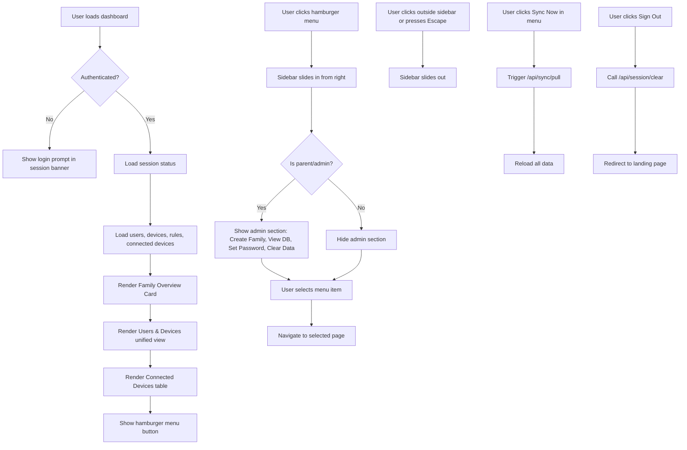
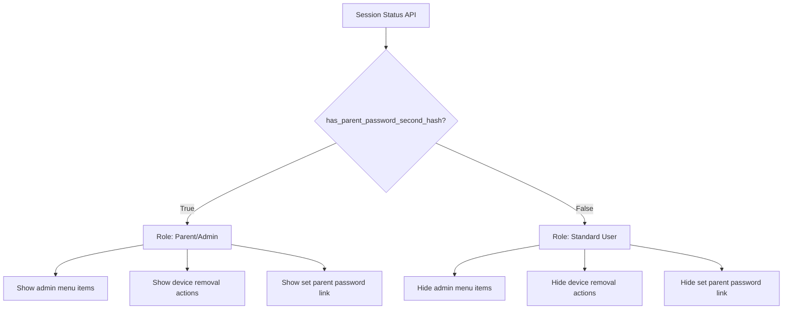
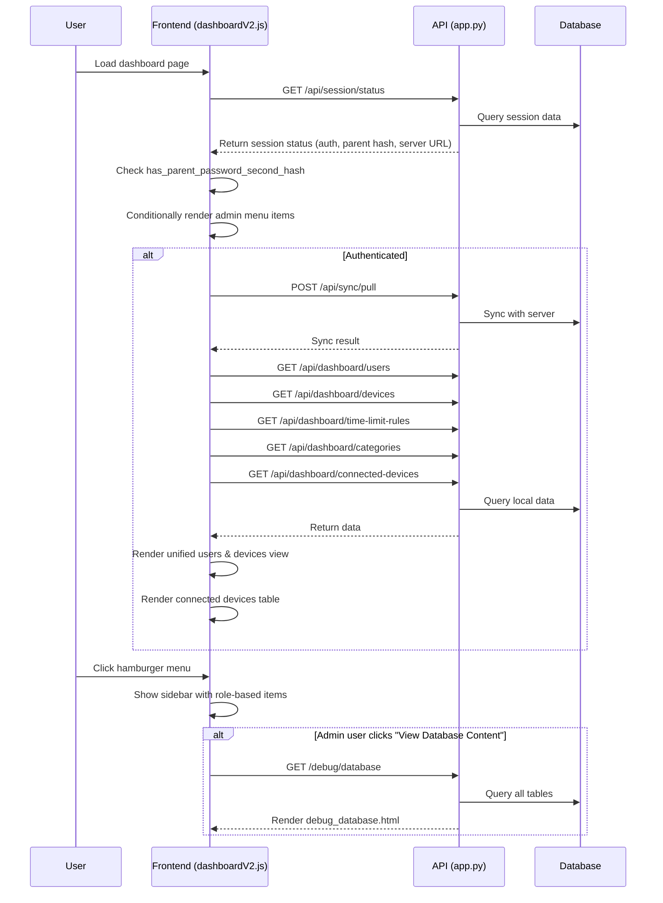
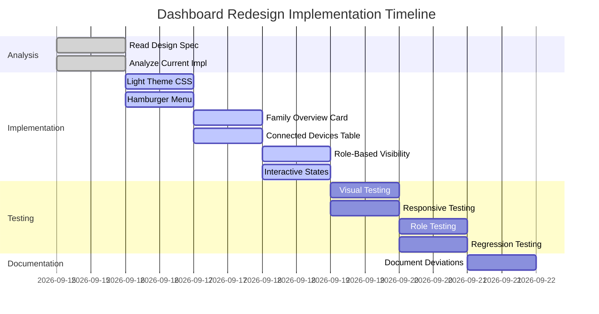

# Dashboard V2 Visual Redesign — Design Mockup & Specification

## 1. Overview

This document specifies the visual redesign of the TimeLimit Dashboard V2 interface. The redesign introduces a **light-themed, modern aesthetic** with a **hamburger menu** for navigation, a **unified central screen** for devices and users with their associated rules, and **role-based visibility** for administrative features.

### Key Design Goals

| Goal | Description |
|------|-------------|
| **Light Background** | Replace the current dark gradient with a clean, light color scheme |
| **Unified Central View** | Display devices, users, and their associated time-limit rules in a single organized layout |
| **Hamburger Menu** | Add a clearly visible hamburger icon in the top-right corner |
| **Role-Based Visibility** | Hide admin actions (Create New Family, View Database Content) from standard users |
| **Accessibility** | WCAG 2.1 AA compliance: color contrast, keyboard navigation, ARIA labels |
| **Responsive** | Mobile-first breakpoints at 768px and 480px |

---

## 2. Layout Structure

### Overall Page Layout

```
┌─────────────────────────────────────────────────────────────────────────┐
│  HEADER (fixed, full-width)                                            │
│  ┌───────────────────────────────────────────────────────────────────┐  │
│  │  ⏱️ TimeLimit Dashboard                           [☰ Menu]      │  │
│  │  Server: api.timelimit.io  •  v2.0.0                               │  │
│  └───────────────────────────────────────────────────────────────────┘  │
├─────────────────────────────────────────────────────────────────────────┤
│  MAIN CONTENT AREA                                                      │
│  ┌───────────────────────────────────────────────────────────────────┐  │
│  │  FAMILY OVERVIEW CARD                                              │  │
│  │  ┌──────────────┬──────────────┬──────────────┐                   │  │
│  │  │  Family:     │  Devices: 3  │  Users: 4    │                   │  │
│  │  │  parent@…    │              │              │                   │  │
│  │  └──────────────┴──────────────┴──────────────┘                   │  │
│  └───────────────────────────────────────────────────────────────────┘  │
│                                                                         │
│  ┌───────────────────────────────────────────────────────────────────┐  │
│  │  USERS & DEVICES (unified view)                                    │  │
│  │  ┌───────────────────────────────────────────────────────────────┐  │  │
│  │  │  USER CARD: "Alice" (👤 Parent)                               │  │  │
│  │  │  Email: alice@example.com  •  Time Zone: Europe/Amsterdam      │  │  │
│  │  │  Current Device: Living Room Tablet                            │  │  │
│  │  │  ┌───────────────────────────────────────────────────────────┐  │  │  │
│  │  │  │  ASSOCIATED RULES                                         │  │  │  │
│  │  │  │  • Games: 2h/day (Mon-Fri, 16:00-21:00)                   │  │  │  │
│  │  │  │  • Social: 1h/day (Every day, 08:00-22:00)                 │  │  │  │
│  │  │  └───────────────────────────────────────────────────────────┘  │  │  │
│  │  │  ┌───────────────────────────────────────────────────────────┐  │  │  │
│  │  │  │  ASSOCIATED DEVICES                                       │  │  │  │
│  │  │  │  • Living Room Tablet (Android v12, Owner)                 │  │  │  │
│  │  │  └───────────────────────────────────────────────────────────┘  │  │  │
│  │  └───────────────────────────────────────────────────────────────┘  │  │
│  │  ┌───────────────────────────────────────────────────────────────┐  │  │
│  │  │  USER CARD: "Bob" (👶 Child)                                  │  │  │
│  │  │  ...                                                           │  │  │
│  │  └───────────────────────────────────────────────────────────────┘  │  │
│  └───────────────────────────────────────────────────────────────────┘  │
│                                                                         │
│  ┌───────────────────────────────────────────────────────────────────┐  │
│  │  CONNECTED DEVICES                                                  │  │
│  │  ┌───────────────────────────────────────────────────────────────┐  │  │
│  │  │  Device Name         │ Last Seen                             │  │  │
│  │  │  Living Room Tablet  │ 2026-09-14 18:15                      │  │  │
│  │  │  Parent Phone        │ 2026-09-14 18:10                      │  │  │
│  │  └───────────────────────────────────────────────────────────────┘  │  │
│  │  └───────────────────────────────────────────────────────────────────┘  │
└─────────────────────────────────────────────────────────────────────────┘
│  FOOTER                                                                   │
│  Dashboard v2.0.0 • Last synced: 2 min ago                              │
└─────────────────────────────────────────────────────────────────────────┘
```

### Hamburger Menu Sidebar (slides in from right)

```
┌─────────────────────────────────────────────────────────────────────────┐
│  HEADER                                                                 │
│  ⏱️ TimeLimit Dashboard                           [☰ Menu]              │
├─────────────────────────────────────────────────────────────────────────┤
│  ┌───────────────────────────────────────────────────────────────────┐  │
│  │  [X] Close                                                        │  │
│  │                                                                   │  │
│  │  DASHBOARD                                                         │  │
│  │  • Overview                                                      │  │
│  │  • Users & Devices                                               │  │
│  │  • Time Limit Rules                                              │  │
│  │  • Connected Devices                                             │  │
│  │                                                                   │  │
│  │  SERVER                                                          │  │
│  │  • Server Status                                                 │  │
│  │  • Sync Now                                                      │  │
│  │                                                                   │  │
│  │  SESSION                                                         │  │
│  │  • Session Details                                               │  │
│  │  • Sign Out                                                      │  │
│  │                                                                   │  │
│  │  ─────────────────────────────────────────────────────────────   │  │
│  │  ADMINISTRATION  [visible only to parent/admin role]              │  │
│  │  • Create New Family                                             │  │
│  │  • View Database Content                                         │  │
│  │  • Set Parent Password                                           │  │
│  │  • Clear All Data                                                │  │
│  │  ─────────────────────────────────────────────────────────────   │  │
│  │                                                                   │  │
│  │  HELP                                                            │  │
│  │  • Documentation                                                 │  │
│  │  • Keyboard Shortcuts                                            │  │
│  └───────────────────────────────────────────────────────────────────┘  │
└─────────────────────────────────────────────────────────────────────────┘
```

---

## 3. Color Scheme

### Light Theme Palette

| Role | Variable | Hex | Usage |
|------|----------|-----|-------|
| **Background** | `--color-bg` | `#f5f7fa` | Page background |
| **Card Background** | `--color-card` | `#ffffff` | Content cards, modal content |
| **Card Border** | `--color-border` | `#e9ecef` | Card borders, dividers |
| **Text Primary** | `--color-text-primary` | `#212529` | Main body text |
| **Text Secondary** | `--color-text-secondary` | `#6c757d` | Secondary text, labels |
| **Text Muted** | `--color-text-muted` | `#9aa0a6` | Placeholder, disabled text |
| **Primary** | `--color-primary` | `#667eea` | Primary buttons, links, accents |
| **Primary Hover** | `--color-primary-hover` | `#5a6fd8` | Hover state for primary |
| **Success** | `--color-success` | `#28a745` | Success badges, indicators |
| **Success Light** | `--color-success-light` | `#d4edda` | Success background |
| **Warning** | `--color-warning` | `#ffc107` | Warning badges, indicators |
| **Warning Light** | `--color-warning-light` | `#fff3cd` | Warning background |
| **Error** | `--color-error` | `#dc3545` | Error badges, indicators |
| **Error Light** | `--color-error-light` | `#f8d7da` | Error background |
| **Info** | `--color-info` | `#17a2b8` | Info badges, indicators |
| **Sidebar Overlay** | `--color-overlay` | `rgba(0, 0, 0, 0.5)` | Sidebar backdrop |
| **Shadow** | `--color-shadow` | `rgba(0, 0, 0, 0.08)` | Card shadows |

### Status Indicator Colors

| Status | Color | Background |
|--------|-------|------------|
| Online / Active | `#28a745` | `#d4edda` |
| Warning | `#ffc107` | `#fff3cd` |
| Error / Offline | `#dc3545` | `#f8d7da` |
| Info | `#17a2b8` | `#d1ecf1` |

---

## 4. Typography

### Font Stack

```
-apple-system, BlinkMacSystemFont, 'Segoe UI', Roboto, Oxygen, Ubuntu, sans-serif
```

### Typography Scale

| Element | Size | Weight | Line Height | Letter Spacing | Color |
|---------|------|--------|-------------|----------------|-------|
| Page Title (H1) | 24px | 600 | 1.2 | -0.5px | `--color-text-primary` |
| Section Heading (H2) | 18px | 600 | 1.3 | -0.25px | `--color-text-primary` |
| Card Title (H3) | 16px | 600 | 1.3 | 0 | `--color-text-primary` |
| Body Text | 14px | 400 | 1.6 | 0.1px | `--color-text-primary` |
| Secondary Text | 14px | 400 | 1.6 | 0.1px | `--color-text-secondary` |
| Caption / Label | 12px | 500 | 1.4 | 0.3px | `--color-text-secondary` |
| Badge / Tag | 12px | 600 | 1.2 | 0.3px | Varies by type |
| Monospace (tokens, IDs) | 12px | 400 | 1.4 | 0 | `--color-text-muted` |

---

## 5. Component Placement

### 5.1 Header (Fixed, Top)

```
┌─────────────────────────────────────────────────────────────────────────┐
│  ⏱️ TimeLimit Dashboard                           [☰ Menu]             │
│  Server: api.timelimit.io  •  v2.0.0                                   │
└─────────────────────────────────────────────────────────────────────────┘
```

**Components:**
- **Logo/Title**: Left-aligned, `⏱️ TimeLimit Dashboard` (H1, 24px, 600 weight)
- **Server Info**: Left-aligned below title, small text showing server URL and version
- **Hamburger Menu Button**: Right-aligned, top-right corner
  - Icon: `☰` (Unicode hamburger, 24px)
  - Button: Circular, 40x40px, transparent background, `--color-primary` icon color
  - Hover: Background `--color-primary` with white icon, subtle shadow
  - ARIA: `aria-label="Open menu"`, `aria-expanded="false"` (toggles to `true`)
  - Keyboard: `Enter` and `Space` activate

**CSS Classes:**
- `.dashboard-header` — fixed header container
- `.header-title` — logo and title text
- `.header-server-info` — server URL and version
- `.menu-toggle` — hamburger button

### 5.2 Hamburger Menu Sidebar

**Position:** Fixed, slides in from the right (right: 0)
**Width:** 280px (desktop), 90% (mobile)
**Overlay:** Semi-transparent black overlay behind sidebar

**Menu Sections:**

| Section | Items | Role Visibility |
|---------|-------|-----------------|
| **Dashboard** | Overview, Users & Devices, Time Limit Rules, Connected Devices | All authenticated users |
| **Server** | Server Status, Sync Now | All authenticated users |
| **Session** | Session Details, Sign Out | All authenticated users |
| **Admin** | Create New Family, View Database Content, Set Parent Password, Clear All Data | Parent/Admin only |
| **Help** | Documentation, Keyboard Shortcuts | All users |

**Role Detection:**
- Admin features visible when `session.has_parent_password_second_hash === true`
- This indicates the user has set a parent password (parent role)
- Standard users (child accounts or unauthenticated) do not see admin section

### 5.3 Family Overview Card

**Position:** Top of main content, below header
**Background:** `--color-card` (white)
**Border:** 1px solid `--color-border`
**Shadow:** `0 2px 8px --color-shadow`
**Border Radius:** 12px
**Padding:** 20px

**Content:**
- Family email (truncated with ellipsis)
- Stat badges: Devices count, Users count
- Last sync timestamp

### 5.4 Users & Devices Unified View

**Position:** Below Family Overview Card
**Layout:** Vertical stack of user cards

**User Card Structure:**
```
┌─────────────────────────────────────────────────────────────────────┐
│  USER CARD: "Alice" (👤 Parent)                                     │
│  Email: alice@example.com  •  Time Zone: Europe/Amsterdam           │
│  Current Device: Living Room Tablet                                 │
│  ┌───────────────────────────────────────────────────────────────┐  │
│  │  ASSOCIATED RULES                                             │  │
│  │  • Games: 2h/day (Mon-Fri, 16:00-21:00)                       │  │
│  │  • Social: 1h/day (Every day, 08:00-22:00)                     │  │
│  └───────────────────────────────────────────────────────────────┘  │
│  ┌───────────────────────────────────────────────────────────────┐  │
│  │  ASSOCIATED DEVICES                                           │  │
│  │  • Living Room Tablet (Android v12, Owner)                     │  │
│  └───────────────────────────────────────────────────────────────┘  │
└─────────────────────────────────────────────────────────────────────┘
```

**User Card CSS:**
- Background: `--color-card`
- Border: 1px solid `--color-border`
- Border Radius: 10px
- Padding: 16px
- Margin Bottom: 12px
- Box Shadow: `0 1px 4px --color-shadow`
- Transition: `box-shadow 0.2s ease, transform 0.1s ease`
- Hover: `box-shadow: 0 4px 12px --color-shadow`, `transform: translateY(-1px)`

**User Card Header:**
- User avatar placeholder (colored circle with initials)
- User name (bold, 16px)
- User type badge (Parent: purple, Child: blue)
- Email and time zone (secondary text, 14px)

**Associated Rules Section:**
- Collapsible by default (expandable)
- Rule list with category name, duration, days, time range
- Each rule has an edit (✏️) and delete (🗑️) action

**Associated Devices Section:**
- Collapsible by default (expandable)
- Device list with name, platform, app version
- Current device highlighted with green checkmark

### 5.5 Connected Devices Table

**Position:** Below Users & Devices section
**Controls:** Refresh button
**Table Columns:** Device Name, Last Seen

### 5.6 Footer

**Position:** Fixed at bottom
**Content:** Version info, last sync timestamp
**Background:** `--color-card`
**Border Top:** 1px solid `--color-border`

---

## 6. Navigation Flow



---

## 7. Role-Based Visibility

### Role Detection Logic



### Menu Item Visibility Matrix

| Menu Item | Parent/Admin | Standard User | Unauthenticated |
|-----------|-------------|---------------|-----------------|
| Overview | ✅ | ✅ | ❌ |
| Users & Devices | ✅ | ✅ | ❌ |
| Time Limit Rules | ✅ | ✅ | ❌ |
| Connected Devices | ✅ | ✅ | ❌ |
| Server Status | ✅ | ✅ | ✅ |
| Sync Now | ✅ | ✅ | ❌ |
| Session Details | ✅ | ✅ | ❌ |
| Sign Out | ✅ | ✅ | ❌ |
| **Create New Family** | ✅ | ❌ | ❌ |
| **View Database Content** | ✅ | ❌ | ❌ |
| **Set Parent Password** | ✅ | ❌ | ❌ |
| **Clear All Data** | ✅ | ❌ | ❌ |
| Documentation | ✅ | ✅ | ✅ |
| Keyboard Shortcuts | ✅ | ✅ | ✅ |

### Implementation Notes

- The `has_parent_password_second_hash` field is already returned by the `/api/session/status` endpoint
- The frontend JavaScript should check this field and conditionally render admin menu items
- Server-side: The `/debug/database` and `/create-family` routes already check for `device_auth_token` in session
- Additional server-side check: verify `has_parent_password_second_hash` before rendering admin-only pages
- The hamburger menu should be visible to all users, but admin items within it should be conditionally rendered

---

## 8. Accessibility

### WCAG 2.1 AA Compliance

| Requirement | Implementation |
|-------------|----------------|
| **Color Contrast** | All text/background combinations meet 4.5:1 contrast ratio. Primary text `#212529` on `#ffffff` = 15.9:1. Secondary text `#6c757d` on `#ffffff` = 4.6:1. |
| **Keyboard Navigation** | All interactive elements are focusable via `Tab`. Hamburger menu, menu items, buttons, and table action buttons all support `Enter` and `Space` activation. |
| **ARIA Labels** | Hamburger button: `aria-label="Open menu"`, `aria-expanded`. Menu items have `role="menuitem"`. User type badges have `aria-label="Parent user"` / `aria-label="Child user"`. |
| **Focus Management** | When menu opens, focus moves to first menu item. When menu closes, focus returns to hamburger button. Modal dialogs trap focus. |
| **Screen Reader** | All icons have `aria-hidden="true"` with text alternatives in adjacent spans. Status indicators have `aria-label` with status text. |
| **Skip Links** | "Skip to main content" link at top of page, visible on focus only. |
| **Responsive Text** | Font sizes use `px` with `rem` fallbacks. No text smaller than 12px. |

### Keyboard Shortcuts

| Shortcut | Action |
|----------|--------|
| `☰` button + `Enter`/`Space` | Open/close menu |
| `Escape` | Close menu, close modals |
| `Tab` | Navigate between focusable elements |
| `Ctrl/Cmd + K` | Focus search (future enhancement) |
| `Ctrl/Cmd + R` | Refresh data |

---

## 9. Responsive Design

### Breakpoints

| Breakpoint | Max Width | Changes |
|------------|-----------|---------|
| **Desktop** | 1200px+ | Full layout, sidebar 280px, 3-column stat cards |
| **Tablet** | 768px - 1199px | Sidebar 90% width, stat cards stack to 2-column, tables scrollable |
| **Mobile** | 480px - 767px | Sidebar full-width, stat cards single column, user cards compact, tables horizontal scroll |
| **Small Mobile** | < 480px | Font sizes reduced, padding reduced, hamburger icon larger |

### Mobile Adaptations

- **Header**: Server info moves below title, hamburger icon larger (28px)
- **Family Overview**: Stat cards stack vertically (1 column)
- **User Cards**: Avatar smaller, rules/devices sections collapsed by default
- **Tables**: Horizontal scroll container with `overflow-x: auto`
- **Menu Sidebar**: Full width (90vw), close button larger

---

## 10. Component Inventory

### New Components

| Component | Description | CSS Class |
|-----------|-------------|-----------|
| `.menu-toggle` | Hamburger button in header | `.menu-toggle` |
| `.sidebar` | Slide-in menu panel | `.dashboard-sidebar` |
| `.sidebar-overlay` | Backdrop for sidebar | `.sidebar-overlay` |
| `.user-card` | Card displaying user with associated rules and devices | `.user-card` |
| `.family-overview-card` | Summary card with family stats | `.family-overview-card` |
| `.stat-badge` | Small stat display (count + label) | `.stat-badge` |
| `.user-type-badge` | Badge showing parent/child type | `.user-type-badge` |
| `.rule-item` | Individual rule display in user card | `.rule-item` |
| `.device-item` | Individual device display in user card | `.device-item` |
| `.collapsible-section` | Expandable/collapsible section | `.collapsible-section` |
| `.connected-devices-table` | Table for connected devices | `.connected-devices-table` |

### Modified Components

| Component | Changes |
|-----------|---------|
| `.dashboard-header` | Add hamburger button, change to light theme |
| `.dashboard-content` | Change background to white, add shadow, light text colors |
| `.dashboard-table` | Light theme: dark text, light borders, white background |
| `.refresh-btn` | Light theme: adjust colors for light background |
| `.alert` | Light theme: dark text, appropriate background colors |
| `.status-indicator` | Use new status colors (green/orange/red) |

### Removed Components

| Component | Reason |
|-----------|--------|
| Inline session action links | Replaced by hamburger menu navigation |
| `.server-info` in header | Moved to sidebar "Server Status" section |
| Standalone Time Limit Rules table | Rules now displayed within user cards |

---

## 11. Data Integration

### API Endpoints Used

| Endpoint | Purpose | Role Visibility |
|----------|---------|-----------------|
| `/api/session/status` | Get session status, auth state, parent password hash | All |
| `/api/sync/pull` | Trigger sync to fetch latest data | Authenticated |
| `/api/dashboard/users` | Get family users | Authenticated |
| `/api/dashboard/devices` | Get family devices | Authenticated |
| `/api/dashboard/categories` | Get categories for rule display | Authenticated |
| `/api/dashboard/time-limit-rules` | Get/create/update/delete rules | Authenticated |
| `/api/dashboard/connected-devices` | Get connected devices | Authenticated |
| `/api/dashboard/stream` | SSE for real-time updates | Authenticated |
| `/debug/database` | Database viewer | Admin only |
| `/create-family` | Create new family | Admin only |
| `/set-parent-password` | Set parent password | Admin only |
| `/api/session/clear` | Clear session | All |
| `/api/clear-all` | Clear all local data | Admin only |

### Data Flow



---

## 12. CSS Architecture

### CSS Custom Properties (Variables)

```css
:root {
    /* Light theme colors */
    --color-bg: #f5f7fa;
    --color-card: #ffffff;
    --color-border: #e9ecef;
    --color-text-primary: #212529;
    --color-text-secondary: #6c757d;
    --color-text-muted: #9aa0a6;
    --color-primary: #667eea;
    --color-primary-hover: #5a6fd8;
    --color-success: #28a745;
    --color-success-light: #d4edda;
    --color-warning: #ffc107;
    --color-warning-light: #fff3cd;
    --color-error: #dc3545;
    --color-error-light: #f8d7da;
    --color-info: #17a2b8;
    --color-overlay: rgba(0, 0, 0, 0.5);
    --color-shadow: rgba(0, 0, 0, 0.08);
    
    /* Spacing */
    --spacing-xs: 4px;
    --spacing-sm: 8px;
    --spacing-md: 16px;
    --spacing-lg: 24px;
    --spacing-xl: 32px;
    
    /* Border Radius */
    --radius-sm: 4px;
    --radius-md: 8px;
    --radius-lg: 12px;
    --radius-xl: 16px;
    
    /* Transitions */
    --transition-fast: 0.15s ease;
    --transition-normal: 0.2s ease;
    --transition-slow: 0.3s ease;
}
```

### CSS File Structure

The CSS will be organized into logical sections within `dashboardV2.css`:

1. **Base styles** — Reset, body, typography
2. **Color variables** — CSS custom properties
3. **Header** — Fixed header with hamburger menu
4. **Sidebar** — Slide-in menu panel
5. **Cards** — Family overview, user cards
6. **Tables** — Dashboard tables with light theme
7. **Buttons** — Primary, secondary, action buttons
8. **Badges** — Status, type, stat badges
9. **Modals** — Rule form, add user, confirm dialogs
10. **Alerts** — Toast notifications
11. **Responsive** — Media queries for all breakpoints

---

## 13. JavaScript Architecture

### New Functions

| Function | Purpose |
|----------|---------|
| `toggleMenu()` | Open/close hamburger menu sidebar |
| `closeMenu()` | Close sidebar (click outside, Escape) |
| `renderFamilyOverview(data)` | Render family overview card |
| `renderUserCards(users, devices, rules, categories)` | Render unified user cards with associated rules and devices |
| `renderConnectedDevicesTable(devices)` | Render connected devices table |
| `toggleCollapsible(sectionId)` | Expand/collapse sections within user cards |
| `checkAdminVisibility()` | Check session status and show/hide admin menu items |

### Event Listeners

- `DOMContentLoaded` — Initialize dashboard, check auth, load data
- `keydown` — Escape to close menu/modals, keyboard shortcuts
- `click` — Outside click to close sidebar
- SSE `sync_complete` — Auto-refresh data after sync

---

## 14. Migration Considerations

### Backward Compatibility

- The existing dark theme CSS will be replaced with light theme variables
- Existing API endpoints remain unchanged
- The hamburger menu is additive — existing direct links still work
- Admin features remain accessible via direct URL (`/debug/database`, `/create-family`) even if hidden in menu

### Testing Impact

- Existing tests for `dashboardV2.html` check for specific elements (refresh button, tables)
- Tests will need updating to account for new hamburger menu and restructured layout
- Role-based visibility tests will need to verify admin items are hidden for standard users
- The `test_timechecker.py` test checks for `/api/sync/pull` in JavaScript — this will remain

---

## 15. Summary of Changes

### What's New
1. **Light theme** replacing dark gradient background
2. **Hamburger menu** in top-right corner with slide-in sidebar
3. **Family Overview Card** with summary statistics (devices, users)
4. **Unified Users & Devices view** with user cards showing associated rules and devices
5. **Connected Devices table** (replaces standalone rules table)
6. **Role-based visibility** for admin menu items
7. **Collapsible sections** within user cards for rules and devices
8. **CSS custom properties** for consistent theming
9. **Accessibility enhancements** (ARIA labels, keyboard navigation, focus management)

### What's Changed
1. **Header** — Light background, hamburger button added
2. **Cards** — White background with subtle shadow instead of dark semi-transparent
3. **Tables** — Light text on white background with light borders
4. **Buttons** — Adjusted colors for light theme
5. **Navigation** — Inline links replaced by hamburger menu sidebar
6. **Rules display** — Now shown within user cards instead of standalone table

### What's Preserved
1. All existing API endpoints and data structures
2. All existing JavaScript functions (loadUsers, loadDevices, refreshTimeLimitRules, etc.)
3. All existing modal dialogs (rule form, add user)
4. All existing alert/notification system
5. All existing responsive breakpoints

---

## 16. Implementation Plan

### Overview

This implementation plan outlines the step-by-step process for implementing the dashboard visual redesign. Each step is designed to be executed in order, with clear deliverables and verification criteria.

### Step 1: Read Design Specification

**Objective:** Understand the complete visual requirements, layout structure, component specifications, and role-based visibility rules.

**Actions:**
- Read `plans/dashboard-redesign-mockup.md` thoroughly
- Identify all CSS custom properties and color values
- Document component class names and their expected structure
- Note role-based visibility conditions (`has_parent_password_second_hash`)

**Deliverable:** Complete understanding of design requirements documented in this plan.

---

### Step 2: Analyze Current Implementation

**Objective:** Identify components that need modification, removal, or addition based on the new design specifications.

**Actions:**
- Review `timelimit-ui/rootfs/usr/bin/dashboardV2/templates/dashboardV2.html`
- Review `timelimit-ui/rootfs/usr/bin/dashboardV2/static/css/dashboardV2.css`
- Review `timelimit-ui/rootfs/usr/bin/dashboardV2/static/js/dashboardV2.js`
- Identify existing navigation patterns (inline links vs. hamburger menu)
- Map current color scheme to new light theme palette
- Identify components to remove (standalone rules table, inline session links)

**Deliverable:** Inventory of changes needed with file locations and modification types.

---

### Step 3: Implement Light-Themed Color Scheme

**Objective:** Apply the new light theme across all dashboard components.

**Actions:**
- Update CSS custom properties in `dashboardV2.css`:
  - Set `--color-bg: #f5f7fa`
  - Set `--color-card: #ffffff`
  - Set `--color-text-primary: #212529`
  - Set `--color-text-secondary: #6c757d`
  - Update all component backgrounds to use light theme variables
- Update typography to match new scale (24px H1, 18px H2, 16px H3, 14px body)
- Ensure all text/background combinations meet 4.5:1 contrast ratio

**Deliverable:** Light-themed dashboard with consistent spacing, typography, and visual hierarchy.

---

### Step 4: Implement Hamburger Menu Navigation

**Objective:** Replace current navigation with hamburger menu sidebar.

**Actions:**
- Add hamburger button (`.menu-toggle`) to header in `dashboardV2.html`
- Create sidebar markup with navigation sections:
  - Dashboard (Overview, Users & Devices, Time Limit Rules, Connected Devices)
  - Server (Server Status, Sync Now)
  - Session (Session Details, Sign Out)
  - Administration (Create New Family, View Database Content, Set Parent Password, Clear All Data)
  - Help (Documentation, Keyboard Shortcuts)
- Implement CSS for slide-in animation (280px width, right position)
- Add JavaScript for `toggleMenu()` and `closeMenu()` functions
- Implement click-outside and Escape key handlers

**Deliverable:** Functional hamburger menu with slide-in sidebar navigation.

---

### Step 5: Create Family Overview Card

**Objective:** Implement the unified central screen with Family Overview Card.

**Actions:**
- Create `.family-overview-card` component in HTML
- Display family email (truncated with ellipsis)
- Add stat badges for Devices count and Users count (removed Rules stat per user feedback)
- Include last sync timestamp
- Apply card styling: white background, 12px border-radius, 20px padding, subtle shadow

**Deliverable:** Family Overview Card positioned at top of main content.

---

### Step 6: Implement Connected Devices Table

**Objective:** Replace standalone Time Limit Rules table with Connected Devices table.

**Actions:**
- Remove existing Time Limit Rules table markup
- Create new `.connected-devices-table` component
- Add columns: Device Name, Last Seen
- Include refresh button
- Apply light theme styling: dark text on white background, light borders

**Deliverable:** Connected Devices table positioned below Users & Devices section.

---

### Step 7: Implement Role-Based Visibility

**Objective:** Show appropriate components based on user role.

**Actions:**
- Implement `checkAdminVisibility()` function in JavaScript
- Check `session.has_parent_password_second_hash` from session status API
- Conditionally render admin menu items:
  - Show: Create New Family, View Database Content, Set Parent Password, Clear All Data
  - Hide: Admin section entirely for standard users
- Ensure hamburger menu is visible to all users
- Verify device removal actions are hidden for standard users

**Deliverable:** Role-based visibility working correctly for all user types.

---

### Step 8: Implement Interactive Element States

**Objective:** Ensure all interactive elements have correct visual states.

**Actions:**
- Add hover states for hamburger menu button (background change, white icon)
- Add hover states for menu items
- Add hover states for user cards (elevated shadow, slight lift)
- Add focus states for all interactive elements
- Implement ARIA attributes:
  - `aria-label="Open menu"` on hamburger button
  - `aria-expanded` toggle
  - `role="menuitem"` on menu items
  - `aria-hidden="true"` on decorative icons

**Deliverable:** All interactive elements with proper hover, active, and accessibility states.

---

### Step 9: Test Implementation

**Objective:** Verify visual accuracy, responsive behavior, and role-based functionality.

**Actions:**
- Test desktop layout (1200px+)
- Test tablet layout (768px - 1199px)
- Test mobile layout (480px - 767px)
- Test small mobile (< 480px)
- Verify light theme colors match specification
- Verify hamburger menu opens/closes correctly
- Test role-based visibility with admin and standard user accounts
- Run existing test suite to ensure no regressions

**Deliverable:** Fully tested implementation passing all verification criteria.

---

### Step 10: Document Deviations and Limitations

**Objective:** Record any deviations from design specification or technical limitations.

**Actions:**
- Document any visual discrepancies from mockup
- Record any technical constraints that affected implementation
- Note any compromises made for performance or compatibility
- Update this document with findings

**Deliverable:** Complete documentation of implementation notes and limitations.

---

### Implementation Order Diagram


