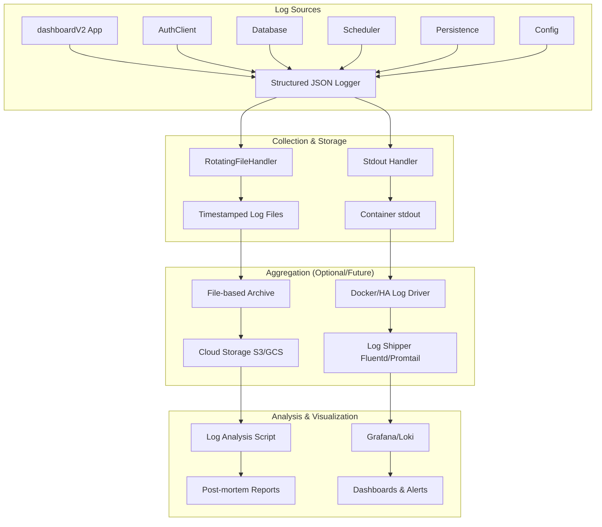
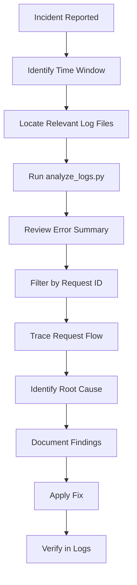
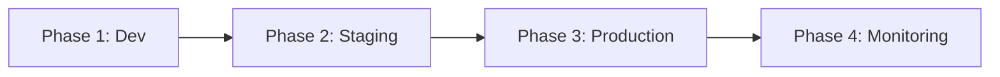
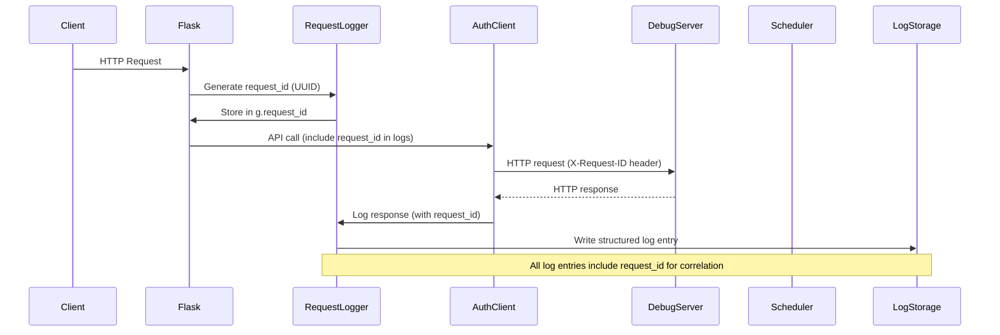

# DashboardV2 Logging Strategy — Stepwise Implementation Plan

## Overview

This document defines a comprehensive, stepwise implementation plan for a logging infrastructure for the **dashboardV2** Flask application. The strategy leverages patterns established in the debug-server's logging infrastructure (`debug-server/app/utils/logger.py`, `debug-server/app/utils/log_rotation.py`, `debug-server/app/middleware/server_message_logger.py`, `debug-server/app/middleware/api_message_logger.py`) while adapting them for the Flask-based dashboardV2 architecture.

The dashboardV2 application is a Flask-based web dashboard that acts as a proxy between the user's browser and the TimeLimit debug-server backend. It manages server selection, authentication flows, session management, and periodic server health checks via APScheduler. Effective logging is critical for diagnosing issues across these distributed components.

### Objectives

| # | Objective | Success Criteria |
|---|-----------|-----------------|
| 1 | Enable post-mortem debugging of all dashboardV2 request flows | Every HTTP request can be traced end-to-end via a request ID |
| 2 | Protect sensitive data in logs | No passwords, tokens, or PII appear in any log output |
| 3 | Minimize performance impact | Logging adds <1ms latency per request in production |
| 4 | Support multi-environment deployment | Works identically in dev, Docker, and HA ingress |
| 5 | Enable centralized aggregation (future) | Logs are structured JSON, ready for Loki/Elasticsearch |
| 6 | Provide operational visibility | Health checks, scheduler events, and auth flows are logged at INFO |

### Key Components



### Log Sources

| Component | File | Logger Name | Responsibility |
|-----------|------|-------------|----------------|
| Flask app & routes | `dashboardV2/app.py` | `dashboardV2.app` | Request/response logging, route-level events |
| HTTP client | `dashboardV2/auth_client.py` | `dashboardV2.auth_client` | API call logging, retry attempts, error categorization |
| Database | `dashboardV2/database.py` | `dashboardV2.database` | Connection management, CRUD operations, errors |
| Scheduler | `dashboardV2/scheduler.py` | `dashboardV2.scheduler` | Job lifecycle, server check results |
| Persistence | `dashboardV2/persistence.py` | `dashboardV2.persistence` | File I/O, HA ingress detection |
| Config | `dashboardV2/config.py` | `dashboardV2.config` | Configuration loading, validation |
| Middleware | `dashboardV2/middleware/` | `dashboardV2.middleware` | Request ID generation, request/response hooks |

### Aggregation Tools

| Layer | Tool | Purpose |
|-------|------|---------|
| Collection | `structlog` + `RotatingFileHandler` | Structured JSON logging with file rotation |
| Storage | File-based (timestamped) + SQLite (optional) | Primary persistence with rotation; queryable secondary store |
| Aggregation | Fluentd / Promtail (optional) | Ship logs to centralized systems |
| Visualization | Grafana + Loki (optional) | Dashboards and alerting |
| Analysis | `scripts/analyze_logs.py` (adapted) | CLI log analysis for post-mortem |

### Storage

| Tier | Storage | Retention | Use Case |
|------|---------|-----------|----------|
| Primary | File-based with rotation | 10 timestamped files, 5 size-rotated backups | Real-time debugging, post-mortem |
| Secondary | SQLite log table (optional) | 7 days | SQL-based querying, correlation |
| Tertiary | Cloud storage (S3/GCS) | 30 days | Long-term retention, compliance |

### Analysis & Alerting

| Tool | Purpose |
|------|---------|
| `analyze_logs.py` | CLI analysis: errors, security events, communication issues |
| Grafana dashboards | Real-time visualization of request rates, error rates, latency |
| Prometheus Alertmanager | Alert on error rate spikes, auth failures, scheduler failures |

---

## 1. Requirements Gathering

### 1.1 Logging Requirements by Component

#### 1.1.1 `app.py` — Flask Application and Routes

| Requirement | Detail |
|-------------|--------|
| Log levels | DEBUG: request payloads, response bodies, retry attempts. INFO: server selection, auth flows, scheduler execution. WARNING: missing fields, invalid server key. ERROR: failed API proxy calls, exceptions. |
| Retention | 10 timestamped files, 5 size-rotated backups (10MB each) |
| Compliance | No raw session data logged; session existence only. Sanitize all request bodies. |
| Correlation | Request ID (UUID, 8 chars) generated per request, stored in Flask `g`, included in all log entries |
| Performance | Async file writes; no blocking I/O on request path |

**Routes to instrument:**

| Route | Log Events |
|-------|-----------|
| `POST /select-server` | Server key selection, persistence, URL resolution |
| `POST /api/auth/send-mail-login-code` | Mail login code request, proxy to debug-server |
| `POST /api/auth/sign-in-by-mail-code` | Sign-in attempt, token storage in session |
| `POST /api/auth/create-family` | Family creation, device auth token storage |
| `POST /api/auth/sign-in-into-family` | Family sign-in, token storage |
| `POST /api/parent/create-add-device-token` | Add device token creation |
| `POST /api/child/add-device` | Child device registration |
| `POST /api/auth/get-status-by-mail-address` | Family status retrieval |
| `POST /api/auth/recover-parent-password` | Password recovery |
| `POST /api/session/clear` | Session clearing |
| `GET /api/session/status` | Session status query |
| `GET /api/timechecker/status` | Timechecker status, on-demand server check |
| `GET /api/timechecker/history` | Historical check results retrieval |
| `GET /health` | Health check |

#### 1.1.2 `auth_client.py` — HTTP Client for Debug-Server API

| Requirement | Detail |
|-------------|--------|
| Log levels | DEBUG: request URLs, response status codes, retry attempts. INFO: successful API calls. WARNING: timeouts, connection errors. ERROR: server errors, invalid responses. |
| Retention | Same as app.py (shared log file) |
| Compliance | Sanitize `mailLoginToken`, `mailAuthToken`, `deviceAuthToken`, `parentPassword`, `parentPasswordSecondHash`, `registerToken` from all log entries |
| Correlation | Propagate request ID via `X-Request-ID` HTTP header to debug-server |
| Error categorization | Standardized error codes: `timeout`, `unreachable`, `invalid_response`, `server_error`, `unknown` |

#### 1.1.3 `database.py` — SQLite Database Operations

| Requirement | Detail |
|-------------|--------|
| Log levels | DEBUG: connection creation/closure, CRUD operations with row counts. INFO: database initialization. ERROR: constraint violations, connection failures. |
| Retention | Same as app.py |
| Compliance | No sensitive data in database logs; log SQL statements with sanitized parameters |
| Performance | Log queries at DEBUG only; INFO for init only |

#### 1.1.4 `scheduler.py` — APScheduler Background Tasks

| Requirement | Detail |
|-------------|--------|
| Log levels | DEBUG: job execution start/completion with duration. INFO: scheduler start/stop, server check execution. ERROR: job execution failures, misfires. |
| Retention | Same as app.py |
| Compliance | No sensitive data in scheduler logs |
| Performance | Log check results at INFO; full details at DEBUG |

#### 1.1.5 `persistence.py` — Server Selection Persistence

| Requirement | Detail |
|-------------|--------|
| Log levels | DEBUG: file read/write operations, lock acquisition/release. INFO: HA ingress detection. ERROR: file I/O errors. |
| Retention | Same as app.py |
| Compliance | No sensitive data in persistence logs |

#### 1.1.6 `config.py` — Configuration Management

| Requirement | Detail |
|-------------|--------|
| Log levels | INFO: configuration values at startup (excluding SECRET_KEY). INFO: validation results. INFO: HA ingress detection. |
| Retention | Same as app.py |
| Compliance | Never log SECRET_KEY, tokens, or passwords |

### 1.2 Cross-Cutting Requirements

| Requirement | Detail |
|-------------|--------|
| Structured format | All log entries must be JSON with standard fields: `timestamp`, `level`, `logger`, `event`, `request_id`, `component` |
| Request correlation | Every log entry within a request must include the same `request_id` |
| Sensitive data | All sensitive keys must be redacted with `***REDACTED***` before logging |
| Async writes | File I/O must not block request processing; use background thread with queue |
| Environment config | All settings via environment variables with fallback defaults |
| Testability | Logging must be testable with pytest; use temp directories for log files |

### 1.3 Compliance Requirements

| Regulation | Requirement | How Met |
|------------|-------------|---------|
| GDPR | No PII in logs | Sensitive data redaction, no raw session data |
| SOC 2 | Audit trail of auth and config events | All auth events logged with timestamps and outcomes |
| PCI DSS | No payment card data | No payment data flows through dashboardV2 |

---

## 2. Tool Selection

### 2.1 Log Collection

| Tool | Rationale | Status |
|------|-----------|--------|
| `structlog` | Already used in debug-server; provides structured JSON logging with processors for sanitization, timestamping, and level filtering | **Adopt** — matches debug-server pattern |
| `logging.handlers.RotatingFileHandler` | Standard library; size-based rotation with backup count | **Adopt** — matches debug-server pattern |
| `logging.StreamHandler` | Standard library; stdout capture for container environments | **Adopt** — matches debug-server pattern |

### 2.2 Log Aggregation

| Tool | Rationale | Status |
|------|-----------|--------|
| `log_rotation.py` (adapted) | Timestamped file rotation with retention policy; already proven in debug-server | **Adopt** — port from debug-server |
| Fluentd | Industry-standard log shipper; supports multiple output targets | **Optional** — for multi-instance deployments |
| Promtail | Lightweight log shipper for Loki; simpler than Fluentd | **Optional** — for Kubernetes/HAOS deployments |
| Docker logging driver | Built-in container log capture | **Use** — for Docker Compose deployments |

### 2.3 Storage

| Tool | Rationale | Status |
|------|-----------|--------|
| File-based (timestamped) | Primary storage; simple, reliable, works in all environments | **Adopt** — primary storage |
| SQLite log table | Queryable secondary store; enables SQL-based analysis | **Optional** — Phase 2 enhancement |
| AWS CloudWatch | Cloud-native log storage | **Optional** — for cloud deployments |
| Google Cloud Logging | Cloud-native log storage | **Optional** — for GCP deployments |
| Elasticsearch | Full-text search and analytics | **Optional** — for self-hosted aggregation |

### 2.4 Visualization

| Tool | Rationale | Status |
|------|-----------|--------|
| Grafana | Industry-standard dashboarding; integrates with Loki, Prometheus | **Recommended** — for centralized deployments |
| Loki | Lightweight log aggregation system; designed for Grafana | **Recommended** — for centralized deployments |
| Kibana | Alternative to Grafana; integrates with Elasticsearch | **Alternative** — for Elasticsearch deployments |
| `analyze_logs.py` (adapted) | CLI analysis tool; no external dependencies | **Adopt** — for local analysis |

### 2.5 Alerting

| Tool | Rationale | Status |
|------|-----------|--------|
| Prometheus Alertmanager | Industry-standard alerting; integrates with Grafana | **Recommended** — for production deployments |
| Custom alert script | Simple script to check log files for error patterns | **Optional** — for single-instance deployments |

### 2.6 Dependency Summary

The dashboardV2 application currently has no `structlog` dependency. The following packages need to be added:

| Package | Version | Purpose |
|---------|---------|---------|
| `structlog` | >=24.2.0 | Structured JSON logging |
| `pytest-timeout` | >=2.0.0 | Test timeout enforcement (already in debug-server) |

---

## 3. Infrastructure Setup

### 3.1 Provision Centralized Log Storage

**Step 3.1.1 — Determine log directory per environment**

| Environment | Log Directory | Rationale |
|-------------|---------------|-----------|
| Development (Windows) | `dashboardV2/logs/` (relative to app directory) | Easy access during development |
| Home Assistant ingress | `/data/logs/` (persistent across container restarts) | Managed by HA supervisor |
| Docker | `/app/logs/` (mounted volume) | Container filesystem |

**Step 3.1.2 — Create log directory on startup**

```python
# In utils/logging.py (new module)
def ensure_log_directory(log_dir: str) -> None:
    """Create the log directory if it doesn't exist."""
    os.makedirs(log_dir, exist_ok=True)
```

**Step 3.1.3 — Configure cloud storage (optional, future)**

For production or multi-instance deployments, configure log shipping to cloud storage:
- AWS CloudWatch: Use `awslogs` agent or Fluent Bit
- Google Cloud Logging: Use `fluentd-gcp` or Ops Agent
- Azure Monitor: Use Azure Monitor Agent

### 3.2 Configure Log Shippers/Agents

**Step 3.2.1 — File-based log shipping (primary)**

The dashboardV2 writes structured JSON logs to files. A log shipper can be configured to read these files and forward them to a central system.

**Step 3.2.2 — Container stdout capture (secondary)**

The s6-overlay run script (`timelimit-ui/rootfs/etc/s6-overlay/s6-rc.d/dashboard-v2/run`) uses `python3 -u app.py` for unbuffered output. Container stdout/stderr is captured by the Docker runtime or Home Assistant supervisor.

**Step 3.2.3 — Log shipper configuration (optional, future)**

For environments requiring centralized aggregation:

| Environment | Shipping Method | Target |
|-------------|----------------|--------|
| Home Assistant (single instance) | File-based logs in `/data/logs/` | Local filesystem |
| Docker Compose | Volume mount for logs + stdout | Local filesystem or Docker logging driver |
| Kubernetes/HAOS Add-on | Sidecar container with Fluentd/Promtail | Loki, Elasticsearch, or CloudWatch |
| Cloud deployment | Direct cloud logging agent | CloudWatch, Stackdriver, or Datadog |

### 3.3 Set Up Log Rotation and Retention Policies

**Step 3.3.1 — Size-based rotation (RotatingFileHandler)**

```python
# In utils/logging.py
from logging.handlers import RotatingFileHandler

file_handler = RotatingFileHandler(
    log_file_path,
    maxBytes=settings.LOG_MAX_BYTES,  # Default: 10MB
    backupCount=settings.LOG_BACKUP_COUNT,  # Default: 5
)
```

**Step 3.3.2 — Startup-based rotation (timestamped files)**

Port the `log_rotation.py` module from debug-server, adapting the filename pattern:

```python
# In utils/log_rotation.py (ported from debug-server)
LOG_FILENAME_PATTERN = "dashboardV2-*.log"

def generate_unique_log_path(log_dir: str, base_name: str = "dashboardV2") -> str:
    """Generate a unique timestamped log file path."""
    # ... (same logic as debug-server, with base_name="dashboardV2")
```

**Step 3.3.3 — Retention policy**

| Log Type | Retention Period | Rationale |
|----------|-----------------|-----------|
| Timestamped startup logs | 10 files (configurable via `MAX_LOG_FILES`) | Covers ~10 application restarts |
| Size-rotated backups | 5 files (configurable via `LOG_BACKUP_COUNT`) | Covers ~50MB of recent logs per startup |
| SQLite log table | 7 days (configurable) | Queryable history for post-mortem analysis |
| Cloud logs | 30 days (configurable) | Long-term retention for compliance |

**Step 3.3.4 — Cleanup procedures**

- **On startup**: `rotate_log_files()` removes oldest timestamped files exceeding `MAX_LOG_FILES`
- **On rotation**: `RotatingFileHandler` automatically manages backup count
- **Scheduled cleanup**: A daily APScheduler job can purge SQLite log entries older than the retention period
- **Manual cleanup**: The `analyze_logs.py` script can be used to inspect and clean up old logs

---

## 4. Security & Compliance

### 4.1 Encrypt Logs in Transit and at Rest

**Step 4.1.1 — Encrypt logs in transit**

- All HTTP communication between dashboardV2 and the debug-server uses HTTPS (for the `official` server option)
- Request ID propagation via `X-Request-ID` HTTP header
- Container-to-container communication within the same host uses localhost

**Step 4.1.2 — Encrypt logs at rest**

- Log files are stored on the local filesystem with restrictive permissions (0600)
- In HA ingress mode, logs are stored in `/data/logs/` which is managed by the HA supervisor
- For cloud deployments, cloud storage encryption (SSE-S3, SSE-KMS) is used

### 4.2 Implement Access Controls and Audit Trails

**Step 4.2.1 — File permissions**

```python
# Set restrictive permissions on log files
os.chmod(log_file_path, 0o600)
```

**Step 4.2.2 — Audit trail**

| Event Type | What's Logged |
|------------|---------------|
| Authentication events | All auth-related events (login code sent, sign-in, family creation, password recovery) with timestamps and outcomes |
| Server selection changes | All server selection changes with selected key and URL |
| Session management | Session creation, clearing, and status checks |
| Configuration changes | Any configuration changes at runtime |

**Step 4.2.3 — Access control**

- Log files are accessible only by the application user
- In HA ingress mode, the HA supervisor manages access
- For centralized systems, RBAC controls access to log data

### 4.3 Ensure Compliance with Data Privacy Regulations

**Step 4.3.1 — GDPR compliance**

| Requirement | How Met |
|-------------|---------|
| No PII in logs | Sensitive data is redacted; no raw session data is logged |
| Data minimization | Only necessary fields are logged; request bodies are sanitized |
| Right to erasure | Log retention policies ensure data is automatically purged |

**Step 4.3.2 — SOC 2 compliance**

| Requirement | How Met |
|-------------|---------|
| Audit trail | All auth and configuration events are logged with timestamps and outcomes |
| Security monitoring | Error rates, auth failures, and scheduler failures are tracked |

**Step 4.3.3 — PCI DSS compliance**

| Requirement | How Met |
|-------------|---------|
| No cardholder data | No payment card data flows through dashboardV2 |

---

## 5. Configuration

### 5.1 Standardize Log Formats

**Step 5.1.1 — Structured JSON format**

All log entries use structured JSON format for machine-parseability, consistent with the debug-server's `structlog` approach. Each entry includes a standardized set of fields:

```json
{
  "timestamp": "2026-08-12T20:30:00.123456Z",
  "level": "INFO",
  "logger": "dashboardV2.app",
  "event": "Server selected",
  "request_id": "a1b2c3d4",
  "component": "server_selection",
  "server_key": "local",
  "server_url": "http://192.168.68.30:8080"
}
```

**Step 5.1.2 — Standard fields (present in every log entry)**

| Field | Description |
|-------|-------------|
| `timestamp` | ISO 8601 UTC timestamp with microsecond precision |
| `level` | Log level name (DEBUG, INFO, WARNING, ERROR, CRITICAL) |
| `logger` | Logger name (module path, e.g., `dashboardV2.app`) |
| `event` | Human-readable event description |
| `request_id` | UUID-based correlation ID for request tracing (when applicable) |
| `component` | Logical component name (e.g., `auth_client`, `scheduler`, `database`) |

**Step 5.1.3 — Contextual fields (added based on component and event type)**

| Field | Description |
|-------|-------------|
| `server_url` | The debug-server URL being communicated with |
| `server_key` | The server selection key (local, official, debug) |
| `status_code` | HTTP status code for API proxy responses |
| `duration_ms` | Request duration in milliseconds |
| `error_code` | Standardized error code (timeout, unreachable, etc.) |
| `error_message` | Human-readable error message |
| `technical_detail` | Technical error details for debugging |
| `session_id` | Flask session identifier (hashed, not raw session data) |
| `family_id` | Family identifier when relevant |
| `device_id` | Device identifier when relevant |

### 5.2 Define Log Levels and Thresholds

**Step 5.2.1 — Log level definitions**

| Level | Numeric Value | Description | DashboardV2 Usage |
|-------|--------------|-------------|-------------------|
| `DEBUG` | 10 | Detailed diagnostic information | Request payloads, response bodies, retry attempts, internal state transitions |
| `INFO` | 20 | General operational information | Server selection, successful auth flows, scheduler execution, health checks |
| `WARNING` | 30 | Potential issues that don't prevent operation | Retry attempts, degraded performance, fallback to default server |
| `ERROR` | 40 | Errors that prevent a specific operation from completing | Failed API proxy calls, database errors, authentication failures |
| `CRITICAL` | 50 | Critical errors that may cause application failure | Database corruption, unrecoverable configuration errors, scheduler failure |

**Step 5.2.2 — Default levels by environment**

| Environment | Default Level | Rationale |
|-------------|---------------|-----------|
| Production | `INFO` | Provides operational visibility without excessive noise |
| Development | `DEBUG` | Enables full diagnostic tracing |

**Step 5.2.3 — Alert thresholds**

| Metric | Threshold | Alert Level | Action |
|--------|-----------|-------------|--------|
| Error rate (5xx responses) | >5% over 5 minutes | WARNING | Investigate error logs |
| Error rate (5xx responses) | >20% over 5 minutes | CRITICAL | Page on-call, check debug-server connectivity |
| Auth failure rate | >10% over 5 minutes | WARNING | Check debug-server auth endpoints |
| Scheduler failure rate | >3 consecutive failures | CRITICAL | Check debug-server connectivity, restart scheduler |
| Log file size | >10MB (per file) | INFO | RotatingFileHandler handles automatically |
| Log directory size | >100MB total | WARNING | Review retention policy, increase `MAX_LOG_FILES` |

### 5.3 Environment Variables

All logging configuration is environment-variable-driven, matching the debug-server's pattern:

| Variable | Default | Description |
|----------|---------|-------------|
| `LOG_LEVEL` | `INFO` | Logging level (DEBUG, INFO, WARNING, ERROR, CRITICAL) |
| `LOG_FILE_PATH` | `logs/dashboardV2.log` | Base path for log files |
| `LOG_MAX_BYTES` | `10485760` (10MB) | Maximum size of each log file before rotation |
| `LOG_BACKUP_COUNT` | `5` | Number of rotated backup files to keep |
| `LOG_FORMAT` | `json` | Output format (`json` or `console`) |
| `MAX_LOG_FILES` | `10` | Maximum number of timestamped log files to retain on startup |
| `MESSAGE_LOGGING_ENABLED` | `True` | Enable outgoing message logging |
| `MESSAGE_LOGGING_ASYNC` | `True` | Use background thread for file writes |
| `MESSAGE_LOGGING_LEVEL` | `INFO` | Log level for message logging |
| `MESSAGE_LOGGING_MAX_BUFFER_SIZE` | `1000` | Max in-memory buffer entries |
| `MESSAGE_LOGGING_SANITIZE` | `True` | Sanitize sensitive data |

### 5.4 Logger Hierarchy

A hierarchical logger structure mirrors the application's module organization:

```
dashboardV2
├── app              (Flask routes, request handling)
├── auth_client      (HTTP client for debug-server API)
├── database         (SQLite database operations)
├── scheduler        (APScheduler background tasks)
├── persistence      (Server selection persistence)
├── config           (Configuration management)
└── middleware       (Flask middleware for request/response logging)
```

Each module obtains its logger via `logging.getLogger(__name__)`, which automatically places it in the correct hierarchy.

---

## 6. Sensitive Data Sanitization

### 6.1 Sensitive Key Set

The strategy adopts the debug-server's `SENSITIVE_KEYS` set, extended for dashboardV2-specific fields:

| Category | Keys |
|----------|------|
| Passwords | `password`, `password_hash`, `second_hash`, `second_salt`, `parentPassword`, `parentPasswordSecondHash`, `secondHash`, `secondSalt` |
| Tokens | `token`, `access_token`, `refresh_token`, `device_auth_token`, `deviceAuthToken`, `mail_auth_token`, `mailAuthToken`, `mail_login_token`, `mailLoginToken`, `identityToken` |
| Secrets | `secret_key`, `jwt_secret`, `api_key`, `private_key` |
| Crypto | `signature`, `encrypted` |
| Session | `session`, `cookie` |

### 6.2 Sanitization Rules

1. **Key-based redaction**: Any dictionary key matching (case-insensitive) a sensitive key is replaced with `***REDACTED***`
2. **Recursive sanitization**: Nested dictionaries and lists are sanitized recursively
3. **String truncation**: String values longer than 500 characters are truncated with `...[truncated]`
4. **Header sanitization**: HTTP headers matching sensitive patterns are redacted
5. **URL sanitization**: Query parameters containing sensitive keys are redacted

### 6.3 Sanitization Implementation

A `_sanitize_processor` function (matching the debug-server's `structlog` processor pattern) is applied to all log entries before they are written. This processor:

1. Recursively walks the log event dictionary
2. Replaces sensitive key values with `***REDACTED***`
3. Truncates long string values
4. Handles Pydantic models, dataclasses, and custom objects via `model_dump()` or `dict()`

---

## 7. Testing & Validation

### 7.1 Unit Tests

**Step 7.1.1 — Logger configuration tests**

- Verify log level, format, and handler configuration
- Verify environment variable overrides work correctly
- Verify log directory creation

**Step 7.1.2 — Sanitization tests**

- Verify sensitive data is redacted correctly (passwords, tokens, secrets)
- Verify recursive sanitization of nested dictionaries and lists
- Verify string truncation for long values (>500 chars)
- Verify header sanitization

**Step 7.1.3 — Rotation tests**

- Verify file rotation triggers at `LOG_MAX_BYTES`
- Verify backup count is enforced (`LOG_BACKUP_COUNT`)
- Verify timestamped file rotation on startup
- Verify `MAX_LOG_FILES` retention policy

**Step 7.1.4 — Request ID tests**

- Verify request ID generation (UUID, 8 chars)
- Verify request ID propagation through Flask `g` object
- Verify request ID appears in all log entries for a request
- Verify `X-Request-ID` header is sent to debug-server

### 7.2 Integration Tests

**Step 7.2.1 — End-to-end request tracing**

- Verify request ID appears in all log entries for a request across all components
- Verify request ID is propagated to debug-server via `X-Request-ID` header

**Step 7.2.2 — Error logging**

- Verify errors are logged with full context (path, method, error details)
- Verify 404 and 500 error handlers log appropriately
- Verify exception tracebacks are captured

**Step 7.2.3 — Scheduler logging**

- Verify scheduled tasks are logged correctly
- Verify server check results are logged with success/failure status
- Verify scheduler lifecycle events (start, stop, job addition)

**Step 7.2.4 — Auth flow logging**

- Verify auth events are logged with appropriate levels
- Verify sensitive data is sanitized in auth logs
- Verify token storage events are logged

### 7.3 Test Infrastructure

- Use `pytest` with `timeout` markers (matching existing dashboardV2 test pattern in `timelimit-ui/rootfs/usr/bin/dashboardV2/tests/pytest.ini`)
- Use temporary directories for log file tests
- Use `unittest.mock` to mock external dependencies (AuthClient, Database)
- Verify log output by reading log files and parsing JSON entries
- All tests must have a timeout mechanism (per project rules)

### 7.4 Testing & Validation Scenarios

**Step 7.4.1 — Simulate log scenarios**

| Scenario | Expected Behavior |
|----------|-------------------|
| Normal request flow | Request logged at INFO with request_id, response logged with status_code and duration |
| API proxy failure | Error logged at ERROR with error_code, error_message, technical_detail |
| Auth failure | Warning logged at WARNING with sanitized request body |
| Scheduler check failure | Error logged at ERROR with server_url and error_code |
| Large request body | Body truncated to 500 chars, sensitive fields redacted |
| Concurrent requests | Each request has unique request_id, no log interleaving |

**Step 7.4.2 — Validate log integrity**

- Verify all log entries are valid JSON
- Verify all entries have required standard fields
- Verify no sensitive data appears in any log entry
- Verify request_id correlation is consistent

**Step 7.4.3 — Validate performance under load**

- Simulate 100 concurrent requests
- Verify log write latency <1ms per request
- Verify no log entries are lost
- Verify async logging queue does not overflow

---

## 8. Monitoring & Maintenance

### 8.1 Set Up Dashboards for Real-Time Log Analysis

**Step 8.1.1 — Grafana dashboards (for centralized deployments)**

Pre-built dashboards for:
- Request rate and error rate over time
- Response time distribution
- Error breakdown by component
- Authentication success/failure rates
- Scheduler execution status

**Step 8.1.2 — Local analysis (for single-instance deployments)**

- The `analyze_logs.py` script provides summary reports
- `grep` and `jq` can be used for ad-hoc log queries
- SQLite log table enables SQL-based analysis

**Step 8.1.3 — Post-mortem debugging workflow**



**Step-by-step workflow:**
1. **Identify time window**: Determine when the incident occurred
2. **Locate log files**: Find the timestamped log file(s) covering that period
3. **Run analysis**: Execute `analyze_logs.py` for a summary of errors and warnings
4. **Filter by request ID**: If a specific request is implicated, filter logs by request_id
5. **Trace request flow**: Follow the request from Flask route → AuthClient → debug-server → response
6. **Identify root cause**: Look for error patterns, timeouts, or unexpected state transitions
7. **Document findings**: Record the root cause and contributing factors
8. **Apply fix**: Implement the fix and verify in subsequent log entries

### 8.2 Establish SLAs for Log Availability and Latency

| SLA | Target | Measurement |
|-----|--------|-------------|
| Log availability | 99.9% | Percentage of time log files are writable |
| Log write latency | <1ms | Time from log call to file write (async) |
| Log retention | 10 files minimum | Number of timestamped files retained |
| Log rotation | Automatic | No manual intervention required |
| Log search | <5 seconds | Time to search 10MB of logs |

### 8.3 Schedule Regular Audits and Updates

**Step 8.3.1 — Daily audits**

- Run `analyze_logs.py` to check for errors and warnings
- Review security events (auth failures, token issues)
- Check log file sizes and rotation status

**Step 8.3.2 — Weekly audits**

- Review communication issues (timeouts, connection errors)
- Analyze performance trends (slow requests, scheduler delays)
- Verify no sensitive data has leaked into logs

**Step 8.3.3 — Monthly audits**

- Review retention policy compliance
- Update sensitive key set if new fields are added
- Review and update alert thresholds
- Update `analyze_logs.py` with new patterns

**Step 8.3.4 — Quarterly updates**

- Review and update logging strategy based on incident patterns
- Update dependencies (structlog, etc.)
- Review and update runbooks
- Conduct security review of log data

---

## 9. Documentation

### 9.1 Runbooks for Troubleshooting and Incident Response

**Runbook 1: High Error Rate**

1. Run `analyze_logs.py --log-file logs/dashboardV2.log`
2. Check error summary for common patterns
3. Filter by request_id for specific failing requests
4. Check debug-server connectivity (scheduler logs)
5. Verify auth token validity (auth_client logs)
6. If database errors, check SQLite file permissions

**Runbook 2: Authentication Failures**

1. Filter logs for `component=auth_client` and `level=WARNING`
2. Check error_code field for `timeout`, `unreachable`, `invalid_response`
3. Verify debug-server URL is correct (config logs)
4. Check if debug-server is running and accessible
5. Review sanitized request bodies for missing fields

**Runbook 3: Scheduler Not Running**

1. Check scheduler logs for `component=scheduler`
2. Verify APScheduler started successfully
3. Check for job execution failures or misfires
4. Verify database is accessible (database logs)
5. Check server check results in database

**Runbook 4: Log File Not Created**

1. Check if the `logs/` directory exists
2. Verify write permissions on the log directory
3. Check `LOG_FILE_PATH` configuration
4. Verify `LOG_LEVEL` is not set to a level that suppresses all output

**Runbook 5: Logs Not Rotating**

1. Verify `LOG_MAX_BYTES` is set correctly
2. Check file permissions on log files
3. Restart the application to trigger startup-based rotation
4. Verify `MAX_LOG_FILES` retention policy is applied

### 9.2 Configuration Documentation

**Step 9.2.1 — Document configuration files**

| File | Purpose |
|------|---------|
| `dashboardV2/config.py` | Environment variable configuration |
| `dashboardV2/utils/logging.py` | Logging setup and structlog configuration |
| `dashboardV2/utils/log_rotation.py` | Log file rotation and retention |
| `dashboardV2/utils/sanitization.py` | Sensitive data sanitization |
| `dashboardV2/middleware/request_logging.py` | Flask request/response logging middleware |

**Step 9.2.2 — Document tool integrations**

| Integration | File | Description |
|-------------|------|-------------|
| structlog | `utils/logging.py` | Structured JSON logging with processors |
| RotatingFileHandler | `utils/logging.py` | Size-based log rotation |
| log_rotation.py | `utils/log_rotation.py` | Timestamped file rotation with retention |
| Flask middleware | `middleware/request_logging.py` | Request ID generation, before/after request hooks |
| AuthClient | `auth_client.py` | API call logging with sanitization |
| APScheduler | `scheduler.py` | Job lifecycle and server check logging |

### 9.3 Escalation Procedures

| Severity | Response Time | Escalation Path |
|----------|---------------|-----------------|
| CRITICAL | 15 minutes | Page on-call → Investigate logs → Check debug-server → Restart if needed |
| ERROR | 1 hour | Review error logs → Check debug-server connectivity → File incident |
| WARNING | 4 hours | Review warning logs → Check for patterns → Schedule investigation |
| INFO | N/A | Regular review during daily audit |

---

## 10. Rollout Plan

### 10.1 Phase Deployment



**Phase 1: Development Environment**

| Step | Action | Deliverable |
|------|--------|-------------|
| 1.1 | Create `utils/logging.py` module with structlog configuration | `dashboardV2/utils/logging.py` |
| 1.2 | Create `utils/log_rotation.py` (ported from debug-server) | `dashboardV2/utils/log_rotation.py` |
| 1.3 | Create `utils/sanitization.py` with `_sanitize_processor` | `dashboardV2/utils/sanitization.py` |
| 1.4 | Create `middleware/request_logging.py` with Flask hooks | `dashboardV2/middleware/request_logging.py` |
| 1.5 | Update `config.py` with logging environment variables | `dashboardV2/config.py` (updated) |
| 1.6 | Update `app.py` to use new logging setup | `dashboardV2/app.py` (updated) |
| 1.7 | Update `auth_client.py` to use structured logging | `dashboardV2/auth_client.py` (updated) |
| 1.8 | Update `database.py` to use structured logging | `dashboardV2/database.py` (updated) |
| 1.9 | Update `scheduler.py` to use structured logging | `dashboardV2/scheduler.py` (updated) |
| 1.10 | Update `persistence.py` to use structured logging | `dashboardV2/persistence.py` (updated) |
| 1.11 | Write unit tests for logging configuration | `dashboardV2/tests/test_logging.py` |
| 1.12 | Write unit tests for sanitization | `dashboardV2/tests/test_sanitization.py` |
| 1.13 | Write unit tests for log rotation | `dashboardV2/tests/test_log_rotation.py` |
| 1.14 | Write unit tests for request ID propagation | `dashboardV2/tests/test_request_logging.py` |
| 1.15 | Adapt `scripts/analyze_logs.py` for dashboardV2 | `dashboardV2/scripts/analyze_logs.py` |

**Phase 2: Staging Environment**

| Step | Action | Deliverable |
|------|--------|-------------|
| 2.1 | Deploy to staging with `LOG_LEVEL=DEBUG` | Staging environment running |
| 2.2 | Run integration tests (end-to-end request tracing) | Test results |
| 2.3 | Run load tests (100 concurrent requests) | Performance metrics |
| 2.4 | Verify log integrity (all entries valid JSON) | Validation report |
| 2.5 | Verify no sensitive data in logs | Security audit report |
| 2.6 | Verify request ID correlation across components | Correlation report |
| 2.7 | Verify log rotation and retention | Rotation test results |
| 2.8 | Run `analyze_logs.py` on staging logs | Analysis report |
| 2.9 | Review and adjust alert thresholds | Updated thresholds |
| 2.10 | Document any issues found | Issue log |

**Phase 3: Production Environment**

| Step | Action | Deliverable |
|------|--------|-------------|
| 3.1 | Deploy to production with `LOG_LEVEL=INFO` | Production environment running |
| 3.2 | Monitor error rate for 24 hours | Monitoring dashboard |
| 3.3 | Verify log file creation and rotation | Log file verification |
| 3.4 | Verify request ID correlation in production logs | Correlation verification |
| 3.5 | Verify no sensitive data leakage | Security verification |
| 3.6 | Set up Grafana dashboards (if centralized) | Dashboards configured |
| 3.7 | Configure alerts (if centralized) | Alerts configured |
| 3.8 | Update runbooks with production findings | Updated runbooks |

**Phase 4: Monitoring & Maintenance**

| Step | Action | Deliverable |
|------|--------|-------------|
| 4.1 | Set up daily audit schedule | Cron job / APScheduler job |
| 4.2 | Set up weekly audit schedule | Audit checklist |
| 4.3 | Set up monthly audit schedule | Audit report template |
| 4.4 | Set up quarterly review schedule | Review checklist |
| 4.5 | Monitor SLAs (availability, latency) | SLA dashboard |
| 4.6 | Review and update alert thresholds | Updated thresholds |

### 10.2 Rollback Procedures

**Rollback Step 1: Identify the issue**

- Check logs for errors introduced by the logging changes
- Verify the issue is related to the logging infrastructure (not application logic)
- Check if the issue affects all environments or just production

**Rollback Step 2: Revert logging configuration**

```bash
# Revert to previous logging configuration
# 1. Restore the original app.py (without new logging setup)
# 2. Remove new utility modules
# 3. Restore original config.py
```

**Rollback Step 3: Revert to basic logging**

If the new logging infrastructure causes issues, revert to the original `logging.basicConfig()` approach:

```python
# In app.py, revert to:
import logging
logging.basicConfig(
    level=logging.INFO,
    format='%(asctime)s - %(name)s - %(levelname)s - %(message)s'
)
logger = logging.getLogger(__name__)
```

**Rollback Step 4: Verify rollback**

- Verify the application starts successfully
- Verify basic logging works (stdout output)
- Verify no errors in the application logs
- Notify stakeholders that rollback is complete

**Rollback Step 5: Post-rollback analysis**

- Document the root cause of the rollback
- Fix the issue in a development branch
- Re-test thoroughly before re-deploying
- Update the rollout plan with lessons learned

### 10.3 Rollback Triggers

| Trigger | Action |
|---------|--------|
| Application fails to start | Immediate rollback to basic logging |
| Log write latency >5ms per request | Rollback and investigate async logging |
| Log file corruption detected | Rollback and investigate file handler |
| Sensitive data found in logs | Immediate rollback and security audit |
| Log rotation fails, disk fills | Rollback and investigate rotation logic |
| Request ID correlation broken | Rollback and investigate middleware |

---

## Appendix A: Implementation Timeline

### Phase 1 — Foundation (Steps 1.1–1.4)

| Step | Description | Estimated Effort |
|------|-------------|-----------------|
| 1.1 | Create `utils/logging.py` with structlog configuration | Small |
| 1.2 | Create `utils/log_rotation.py` (ported from debug-server) | Small |
| 1.3 | Create `utils/sanitization.py` with `_sanitize_processor` | Small |
| 1.4 | Create `middleware/request_logging.py` with Flask hooks | Medium |

### Phase 2 — Integration (Steps 1.5–1.10)

| Step | Description | Estimated Effort |
|------|-------------|-----------------|
| 1.5 | Update `config.py` with logging environment variables | Small |
| 1.6 | Update `app.py` to use new logging setup | Medium |
| 1.7 | Update `auth_client.py` to use structured logging | Medium |
| 1.8 | Update `database.py` to use structured logging | Small |
| 1.9 | Update `scheduler.py` to use structured logging | Small |
| 1.10 | Update `persistence.py` to use structured logging | Small |

### Phase 3 — Testing (Steps 1.11–1.15)

| Step | Description | Estimated Effort |
|------|-------------|-----------------|
| 1.11 | Write unit tests for logging configuration | Medium |
| 1.12 | Write unit tests for sanitization | Medium |
| 1.13 | Write unit tests for log rotation | Medium |
| 1.14 | Write unit tests for request ID propagation | Medium |
| 1.15 | Adapt `analyze_logs.py` for dashboardV2 | Medium |

### Phase 4 — Deployment (Steps 2.1–4.6)

| Step | Description | Estimated Effort |
|------|-------------|-----------------|
| 2.1–2.10 | Staging deployment and testing | Medium |
| 3.1–3.8 | Production deployment and monitoring | Medium |
| 4.1–4.6 | Ongoing monitoring and maintenance | Ongoing |

---

## Appendix B: File Inventory

### New Files to Create

| File | Purpose |
|------|---------|
| `dashboardV2/utils/__init__.py` | Utils package init |
| `dashboardV2/utils/logging.py` | Structlog configuration, setup_logging() |
| `dashboardV2/utils/log_rotation.py` | Timestamped file rotation (ported from debug-server) |
| `dashboardV2/utils/sanitization.py` | Sensitive data sanitization processor |
| `dashboardV2/middleware/__init__.py` | Middleware package init |
| `dashboardV2/middleware/request_logging.py` | Flask request/response logging middleware |
| `dashboardV2/scripts/analyze_logs.py` | Log analysis script (adapted from debug-server) |
| `dashboardV2/tests/test_logging.py` | Unit tests for logging configuration |
| `dashboardV2/tests/test_sanitization.py` | Unit tests for sanitization |
| `dashboardV2/tests/test_log_rotation.py` | Unit tests for log rotation |
| `dashboardV2/tests/test_request_logging.py` | Unit tests for request ID propagation |

### Existing Files to Modify

| File | Changes |
|------|---------|
| `dashboardV2/config.py` | Add logging environment variables (LOG_LEVEL, LOG_FILE_PATH, etc.) |
| `dashboardV2/app.py` | Replace `logging.basicConfig()` with `setup_logging()`; add request ID middleware; add structured logging to routes |
| `dashboardV2/auth_client.py` | Replace `logging.getLogger(__name__)` with structured logging; add request ID propagation; add sanitization |
| `dashboardV2/database.py` | Replace `logging.getLogger(__name__)` with structured logging; add structured fields |
| `dashboardV2/scheduler.py` | Replace `logging.getLogger(__name__)` with structured logging; add structured fields |
| `dashboardV2/persistence.py` | Replace `logging.getLogger(__name__)` with structured logging; add structured fields |
| `dashboardV2/tests/conftest.py` | Add logging fixtures if needed |

### Reference Files (Debug-Server Patterns)

| File | Reference For |
|------|---------------|
| `debug-server/app/utils/logger.py` | Structlog configuration, sanitization processor |
| `debug-server/app/utils/log_rotation.py` | Timestamped file rotation, retention policy |
| `debug-server/app/core/logging.py` | setup_logging() function, file handler setup |
| `debug-server/app/core/config.py` | Environment variable configuration pattern |
| `debug-server/app/middleware/logging.py` | Request/response logging middleware pattern |
| `debug-server/app/middleware/api_message_logger.py` | Request body sanitization, immediate logging |
| `debug-server/app/middleware/server_message_logger.py` | SENSITIVE_KEYS, async logging, log buffer |
| `debug-server/app/middleware/message_sent_logger.py` | Unified logging facade pattern |
| `debug-server/app/main.py` | Application startup logging initialization |
| `debug-server/scripts/analyze_logs.py` | Log analysis script pattern |
| `debug-server/docs/logging.md` | Full logging documentation reference |

---

## Appendix C: Request Correlation Flow



The request ID is:
1. Generated as a truncated UUID (8 characters) at the start of each request
2. Stored in Flask's `g` object for request-scoped access
3. Included in all log entries via a custom logging filter
4. Propagated to the debug-server via a custom HTTP header (`X-Request-ID`) for cross-component tracing

---

## Appendix D: Post-Mortem Debugging Workflow


**Step-by-step workflow:**
1. **Identify time window**: Determine when the incident occurred
2. **Locate log files**: Find the timestamped log file(s) covering that period
3. **Run analysis**: Execute `analyze_logs.py` for a summary of errors and warnings
4. **Filter by request ID**: If a specific request is implicated, filter logs by request_id
5. **Trace request flow**: Follow the request from Flask route → AuthClient → debug-server → response
6. **Identify root cause**: Look for error patterns, timeouts, or unexpected state transitions
7. **Document findings**: Record the root cause and contributing factors
8. **Apply fix**: Implement the fix and verify in subsequent log entries

---

## Appendix E: Performance Considerations

### Async Logging

To minimize performance overhead, the strategy adopts the debug-server's **async logging mode**:

- A `queue.Queue` is used to pass log messages from the main thread to a background daemon thread
- The worker thread polls the queue with a 0.1-second timeout to allow graceful shutdown
- The `flush()` method drains the queue, ensuring all queued messages are written before shutdown
- The `stop_async_logging()` method signals the worker thread to stop and joins it

This ensures that file I/O operations do not block request processing.

### Log Level Filtering

- **Production**: `INFO` level by default, with `DEBUG` available via environment variable
- **Development**: `DEBUG` level for full diagnostic tracing
- The `structlog` `filter_by_level` processor ensures that messages below the configured level are not processed

### Buffer Management

- An in-memory log buffer (default: 1000 entries) provides recent log entries for runtime analysis
- The buffer is thread-safe with a `threading.Lock`
- Buffer entries are structured dictionaries containing timestamp, level, event, and context

### Performance Impact Mitigation

| Technique | Impact |
|-----------|--------|
| Async file writes | Eliminates I/O blocking on request path |
| Log level filtering | Reduces processing for low-priority messages |
| String truncation | Prevents excessive memory usage from large payloads |
| Sanitization at log time | Avoids storing sensitive data in memory |
| RotatingFileHandler | Prevents unbounded log file growth |

---

## Appendix F: Scalability Considerations

### Multi-Instance Deployments

For deployments with multiple dashboardV2 instances:

- **Log file naming**: Include instance identifier in log filenames (e.g., `dashboardV2-{instance_id}-{timestamp}.log`)
- **Centralized aggregation**: Use a log shipper (Fluentd, Promtail) to collect logs from all instances
- **Request ID propagation**: Ensure request IDs are unique across instances (UUID-based)

### Log Volume Management

- **Log level tuning**: Use `INFO` in production, `DEBUG` only when troubleshooting
- **Sampling**: For high-volume endpoints, consider sampling DEBUG-level logs (e.g., log 1 in 100 requests)
- **Conditional logging**: Log full request/response bodies only for error responses or when verbose mode is enabled

### Resource Constraints

The dashboardV2 runs in a Home Assistant add-on container with limited resources:

- **Memory**: Async logging with bounded queue prevents memory exhaustion
- **Disk**: RotatingFileHandler with size limits prevents disk exhaustion
- **CPU**: Minimal processing overhead from structured logging (JSON serialization is fast)

---

## Appendix G: Summary

This logging strategy provides a comprehensive framework for effective post-mortem debugging of the dashboardV2 application. Key design decisions:

1. **Structured JSON logging** with `structlog` for machine-parseability
2. **Async file writes** with background thread for minimal performance impact
3. **Request ID correlation** across all components and the debug-server
4. **Automatic sensitive data sanitization** to protect user privacy
5. **Dual storage** (file-based with rotation + optional SQLite for querying)
6. **Configurable via environment variables** for different deployment environments
7. **Analysis tooling** adapted from the debug-server's `analyze_logs.py`
8. **Scalable architecture** supporting single-instance and multi-instance deployments
9. **Security-first design** with audit trails and compliance support
10. **Future-proof roadmap** from basic logging to full distributed tracing

The strategy builds on the proven patterns established in the debug-server's logging infrastructure, ensuring consistency across the TimeLimit ecosystem while adapting to the Flask-based dashboardV2 architecture.
