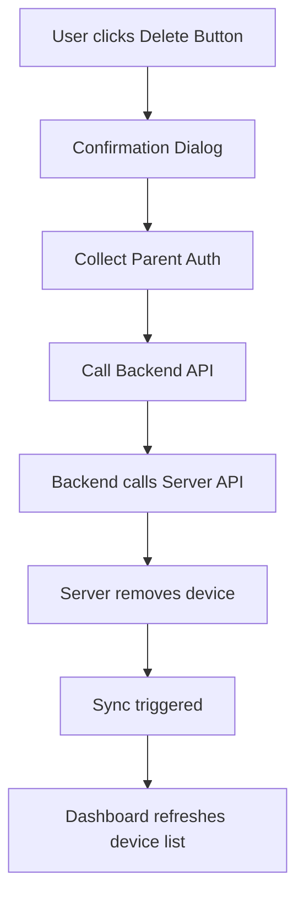

# Device Removal Feature Design

## Overview

Add a device removal interface to the TimeLimit Dashboard v2, allowing parents to remove devices from their family directly from the dashboard UI.

## Architecture



## Backend Changes

### 1. New API Endpoint in `app.py`

**Route:** `POST /api/dashboard/devices/remove`

**Request Body:**
```json
{
  "deviceId": "device-id-to-remove",
  "parentUserId": "parent-user-id",
  "parentPasswordSecondHash": "password-hash-or-u2f"
}
```

**Response:**
```json
{
  "status": "ok",
  "message": "Device removed successfully"
}
```

**Implementation Location:** `timelimit-ui/rootfs/usr/bin/dashboardV2/app.py` (after line 2152)

### 2. New Method in `auth_client.py`

**Method:** `remove_device()`

```python
def remove_device(
    self,
    device_auth_token: str,
    parent_user_id: str,
    parent_password_second_hash: str,
    device_id: str
) -> APIResponse:
    """Remove a device from the family on the server.
    
    Args:
        device_auth_token: Device auth token for authentication.
        parent_user_id: ID of the parent user making the request.
        parent_password_second_hash: Parent's second password hash or U2F integrity.
        device_id: ID of the device to remove.
        
    Returns:
        APIResponse with ok: true on success.
    """
```

**Implementation Location:** `timelimit-ui/rootfs/usr/bin/dashboardV2/auth_client.py` (after line 1041)

## Frontend Changes

### 1. UI Update in `dashboardV2.html`

Add a delete button column to the devices table:

```html
<!-- Line 470-480: Update table headers -->
<thead>
    <tr>
        <th>Name</th>
        <th>Model</th>
        <th>Current User</th>
        <th>Protection Level</th>
        <th>App Version</th>
        <th>Platform</th>
        <th>Signing Key</th>
        <th>Added At</th>
        <th>Actions</th>
    </tr>
</thead>

<!-- Line 482-485: Update tbody -->
<tbody id="devices-body">
    <tr><td colspan="9" style="text-align: center; color: #666;">Loading...</td></tr>
</tbody>
```

### 2. JavaScript Update in `dashboardV2.js`

#### New Functions:

```javascript
/**
 * Show device removal confirmation dialog
 * @param {string} deviceId - Device ID to remove
 * @param {string} deviceName - Device name for display
 */
async function confirmRemoveDevice(deviceId, deviceName) {
    // Show modal dialog
    // Collect parent authentication
    // Call removeDevice API
}

/**
 * Remove device from server
 * @param {string} deviceId - Device ID to remove
 * @param {string} parentUserId - Parent user ID
 * @param {string} parentPasswordSecondHash - Parent password hash
 */
async function removeDevice(deviceId, parentUserId, parentPasswordSecondHash) {
    const response = await fetch('/api/dashboard/devices/remove', {
        method: 'POST',
        headers: { 'Content-Type': 'application/json' },
        body: JSON.stringify({
            deviceId,
            parentUserId,
            parentPasswordSecondHash
        })
    });
    return await response.json();
}

/**
 * Render devices table with delete button
 * @param {Array} devices - Array of device objects
 * @param {string} ownDeviceId - The ID of the current device
 */
function renderDevicesTable(devices, ownDeviceId) {
    // ... existing code ...
    
    tbody.innerHTML = devices.map(device => {
        const isCurrentDevice = device.id === ownDeviceId;
        const canDelete = !isCurrentDevice; // Can't delete current device
        
        return `
            <tr class="${rowClass}">
                <td>${escapeHtml(device.name)}${currentDeviceBadge}</td>
                <td>${escapeHtml(device.model)}</td>
                <td>${escapeHtml(device.current_user_name)}</td>
                <td>${protectionLevelLabel}</td>
                <td>${device.current_app_version || 'N/A'}</td>
                <td>${platform} (v${platformLevel})</td>
                <td class="time-cell" style="font-family: monospace; font-size: 12px; color: #888;">${escapeHtml(signingKeyDisplay)}</td>
                <td class="time-cell">${addedAt}</td>
                <td>
                    ${canDelete ? `<button class="delete-btn" onclick="confirmRemoveDevice('${device.id}', '${escapeHtml(device.name)}')">🗑️</button>` : '<span style="color: #666;">-</span>'}
                </td>
            </tr>
        `;
    }).join('');
}
```

### 3. CSS Styles in `dashboardV2.html`

Add to the style block (after line 276):

```css
.delete-btn {
    background: rgba(244, 67, 54, 0.2);
    border: 1px solid rgba(244, 67, 54, 0.5);
    border-radius: 4px;
    color: #f44336;
    cursor: pointer;
    font-size: 14px;
    padding: 4px 8px;
    transition: all 0.2s ease;
}

.delete-btn:hover {
    background: rgba(244, 67, 54, 0.3);
    transform: translateY(-1px);
}

.delete-btn:disabled {
    opacity: 0.5;
    cursor: not-allowed;
}
```

## Security Considerations

1. **Authentication Required**: User must be authenticated with a device auth token
2. **Parent Verification**: Must provide valid `parentUserId` and `parentPasswordSecondHash`
3. **Current Device Protection**: Cannot delete the device currently being used by the dashboard
4. **Server Validation**: Server validates all credentials before deletion

## User Flow

1. Parent views Family Devices table
2. Parent clicks delete button (🗑️) next to a device
3. Confirmation dialog appears: "Remove device 'Device Name'? This cannot be undone."
4. Parent enters their password (second password hash)
5. System calls server API to remove device
6. On success: Show success message, refresh device list
7. On failure: Show error message

## Error Handling

| Error | User Message |
|-------|--------------|
| 400 Bad Request | "Invalid request. Please try again." |
| 401 Unauthorized | "Authentication failed. Please log in again." |
| 409 Conflict | "Cannot remove this device. It may be the current device or already removed." |
| Network Error | "Connection failed. Please check your network." |

## Implementation Checklist

- [ ] Add `remove_device()` method to `auth_client.py`
- [ ] Add `/api/dashboard/devices/remove` route to `app.py`
- [ ] Add delete button column to devices table in `dashboardV2.html`
- [ ] Add CSS styles for delete button in `dashboardV2.html`
- [ ] Add `confirmRemoveDevice()` function to `dashboardV2.js`
- [ ] Add `removeDevice()` function to `dashboardV2.js`
- [ ] Update `renderDevicesTable()` to include delete button
- [ ] Add delete button to `window.dashboardV2` exports
- [ ] Test with various scenarios (current device, non-existent device, auth failure)