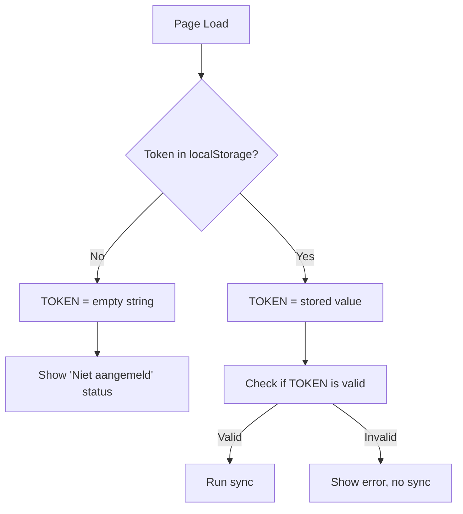

# Plan: Prevent Unauthenticated Data Fetch on UI Startup

## Problem Statement

When the TimeLimit UI starts and the user hasn't signed in yet, the application attempts to fetch data from the server via `/sync/pull-status`, which fails with a 401 Unauthorized error. This is unnecessary and creates noise in the logs.

## Root Cause Analysis

### Issue 1: DEFAULT_TOKEN Fallback
**File:** `timelimit-ui/rootfs/usr/bin/dashboard.html` (line 335-336)

```javascript
const DEFAULT_TOKEN = "wCl56ssLezn0aDvgfPoL9hKpEWBq7F8J";
let TOKEN = localStorage.getItem('timelimit_token') || DEFAULT_TOKEN;
```

The `DEFAULT_TOKEN` is a hardcoded placeholder that:
- Is used as a fallback when no token exists in localStorage
- Is a non-empty string, so it passes the `if (TOKEN)` check
- Causes the UI to attempt a sync with an invalid token

### Issue 2: Unconditional Sync Call
**File:** `timelimit-ui/rootfs/usr/bin/dashboard.html` (line 474)

```javascript
if (TOKEN) runSync();
```

This check only verifies if TOKEN is truthy (non-empty), not if it's a valid, user-authenticated token.

### Issue 3: runSync() Token Validation
**File:** `timelimit-ui/rootfs/usr/bin/sync.js` (lines 164-171)

```javascript
if (!TOKEN || TOKEN === "" || TOKEN.includes("#")) {
    addLog("Sync overgeslagen: Geen geldig token.", true);
    return;
}
```

The validation rejects tokens containing "#", but the DEFAULT_TOKEN doesn't contain this character, so it passes.

## Solution Design

### Option A: Remove DEFAULT_TOKEN (Recommended)
Remove the hardcoded fallback token entirely. The token should be:
- Empty/undefined when not signed in
- Only set after successful authentication

### Option B: Add Authentication State Flag
Add a separate flag to track if the user has completed the sign-in flow, separate from just having a token.

## Implementation Plan

### Step 1: Remove DEFAULT_TOKEN Fallback
**File:** `timelimit-ui/rootfs/usr/bin/dashboard.html`

Change:
```javascript
const DEFAULT_TOKEN = "wCl56ssLezn0aDvgfPoL9hKpEWBq7F8J";
let TOKEN = localStorage.getItem('timelimit_token') || DEFAULT_TOKEN;
```

To:
```javascript
let TOKEN = localStorage.getItem('timelimit_token') || '';
```

### Step 2: Update window.onload Logic
**File:** `timelimit-ui/rootfs/usr/bin/dashboard.html`

Change the sync call to check for a valid, non-empty token:
```javascript
if (TOKEN && TOKEN !== '') runSync();
```

Or better, add a helper function to check if the user is properly authenticated.

### Step 3: Update Status Badge on Load
**File:** `timelimit-ui/rootfs/usr/bin/dashboard.html`

Add logic to show "Niet aangemeld" status when no token is present.

### Step 4: Update runSync() Validation
**File:** `timelimit-ui/rootfs/usr/bin/sync.js`

The existing validation is adequate, but we should ensure the early return happens before any network requests.

## Files to Modify

1. `timelimit-ui/rootfs/usr/bin/dashboard.html` - Remove DEFAULT_TOKEN, update onload logic
2. `timelimit-ui/rootfs/usr/bin/sync.js` - Verify token validation is correct (no changes needed if Option A is used)

## Testing Plan

1. Start the UI without any stored token
2. Verify no `/sync/pull-status` request is made
3. Verify the status badge shows "Niet aangemeld" or similar
4. Sign in with a valid token
5. Verify sync works correctly after authentication

## Flow Diagram



## Alternative Considerations

### Why not keep DEFAULT_TOKEN for testing?
- It creates confusion between test and production behavior
- It generates unnecessary server load
- It pollutes logs with failed requests
- Testing should use proper authentication flow

### Why not just check for "#" in token?
- The "#" check is a workaround, not a proper solution
- A valid token could theoretically contain "#"
- Better to have explicit authentication state