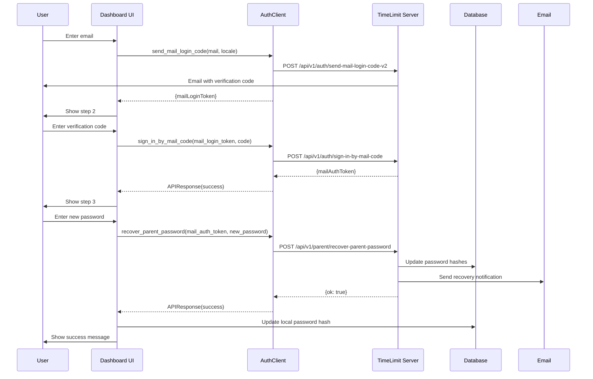

# Recover Parent Password Implementation Plan

## Overview

This document outlines the implementation plan for the "Recover Parent Password" flow in the TimeLimit Dashboard V2. The flow allows authenticated users to recover their parent password using a mail auth token, as specified in `docs/ServerAPI.md`.

## Current State Analysis

### Existing Implementation

1. **Auth Client** (`auth_client.py`):
   - ✅ `recover_parent_password()` method exists (lines 885-928)
   - ✅ Properly logs request/response with sanitization
   - ✅ Handles errors and timeouts

2. **App Routes** (`app.py`):
   - ✅ `/api/auth/recover-parent-password` endpoint exists (lines 1690-1752)
   - ✅ Proxies to server's `/parent/recover-parent-password` endpoint
   - ✅ Basic logging implemented

3. **Crypto Utils** (`crypto_utils.py`):
   - ✅ `generate_family_hashes()` function for bcrypt password hashing
   - ✅ Uses `$2a$` prefix to match server expectations

4. **Database** (`database.py`):
   - ✅ `get_parent_password_hash()` function
   - ✅ `upsert_family_password_hash()` function

### Missing Components

1. ❌ Server-side rendered UI template for recover parent password flow
2. ❌ Routes for the recover parent password flow (GET/POST)
3. ❌ Tests for the recover parent password API endpoint
4. ❌ Audit logging for the recover parent password flow
5. ❌ Update local database with new password hash after successful recovery
6. ❌ Documentation updates

## Implementation Design

### 1. User Interface Design

#### New Template: `recover_parent_password.html`

A new template following the existing pattern from `login_as_parent.html`:

```
Step 1: Enter Email
  - Input: Email address
  - Action: Send verification code to email

Step 2: Enter Verification Code
  - Input: 3-word verification code
  - Action: Verify code and get mail auth token

Step 3: Enter New Password
  - Input: New password (2x for confirmation)
  - Action: Hash password and call recover_parent_password API
```

### 2. API Interactions

#### Request Flow



### 3. Implementation Steps

#### Step 1: Create Audit Logging Module

Create `utils/recover_password_logging.py` for structured audit logging:

```python
def log_recover_password_request(mail_auth_token, new_password_data, request_id, server_url)
def log_recover_password_response(request_id, success, status_code, response_data, error_code, error_message)
def log_recover_password_failure(request_id, error_code, error_message, technical_detail)
```

#### Step 2: Add Routes to app.py

Add new routes:
- `GET /recover-parent-password` - Render the recover password form
- `POST /recover-parent-password` - Process form submission

#### Step 3: Create Template

Create `templates/recover_parent_password.html` with 3-step form:
1. Enter email
2. Enter verification code
3. Enter new password

#### Step 4: Update API Endpoint

Modify `/api/auth/recover-parent-password` to:
- Update local database with new password hash after successful recovery
- Add comprehensive logging

#### Step 5: Create Unit Tests

Create `tests/test_recover_parent_password.py` with tests for:
- API endpoint success/failure cases
- Password hashing validation
- Database update after recovery
- Error handling

#### Step 6: Update Documentation

Update `docs/ServerAPI.md` with:
- Complete flow documentation
- Request/response examples
- Error handling

## Detailed Implementation

### File Changes Summary

| File | Action | Description |
|------|--------|-------------|
| `utils/recover_password_logging.py` | Create | Audit logging for password recovery |
| `templates/recover_parent_password.html` | Create | UI template for recovery flow |
| `app.py` | Modify | Add routes and update API endpoint |
| `tests/test_recover_parent_password.py` | Create | Unit tests |
| `docs/ServerAPI.md` | Update | Documentation |

### API Endpoint Details

#### POST /api/auth/recover-parent-password

**Request:**
```json
{
    "mailAuthToken": "auth_token_xyz789",
    "newPassword": {
        "hash": "$2a$12$...",
        "secondHash": "$2a$12$...",
        "secondSalt": "$2a$12$salt..."
    }
}
```

**Response (Success):**
```json
{
    "ok": true
}
```

**Response (Error):**
```json
{
    "status": "error",
    "error_code": "unauthorized",
    "error_message": "Invalid or expired token"
}
```

### Password Hashing Requirements

- Use `generate_family_hashes()` from `crypto_utils.py`
- Ensure `$2a$` prefix (not `$2b$`)
- 12 rounds for bcrypt

### Logging Requirements

All interactions with the timelimit server must be logged:

1. **Request Logging:**
   - Request ID
   - Endpoint
   - Request payload (sanitized)
   - Timestamp

2. **Response Logging:**
   - Request ID
   - Status code
   - Response data (sanitized)
   - Duration

3. **Error Logging:**
   - Error code
   - Error message
   - Technical details
   - Stack trace (if available)

4. **State Transitions:**
   - Email entered
   - Code verified
   - Password recovered
   - Database updated

## Testing Strategy

### Unit Tests

1. **API Endpoint Tests:**
   - Success case with valid mail auth token
   - Invalid/expired mail auth token
   - Missing required fields
   - Server timeout
   - Server unreachable

2. **Password Hashing Tests:**
   - Valid bcrypt hash format
   - `$2a$` prefix validation
   - Hash length validation

3. **Database Tests:**
   - Password hash stored in database
   - Password hash stored in session
   - Database update after recovery

4. **Integration Tests:**
   - Complete recovery flow
   - Error handling at each step

### Test Coverage Goals

- 100% of API endpoint code paths
- Edge cases for password validation
- Error handling scenarios
- Database interaction verification

## Maintainability Considerations

1. **Code Organization:**
   - Follow existing patterns from `login_as_parent` flow
   - Use existing crypto utilities
   - Reuse existing database functions

2. **Debuggability:**
   - Comprehensive logging at each step
   - Request IDs for tracing
   - Sanitized sensitive data in logs

3. **Test Coverage:**
   - Unit tests for all new functions
   - Integration tests for complete flow
   - Edge case coverage

## Implementation Order

1. Create audit logging module
2. Create UI template
3. Add routes to app.py
4. Update API endpoint with database update
5. Create unit tests
6. Update documentation
7. Run all tests to verify no regressions

## Success Criteria

- [ ] UI template renders correctly
- [ ] All three steps work correctly
- [ ] Password is properly hashed with `$2a$` prefix
- [ ] API call to server succeeds
- [ ] Local database is updated with new hash
- [ ] Session is updated with new hash
- [ ] All tests pass
- [ ] Documentation is complete