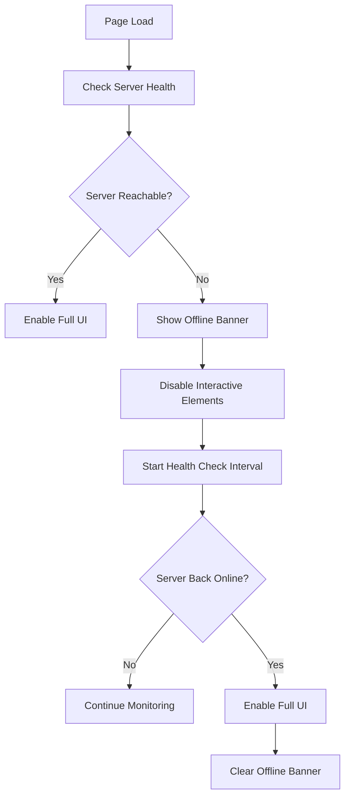

# Server Down Detection and Interaction Blocking Design

## Problem Statement

When `app.py` is killed but the dashboard webpage remains open, the browser continues to queue events (API requests, SSE connections, etc.) toward the now-down server. This causes:
- Browser freeze due to pending requests
- Poor user experience with no clear indication of server status
- Resource exhaustion from queued requests

## Solution Overview

Implement a comprehensive server health monitoring system that:
1. Detects when the server is down (connection refused, timeout, etc.)
2. Displays a clear "Server Offline" message to the user
3. Disables all interactive elements (buttons, forms, etc.)
4. Prevents queued requests from overwhelming the browser
5. Implements a reconnection mechanism with exponential backoff

## Architecture



## Implementation Details

### 1. Server Health Check Mechanism

**New Function: `checkServerHealth()`**
- Makes a lightweight GET request to `/api/session/status`
- Uses short timeout (3 seconds) to quickly detect failures
- Returns `{online: true}` or `{online: false, error: 'timeout'|'unreachable'|'error'}`

**New Function: `handleServerDown(errorType)`**
- Sets `isServerOnline = false`
- Shows offline banner
- Disables all interactive elements
- Stops SSE connection
- Starts health check polling

**New Function: `handleServerUp()`**
- Sets `isServerOnline = true`
- Hides offline banner
- Enables all interactive elements
- Reconnects SSE
- Refreshes data

### 2. UI State Management

**New Global Variables:**
```javascript
let isServerOnline = true;  // Track server availability
let healthCheckInterval = null;  // Polling interval ID
let sseConnection = null;  // SSE connection reference
```

**New CSS Classes:**
- `.server-offline` - Applied to body when server is down
- `.offline-banner` - Prominent banner showing server is offline
- `.disabled` - Applied to buttons/inputs when server is down

### 3. Modified Functions

**`apiRequest()` - Enhanced Error Handling:**
- Catch network errors (TypeError from fetch)
- Detect connection refused/timeout
- Call `handleServerDown()` on network failure
- Return early if server is offline

**`checkAuthentication()` - Server Check:**
- Check `isServerOnline` before making request
- Handle network errors gracefully

**`connectSSE()` - SSE Management:**
- Store reference to EventSource
- Close existing connection before creating new one
- Handle error events to detect server issues

**DOM Ready Handler:**
- Initial server health check
- Set up periodic health monitoring
- Enable/disable UI based on server status

### 4. UI Changes

**New HTML Element (in dashboardV2.html):**
```html
<div id="offline-banner" class="offline-banner" style="display: none;">
    <span class="offline-indicator">⚠️</span>
    <span class="offline-message">Server is offline. Dashboard is in read-only mode.</span>
    <button id="retry-btn" class="retry-btn">Retry Connection</button>
</div>
```

**Modified Body Class:**
- Add `server-offline` class to body when server is down
- CSS uses this to visually indicate disabled state

### 5. Health Check Polling

**Polling Strategy:**
- Initial check on page load
- If server is down, start polling every 10 seconds
- Exponential backoff: 10s, 15s, 20s, 30s (max 30s)
- Stop polling when server comes back online

**Polling Function: `pollServerHealth()`**
- Check server status
- Update UI accordingly
- Adjust polling interval based on server state

### 6. Button/Interaction Disabling

**Strategy:**
- Add `disabled` attribute to buttons when server is offline
- Add `pointer-events: none` CSS for visual feedback
- Prevent form submissions when server is down
- Show tooltip explaining why interaction is disabled

## Files to Modify

1. **dashboardV2.js**
   - Add `isServerOnline` global variable
   - Add `checkServerHealth()` function
   - Add `handleServerDown()` function
   - Add `handleServerUp()` function
   - Add `pollServerHealth()` function
   - Modify `apiRequest()` to handle network errors
   - Modify `connectSSE()` to manage connection lifecycle
   - Modify DOMContentLoaded handler for initial health check

2. **dashboardV2.html**
   - Add offline banner HTML element
   - Add retry button

3. **dashboardV2.css**
   - Add `.server-offline` body styles
   - Add `.offline-banner` styles
   - Add `.disabled` button styles
   - Add `.retry-btn` styles

## Testing Considerations

1. Test with server running normally
2. Kill server and verify offline banner appears
3. Verify buttons are disabled
4. Verify no new requests are queued
5. Restart server and verify reconnection
6. Test SSE reconnection
7. Test polling interval behavior

## Edge Cases

1. **User navigates away during offline state** - Clean up polling interval
2. **Multiple rapid health checks** - Use debouncing
3. **SSE connection lost** - Attempt reconnection
4. **Network flapping** - Implement hysteresis to avoid rapid state changes
5. **Page refresh during offline** - Health check on load

## Backward Compatibility

- All changes are additive
- No breaking changes to existing API endpoints
- Existing functionality preserved when server is online