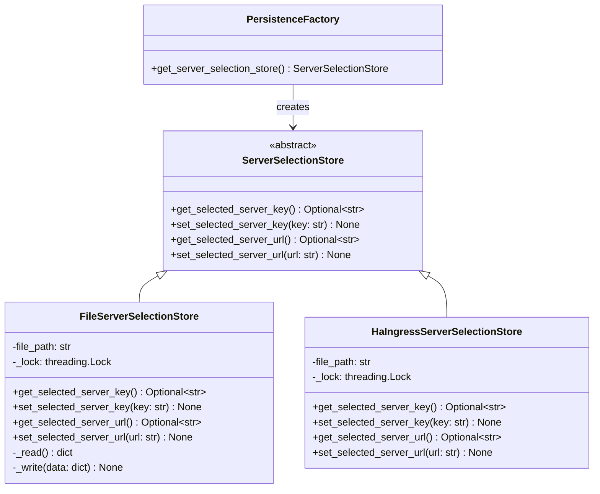
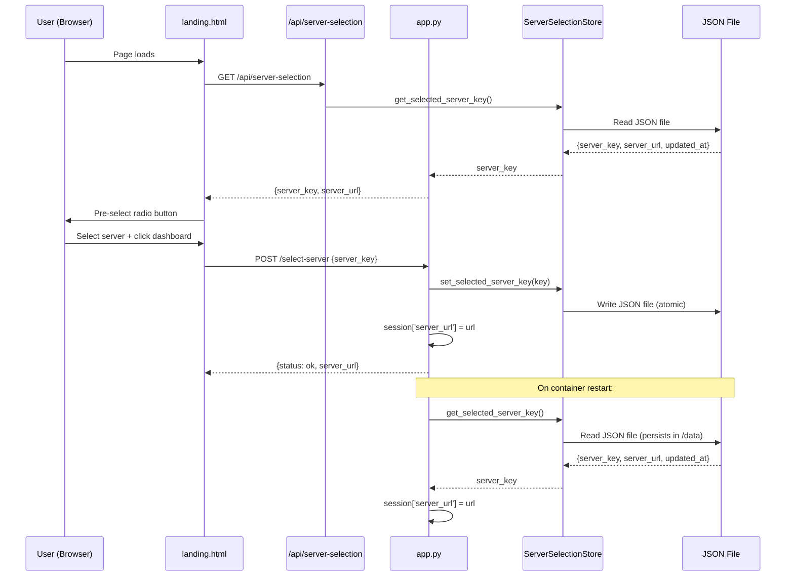

# Server Selection Persistence Plan

## Overview

This plan addresses the requirement to persist the Dashboard V2 server selection across application restarts, with a persistence abstraction that supports different storage implementations for Windows (development) and Home Assistant (production) environments.

## Current State Analysis

### Current Method of Server Selection

**Frontend** (`landing.html`):
- Radio button group with 3 predefined options: Local, Official, Debug Server
- User selects a server, then clicks "New Dashboard v2" or "Legacy Dashboard"
- The `selectDashboard(version)` JavaScript function reads the selected radio button value and POSTs to `/select-server`

**Backend** (`app.py`):
- `/select-server` POST route accepts JSON body with `server_key` field
- Maps the key to a URL via `Config.get_server_url(server_key)`
- Stores the URL in Flask session: `session['server_url'] = url`
- Server options defined in `Config.SERVER_OPTIONS` (class-level dict in `config.py`)

**Server Options**:
| Key | Name | URL |
|-----|------|-----|
| `local` | 🏠 Lokaal | `http://192.168.68.30:8080` |
| `official` | 🌍 Officieel | `https://api.timelimit.io` |
| `debug` | 🐛 Debug Server | `http://localhost:8080` |

### Current Storage Mechanism (The Problem)

Server selection is stored **only in the Flask session** (`session['server_url']`):

- Flask sessions are **cookie-based** and signed with `SECRET_KEY`
- `get_current_server_url()` reads from session, falling back to `config.DEBUG_SERVER_URL`
- `set_current_server_url()` writes to session

**Why this fails in HA:**
1. The HA container is **ephemeral** — filesystem is cleared on each restart
2. The SQLite database (`dashboardV2.db`) lives in the container filesystem and is lost on restart
3. Flask session cookies may persist in the browser, but if `SECRET_KEY` changes (not set via env var), the session becomes invalid
4. Even with a valid session cookie, the server selection is not persisted to any durable store
5. On restart, the app falls back to `config.DEBUG_SERVER_URL` (`http://localhost:8080`) — the user's selection is lost

### HA Environment Characteristics

- **Container**: Docker container managed by s6-overlay
- **Filesystem**: Ephemeral — `/usr/bin/dashboardV2/` and `dashboardV2.db` are lost on restart
- **Persistent storage**: The `/data` directory is mapped to HA's config and survives restarts
  - `/data/options.json` — HA add-on configuration (persists)
  - `/data/timelimit_ui_storage.json` — Legacy UI state storage (persists)
- **Startup**: s6-overlay run script at `rootfs/etc/s6-overlay/s6-rc.d/web-server/run` starts `web_server.py`
- **HA detection**: Can be done via a command-line argument (`--ha-ingress`) passed from the HA start script

## Design Decisions

### Storage Mechanism: JSON File in Persistent Directory

**Preferred storage**: A JSON file written to a persistent directory.

- **On Windows**: File stored in the app directory (`dashboardV2/server_selection.json`)
- **In HA**: File stored in the persistent `/data` directory (`/data/timelimit_ui_server_selection.json`)

**Why not SQLite?** The SQLite database (`dashboardV2.db`) is in the container filesystem and is lost on restart. While we could move it to `/data`, a simple JSON file is more appropriate for a single key-value pair and avoids database connection overhead.

**Why not Flask session alone?** Flask sessions are cookie-based and don't survive container restarts reliably (SECRET_KEY may change).

**Why not HA `options.json`?** The `options.json` file is managed by HA's add-on config UI and shouldn't be modified by the application at runtime.

### Scope: Application-Wide (Not User-Specific)

The server selection should be **application-wide**, not user-specific, because:
- There is typically only one user accessing the dashboard
- The server selection is a configuration choice, not a per-user preference
- It simplifies the persistence model (no need for user identification)

### Security Considerations

- The server selection stores only a **predefined server key** (e.g., `local`, `official`, `debug`), not an arbitrary URL
- This prevents SSRF attacks since only predefined URLs from `Config.SERVER_OPTIONS` are used
- The persistence file contains no sensitive data
- File permissions should be restricted to the application user (default on both Windows and HA)
- No performance concerns — file I/O for a small JSON file is negligible

## Architecture

### Persistence Abstraction

A new `persistence.py` module provides an abstract interface with environment-specific implementations:

### Data Flow

### Environment Detection

HA environment is detected via:
1. **Command-line argument**: `--ha-ingress` passed from the HA start script
2. **Environment variable**: `HA_INGRESS=true` (fallback)
3. **Default**: Windows/local development mode

The HA start script (`s6-rc.d/web-server/run`) will be updated to pass `--ha-ingress` when starting the Dashboard V2 Flask app.

## Implementation Steps

### Step 1: Create `persistence.py`

**File**: `timelimit-ui/rootfs/usr/bin/dashboardV2/persistence.py`

- Abstract base class `ServerSelectionStore` with methods:
  - `get_selected_server_key() -> Optional[str]`
  - `set_selected_server_key(key: str) -> None`
  - `get_selected_server_url() -> Optional[str]`
  - `set_selected_server_url(url: str) -> None`
- `FileServerSelectionStore` implementation:
  - Stores data in a JSON file with atomic writes (write to temp, then rename)
  - Thread-safe with `threading.Lock`
  - File format: `{"server_key": "local", "server_url": "http://...", "updated_at": 1234567890}`
- `HaIngressServerSelectionStore` implementation:
  - Extends `FileServerSelectionStore`
  - Uses HA's persistent `/data` directory
  - File path: `/data/timelimit_ui_server_selection.json`
- `PersistenceFactory` with `get_server_selection_store()` factory method
- HA detection via `sys.argv` and environment variable

### Step 2: Modify `config.py`

**File**: `timelimit-ui/rootfs/usr/bin/dashboardV2/config.py`

- Add `HA_INGRESS` property: detects HA environment from command-line argument or env var
- Add `PERSISTENCE_DIR` property: returns `/data` on HA, app directory on Windows
- Add `SERVER_SELECTION_FILE` property: returns `timelimit_ui_server_selection.json`
- Add `get_persistence_file_path()` classmethod: returns full path to the persistence file

### Step 3: Modify `app.py`

**File**: `timelimit-ui/rootfs/usr/bin/dashboardV2/app.py`

- Import `persistence` module
- Initialize the server selection store on app startup
- Modify `get_current_server_url()`:
  - Check persistent store first for `server_key`
  - Map key to URL via `Config.get_server_url()`
  - Fall back to session, then config default
- Modify `/select-server` route:
  - Save `server_key` to persistent store in addition to session
- Add new `/api/server-selection` GET route:
  - Returns `{server_key, server_url}` from persistent store
- Modify `create_app()` to initialize persistence on startup

### Step 4: Modify `landing.html`

**File**: `timelimit-ui/rootfs/usr/bin/dashboardV2/templates/landing.html`

- Add JavaScript to fetch `/api/server-selection` on page load
- Pre-select the corresponding radio button based on the persisted `server_key`
- Update `selectDashboard()` to use the persisted server key

### Step 5: Add `settings` table to `database.py`

**File**: `timelimit-ui/rootfs/usr/bin/dashboardV2/database.py`

- Add `settings` table to `init_db()`:
  - `key TEXT PRIMARY KEY`
  - `value TEXT`
  - `updated_at INTEGER`
- Add `save_setting(db, key, value)` function
- Add `get_setting(db, key)` function
- Add `get_all_settings(db)` function
- This serves as a secondary fallback persistence mechanism

### Step 6: Update HA Start Script

**File**: `timelimit-ui/rootfs/etc/s6-overlay/s6-rc.d/web-server/run`

- Add a new s6-overlay service for Dashboard V2, OR
- Modify the existing run script to also start the Dashboard V2 Flask app with `--ha-ingress` argument

### Step 7: Write Unit Tests

**File**: `timelimit-ui/rootfs/usr/bin/dashboardV2/tests/test_persistence.py`

- Test `FileServerSelectionStore`:
  - Save and retrieve server key
  - Save and retrieve server URL
  - Atomic write (temp file cleanup)
  - Thread safety
  - File not exists (returns None)
  - Corrupt file handling
- Test `HaIngressServerSelectionStore`:
  - Correct file path in HA mode
  - Same behavior as `FileServerSelectionStore`
- Test `PersistenceFactory`:
  - Returns correct implementation based on HA detection
  - Default to `FileServerSelectionStore` on Windows
  - Returns `HaIngressServerSelectionStore` when `--ha-ingress` is passed

### Step 8: Update Existing Tests

**Files**: `test_landing.py`, `test_config.py`

- Update `test_landing.py`:
  - Add tests for `/api/server-selection` endpoint
  - Update server selection tests to verify persistence
  - Add tests for pre-selection on landing page
- Update `test_config.py`:
  - Add tests for `HA_INGRESS`, `PERSISTENCE_DIR`, `SERVER_SELECTION_FILE` properties
  - Add tests for `get_persistence_file_path()` method

### Step 9: Update Documentation

**File**: `timelimit-ui/docs/dashboardV2-implementation.md`

- Update server selection section to describe persistence mechanism
- Add persistence abstraction architecture
- Update HA deployment instructions

## File Changes Summary

| File | Action | Description |
|------|--------|-------------|
| `dashboardV2/persistence.py` | **NEW** | Persistence abstraction with file-based and HA implementations |
| `dashboardV2/config.py` | **MODIFY** | Add HA detection, persistence directory, and file path config |
| `dashboardV2/app.py` | **MODIFY** | Integrate persistence store, add `/api/server-selection` endpoint |
| `dashboardV2/database.py` | **MODIFY** | Add `settings` table and CRUD functions |
| `dashboardV2/templates/landing.html` | **MODIFY** | Pre-select persisted server on page load |
| `dashboardV2/tests/test_persistence.py` | **NEW** | Unit tests for persistence abstraction |
| `dashboardV2/tests/test_landing.py` | **MODIFY** | Add tests for persistence integration |
| `dashboardV2/tests/test_config.py` | **MODIFY** | Add tests for persistence config |
| `rootfs/etc/s6-overlay/s6-rc.d/web-server/run` | **MODIFY** | Pass `--ha-ingress` to Dashboard V2 Flask app |
| `docs/dashboardV2-implementation.md` | **MODIFY** | Update documentation |

## Security & Performance Constraints

### Security
- Server selection stores only a **predefined key** (not arbitrary URL), preventing SSRF
- Persistence file contains no sensitive data
- File permissions default to application user only
- No authentication tokens or passwords stored in the persistence file

### Performance
- File I/O for small JSON file (< 1KB) is negligible
- Atomic writes (temp file + rename) prevent corruption
- Thread-safe with `threading.Lock`
- No database connection overhead for server selection
- Persistence operations are synchronous but fast (sub-millisecond)

### HA Container Restart
- The `/data` directory is persistent in HA and survives container restarts
- The persistence file is written to `/data/timelimit_ui_server_selection.json`
- On restart, the app reads the file and restores the server selection
- Falls back to config default if the file doesn't exist or is corrupt
