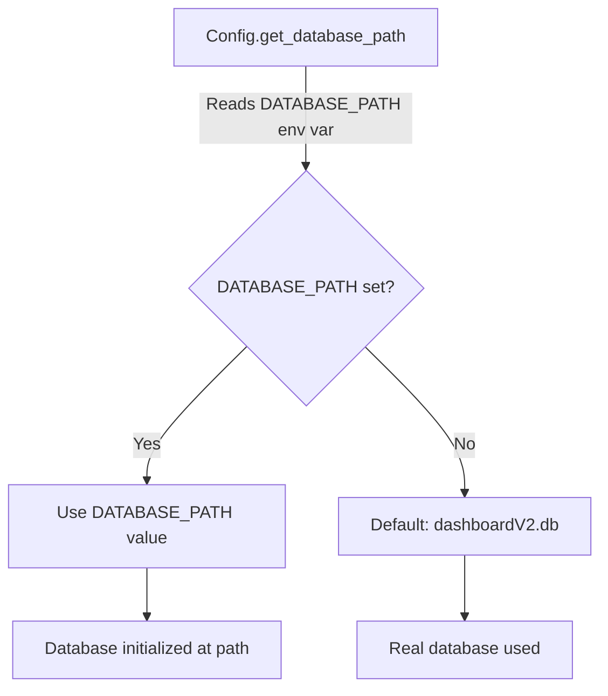
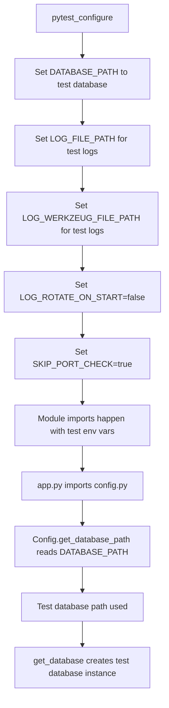

# Test Database Isolation Design Plan

## Problem Statement

When running unit tests, there is a risk that tests may interact with the real dashboard database (`dashboardV2.db`) instead of isolated test databases. This can lead to:
- Test data pollution affecting production data
- Tests failing due to unexpected data from production
- Security concerns with test data in production database

## Current Architecture Analysis

### Database Configuration Flow



### Current Test Infrastructure

1. **`conftest.py`** - Main pytest configuration
   - `pytest_configure` hook sets log-related environment variables
   - Does NOT set `DATABASE_PATH` early enough
   - Has `client` fixture that creates test databases
   - Has `test_db` fixture for direct database access

2. **`database.py`** - Database module
   - Singleton pattern with `_db_instance` global variable
   - `get_database()` returns singleton, creates if None
   - `reset_database()` clears singleton for testing
   - `Database.__init__` uses `Config.get_database_path()` if no path provided

3. **Test Files** - Various test modules
   - Some import `app` at module level (e.g., `test_time_limit_rules_e2e.py`)
   - Some have their own `test_app` fixtures duplicating conftest.py logic

### Identified Issues

1. **Early Database Initialization**: When test files import `app` at module level, the Flask app is created and may initialize the database before `pytest_configure` runs or before test fixtures can override `DATABASE_PATH`.

2. **Missing DATABASE_PATH in pytest_configure**: The `pytest_configure` hook sets log paths but not `DATABASE_PATH`, so the real database could be used during module import.

3. **Duplicate Fixture Logic**: `test_dashboard_api.py` and `test_time_limit_rules_e2e.py` have their own `test_app` fixtures that duplicate and potentially conflict with `conftest.py` fixtures.

4. **No Verification Tests**: There are no tests that verify tests don't touch the real database.

## Proposed Solution

### Architecture Diagram



### Implementation Steps

#### Step 1: Enhance pytest_configure Hook

Modify `conftest.py` to set `DATABASE_PATH` environment variable before any test modules are imported:

```python
def pytest_configure(config):
    """Configure test environment before any imports or collection."""
    # Set test-specific log paths
    tests_dir = os.path.dirname(os.path.abspath(__file__))
    log_dir = os.path.join(tests_dir, 'logs')
    os.makedirs(log_dir, exist_ok=True)
    
    os.environ['LOG_FILE_PATH'] = os.path.join(log_dir, 'dashboardV2.log')
    os.environ['LOG_WERKZEUG_FILE_PATH'] = os.path.join(log_dir, 'werkzeug.log')
    os.environ['LOG_ROTATE_ON_START'] = 'false'
    os.environ['LOG_LEVEL'] = 'INFO'
    
    # Set DATABASE_PATH to a test database BEFORE any imports
    # This ensures the real database is never used during test collection
    test_db_path = os.path.join(tests_dir, 'test_isolation.db')
    os.environ['DATABASE_PATH'] = test_db_path
    
    # Skip port check during testing
    os.environ['SKIP_PORT_CHECK'] = 'true'
```

#### Step 2: Create Centralized Test Database Factory

Add a new fixture in `conftest.py` that provides a clean test database for all tests:

```python
@pytest.fixture
def test_database_factory(tmp_path):
    """Factory fixture that provides isolated test databases.
    
    Yields a function that creates a new test database with a unique path.
    """
    def _create_test_db(db_name='test_db'):
        db_path = str(tmp_path / f'{db_name}.db')
        reset_database()
        db = Database(db_path=db_path)
        db.init_db()
        return db, db_path
    
    yield _create_test_db
    
    # Cleanup handled by tmp_path fixture
```

#### Step 3: Add Database Isolation Verification Tests

Create a new test file `test_database_isolation.py` that verifies:
- Tests use test databases, not the real database
- Database path is correctly set from environment variable
- Singleton is properly reset between tests

#### Step 4: Remove Duplicate Fixtures

Remove the `test_app` fixture from `test_dashboard_api.py` and `test_time_limit_rules_e2e.py` and use the centralized fixtures from `conftest.py`.

#### Step 5: Add Test Configuration Validation

Add tests that verify the test environment is properly configured:
- `DATABASE_PATH` environment variable is set
- Test database file exists and is separate from real database
- No data is written to the real database during tests

## Detailed Implementation Plan

### File: `timelimit-ui/rootfs/usr/bin/dashboardV2/tests/conftest.py`

1. **Modify `pytest_configure` hook** (lines 17-38):
   - Add `DATABASE_PATH` environment variable setting
   - Use a dedicated test database path

2. **Add new `test_database_factory` fixture**:
   - Provides factory function for creating isolated test databases
   - Uses pytest's `tmp_path` fixture for automatic cleanup

3. **Update `client` fixture** (lines 61-134):
   - Ensure it uses the test database from environment variable
   - Add verification that real database is not being used

### File: `timelimit-ui/rootfs/usr/bin/dashboardV2/tests/test_database_isolation.py` (NEW)

Create new test file with:
- `TestDatabaseIsolation` class
- Tests verifying test database isolation
- Tests verifying environment variable configuration

### File: `timelimit-ui/rootfs/usr/bin/dashboardV2/tests/test_dashboard_api.py`

1. **Remove `test_app` fixture** (lines 48-137):
   - Replace with usage of `client` fixture from conftest.py

2. **Update imports**:
   - Remove duplicate imports
   - Use fixtures from conftest.py

### File: `timelimit-ui/rootfs/usr/bin/dashboardV2/tests/test_time_limit_rules_e2e.py`

1. **Remove `test_app` fixture** (lines 41-79):
   - Replace with usage of `client` fixture from conftest.py

2. **Update imports**:
   - Remove duplicate imports
   - Use fixtures from conftest.py

## Verification Strategy

### Manual Verification

1. Run tests and verify no `dashboardV2.db` file is modified:
   ```bash
   # Before running tests
   md5sum dashboardV2.db > before.md5
   
   # Run tests
   pytest tests/
   
   # After running tests
   md5sum dashboardV2.db > after.md5
   
   # Compare
   diff before.md5 after.md5  # Should be identical
   ```

2. Check test database files are created in tests directory:
   ```bash
   ls -la tests/*.db  # Should show test database files
   ```

### Automated Verification

Add tests that:
1. Verify `DATABASE_PATH` environment variable is set during tests
2. Verify test database path is different from real database path
3. Verify no data exists in real database after tests run
4. Verify test database is properly cleaned up after each test

## Risk Assessment

### Low Risk Changes
- Adding `DATABASE_PATH` to `pytest_configure`
- Adding verification tests
- Removing duplicate fixtures

### Medium Risk Changes
- Modifying `client` fixture behavior
- Changes to import order in test files

### Mitigation
- Run full test suite after changes
- Verify real database is not modified
- Check for any test failures related to database isolation

## Success Criteria

1. All existing tests pass
2. Real database (`dashboardV2.db`) is never modified during test runs
3. Test databases are properly isolated and cleaned up
4. No test data pollution between tests
5. New verification tests pass

## Timeline

1. **Phase 1**: Enhance `pytest_configure` and add verification tests (1-2 hours)
2. **Phase 2**: Remove duplicate fixtures from test files (1 hour)
3. **Phase 3**: Run full test suite and verify isolation (30 minutes)
4. **Phase 4**: Update documentation (30 minutes)