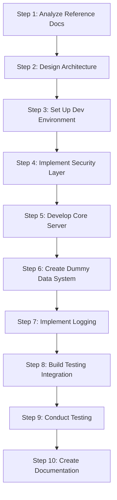

# Python Test Server Implementation Plan

> **Note:** All code and documentation for the test server will be placed in the `debug-server/` directory at the project root (`c:/git/timelimit-ui/debug-server/`).

## Overview

This document describes a comprehensive plan for building a Python-based test server that simulates the TimeLimit backend API (`api.timelimit.io`). The server will run on Windows, implement proper encryption for all client interactions, enforce secure authentication flows (login before data retrieval), serve dummy/mock data, and provide robust logging for communication issue analysis. It is designed to support future automated testing integration.

**Reference Documentation:**
- `context.md` — TimeLimit UI project documentation (UI bridge server, endpoints, crypto)
- `context_android_app.md` — Android app architecture (backend API endpoints, sync protocol, crypto system)

---

## Current Implementation Status

### Completed (tasks 001-022)

The following 22 tasks have been fully implemented and verified:

- [x] **task-001**: Created debug-server directory structure with `app/`, `app/api/`, `app/core/`, `app/models/`, `app/services/`, `logs/`, `tests/` subdirectories and placeholder `__init__.py` files
- [x] **task-002**: Initialized Python project configuration with `pyproject.toml`, `.python-version`, and `README.md`
- [x] **task-003**: Implemented environment configuration with `Settings` class in `app/core/config.py` and `.env.example` file
- [x] **task-004**: Implemented logging configuration with `setup_logging()` function in `app/core/logging.py`
- [x] **task-005**: Created FastAPI application factory with `create_application()` function, app instance, and `api_router`
- [x] **task-006**: Implemented health check endpoint with `GET /health` and `GET /ready` endpoints in `app/api/health.py`
- [x] **task-007**: Implemented user authentication models with `UserBase`, `UserCreate`, `User`, `Token`, and `TokenPayload` models in `app/models/user.py`
- [x] **task-008**: Implemented password hashing service with `verify_password()`, `get_password_hash()`, and `create_access_token()` functions in `app/services/security.py`
- [x] **task-009**: Implemented user service with `create_user()`, `get_user()`, `get_user_by_email()`, `authenticate_user()`, `store_password_hash()`, and `clear_users_db()` functions in `app/services/user.py`
- [x] **task-010**: Implemented authentication endpoints with `POST /register` and `POST /login` endpoints in `app/api/auth.py`, updated `app/api/__init__.py` to include auth router
- [x] **task-011**: Implemented user management endpoints with `GET /users/{user_id}` and `GET /users/email/{email}` endpoints in `app/api/users.py`, updated `app/api/__init__.py` to include users router
- [x] **task-012**: Created test configuration and fixtures with `conftest.py` (client and test_user fixtures), `tests/__init__.py`, and `pytest.ini` configuration
- [x] **task-013**: Implemented unit tests for configuration with `test_config.py` verifying all settings values
- [x] **task-014**: Implemented unit tests for logging with `test_logging.py` containing `test_setup_logging()`, `test_log_file_path()`, and `test_log_level()` tests
- [x] **task-015**: Implemented unit tests for security services with `test_security.py` containing 9 tests covering password hashing, token creation, expiration, algorithm, and signature verification
- [x] **task-016**: Implemented unit tests for user services with `test_user_service.py` containing 10 tests covering user creation, retrieval, and authentication
- [x] **task-017**: Implemented integration tests for API endpoints with `test_api.py` containing 12 tests covering health checks, user registration, login, and user retrieval
- [x] **task-018**: Created application entry points with `debug-server/app/__main__.py` and `debug-server/run.py` both using uvicorn to run the app on host "0.0.0.0", port 8000, with reload=True
- [x] **task-019**: Created `.env` file with all required configuration variables and updated `README.md` with comprehensive documentation
- [x] **task-020**: Final validation and test execution — All 42 pytest tests passed, server started successfully on port 8000, all API endpoints validated, log file created, all modules import without errors
- [x] **task-021**: Created analysis documentation with 4 files in `debug-server/docs/analysis/`: `endpoint-mapping.md` (21 backend API endpoints + 16 UI bridge endpoints with method and auth requirements), `security-requirements.md` (bcrypt cost 12, HMAC-SHA256/SHA512, SHA512 hex, DH key exchange secp256r1, Curve25519, AES-GCM CryptContainer, JWT, secure headers, HTTPS/TLS, threat model), `data-models.md` (ServerDataStatus, ClientDataStatus, ServerUserData, ServerDeviceData, ServerUpdatedCategoryBaseData, ActionUploadItem, ParentPassword, plus 13 additional models), `data-flow-diagrams.md` (authentication flow, sync protocol, key request/response protocol, crypto system, WebSocket, error handling with Mermaid diagrams)
- [x] **task-022**: Created architecture documentation in `debug-server/docs/architecture.md` with high-level architecture diagram (Mermaid), component interaction diagram (Mermaid classDiagram), data flow diagrams (authentication flow, sync protocol, key request/response protocol, WebSocket, error handling), design decisions and rationale (9 decisions), technology stack overview, and project structure documentation

### Gap Analysis

The implemented tasks (001-020) created a **basic generic user authentication server** using FastAPI. However, the comprehensive plan (Steps 1-10) describes a **full TimeLimit backend API simulator** with 21 backend API endpoints, sync protocol, crypto system, WebSocket support, mock data generation, and comprehensive documentation.

The following work from Steps 1-10 remains **unimplemented**:

| Step | Description | Status |
|------|-------------|--------|
| Step 1 | Analyze reference documentation and create analysis docs | **Not started** |
| Step 2 | Design server architecture and create architecture docs | **Not started** |
| Step 3 | Set up Python dev environment (structlog, additional config) | **Partially done** — basic setup done, missing structlog and additional config vars |
| Step 4 | Implement security layer (HMAC, AES-GCM, Curve25519, DH, middleware) | **Not started** |
| Step 5 | Develop core server functionality (TimeLimit API endpoints, state, gzip, response models) | **Partially done** — only generic auth endpoints exist, no TimeLimit-specific endpoints |
| Step 6 | Create dummy data generation system (mock data, device/category/action/sync models) | **Not started** |
| Step 7 | Implement robust logging infrastructure (structlog, middleware, exceptions, log analysis) | **Partially done** — basic logging only, no structlog or middleware |
| Step 8 | Build automated testing integration (scenarios, test client, testing docs) | **Partially done** — conftest.py exists, no scenarios or test client |
| Step 9 | Conduct thorough testing (crypto, sync, parent, child, purchase, websocket, load tests) | **Partially done** — only basic tests exist |
| Step 10 | Create comprehensive documentation (architecture, API, security, deployment, maintenance) | **Not started** — only basic README exists |

---

## Step 1: Analyze Reference Documentation

### Objective
Extract API endpoint specifications, authentication requirements, data models, and expected response formats from `context.md` and `context_android_app.md`. Produce a structured analysis report.

### Sub-tasks

1. **Parse `context.md`**
   - Extract the 16 UI bridge endpoints (Table in §307–329)
   - Extract the 4 UI bridge endpoints from §409–419
   - Document the proxy route mapping (UI route → backend API path)
   - Extract crypto functions: bcrypt (cost 12), HMAC-SHA512, HMAC-SHA256 binary, SHA512 hex
   - Extract configuration schema (`server_url`, `logging_mode`)
   - Extract data flow: authentication → rule management → synchronization → state management

2. **Parse `context_android_app.md`**
   - Extract the 21 backend API endpoints (Table in §125–147)
   - Document the HTTP request format: `Content-Type: application/json; charset=utf-8`, `Content-Encoding: gzip`, `Content-Length` auto-negotiation (411 retry)
   - Document the authentication flow: email → code → mailAuthToken → family creation → deviceAuthToken
   - Document the sync protocol: action-based CRDT, `push-actions` (batch of 25), `pull-status` (ClientDataStatus → ServerDataStatus)
   - Document the crypto system: Curve25519, AES-GCM CryptContainer, DH key exchange (secp256r1), bcrypt, HMAC-SHA256
   - Document the WebSocket (Socket.IO) events: `devicelogin`, `should sync`, `connected devices`, `sign out`
   - Document the key request/response protocol for encrypted app lists
   - Document the error handling: HTTP 400/401/403/404/409/410/429 mapping

3. **Create Endpoint Mapping Table**

   | UI Route (context.md) | Backend API (context_android_app.md) | Method | Auth Required |
   |---|---|---|---|
   | `/set-server` | N/A (internal) | POST | No |
   | `/ha-storage` | N/A (internal) | POST/GET | No |
   | `/ha-events-longpoll` | N/A (internal) | GET | No |
   | `/wizard-step1` | `/auth/send-mail-login-code-v2` | POST | No |
   | `/wizard-step2` | `/auth/sign-in-by-mail-code` | POST | No |
   | `/wizard-step3` | `/parent/create-family` | POST | No (mail auth) |
   | `/wizard-login` | `/parent/sign-in-into-family` | POST | No (mail auth) |
   | `/sync` | `/sync/pull-status` | POST | Yes (deviceAuthToken) |
   | `/sync/push-actions` | `/sync/push-actions` | POST | Yes (deviceAuthToken) |
   | `/generate-hashes` | N/A (internal) | POST | No |
   | `/regenerate-hash` | N/A (internal) | POST | No |
   | `/calculate-hmac` | N/A (internal) | POST | No |
   | `/calculate-hmac-sha256` | N/A (internal) | POST | No |
   | `/calculate-sha512` | N/A (internal) | POST | No |
   | `/debug-integrity` | N/A (internal) | POST | No |
   | `/get-token-device` | N/A (internal) | POST | No |

   **Backend API Endpoints (from context_android_app.md §125–147):**

   | Method | Path | Purpose | Auth Required |
   |---|---|---|---|
   | GET | `/time` | Get server time in milliseconds | No |
   | POST | `/auth/send-mail-login-code-v2` | Send email login code | No |
   | POST | `/auth/sign-in-by-mail-code` | Sign in with email + code | No |
   | POST | `/parent/get-status-by-mail-address` | Get family/mail status | No (mailAuthToken) |
   | POST | `/parent/create-family` | Create family | No (mailAuthToken) |
   | POST | `/parent/sign-in-into-family` | Sign in to existing family | No (mailAuthToken) |
   | POST | `/parent/recover-parent-password` | Recover parent password | No (mailAuthToken) |
   | POST | `/child/add-device` | Register child device | No (registerToken) |
   | POST | `/sync/push-actions` | Push pending actions | Yes (deviceAuthToken) |
   | POST | `/sync/pull-status` | Pull server status | Yes (deviceAuthToken) |
   | POST | `/parent/create-add-device-token` | Create add-device token | Yes (deviceAuthToken) |
   | POST | `/purchase/can-do-purchase` | Check purchase eligibility | Yes (deviceAuthToken) |
   | POST | `/purchase/finish-purchase-by-google-play` | Finish Google Play purchase | Yes (deviceAuthToken) |
   | POST | `/parent/link-mail-address` | Link email to parent account | Yes (deviceAuthToken) |
   | POST | `/child/update-primary-device` | Update primary device | Yes (deviceAuthToken) |
   | POST | `/child/logout-at-primary-device` | Sign out at primary device | Yes (deviceAuthToken) |
   | POST | `/sync/report-removed` | Report device as removed | Yes (deviceAuthToken) |
   | POST | `/parent/remove-device` | Remove a device | Yes (deviceAuthToken) |
   | POST | `/sync/is-device-removed` | Check if device was removed | Yes (deviceAuthToken) |
   | POST | `/parent/create-identity-token` | Create identity token | Yes (deviceAuthToken) |
   | POST | `/parent/delete-account` | Delete account | Yes (deviceAuthToken) |

4. **Document Security Requirements**
   - bcrypt password hashing (cost factor 12, two salts)
   - HMAC-SHA256 binary format for sync action integrity (`"password:" + base64(hmac)`)
   - HMAC-SHA512 for legacy sync action signing
   - SHA512 hex for legacy integrity
   - DH key exchange (ECDH secp256r1) for parent password encryption
   - Curve25519 for device signing keys and key request/response protocol
   - AES-GCM CryptContainer for encrypted app lists
   - JWT tokens for session management
   - Secure headers: `X-Content-Type-Options`, `X-Frame-Options`, `Content-Security-Policy`
   - HTTPS/TLS enforcement (configurable for local testing)

5. **Document Data Models**
   - `ServerDataStatus`: devices, users, categories, apps, crypto keys, pings, DH key, U2F data, fullVersion, message, apiLevel
   - `ClientDataStatus`: clientLevel, devices, users, apps, devicesDetail, categories, kri, kr, dh, u2f
   - `ServerUserData`: id, name, password, secondPasswordSalt, type, timeZone, disableLimitsUntil, mail, currentDevice, categoryForNotAssignedApps, relaxPrimaryDevice, flags, limitLoginCategory, preBlockDuration
   - `ServerDeviceData`: deviceId, name, model, addedAt, currentUserId, currentProtectionLevel, highestProtectionLevel, currentAppVersion, highestAppVersion, publicKey, platformType, platformLevel
   - `ServerUpdatedCategoryBaseData`: categoryId, childId, title, blockedTimes, extraTime, extraTimeDay, tempBlocked, tempBlockTime, version, parentCategoryId, blockAllNotifications, timeWarnings, sort, networks, flags, blockNotificationDelay, atw
   - `ActionUploadItem`: encodedAction, sequenceNumber, integrity, type, userId
   - `ParentPassword`: hash, secondHash, secondSalt, encrypted

6. **Create Data Flow Diagrams**
   - Authentication flow: email → code → mailAuthToken → family creation → deviceAuthToken → pull-status
   - Sync flow: push-actions (batch 25) → pull-status (ClientDataStatus → ServerDataStatus) → apply → crypto sync
   - Key request/response protocol: Device B → Server → Device A (request) → Device A → Server → Device B (response) → finish

### Deliverables
- `docs/analysis/endpoint-mapping.md` — Complete endpoint mapping table
- `docs/analysis/security-requirements.md` — Security requirements document
- `docs/analysis/data-models.md` — Data model specifications
- `docs/analysis/data-flow-diagrams.md` — Data flow diagrams (Mermaid)

---

## Step 2: Design Server Architecture

### Objective
Design a modular server architecture with clear separation of concerns, architectural diagrams, and a well-defined project structure.

### Sub-tasks

1. **Choose Framework**
   - **FastAPI** as the HTTP framework (async support, automatic OpenAPI docs, Pydantic validation, dependency injection)
   - **Uvicorn** as the ASGI server
   - **python-socketio** for WebSocket (Socket.IO) support
   - Rationale: FastAPI provides better structure, validation, and documentation than raw `http.server`

2. **Define Architecture Layers**

   ```
   ┌─────────────────────────────────────────────────────────┐
   │                    Client (Android App / UI)             │
   │  HTTP/gzip + Socket.IO + JWT + HMAC integrity            │
   ├─────────────────────────────────────────────────────────┤
   │              API Gateway / Middleware Layer              │
   │  Logging, Auth, Encryption, CORS, Security Headers       │
   ├─────────────────────────────────────────────────────────┤
   │              Controller / Router Layer                   │
   │  Auth Routes, Sync Routes, Parent Routes, Child Routes   │
   ├─────────────────────────────────────────────────────────┤
   │              Service / Business Logic Layer              │
   │  AuthService, SyncService, CryptoService, MockDataService │
   ├─────────────────────────────────────────────────────────┤
   │              Data / Model Layer                          │
   │  Pydantic Models, Mock Data Store, State Manager         │
   ├─────────────────────────────────────────────────────────┤
   │              Security / Crypto Layer                     │
   │  JWT, bcrypt, HMAC-SHA256, AES-GCM, Curve25519, DH       │
   └─────────────────────────────────────────────────────────┘
   ```

3. **Create Component Interaction Diagram**

   ```mermaid
   classDiagram
       class Client {
           +POST /auth/send-mail-login-code-v2
           +POST /auth/sign-in-by-mail-code
           +POST /sync/pull-status
           +POST /sync/push-actions
       }
       class Middleware {
           +RequestLogging
           +AuthVerification
           +EncryptionHandshake
           +SecurityHeaders
       }
       class Controllers {
           +AuthController
           +SyncController
           +ParentController
           +ChildController
       }
       class Services {
           +AuthService
           +SyncService
           +CryptoService
           +MockDataService
       }
       class Models {
           +User
           +Device
           +Category
           +Action
           +ServerDataStatus
           +ClientDataStatus
       }
       class Security {
           +JWTManager
           +BcryptHasher
           +HmacSigner
           +AesGcmCrypt
           +Curve25519
           +DhHandshake
       }

       Client --> Middleware : HTTP/gzip + JWT
       Middleware --> Controllers : authenticated request
       Controllers --> Services : business logic
       Services --> Models : data operations
       Services --> Security : crypto operations
       Controllers --> Security : token validation
   ```

4. **Define Project Structure**

   ```
   debug-server/
   ├── app/
   │   ├── __init__.py
   │   ├── main.py                    # FastAPI app creation, middleware registration
   │   ├── config.py                  # Configuration management (Pydantic settings)
   │   ├── api/
   │   │   ├── __init__.py
   │   │   ├── deps.py                # Dependency injection (auth, db, config)
   │   │   ├── auth.py                # Auth endpoints (login, family, device)
   │   │   ├── sync.py                # Sync endpoints (push-actions, pull-status)
   │   │   ├── parent.py              # Parent management endpoints
   │   │   ├── child.py               # Child device endpoints
   │   │   ├── purchase.py            # Purchase endpoints
   │   │   └── time.py                # Server time endpoint
   │   ├── core/
   │   │   ├── __init__.py
   │   │   ├── security.py            # JWT, bcrypt, HMAC, AES-GCM, Curve25519, DH
   │   │   ├── auth.py                # Authentication logic, session management
   │   │   ├── state.py               # In-memory state management
   │   │   └── exceptions.py          # Custom exception classes
   │   ├── models/
   │   │   ├── __init__.py
   │   │   ├── user.py                # User data models
   │   │   ├── device.py              # Device data models
   │   │   ├── category.py            # Category data models
   │   │   ├── action.py              # Sync action models
   │   │   ├── sync.py                # ServerDataStatus, ClientDataStatus
   │   │   └── response.py            # Standardized API response wrapper
   │   ├── services/
   │   │   ├── __init__.py
   │   │   ├── mock_data.py           # Dummy data generation
   │   │   ├── sync_service.py        # Sync protocol logic
   │   │   ├── auth_service.py        # Authentication service
   │   │   └── crypto_service.py      # Crypto service wrapper
   │   ├── middleware/
   │   │   ├── __init__.py
   │   │   ├── logging.py             # Structured request/response logging
   │   │   ├── auth.py                # JWT authentication middleware
   │   │   ├── encryption.py          # Encryption handshake monitoring
   │   │   └── security_headers.py    # Security header injection
   │   ├── websocket/
   │   │   ├── __init__.py
   │   │   ├── manager.py             # Socket.IO connection management
   │   │   └── handlers.py            # Socket.IO event handlers
   │   └── utils/
   │       ├── __init__.py
   │       ├── logger.py              # Structured logging setup (structlog)
   │       ├── gzip_utils.py          # Gzip compression/decompression
   │       └── helpers.py             # Utility functions
   ├── tests/
   │   ├── __init__.py
   │   ├── conftest.py                # Pytest fixtures
   │   ├── test_auth.py               # Authentication tests
   │   ├── test_sync.py               # Sync protocol tests
   │   ├── test_crypto.py             # Crypto tests
   │   ├── test_endpoints.py          # Endpoint integration tests
   │   └── test_websocket.py          # WebSocket tests
   ├── docs/
   │   ├── architecture.md            # Architecture documentation
   │   ├── api.md                     # API documentation
   │   ├── security.md                # Security implementation guide
   │   ├── deployment.md              # Deployment instructions
   │   └── analysis/                  # Step 1 deliverables
   ├── requirements.txt               # Production dependencies
   ├── requirements-dev.txt           # Development dependencies
   ├── Dockerfile                     # Docker configuration
   ├── .env.example                   # Environment variable template
   ├── README.md                      # Project README
   └── run.py                         # Entry point script
   ```

5. **Document Architecture Decisions**
   - **FastAPI over Flask**: Better async support, automatic validation, OpenAPI generation, dependency injection
   - **In-memory state store**: Sufficient for test server; no database needed; state resets on restart
   - **JWT for sessions**: Stateless authentication, easy to validate, supports expiration
   - **Gzip middleware**: Transparent gzip decompression for request bodies, gzip compression for responses
   - **Modular structure**: Clear separation of concerns for maintainability and testability
   - **Configurable endpoints**: All endpoints configurable via environment variables for testing flexibility

### Deliverables
- `docs/architecture.md` — Full architecture documentation with diagrams
- `docs/analysis/endpoint-mapping.md` — Endpoint mapping (from Step 1)
- `docs/analysis/security-requirements.md` — Security requirements (from Step 1)
- `docs/analysis/data-models.md` — Data models (from Step 1)
- `docs/analysis/data-flow-diagrams.md` — Data flow diagrams (from Step 1)

---

## Step 3: Set Up Python Development Environment

### Objective
Set up the Python development environment on Windows with all required dependencies, virtual environments, dependency management, coding standards, and security guidelines.

### Sub-tasks

1. **Python Version**
   - Require Python 3.11+ (for `typing` improvements, `tomllib`, better async support)
   - Verify Windows compatibility: use `pathlib` for all path operations, avoid Unix-specific utilities

2. **Virtual Environment Setup**
   - Create virtual environment: `python -m venv .venv`
   - Activate: `.venv\Scripts\activate` (Windows)
   - Use `pip` for package management

3. **Dependency Management**
   - `requirements.txt` (production):
     ```
     fastapi>=0.115.0
     uvicorn[standard]>=0.30.0
     python-socketio[asyncio]>=5.11.0
     python-jose[cryptography]>=3.3.0
     bcrypt>=4.2.0
     cryptography>=43.0.0
     pydantic>=2.9.0
     pydantic-settings>=2.5.0
     structlog>=24.2.0
     python-multipart>=0.0.10
     ```
   - `requirements-dev.txt` (development):
     ```
     -r requirements.txt
     pytest>=8.3.0
     pytest-asyncio>=0.24.0
     pytest-cov>=5.0.0
     httpx>=0.27.0
     pytest-socketio>=0.0.1
     ```

4. **Configuration Management**
   - Use `pydantic-settings` for configuration
   - Create `.env.example` with all configurable values:
     - `SERVER_HOST` (default: `0.0.0.0`)
     - `SERVER_PORT` (default: `8080`)
     - `JWT_SECRET_KEY` (default: generated random key)
     - `JWT_ALGORITHM` (default: `HS256`)
     - `JWT_EXPIRATION_MINUTES` (default: `60`)
     - `BCRYPT_COST` (default: `12`)
     - `LOG_LEVEL` (default: `INFO`)
     - `LOG_FILE_PATH` (default: `logs/debug-server.log`)
     - `ENABLE_HTTPS` (default: `false` for local testing)
     - `MOCK_DATA_SEED` (default: `42` for reproducible mock data)
     - `ENABLE_WEBSOCKET` (default: `true`)
     - `LONGPOLL_TIMEOUT_SECONDS` (default: `25`)

5. **Coding Standards**
   - PEP 8 style guide
   - Type hints on all functions and methods
   - Docstrings on all public functions (Google style)
   - Use `pathlib.Path` for all file operations
   - Use `logging` module with structured logging via `structlog`
   - No hardcoded paths; all paths relative to project root
   - Use `os.environ` or `pydantic-settings` for configuration

6. **Security Guidelines**
   - Never log passwords, tokens, or sensitive data in plaintext
   - Use `secrets` module for generating random tokens
   - Validate all input data with Pydantic models
   - Use parameterized queries (not applicable for in-memory store, but good practice)
   - Implement rate limiting for auth endpoints
   - Use secure random for JWT secret key generation
   - Enforce HTTPS in production (configurable for local testing)

7. **Project Initialization**
   - Create `run.py` entry point
   - Create `app/__init__.py`
   - Create `app/config.py` with Pydantic settings
   - Create `app/utils/logger.py` with structlog configuration
   - Create `requirements.txt` and `requirements-dev.txt`
   - Create `.env.example`
   - Create `README.md` with setup instructions

### Deliverables
- `requirements.txt`
- `requirements-dev.txt`
- `.env.example`
- `run.py`
- `app/config.py`
- `app/utils/logger.py`
- `README.md`

---

## Step 4: Implement Security Layer

### Objective
Implement the security layer including encryption mechanisms, JWT token generation and validation, secure authentication flow, session management, and middleware for request/response encryption, authentication verification, and secure header handling.

### Sub-tasks

1. **JWT Manager** (`app/core/security.py`)
   - `generate_token(user_id, device_id, expires_delta)` — Create JWT with claims: `sub`, `device_id`, `exp`, `iat`, `jti`
   - `validate_token(token)` — Verify JWT signature, check expiration, return claims
   - `decode_token(token)` — Decode without verification (for debugging)
   - Use `python-jose[cryptography]` for JWT operations
   - Algorithm: HS256 (configurable)

2. **Bcrypt Hasher** (`app/core/security.py`)
   - `hash_password(password)` — Generate bcrypt hash with cost factor 12
   - `verify_password(password, hash)` — Verify bcrypt hash
   - `hash_password_with_salt(password, salt)` — Hash with specific salt (for second hash regeneration)
   - Use `bcrypt` library

3. **HMAC Signer** (`app/core/security.py`)
   - `calculate_hmac_sha256(second_hash, sequence_number, device_id, encoded_action)` — HMAC-SHA256 binary format
     - Key: `second_hash` (UTF-8 bytes)
     - Message: `seq_bytes (8) + device_id_len (4) + device_id_bytes + action_len (4) + action_bytes`
     - Output: `"password:" + base64(hmac_digest)`
   - `calculate_hmac_sha512(key_base64, message)` — HMAC-SHA512
   - `calculate_sha512_hex(message)` — SHA512 hex digest
   - Use `hmac` and `hashlib` from standard library

4. **AES-GCM CryptContainer** (`app/core/security.py`)
   - `encrypt_data(plaintext, key)` — AES-GCM encryption with 12-byte IV, 128-bit auth tag
   - `decrypt_data(ciphertext, key)` — AES-GCM decryption with auth tag verification
   - `CryptContainer` class with format versions: `FORMAT_LEGACY (0)`, `FORMAT_APP_LIST_V2 (1)`, `FORMAT_APP_DIFF_V2 (2)`
   - Header: generation (8 bytes) + counter (8 bytes) + IV (4 bytes) = 20 bytes
   - Use `cryptography.hazmat.primitives.ciphers.aead.AESGCM`

5. **Curve25519 Operations** (`app/core/security.py`)
   - `generate_keypair()` — Generate Curve25519 key pair (32-byte public + 32-byte private)
   - `sign(private_key, message)` — Sign message (64-byte signature)
   - `verify(public_key, message, signature)` — Verify signature
   - `shared_secret(private_key, public_key)` — Compute ECDH shared secret
   - Use `nacl.signing` (PyNaCl) or `cryptography` library

6. **DH Key Exchange** (`app/core/security.py`)
   - `dh_handshake(server_dh_key)` — ECDH with secp256r1 curve
   - `dh_encrypt(crypt_data, auth_data, server_dh_key)` — Encrypt data using DH shared secret
   - Output format: `base64(iv + encryptedData) + "." + base64(ownPublicKey) + "." + keyVersion`
   - Use `cryptography.hazmat.primitives.asymmetric.ec`

7. **Authentication Middleware** (`app/middleware/auth.py`)
   - Intercept requests to protected endpoints
   - Extract JWT from `Authorization: Bearer <token>` header
   - Validate token and extract claims
   - Attach user/device info to request state
   - Return 401 if token is missing or invalid
   - Protected endpoints: `/sync/*`, `/parent/*`, `/child/*`, `/purchase/*`

8. **Encryption Handshake Middleware** (`app/middleware/encryption.py`)
   - Monitor encryption handshake for WebSocket connections
   - Log encryption handshake events (DH key exchange, key request/response)
   - Track encryption state per session
   - Log encryption failures and diagnostics

9. **Security Headers Middleware** (`app/middleware/security_headers.py`)
   - Add `X-Content-Type-Options: nosniff`
   - Add `X-Frame-Options: DENY`
   - Add `Content-Security-Policy: default-src 'none'`
   - Add `Strict-Transport-Security` (if HTTPS enabled)
   - Add `X-XSS-Protection: 1; mode=block`

10. **Threat Modeling**
    - Document potential threats: token theft, replay attacks, man-in-the-middle, brute force
    - Mitigation strategies: JWT expiration, HTTPS, rate limiting, HMAC integrity
    - Document in `docs/security.md`

### Deliverables
- `app/core/security.py` — All crypto functions
- `app/middleware/auth.py` — Authentication middleware
- `app/middleware/encryption.py` — Encryption handshake middleware
- `app/middleware/security_headers.py` — Security headers middleware
- `docs/security.md` — Security implementation guide and threat model

---

## Step 5: Develop Core Server Functionality

### Objective
Develop the core server functionality with HTTP request handlers for all specified endpoints. Implement proper routing, request validation, business logic processing, and response formatting. Ensure login endpoints are implemented before data retrieval endpoints with appropriate access controls. Maintain state management for authenticated sessions.

### Sub-tasks

1. **Application Factory** (`app/main.py`)
   - Create FastAPI app instance
   - Register middleware (logging, auth, encryption, security headers)
   - Register routers (auth, sync, parent, child, purchase, time)
   - Configure CORS
   - Add exception handlers
   - Add startup/shutdown event handlers

2. **Gzip Middleware** (`app/middleware/gzip.py`)
   - Decompress incoming gzip request bodies
   - Compress outgoing gzip response bodies
   - Handle `Content-Encoding: gzip` header
   - Handle `Content-Length` auto-negotiation (411 retry simulation)

3. **Auth Controller** (`app/api/auth.py`)
   - `POST /time` — Return server time in milliseconds
   - `POST /auth/send-mail-login-code-v2` — Generate and store email login code (dummy code)
     - Request: `{mail, locale, deviceAuthToken?}`
     - Response: `{mailLoginToken, mailServerBlacklisted, mailAddressNotWhitelisted, blockedForIntegrityReasons, mailServerBlacklistedTemporarily}`
   - `POST /auth/sign-in-by-mail-code` — Validate code, return mailAuthToken
     - Request: `{mailLoginToken, receivedCode}`
     - Response: `{mailAuthToken}`
   - `POST /parent/get-status-by-mail-address` — Check family status
     - Request: `{mailAuthToken}`
     - Response: `{mail, status, canCreateFamily, alwaysPro}`
   - `POST /parent/create-family` — Create family with parent password
     - Request: `{mailAuthToken, parentPassword: {hash, secondHash, secondSalt, encrypted}, ...}`
     - Response: `{deviceAuthToken, ownDeviceId, data: ServerDataStatus}`
   - `POST /parent/sign-in-into-family` — Sign in to existing family
     - Request: `{mailAuthToken, parentPasswordSecondHash, ...}`
     - Response: `{deviceAuthToken, ownDeviceId, data: ServerDataStatus}`
   - `POST /parent/recover-parent-password` — Recover parent password
     - Request: `{mailAuthToken, newPassword: {hash, secondHash, secondSalt, encrypted}}`
     - Response: `{status: "ok"}`

4. **Child Controller** (`app/api/child.py`)
   - `POST /child/add-device` — Register child device
     - Request: `{registerToken, childDevice: {model}, deviceName, clientLevel?}`
     - Response: `{deviceAuthToken, ownDeviceId, data: ServerDataStatus?}`
   - `POST /child/update-primary-device` — Update primary device
     - Request: `{deviceAuthToken, primaryDeviceId}`
     - Response: `{status: "ok"}`
   - `POST /child/logout-at-primary-device` — Sign out at primary device
     - Request: `{deviceAuthToken}`
     - Response: `{status: "ok"}`

5. **Sync Controller** (`app/api/sync.py`)
   - `POST /sync/push-actions` — Push pending actions to server
     - Request: `{deviceAuthToken, actions: [ActionUploadItem]}`
     - Response: `{shouldDoFullSync: bool}`
   - `POST /sync/pull-status` — Pull server status
     - Request: `{deviceAuthToken, status: ClientDataStatus}`
     - Response: `ServerDataStatus`
   - `POST /sync/report-removed` — Report device as removed
     - Request: `{deviceAuthToken}`
     - Response: `{status: "ok"}`
   - `POST /sync/is-device-removed` — Check if device was removed
     - Request: `{deviceAuthToken}`
     - Response: `{isDeviceRemoved: bool}`

6. **Parent Controller** (`app/api/parent.py`)
   - `POST /parent/create-add-device-token` — Create add-device token
     - Request: `{deviceAuthToken, parentId, parentPasswordSecondHash}`
     - Response: `{token, deviceId}`
   - `POST /parent/remove-device` — Remove a device
     - Request: `{deviceAuthToken, deviceId}`
     - Response: `{status: "ok"}`
   - `POST /parent/link-mail-address` — Link email to parent account
     - Request: `{deviceAuthToken, mailAuthToken}`
     - Response: `{status: "ok"}`
   - `POST /parent/create-identity-token` — Create identity token
     - Request: `{deviceAuthToken}`
     - Response: `{identityToken}`
   - `POST /parent/delete-account` — Delete account
     - Request: `{deviceAuthToken}`
     - Response: `{status: "ok"}`

7. **Purchase Controller** (`app/api/purchase.py`)
   - `POST /purchase/can-do-purchase` — Check purchase eligibility
     - Request: `{deviceAuthToken, productId}`
     - Response: `{canDoPurchase: bool}`
   - `POST /purchase/finish-purchase-by-google-play` — Finish Google Play purchase
     - Request: `{deviceAuthToken, productId, purchaseToken, signature}`
     - Response: `{status: "ok", fullVersionUntil: <timestamp>}`

8. **State Management** (`app/core/state.py`)
   - In-memory store for:
     - Families (family_id → family data)
     - Users (user_id → user data)
     - Devices (device_id → device data)
     - Categories (category_id → category data)
     - Auth tokens (mail_login_token → {mail, code}, mail_auth_token → {mail, family_id}, device_auth_token → {device_id, family_id})
     - Add-device tokens (token → {device_id, parent_id, expires_at})
     - Pending actions (sequence_number → action)
     - Sync versions (per entity type)
   - Thread-safe access using `asyncio.Lock`
   - State reset capability for testing

9. **Standardized Response Format** (`app/models/response.py`)
   - All responses wrapped in a standard format:
     ```json
     {
       "status": "ok" | "error",
       "data": <response data>,
       "error": <error message if status is "error">
     }
     ```
   - For sync endpoints, return raw `ServerDataStatus` / `ActionUploadResponse` as per protocol
   - For auth endpoints, return protocol-specific response formats

10. **Request Validation**
    - Use Pydantic models for all request bodies
    - Validate required fields
    - Return 400 with error details for invalid requests
    - Log validation errors

### Deliverables
- `app/main.py` — Application factory
- `app/api/auth.py` — Auth controller
- `app/api/sync.py` — Sync controller
- `app/api/parent.py` — Parent controller
- `app/api/child.py` — Child controller
- `app/api/purchase.py` — Purchase controller
- `app/api/time.py` — Time endpoint
- `app/core/state.py` — State management
- `app/models/response.py` — Standardized response models
- `app/middleware/gzip.py` — Gzip middleware

---

## Step 6: Create Dummy Data Generation System

### Objective
Create a comprehensive dummy data generation system with configurable mock data for all API responses. Implement data models matching the reference documentation specifications. Ensure logical sequence consistency and realistic data relationships.

### Sub-tasks

1. **Mock Data Generator** (`app/services/mock_data.py`)
   - `MockDataGenerator` class with seed-based reproducibility
   - Generate families with parent and child users
   - Generate devices (parent device, child devices)
   - Generate categories (time limit categories per child)
   - Generate apps per device
   - Generate time limit rules
   - Generate used time items
   - Generate child tasks
   - Generate crypto keys (Curve25519, DH)
   - Generate U2F data
   - Configurable via `MOCK_DATA_SEED` environment variable

2. **Data Models** (`app/models/`)
   - `User` model: id, name, password, secondPasswordSalt, type, timeZone, disableLimitsUntil, mail, currentDevice, categoryForNotAssignedApps, relaxPrimaryDevice, flags, limitLoginCategory, preBlockDuration
   - `Device` model: deviceId, name, model, addedAt, currentUserId, currentProtectionLevel, highestProtectionLevel, currentAppVersion, highestAppVersion, publicKey, platformType, platformLevel
   - `Category` model: categoryId, childId, title, blockedTimes, extraTime, extraTimeDay, tempBlocked, tempBlockTime, version, parentCategoryId, blockAllNotifications, timeWarnings, sort, networks, flags, blockNotificationDelay, atw
   - `CategoryApp` model: categoryId, apps, version
   - `UsedTimeItem` model: categoryId, usedTime, date
   - `TimeLimitRule` model: categoryId, day, startTime, endTime, maxTime
   - `ChildTask` model: categoryId, taskId, title, description, completed
   - `Action` model: type, sequenceNumber, encodedAction, integrity, userId
   - `ServerDataStatus` model: devices, devices2, apps, rmCategories, categoryBase, categoryApp, usedTimes, rules, tasks, users, krq, kr, pings, dh, u2f, fullVersion, message, apiLevel
   - `ClientDataStatus` model: clientLevel, devices, users, apps, devicesDetail, categories, kri, kr, dh, u2f

3. **Logical Sequence Consistency**
   - Family creation → device registration → initial pull-status → sync loop
   - Parent password hash → second hash → second salt → integrity signing
   - Device auth token → pull-status → ServerDataStatus → apply locally
   - Actions → push-actions → shouldDoFullSync → pull-status → apply

4. **Realistic Data Relationships**
   - Parent user has `type: "parent"` and `mail` field
   - Child user has `type: "child"` and `categoryForNotAssignedApps`
   - Categories belong to child users (`childId` references user `id`)
   - Apps are assigned to categories
   - Time limit rules belong to categories
   - Devices belong to families
   - Device auth tokens are unique per device

5. **Configurable Mock Data**
   - `MOCK_DATA_SEED` — Seed for reproducible data
   - `MOCK_FAMILY_COUNT` — Number of families to generate (default: 1)
   - `MOCK_CHILD_COUNT` — Number of child users per family (default: 2)
   - `MOCK_DEVICE_COUNT` — Number of devices per family (default: 3)
   - `MOCK_CATEGORY_COUNT` — Number of categories per child (default: 3)
   - `MOCK_APP_COUNT` — Number of apps per device (default: 10)

6. **Mock Data Structure Documentation**
   - Document the structure of each generated data model
   - Document the relationships between models
   - Document the generation logic
   - Include example JSON output

### Deliverables
- `app/services/mock_data.py` — Mock data generator
- `app/models/user.py` — User model
- `app/models/device.py` — Device model
- `app/models/category.py` — Category model
- `app/models/action.py` — Action model
- `app/models/sync.py` — ServerDataStatus, ClientDataStatus models
- `docs/analysis/mock-data-structure.md` — Mock data structure documentation

---

## Step 7: Implement Robust Logging Infrastructure

### Objective
Implement robust logging infrastructure with structured logging for requests, responses, encryption handshakes, and error diagnostics. Configure log levels, formats, and storage mechanisms. Create monitoring capabilities for security events and communication issues.

### Sub-tasks

1. **Structured Logging Setup** (`app/utils/logger.py`)
   - Use `structlog` for structured logging
   - Configure processors: timestamp, log level, JSON output, stack info
   - Configure log levels: DEBUG, INFO, WARNING, ERROR, CRITICAL
   - Support both console and file output
   - File output: `logs/debug-server.log` (configurable via `LOG_FILE_PATH`)
   - Console output: stderr with colored output
   - Log rotation: max 10MB per file, 5 backup files

2. **Request/Response Logging Middleware** (`app/middleware/logging.py`)
   - Log incoming request: method, path, headers (sanitized), body size, client IP
   - Log outgoing response: status code, response size, duration
   - Sanitize sensitive data: passwords, tokens, secondHash
   - Log request ID for correlation (UUID per request)
   - Log at INFO level for normal requests, DEBUG for verbose

3. **Encryption Handshake Monitoring** (`app/middleware/encryption.py`)
   - Log encryption handshake events:
     - DH key exchange initiation
     - Key request/response protocol steps
     - AES-GCM encryption/decryption operations
     - Curve25519 signing/verification
   - Log encryption failures with diagnostics
   - Log encryption state per session
   - Log at INFO level for successful handshakes, WARNING for failures

4. **Error Diagnostics** (`app/core/exceptions.py`)
   - Custom exception classes:
     - `AuthenticationError` — 401 Unauthorized
     - `AuthorizationError` — 403 Forbidden
     - `NotFoundError` — 404 Not Found
     - `ConflictError` — 409 Conflict
     - `RateLimitError` — 429 Too Many Requests
     - `CryptoError` — Encryption/decryption failures
     - `ValidationError` — Input validation failures
   - Log full stack traces for errors
   - Include request context in error logs
   - Log at ERROR level for exceptions, CRITICAL for unhandled errors

5. **Security Event Monitoring**
   - Log authentication attempts (success/failure)
   - Log token validation failures
   - Log rate limit violations
   - Log suspicious activity (multiple failed auth attempts)
   - Log at WARNING level for security events

6. **Communication Issue Analysis**
   - Log network errors (timeouts, connection refused)
   - Log protocol violations (invalid request format, missing fields)
   - Log sync protocol errors (invalid sequence numbers, integrity mismatches)
   - Log at WARNING level for communication issues

7. **Log Configuration**
   - `LOG_LEVEL` environment variable (default: `INFO`)
   - `LOG_FILE_PATH` environment variable (default: `logs/debug-server.log`)
   - `LOG_MAX_BYTES` environment variable (default: `10485760` = 10MB)
   - `LOG_BACKUP_COUNT` environment variable (default: `5`)
   - `LOG_FORMAT` environment variable (default: `json`, alternative: `console`)

8. **Monitoring Capabilities**
   - Health check endpoint: `GET /health` — Returns server status, uptime, active connections
   - Metrics endpoint: `GET /metrics` — Returns request count, error count, active sessions
   - Log analysis script: `scripts/analyze_logs.py` — Parse logs for errors, security events, communication issues

### Deliverables
- `app/utils/logger.py` — Structured logging setup
- `app/middleware/logging.py` — Request/response logging middleware
- `app/core/exceptions.py` — Custom exception classes
- `app/api/health.py` — Health check and metrics endpoints
- `scripts/analyze_logs.py` — Log analysis script
- `docs/logging.md` — Logging architecture and analysis procedures

---

## Step 8: Build Automated Testing Integration

### Objective
Build automated testing integration capabilities with configurable endpoints, test scenario definitions, and standardized API response formats. Implement health check endpoints, configuration management, and extensibility hooks for future test automation.

### Sub-tasks

1. **Health Check Endpoints** (`app/api/health.py`)
   - `GET /health` — Basic health check (server status, uptime)
   - `GET /health/detailed` — Detailed health (active sessions, sync state, crypto status)
   - `GET /metrics` — Prometheus-style metrics (request count, error count, active sessions)

2. **Configuration Management** (`app/config.py`)
   - All endpoints configurable via environment variables
   - `TEST_MODE` flag — When true, returns dummy data without real auth
   - `MOCK_DATA_SEED` — Seed for reproducible mock data
   - `ENABLE_WEBSOCKET` — Enable/disable WebSocket support
   - `LONGPOLL_TIMEOUT_SECONDS` — Long-poll timeout
   - `RATE_LIMIT_ENABLED` — Enable/disable rate limiting
   - `RATE_LIMIT_REQUESTS_PER_MINUTE` — Rate limit threshold

3. **Test Scenario Definitions** (`tests/scenarios/`)
   - `auth_flow.json` — Test authentication flow (email → code → family creation → device auth)
   - `sync_flow.json` — Test sync flow (push-actions → pull-status → apply)
   - `crypto_flow.json` — Test crypto flow (DH handshake, key request/response, AES-GCM)
   - `error_scenarios.json` — Test error scenarios (401, 403, 404, 409, 429)
   - Each scenario defines: name, description, steps, expected results

4. **Standardized API Response Formats** (`app/models/response.py`)
   - All responses wrapped in standard format:
     ```json
     {
       "status": "ok" | "error",
       "data": <response data>,
       "error": <error message if status is "error">
     }
     ```
   - For sync endpoints, return protocol-specific formats (ServerDataStatus, ActionUploadResponse)
   - For auth endpoints, return protocol-specific formats (mailLoginToken, mailAuthToken, deviceAuthToken)
   - Error responses include: error code, message, details

5. **Extensibility Hooks**
   - Plugin system for custom mock data generators
   - Hook system for pre/post request processing
   - Custom middleware registration
   - Event system for test automation (emit events on auth success, sync complete, etc.)

6. **Test Client** (`tests/client.py`)
   - Python client for interacting with the test server
   - Methods for all API endpoints
   - Automatic gzip compression/decompression
   - JWT token management
   - Request/response logging
   - Assertion helpers

7. **Configuration for Testing**
   - `tests/conftest.py` — Pytest fixtures (server instance, client, mock data)
   - `tests/config.py` — Test configuration
   - `tests/fixtures/` — Test fixtures (pre-generated mock data)

### Deliverables
- `app/api/health.py` — Health check and metrics endpoints
- `app/config.py` — Configuration management
- `tests/scenarios/` — Test scenario definitions
- `tests/client.py` — Test client
- `tests/conftest.py` — Pytest fixtures
- `docs/testing.md` — Testing integration documentation

---

## Step 9: Conduct Thorough Testing

### Objective
Conduct thorough testing including unit tests, integration tests, security validation, and Windows compatibility verification. Perform load testing, encryption handshake validation, and authentication flow testing.

### Sub-tasks

1. **Unit Tests** (`tests/`)
   - `test_crypto.py` — Test all crypto functions (bcrypt, HMAC, AES-GCM, Curve25519, DH)
   - `test_auth.py` — Test JWT generation/validation, password hashing
   - `test_mock_data.py` — Test mock data generation (reproducibility, data relationships)
   - `test_state.py` — Test state management (thread safety, state reset)
   - `test_gzip.py` — Test gzip compression/decompression
   - `test_response.py` — Test standardized response format

2. **Integration Tests** (`tests/`)
   - `test_auth_endpoints.py` — Test all auth endpoints (login, family creation, device registration)
   - `test_sync_endpoints.py` — Test sync endpoints (push-actions, pull-status)
   - `test_parent_endpoints.py` — Test parent management endpoints
   - `test_child_endpoints.py` — Test child device endpoints
   - `test_purchase_endpoints.py` — Test purchase endpoints
   - `test_websocket.py` — Test WebSocket (Socket.IO) events

3. **Security Validation**
   - Test JWT token expiration
   - Test invalid token rejection
   - Test rate limiting on auth endpoints
   - Test HMAC integrity verification
   - Test encryption/decryption round-trip
   - Test bcrypt password verification
   - Test security headers presence

4. **Authentication Flow Testing**
   - Test complete auth flow: email → code → mailAuthToken → family creation → deviceAuthToken
   - Test login before data retrieval (pull-status without auth → 401)
   - Test token refresh
   - Test session expiration

5. **Encryption Handshake Validation**
   - Test DH key exchange
   - Test key request/response protocol
   - Test AES-GCM encryption/decryption
   - Test Curve25519 signing/verification
   - Test CryptContainer format versions

6. **Load Testing**
   - Use `locust` or `pytest-benchmark` for load testing
   - Test concurrent requests (100, 500, 1000 concurrent)
   - Test sync protocol under load (push-actions, pull-status)
   - Test WebSocket connections under load
   - Measure response times, throughput, error rates

7. **Windows Compatibility Verification**
   - Test on Windows 11 with Python 3.11+
   - Verify all paths use `pathlib` (no Unix-specific paths)
   - Verify virtual environment activation works
   - Verify all dependencies install correctly
   - Verify logging works with Windows file paths
   - Verify WebSocket connections work on Windows

8. **Test Results Documentation**
   - Document test results in `docs/testing-results.md`
   - Document identified issues and resolution steps
   - Document performance benchmarks
   - Document security validation results

### Deliverables
- `tests/test_crypto.py`
- `tests/test_auth.py`
- `tests/test_mock_data.py`
- `tests/test_state.py`
- `tests/test_gzip.py`
- `tests/test_response.py`
- `tests/test_auth_endpoints.py`
- `tests/test_sync_endpoints.py`
- `tests/test_parent_endpoints.py`
- `tests/test_child_endpoints.py`
- `tests/test_purchase_endpoints.py`
- `tests/test_websocket.py`
- `tests/test_load.py`
- `docs/testing-results.md`

---

## Step 10: Create Comprehensive Documentation

### Objective
Create comprehensive documentation including architecture overview, API documentation, security implementation guide, deployment instructions for Windows, and maintenance procedures. Document the implementation process, design decisions, and lessons learned.

### Sub-tasks

1. **Architecture Overview** (`docs/architecture.md`)
   - High-level architecture diagram
   - Component interaction diagram
   - Data flow diagrams
   - Design decisions and rationale
   - Technology stack overview

2. **API Documentation** (`docs/api.md`)
   - Complete endpoint reference (all 21 backend + 16 UI bridge endpoints)
   - Request/response schemas (Pydantic models)
   - Authentication requirements per endpoint
   - Error codes and messages
   - Example requests/responses
   - Auto-generated OpenAPI docs (via FastAPI)

3. **Security Implementation Guide** (`docs/security.md`)
   - Crypto system overview (bcrypt, HMAC, AES-GCM, Curve25519, DH)
   - JWT authentication flow
   - Session management
   - Threat model and mitigation strategies
   - Security best practices
   - Key management

4. **Deployment Instructions for Windows** (`docs/deployment.md`)
   - Prerequisites (Python 3.11+, Windows 10/11)
   - Virtual environment setup
   - Dependency installation
   - Configuration (`.env` file)
   - Running the server (`python run.py`)
   - Running tests (`pytest`)
   - Docker deployment (optional)
   - Troubleshooting

5. **Maintenance Procedures** (`docs/maintenance.md`)
   - Adding new endpoints
   - Updating mock data
   - Updating crypto algorithms
   - Log rotation and management
   - Backup and restore procedures
   - Version upgrade procedures

6. **Implementation Process Documentation** (`docs/implementation.md`)
   - Step-by-step implementation summary
   - Design decisions made during implementation
   - Challenges encountered and solutions
   - Lessons learned
   - Future improvements

7. **README.md**
   - Project overview
   - Quick start guide
   - Features
   - Configuration
   - Testing
   - Contributing
   - License

### Deliverables
- `docs/architecture.md`
- `docs/api.md`
- `docs/security.md`
- `docs/deployment.md`
- `docs/maintenance.md`
- `docs/implementation.md`
- `README.md`

---

## Implementation Order

The 10 steps must be executed sequentially, as each step builds upon the previous one:



## Key Design Decisions

1. **FastAPI over Flask**: Better async support, automatic OpenAPI docs, Pydantic validation, dependency injection
2. **In-memory state store**: Sufficient for test server; no database needed; state resets on restart
3. **JWT for sessions**: Stateless authentication, easy to validate, supports expiration
4. **structlog for logging**: Structured JSON logging for easy parsing and analysis
5. **Modular structure**: Clear separation of concerns for maintainability and testability
6. **Configurable endpoints**: All endpoints configurable via environment variables for testing flexibility
7. **Standardized response format**: Consistent API responses for automated testing
8. **Cross-platform compatibility**: Use `pathlib` for all path operations, no Unix-specific utilities
9. **Security first**: All sensitive data encrypted, tokens validated, rate limiting on auth endpoints

---

## Task List

The following tasks represent the remaining work to complete the comprehensive TimeLimit backend API simulator. Tasks 001-020 (basic auth server) have been completed and removed from this list. The tasks below are organized to follow the 10-step implementation order.

### task-021: Create analysis documentation
**Description:** Create the analysis documentation deliverables from Step 1.
**Implementation Details:**
- Create `debug-server/docs/analysis/endpoint-mapping.md` with the complete endpoint mapping table (UI routes → backend API paths, methods, auth requirements)
- Create `debug-server/docs/analysis/security-requirements.md` documenting bcrypt (cost 12), HMAC-SHA256/SHA512, SHA512 hex, DH key exchange (secp256r1), Curve25519, AES-GCM CryptContainer, JWT, secure headers, HTTPS/TLS
- Create `debug-server/docs/analysis/data-models.md` documenting ServerDataStatus, ClientDataStatus, ServerUserData, ServerDeviceData, ServerUpdatedCategoryBaseData, ActionUploadItem, ParentPassword
- Create `debug-server/docs/analysis/data-flow-diagrams.md` with Mermaid diagrams for authentication flow, sync flow, and key request/response protocol
**Acceptance Criteria:**
- All 4 documentation files exist in `debug-server/docs/analysis/`
- Endpoint mapping table includes all 21 backend API endpoints and 16 UI bridge endpoints
- Security requirements document covers all crypto systems
- Data models document covers all specified models
- Data flow diagrams use Mermaid syntax
**Dependencies:** None

### task-022: Create architecture documentation
**Description:** Create the architecture documentation deliverable from Step 2.
**Implementation Details:**
- Create `debug-server/docs/architecture.md` with:
  - High-level architecture diagram (Mermaid)
  - Component interaction diagram (Mermaid classDiagram)
  - Data flow diagrams
  - Design decisions and rationale
  - Technology stack overview
  - Project structure documentation
**Acceptance Criteria:**
- `docs/architecture.md` exists with all required sections
- Architecture diagram shows all layers (Client, Middleware, Controllers, Services, Models, Security)
- Component interaction diagram shows all components and their relationships
- Design decisions are documented
**Dependencies:** task-021

### task-023: Enhance environment setup with structlog and additional configuration
**Description:** Update the development environment to match the comprehensive plan requirements.
**Implementation Details:**
- Update `debug-server/requirements.txt` to add: `structlog>=24.2.0`, `python-socketio[asyncio]>=5.11.0`, `cryptography>=43.0.0`, `bcrypt>=4.2.0` (replace passlib with direct bcrypt)
- Update `debug-server/requirements-dev.txt` to add: `pytest-cov>=5.0.0`, `pytest-socketio>=0.0.1`
- Update `debug-server/app/core/config.py` to add: `SERVER_HOST`, `SERVER_PORT`, `MOCK_DATA_SEED`, `ENABLE_WEBSOCKET`, `LONGPOLL_TIMEOUT_SECONDS`, `RATE_LIMIT_ENABLED`, `RATE_LIMIT_REQUESTS_PER_MINUTE`, `LOG_MAX_BYTES`, `LOG_BACKUP_COUNT`, `LOG_FORMAT`, `TEST_MODE`
- Update `debug-server/.env.example` with all new configuration variables
- Update `debug-server/.env` with all new configuration variables
- Create `debug-server/app/utils/` directory with `__init__.py`
- Create `debug-server/app/utils/logger.py` with structlog configuration (replacing or supplementing `app/core/logging.py`)
- Create `debug-server/app/middleware/` directory with `__init__.py`
- Create `debug-server/app/websocket/` directory with `__init__.py`
- Create `debug-server/scripts/` directory
**Acceptance Criteria:**
- `requirements.txt` includes all dependencies from the plan
- `requirements-dev.txt` includes all dev dependencies from the plan
- `config.py` has all configuration fields from the plan
- `.env.example` and `.env` contain all configuration variables
- `app/utils/logger.py` uses structlog
- All new directories and `__init__.py` files exist
**Dependencies:** task-003 (already implemented, this enhances it)

### task-024: Implement full security layer
**Description:** Implement the complete security layer with all crypto functions and middleware.
**Implementation Details:**
- Create `debug-server/app/core/security.py` with:
  - JWT Manager: `generate_token()`, `validate_token()`, `decode_token()`
  - Bcrypt Hasher: `hash_password()`, `verify_password()`, `hash_password_with_salt()`
  - HMAC Signer: `calculate_hmac_sha256()`, `calculate_hmac_sha512()`, `calculate_sha512_hex()`
  - AES-GCM CryptContainer: `encrypt_data()`, `decrypt_data()`, `CryptContainer` class with format versions
  - Curve25519 Operations: `generate_keypair()`, `sign()`, `verify()`, `shared_secret()`
  - DH Key Exchange: `dh_handshake()`, `dh_encrypt()`
- Create `debug-server/app/middleware/auth.py` — JWT authentication middleware for protected endpoints
- Create `debug-server/app/middleware/encryption.py` — Encryption handshake monitoring middleware
- Create `debug-server/app/middleware/security_headers.py` — Security headers middleware
- Create `debug-server/app/core/exceptions.py` — Custom exception classes (AuthenticationError, AuthorizationError, NotFoundError, ConflictError, RateLimitError, CryptoError, ValidationError)
- Create `debug-server/app/core/auth.py` — Authentication logic and session management
- Create `debug-server/app/core/state.py` — In-memory state management
- Create `debug-server/app/core/deps.py` — Dependency injection (auth, db, config)
**Acceptance Criteria:**
- `app/core/security.py` implements all crypto functions
- `app/middleware/auth.py` validates JWT tokens for protected endpoints
- `app/middleware/encryption.py` logs encryption handshake events
- `app/middleware/security_headers.py` adds all required security headers
- `app/core/exceptions.py` has all custom exception classes
- `app/core/state.py` manages in-memory state with thread-safe access
- All functions are unit tested
**Dependencies:** task-023

### task-025: Implement TimeLimit auth controller
**Description:** Replace the generic auth controller with the full TimeLimit authentication flow.
**Implementation Details:**
- Update `debug-server/app/api/auth.py` to implement:
  - `POST /time` — Return server time in milliseconds
  - `POST /auth/send-mail-login-code-v2` — Generate and store email login code
  - `POST /auth/sign-in-by-mail-code` — Validate code, return mailAuthToken
  - `POST /parent/get-status-by-mail-address` — Check family status
  - `POST /parent/create-family` — Create family with parent password
  - `POST /parent/sign-in-into-family` — Sign in to existing family
  - `POST /parent/recover-parent-password` — Recover parent password
- Create Pydantic request/response models for each endpoint
- Integrate with state management for token storage
- Integrate with crypto service for password hashing
**Acceptance Criteria:**
- All 7 auth endpoints are implemented with correct request/response formats
- Authentication flow follows: email → code → mailAuthToken → family creation → deviceAuthToken
- Request validation uses Pydantic models
- State management stores mail login tokens, mail auth tokens, and device auth tokens
**Dependencies:** task-024

### task-026: Implement child controller
**Description:** Implement the child device management endpoints.
**Implementation Details:**
- Create `debug-server/app/api/child.py` with:
  - `POST /child/add-device` — Register child device
  - `POST /child/update-primary-device` — Update primary device
  - `POST /child/logout-at-primary-device` — Sign out at primary device
- Create Pydantic request/response models for each endpoint
- Integrate with state management
**Acceptance Criteria:**
- All 3 child endpoints are implemented with correct request/response formats
- Endpoints use deviceAuthToken for authentication
- State management tracks child devices
**Dependencies:** task-025

### task-027: Implement sync controller
**Description:** Implement the sync protocol endpoints.
**Implementation Details:**
- Create `debug-server/app/api/sync.py` with:
  - `POST /sync/push-actions` — Push pending actions to server
  - `POST /sync/pull-status` — Pull server status
  - `POST /sync/report-removed` — Report device as removed
  - `POST /sync/is-device-removed` — Check if device was removed
- Create Pydantic request/response models for each endpoint
- Implement sync protocol logic: action-based CRDT, batch of 25, ClientDataStatus → ServerDataStatus
- Integrate with state management for pending actions and sync versions
**Acceptance Criteria:**
- All 4 sync endpoints are implemented with correct request/response formats
- push-actions accepts batch of ActionUploadItem and returns shouldDoFullSync
- pull-status accepts ClientDataStatus and returns ServerDataStatus
- Sync protocol enforces login before data retrieval (401 without deviceAuthToken)
**Dependencies:** task-025

### task-028: Implement parent controller
**Description:** Implement the parent management endpoints.
**Implementation Details:**
- Create `debug-server/app/api/parent.py` with:
  - `POST /parent/create-add-device-token` — Create add-device token
  - `POST /parent/remove-device` — Remove a device
  - `POST /parent/link-mail-address` — Link email to parent account
  - `POST /parent/create-identity-token` — Create identity token
  - `POST /parent/delete-account` — Delete account
- Create Pydantic request/response models for each endpoint
- Integrate with state management
**Acceptance Criteria:**
- All 5 parent endpoints are implemented with correct request/response formats
- Endpoints use deviceAuthToken for authentication
- State management tracks parent actions
**Dependencies:** task-025

### task-029: Implement purchase controller
**Description:** Implement the purchase endpoints.
**Implementation Details:**
- Create `debug-server/app/api/purchase.py` with:
  - `POST /purchase/can-do-purchase` — Check purchase eligibility
  - `POST /purchase/finish-purchase-by-google-play` — Finish Google Play purchase
- Create Pydantic request/response models for each endpoint
- Integrate with state management for full version tracking
**Acceptance Criteria:**
- Both purchase endpoints are implemented with correct request/response formats
- Endpoints use deviceAuthToken for authentication
- State management tracks full version status
**Dependencies:** task-025

### task-030: Implement gzip middleware and time endpoint
**Description:** Implement gzip compression/decompression middleware and the time endpoint.
**Implementation Details:**
- Create `debug-server/app/middleware/gzip.py` with:
  - Decompress incoming gzip request bodies
  - Compress outgoing gzip response bodies
  - Handle `Content-Encoding: gzip` header
  - Handle `Content-Length` auto-negotiation (411 retry simulation)
- Create `debug-server/app/api/time.py` with `POST /time` endpoint
- Update `debug-server/app/main.py` to register gzip middleware and all routers
- Update `debug-server/app/api/__init__.py` to include all new routers
**Acceptance Criteria:**
- Gzip middleware decompresses incoming requests and compresses outgoing responses
- Time endpoint returns server time in milliseconds
- All routers are registered in the main application
- Middleware is properly ordered (logging → gzip → auth → security headers)
**Dependencies:** task-024, task-025, task-026, task-027, task-028, task-029

### task-031: Implement dummy data generation system
**Description:** Create the mock data generator and all TimeLimit data models.
**Implementation Details:**
- Create `debug-server/app/services/mock_data.py` with `MockDataGenerator` class:
  - Seed-based reproducibility
  - Generate families with parent and child users
  - Generate devices (parent device, child devices)
  - Generate categories (time limit categories per child)
  - Generate apps per device
  - Generate time limit rules
  - Generate used time items
  - Generate child tasks
  - Generate crypto keys (Curve25519, DH)
  - Generate U2F data
  - Configurable via `MOCK_DATA_SEED`, `MOCK_FAMILY_COUNT`, `MOCK_CHILD_COUNT`, `MOCK_DEVICE_COUNT`, `MOCK_CATEGORY_COUNT`, `MOCK_APP_COUNT`
- Create `debug-server/app/models/device.py` — Device data model
- Create `debug-server/app/models/category.py` — Category data model
- Create `debug-server/app/models/action.py` — Action data model
- Create `debug-server/app/models/sync.py` — ServerDataStatus, ClientDataStatus models
- Create `debug-server/app/models/response.py` — Standardized API response wrapper
- Update `debug-server/app/models/user.py` to match TimeLimit ServerUserData model
- Create `debug-server/app/services/sync_service.py` — Sync protocol logic
- Create `debug-server/app/services/auth_service.py` — Authentication service
- Create `debug-server/app/services/crypto_service.py` — Crypto service wrapper
- Create `debug-server/docs/analysis/mock-data-structure.md` — Mock data structure documentation
**Acceptance Criteria:**
- MockDataGenerator produces reproducible data with seed
- All data models match the specifications in context.md and context_android_app.md
- Data relationships are consistent (categories belong to child users, apps assigned to categories, etc.)
- Mock data structure documentation exists
**Dependencies:** task-024, task-027

### task-032: Implement WebSocket (Socket.IO) support
**Description:** Implement WebSocket support for real-time sync notifications.
**Implementation Details:**
- Create `debug-server/app/websocket/manager.py` — Socket.IO connection management
- Create `debug-server/app/websocket/handlers.py` — Socket.IO event handlers
- Implement events: `devicelogin`, `should sync`, `connected devices`, `sign out`
- Integrate with state management for connection tracking
- Update `debug-server/app/main.py` to register Socket.IO
**Acceptance Criteria:**
- Socket.IO server is integrated with FastAPI
- All 4 WebSocket events are implemented
- Connection management tracks active sessions
- WebSocket support is configurable via `ENABLE_WEBSOCKET`
**Dependencies:** task-024, task-031

### task-033: Implement robust logging infrastructure
**Description:** Implement structured logging with structlog, request/response logging middleware, and log analysis tools.
**Implementation Details:**
- Create `debug-server/app/utils/logger.py` with structlog configuration:
  - Processors: timestamp, log level, JSON output, stack info
  - Console and file output
  - Log rotation: max 10MB per file, 5 backup files
  - Configurable via `LOG_LEVEL`, `LOG_FILE_PATH`, `LOG_MAX_BYTES`, `LOG_BACKUP_COUNT`, `LOG_FORMAT`
- Create `debug-server/app/middleware/logging.py` — Request/response logging middleware:
  - Log incoming request: method, path, headers (sanitized), body size, client IP
  - Log outgoing response: status code, response size, duration
  - Sanitize sensitive data: passwords, tokens, secondHash
  - Log request ID for correlation (UUID per request)
- Create `debug-server/scripts/analyze_logs.py` — Log analysis script:
  - Parse logs for errors, security events, communication issues
- Create `debug-server/docs/logging.md` — Logging architecture and analysis procedures
- Update `debug-server/app/core/logging.py` to use structlog or replace with `app/utils/logger.py`
**Acceptance Criteria:**
- Structured logging uses structlog with JSON output
- Request/response logging middleware logs all requests with sanitized data
- Log file rotation is configured
- Log analysis script can parse logs for errors and security events
- Logging documentation exists
**Dependencies:** task-023

### task-034: Implement testing integration
**Description:** Build automated testing integration with test scenarios, test client, and testing documentation.
**Implementation Details:**
- Create `debug-server/tests/scenarios/auth_flow.json` — Test authentication flow
- Create `debug-server/tests/scenarios/sync_flow.json` — Test sync flow
- Create `debug-server/tests/scenarios/crypto_flow.json` — Test crypto flow
- Create `debug-server/tests/scenarios/error_scenarios.json` — Test error scenarios
- Create `debug-server/tests/client.py` — Python test client:
  - Methods for all API endpoints
  - Automatic gzip compression/decompression
  - JWT token management
  - Request/response logging
  - Assertion helpers
- Create `debug-server/tests/config.py` — Test configuration
- Create `debug-server/tests/fixtures/` — Test fixtures (pre-generated mock data)
- Update `debug-server/tests/conftest.py` with additional fixtures (server instance, client, mock data)
- Create `debug-server/docs/testing.md` — Testing integration documentation
**Acceptance Criteria:**
- All 4 test scenario JSON files exist with proper structure
- Test client supports all API endpoints with gzip and JWT management
- Test fixtures are pre-generated
- Testing documentation exists
**Dependencies:** task-031, task-032, task-033

### task-035: Implement comprehensive test suite
**Description:** Create all unit tests, integration tests, security validation tests, and load tests.
**Implementation Details:**
- Create `debug-server/tests/test_crypto.py` — Test all crypto functions (bcrypt, HMAC, AES-GCM, Curve25519, DH)
- Create `debug-server/tests/test_auth.py` — Test JWT generation/validation, password hashing
- Create `debug-server/tests/test_mock_data.py` — Test mock data generation (reproducibility, data relationships)
- Create `debug-server/tests/test_state.py` — Test state management (thread safety, state reset)
- Create `debug-server/tests/test_gzip.py` — Test gzip compression/decompression
- Create `debug-server/tests/test_response.py` — Test standardized response format
- Create `debug-server/tests/test_auth_endpoints.py` — Test all auth endpoints
- Create `debug-server/tests/test_sync_endpoints.py` — Test sync endpoints
- Create `debug-server/tests/test_parent_endpoints.py` — Test parent management endpoints
- Create `debug-server/tests/test_child_endpoints.py` — Test child device endpoints
- Create `debug-server/tests/test_purchase_endpoints.py` — Test purchase endpoints
- Create `debug-server/tests/test_websocket.py` — Test WebSocket events
- Create `debug-server/tests/test_load.py` — Load testing with locust or pytest-benchmark
- Create `debug-server/docs/testing-results.md` — Test results documentation
**Acceptance Criteria:**
- All test files exist with comprehensive test coverage
- Unit tests cover all crypto functions, auth, mock data, state, gzip, and response format
- Integration tests cover all API endpoints
- Security validation tests cover JWT expiration, token rejection, rate limiting, HMAC, encryption round-trip, bcrypt, security headers
- Authentication flow tests cover complete flow and login-before-data-retrieval
- Encryption handshake validation tests cover DH, key request/response, AES-GCM, Curve25519, CryptContainer
- Load tests cover concurrent requests and sync protocol under load
- Test results documentation exists
**Dependencies:** task-024, task-025, task-026, task-027, task-028, task-029, task-030, task-031, task-032, task-034

### task-036: Create comprehensive documentation
**Description:** Create all documentation deliverables from Step 10.
**Implementation Details:**
- Create `debug-server/docs/architecture.md` — Architecture overview (if not already created in task-022)
- Create `debug-server/docs/api.md` — Complete API documentation (all 21 backend + 16 UI bridge endpoints)
- Create `debug-server/docs/security.md` — Security implementation guide and threat model
- Create `debug-server/docs/deployment.md` — Deployment instructions for Windows
- Create `debug-server/docs/maintenance.md` — Maintenance procedures
- Create `debug-server/docs/implementation.md` — Implementation process documentation
- Update `debug-server/README.md` — Comprehensive README with quick start, features, configuration, testing, contributing
**Acceptance Criteria:**
- All documentation files exist in `debug-server/docs/`
- API documentation covers all endpoints with request/response schemas
- Security documentation covers all crypto systems and threat model
- Deployment instructions cover Windows setup
- Maintenance procedures cover adding endpoints, updating mock data, log rotation
- Implementation documentation covers design decisions and lessons learned
- README is comprehensive with all required sections
**Dependencies:** task-022, task-031, task-033, task-035

### task-037: Final validation and test execution
**Description:** Run all tests and validate the complete implementation.
**Implementation Details:**
- Execute `pytest` in the `debug-server/` directory
- Verify all tests pass
- Start the server using `python run.py`
- Test all API endpoints manually (health, auth, sync, parent, child, purchase, time)
- Test WebSocket connections
- Verify log file is created at `logs/debug-server.log`
- Verify no import errors in any module
- Verify all documentation files exist
**Acceptance Criteria:**
- All tests pass
- Server starts without errors
- All API endpoints function correctly
- WebSocket connections work
- Log file is created and populated
- No runtime errors
- All modules import successfully
- All documentation files exist
**Dependencies:** All previous tasks

---

## Implementation Order

The 10 steps must be executed sequentially, as each step builds upon the previous one. The task list follows the same sequential order:


## Key Design Decisions

1. **FastAPI over Flask**: Better async support, automatic OpenAPI docs, Pydantic validation, dependency injection
2. **In-memory state store**: Sufficient for test server; no database needed; state resets on restart
3. **JWT for sessions**: Stateless authentication, easy to validate, supports expiration
4. **structlog for logging**: Structured JSON logging for easy parsing and analysis
5. **Modular structure**: Clear separation of concerns for maintainability and testability
6. **Configurable endpoints**: All endpoints configurable via environment variables for testing flexibility
7. **Standardized response format**: Consistent API responses for automated testing
8. **Cross-platform compatibility**: Use `pathlib` for all path operations, no Unix-specific utilities
9. **Security first**: All sensitive data encrypted, tokens validated, rate limiting on auth endpoints
