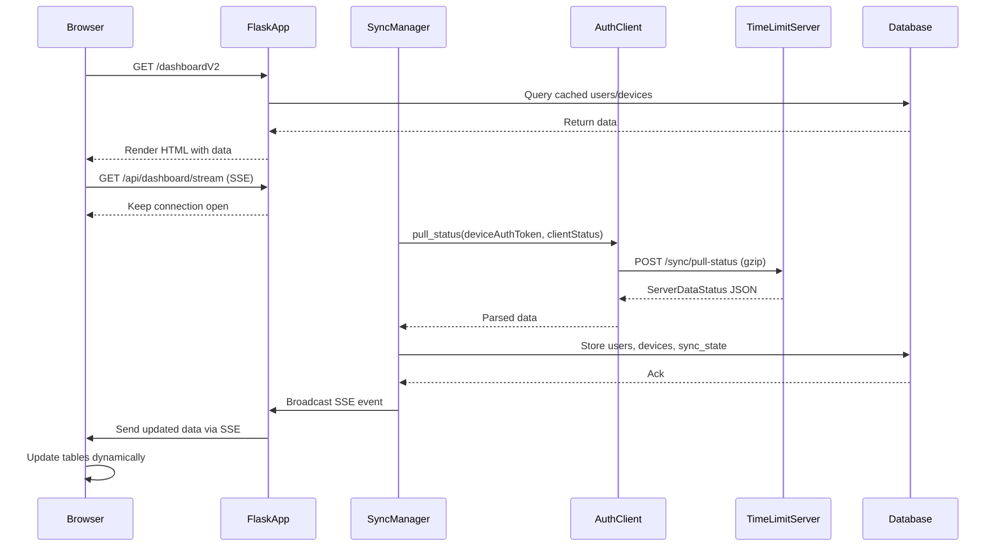

# Users & Devices Dashboard — Implementation Plan

## Overview

This plan details the integration of an interactive dashboard into the existing TimeLimit dashboardV2 Flask application that displays all users and devices known to or connected with the server, mirroring the functionality of the official TimeLimit Android app.

The dashboard will retrieve family data (users, devices, categories) via the TimeLimit sync protocol (`POST /sync/pull-status`), store it in the existing SQLite database, and render it in an interactive web UI with real-time updates via WebSocket (Socket.IO).

---

## 1. Technical Analysis: How the Android App Retrieves and Displays User/Device Data

### 1.1 Sync Protocol Architecture

The TimeLimit Android app uses an **action-based CRDT sync protocol** with two primary HTTP endpoints:

| Endpoint | Method | Purpose |
|----------|--------|---------|
| `/sync/push-actions` | POST | Upload pending actions (changes) to the server |
| `/sync/pull-status` | POST | Pull server state (devices, users, categories, crypto) |

**Sync flow** (from `SyncUtil.kt`):
1. `pushActions()` — Upload queued actions in batches of 25, each with a sequence number and HMAC-SHA256 integrity hash
2. `pullStatus()` — Send `ClientDataStatus` (version numbers for all entity types), receive `ServerDataStatus` (full server state)
3. `ApplyServerDataStatus` — Apply server data to local Room database
4. `CryptoSyncLogic` — Process key requests/responses for encrypted app lists
5. Handle pings (primary device borrowing)

### 1.2 ClientDataStatus (Request Body for pull-status)

The client sends its current sync state version numbers:

```json
{
    "clientLevel": 7,
    "devices": "<device list version string>",
    "users": "<user list version string>",
    "apps": {"<deviceId>": "<installed apps version>", ...},
    "devicesDetail": {"<deviceId>": {"baseVersion": "...", "diffVersion": "..."}, ...},
    "categories": {"<categoryId>": {"baseVersion": "...", "assignedAppsVersion": "...", "timeLimitRulesVersion": "...", "usedTimeItemsVersion": "...", "taskListVersion": "..."}, ...},
    "kri": <last key request server sequence>,
    "kr": <last key response server sequence>,
    "dh": "<dh key version>",
    "u2f": "<u2f version>"
}
```

For an initial pull (no prior state), all version fields are `null` or empty, causing the server to return the full dataset.

### 1.3 ServerDataStatus (Response from pull-status)

The server responds with the complete family state:

```json
{
    "devices": {"version": "...", "data": [...]},
    "devices2": [...],
    "apps": [...],
    "rmCategories": ["<categoryId>", ...],
    "categoryBase": [...],
    "categoryApp": [...],
    "usedTimes": [...],
    "rules": [...],
    "tasks": [...],
    "users": {"version": "...", "data": [...]},
    "krq": [...],
    "kr": [...],
    "pings": [...],
    "dh": {"v": "...", "k": "<base64>"},
    "u2f": {"v": "...", "d": [...]},
    "fullVersion": <timestamp>,
    "message": "<server message>",
    "apiLevel": <int>
}
```

### 1.4 Key Data Models

**ServerDeviceData** (in `devices.data[]`):
```json
{
    "deviceId": "...",
    "name": "...",
    "model": "...",
    "addedAt": <timestamp>,
    "currentUserId": "...",
    "currentProtectionLevel": "...",
    "highestProtectionLevel": "...",
    "currentAppVersion": <int>,
    "highestAppVersion": <int>,
    "publicKey": "<base64 or null>",
    "platformType": "<string or null>",
    "platformLevel": <int or null>
}
```

**ServerUserData** (in `users.data[]`):
```json
{
    "id": "...",
    "name": "...",
    "password": "<bcrypt hash>",
    "secondPasswordSalt": "...",
    "type": "parent" | "child",
    "timeZone": "...",
    "disableLimitsUntil": <timestamp>,
    "mail": "...",
    "currentDevice": "...",
    "categoryForNotAssignedApps": "...",
    "relaxPrimaryDevice": <bool>,
    "flags": <long bitmask>,
    "limitLoginCategory": "<categoryId or null>",
    "preBlockDuration": <long>
}
```

### 1.5 WebSocket Real-Time Updates

The Android app uses Socket.IO (WebSocket transport only) for real-time sync notifications:

| Event | Direction | Payload | Handler |
|-------|-----------|---------|---------|
| `connect` | Server → Client | — | Emit `devicelogin` with auth token |
| `devicelogin` | Client → Server | auth token (ack) | `onConnectionEstablished()` |
| `should sync` | Server → Client | `{isImportant: Boolean}` | `onSyncRequestedByServer(important)` |
| `connected devices` | Server → Client | `[deviceId, ...]` | `onGotConnectedDeviceList(ids)` |
| `sign out` | Server → Client | — | `onGotSignOutRequest()` |

### 1.6 HTTP Request Format

All requests follow the same format:
- **Content-Type**: `application/json; charset=utf-8`
- **Content-Encoding**: `gzip`
- **Content-Length**: Auto-negotiated (first request without, retry with if 411)
- **Auth**: `Authorization: Bearer <deviceAuthToken>` header

### 1.7 Authentication Context

The existing dashboardV2 already handles authentication:
- **Parent flow**: Email → verification code → `sign_in_into_family` → `deviceAuthToken` stored in Flask session
- **Create family flow**: Email → verification code → `create_family` → `deviceAuthToken` stored in Flask session
- The `deviceAuthToken` is the primary credential for all sync API calls

### 1.8 Key Gap: Missing Sync Methods

The existing `AuthClient` class has methods for all auth endpoints but **does NOT** have:
- `pull_status()` — needed to retrieve `ServerDataStatus`
- `push_actions()` — needed to upload actions (not required for read-only dashboard)

The existing database schema has tables for `families`, `devices`, and `auth_tokens` but **does NOT** have:
- `users` table — for storing user data from `ServerDataStatus.users`
- `sync_state` table — for tracking version numbers (ClientDataStatus)
- `categories` table — for storing category data

---

## 2. Proposed Architecture

### 2.1 Architecture Overview

```
┌─────────────────────────────────────────────────────────┐
│                    Browser (Frontend)                    │
│  dashboardV2.html + dashboardV2.js                       │
│  - Users & Devices tables                                │
│  - Real-time updates via Server-Sent Events              │
│  - Manual refresh button                                 │
├─────────────────────────────────────────────────────────┤
│              Flask App (app.py)                          │
│  - /api/sync/pull-status  (proxy to TimeLimit server)    │
│  - /api/dashboard/users   (serve cached users)           │
│  - /api/dashboard/devices (serve cached devices)         │
│  - /api/dashboard/sync   (trigger manual sync)           │
│  - /api/dashboard/stream (SSE for real-time updates)     │
├─────────────────────────────────────────────────────────┤
│           AuthClient (auth_client.py)                     │
│  - pull_status()         [NEW]                           │
│  - push_actions()        [NEW, optional]                 │
│  - Existing auth methods (unchanged)                     │
├─────────────────────────────────────────────────────────┤
│           Database (database.py)                          │
│  - users table           [NEW]                           │
│  - sync_state table      [NEW]                           │
│  - categories table      [NEW]                           │
│  - Existing tables (families, devices, auth_tokens)      │
├─────────────────────────────────────────────────────────┤
│           Sync Manager (sync_manager.py) [NEW]            │
│  - Background sync thread (APScheduler job)              │
│  - Version tracking (ClientDataStatus)                   │
│  - Data application (ServerDataStatus → DB)              │
│  - SSE event broadcasting                                │
├─────────────────────────────────────────────────────────┤
│           TimeLimit Server (api.timelimit.io)             │
│  - POST /sync/pull-status                                │
│  - POST /sync/push-actions                               │
│  - Socket.IO WebSocket                                     │
└─────────────────────────────────────────────────────────┘
```

### 2.2 Technology Choices

| Component | Technology | Rationale |
|-----------|-----------|-----------|
| Backend | Flask (existing) | Already in use, minimal new dependencies |
| HTTP Client | `requests` (existing) | Already used by AuthClient |
| Database | SQLite (existing) | Already in use, cross-platform |
| Background Sync | APScheduler (existing) | Already used for timechecker |
| Real-time Updates | Server-Sent Events (SSE) | Python-native, no extra deps, simpler than Socket.IO for server→client |
| Frontend | Vanilla JS (existing) | Consistent with current dashboardV2.js |
| Gzip | `gzip` (stdlib) | Required by TimeLimit API |

**No new external dependencies required.** All technologies are already in the project stack.

### 2.3 Data Flow



### 2.4 Session Management

The existing session already stores `device_auth_token` and `own_device_id` after authentication. The sync manager will use these session values to authenticate pull-status requests.

For the background sync thread (APScheduler), the session is not available. The sync manager will need to store the `device_auth_token` in the database (in the `auth_tokens` table or a new `sync_credentials` table) so the background job can access it.

### 2.5 Database Schema Changes

**New table: `users`**
```sql
CREATE TABLE IF NOT EXISTS users (
    id TEXT PRIMARY KEY,
    family_id TEXT NOT NULL,
    name TEXT,
    password TEXT,
    second_password_salt TEXT,
    type TEXT,          -- 'parent' or 'child'
    time_zone TEXT,
    disable_limits_until INTEGER,
    mail TEXT,
    current_device TEXT,
    category_for_not_assigned_apps TEXT,
    relax_primary_device INTEGER DEFAULT 0,
    flags INTEGER DEFAULT 0,
    limit_login_category TEXT,
    pre_block_duration INTEGER DEFAULT 0,
    last_updated INTEGER,
    FOREIGN KEY (family_id) REFERENCES families(id)
)
```

**New table: `sync_state`**
```sql
CREATE TABLE IF NOT EXISTS sync_state (
    family_id TEXT PRIMARY KEY,
    device_list_version TEXT,
    user_list_version TEXT,
    last_sync_timestamp INTEGER,
    last_sync_success INTEGER,
    FOREIGN KEY (family_id) REFERENCES families(id)
)
```

**New table: `categories`**
```sql
CREATE TABLE IF NOT EXISTS categories (
    id TEXT PRIMARY KEY,
    family_id TEXT NOT NULL,
    child_id TEXT,
    title TEXT,
    blocked_times TEXT,
    extra_time INTEGER,
    extra_time_day INTEGER,
    temp_blocked INTEGER DEFAULT 0,
    temp_block_time INTEGER,
    version TEXT,
    parent_category_id TEXT,
    block_all_notifications INTEGER DEFAULT 0,
    time_warnings INTEGER DEFAULT 0,
    sort_order INTEGER DEFAULT 0,
    flags INTEGER DEFAULT 0,
    last_updated INTEGER,
    FOREIGN KEY (family_id) REFERENCES families(id)
)
```

**New table: `connected_devices`** (for WebSocket real-time data)
```sql
CREATE TABLE IF NOT EXISTS connected_devices (
    family_id TEXT NOT NULL,
    device_id TEXT NOT NULL,
    last_seen INTEGER,
    PRIMARY KEY (family_id, device_id),
    FOREIGN KEY (family_id) REFERENCES families(id)
)
```

---

## 3. Step-by-Step Implementation Strategy

### Phase 1: Sync Protocol Support (Backend)

#### Step 1.1: Add `pull_status()` method to `AuthClient`

**File:** `timelimit-ui/rootfs/usr/bin/dashboardV2/auth_client.py`

Add a new method that calls `POST /sync/pull-status` with gzip compression and Content-Length auto-negotiation:

```python
def pull_status(
    self,
    device_auth_token: str,
    client_data_status: Optional[Dict[str, Any]] = None
) -> APIResponse:
    """Pull server status (devices, users, categories) from the TimeLimit server.

    Args:
        device_auth_token: Device auth token for authentication.
        client_data_status: Client sync state (version numbers). If None,
                           an empty status is sent for initial full sync.

    Returns:
        APIResponse with ServerDataStatus data.
    """
    request_id = get_request_id()

    # Build ClientDataStatus - empty for initial sync
    if client_data_status is None:
        client_data_status = {
            "clientLevel": 7,
            "devices": None,
            "users": None,
            "apps": {},
            "devicesDetail": {},
            "categories": {},
            "kri": 0,
            "kr": 0,
            "dh": None,
            "u2f": None
        }

    data = {
        "deviceAuthToken": device_auth_token,
        "status": client_data_status
    }

    logger.info(
        "Pulling server status",
        request_id=request_id,
        has_device_auth_token=True
    )

    response = self._request_with_retry('POST', '/sync/pull-status', data)

    if response.success:
        logger.info(
            "Server status pulled successfully",
            request_id=request_id,
            has_devices=isinstance(response.data, dict) and 'devices' in response.data,
            has_users=isinstance(response.data, dict) and 'users' in response.data
        )
    else:
        logger.warning(
            "Failed to pull server status",
            request_id=request_id,
            error_code=response.error_code,
            error_message=response.error_message
        )

    return response
```

**Note:** The existing `_make_request` method uses `json=data` which does NOT gzip-compress. The TimeLimit server expects gzip-compressed bodies. This requires modifying the request method to support gzip compression. See Step 1.2.

#### Step 1.2: Add gzip compression support to `_make_request`

**File:** `timelimit-ui/rootfs/usr/bin/dashboardV2/auth_client.py`

The existing `_make_request` sends JSON without gzip. The TimeLimit server expects `Content-Encoding: gzip`. Add a `gzip_compress` parameter:

```python
import gzip

def _make_request(
    self,
    method: str,
    endpoint: str,
    data: Optional[Dict[str, Any]] = None,
    token: Optional[str] = None,
    retry_count: int = 0,
    skip_prefix: bool = False,
    gzip_compress: bool = False
) -> APIResponse:
    # ... existing code ...

    if method.upper() == 'POST':
        if gzip_compress:
            # Gzip-compress the JSON body
            json_body = json.dumps(data)
            gzipped_body = gzip.compress(json_body.encode('utf-8'))
            headers['Content-Encoding'] = 'gzip'
            headers['Content-Length'] = str(len(gzipped_body))
            response = self.session.post(
                url,
                data=gzipped_body,
                headers=headers,
                timeout=self.timeout
            )
        else:
            response = self.session.post(
                url,
                json=data,
                headers=headers,
                timeout=self.timeout
            )
    # ... rest of existing code ...
```

Then update `pull_status` to use `gzip_compress=True`.

#### Step 1.3: Add `push_actions()` method to `AuthClient` (optional, for future)

**File:** `timelimit-ui/rootfs/usr/bin/dashboardV2/auth_client.py`

```python
def push_actions(
    self,
    device_auth_token: str,
    actions: List[Dict[str, Any]]
) -> APIResponse:
    """Push pending actions to the server.

    Args:
        device_auth_token: Device auth token for authentication.
        actions: List of action objects with encodedAction, sequenceNumber,
                 integrity, type, and userId fields.

    Returns:
        APIResponse with shouldDoFullSync flag.
    """
    # Implementation similar to pull_status but for /sync/push-actions
    # Batches actions in groups of 25
    pass
```

### Phase 2: Database Schema Extension

#### Step 2.1: Add new tables to `Database.init_db()`

**File:** `timelimit-ui/rootfs/usr/bin/dashboardV2/database.py`

Add `users`, `sync_state`, `categories`, and `connected_devices` table creation to the `init_db()` method.

#### Step 2.2: Add CRUD functions for new tables

**File:** `timelimit-ui/rootfs/usr/bin/dashboardV2/database.py`

Add functions:
- `save_users(db, family_id, users_data)` — Bulk insert/update users from ServerDataStatus
- `get_users_by_family(db, family_id)` — Retrieve all users for a family
- `save_sync_state(db, family_id, device_list_version, user_list_version)` — Store sync version numbers
- `get_sync_state(db, family_id)` — Retrieve sync state
- `save_categories(db, family_id, categories_data)` — Bulk insert/update categories
- `save_connected_devices(db, family_id, device_ids)` — Store connected device list
- `get_connected_devices(db, family_id)` — Retrieve connected devices

### Phase 3: Sync Manager Module

#### Step 3.1: Create `sync_manager.py`

**File:** `timelimit-ui/rootfs/usr/bin/dashboardV2/sync_manager.py` (NEW)

This module orchestrates the sync process:

```python
class SyncManager:
    """Manages periodic sync with the TimeLimit server."""

    def __init__(self, db: Database):
        self.db = db
        self._lock = threading.RLock()

    def do_sync(self, device_auth_token: str, server_url: str) -> bool:
        """Execute one sync round: pull status, apply to database."""
        client = AuthClient(base_url=server_url)

        # Get current sync state from database
        sync_state = get_sync_state(self.db, family_id)
        client_status = self._build_client_data_status(sync_state)

        # Pull server status
        response = client.pull_status(device_auth_token, client_status)

        if not response.success:
            return False

        # Apply server data to database
        self._apply_server_data_status(response.data, family_id)

        # Update sync state
        self._update_sync_state(response.data, family_id)

        return True

    def _build_client_data_status(self, sync_state) -> Dict:
        """Build ClientDataStatus from stored sync state."""
        # ...

    def _apply_server_data_status(self, server_data, family_id) -> None:
        """Apply ServerDataStatus to local database."""
        # Extract and store devices, users, categories
        # ...

    def _update_sync_state(self, server_data, family_id) -> None:
        """Update sync state version numbers."""
        # ...
```

#### Step 3.2: Integrate sync into APScheduler

**File:** `timelimit-ui/rootfs/usr/bin/dashboardV2/scheduler.py`

Add a new scheduled job that runs the sync manager every 30 seconds (matching the Android app's rate limiting). The job will:
1. Check if a `device_auth_token` is available (from database or session)
2. Call `SyncManager.do_sync()`
3. Broadcast results via SSE

### Phase 4: API Routes

#### Step 4.1: Add sync API routes to `app.py`

**File:** `timelimit-ui/rootfs/usr/bin/dashboardV2/app.py`

Add new routes:

| Route | Method | Description |
|-------|--------|-------------|
| `/api/sync/pull` | POST | Trigger manual sync (pull-status) |
| `/api/dashboard/users` | GET | Get cached users for current family |
| `/api/dashboard/devices` | GET | Get cached devices for current family |
| `/api/dashboard/categories` | GET | Get cached categories for current family |
| `/api/dashboard/connected-devices` | GET | Get connected devices list |
| `/api/dashboard/stream` | GET | SSE endpoint for real-time updates |

Example route:

```python
@app.route('/api/dashboard/users', methods=['GET'])
def api_dashboard_users():
    """Get all users for the current family."""
    request_id = get_request_id()
    device_auth_token = session.get('device_auth_token')

    if not device_auth_token:
        return jsonify({'status': 'error', 'error': 'Not authenticated'}), 401

    # Get family_id from session or database
    family_id = session.get('family_id')
    if not family_id:
        return jsonify({'status': 'error', 'error': 'No family selected'}), 400

    users = get_users_by_family(get_database(), family_id)

    return jsonify({
        'status': 'ok',
        'users': users,
        'count': len(users)
    })
```

#### Step 4.2: Add SSE endpoint for real-time updates

```python
@app.route('/api/dashboard/stream')
def dashboard_stream():
    """Server-Sent Events endpoint for real-time dashboard updates."""
    def event_stream():
        # Yield events as they occur
        # This can be backed by a simple in-memory queue
        # or by polling the database for changes
        pass

    return Response(event_stream(), mimetype='text/event-stream')
```

### Phase 5: Frontend Integration

#### Step 5.1: Add Users & Devices section to `dashboardV2.html`

**File:** `timelimit-ui/rootfs/usr/bin/dashboardV2/templates/dashboardV2.html`

Add new sections after the existing "Session Information" section:

```html
<div class="dashboard-content">
    <h2>Family Users <span class="version-badge">v1.0.0</span></h2>
    <div style="margin-bottom: 10px;">
        <button class="refresh-btn" id="refresh-users-btn" onclick="refreshUsers()">
            <span>🔄</span> Refresh Users
        </button>
    </div>
    <table class="historical-table" id="users-table">
        <thead>
            <tr>
                <th>Name</th>
                <th>Type</th>
                <th>Email</th>
                <th>Current Device</th>
                <th>Time Zone</th>
                <th>Limits Disabled</th>
            </tr>
        </thead>
        <tbody id="users-body">
            <tr><td colspan="6" style="text-align: center; color: #666;">Loading...</td></tr>
        </tbody>
    </table>
</div>

<div class="dashboard-content">
    <h2>Family Devices</h2>
    <div style="margin-bottom: 10px;">
        <button class="refresh-btn" id="refresh-devices-btn" onclick="refreshDevices()">
            <span>🔄</span> Refresh Devices
        </button>
    </div>
    <table class="historical-table" id="devices-table">
        <thead>
            <tr>
                <th>Name</th>
                <th>Model</th>
                <th>Current User</th>
                <th>Protection Level</th>
                <th>App Version</th>
                <th>Platform</th>
                <th>Added At</th>
            </tr>
        </thead>
        <tbody id="devices-body">
            <tr><td colspan="7" style="text-align: center; color: #666;">Loading...</td></tr>
        </tbody>
    </table>
</div>
```

#### Step 5.2: Add JavaScript for data loading and SSE

**File:** `timelimit-ui/rootfs/usr/bin/dashboardV2/static/js/dashboardV2.js`

Add functions:
- `loadUsers()` — Fetch and render users table
- `loadDevices()` — Fetch and render devices table
- `loadCategories()` — Fetch and render categories
- `connectSSE()` — Connect to SSE endpoint for real-time updates
- `refreshAll()` — Trigger manual sync and reload all data

```javascript
async function loadUsers() {
    try {
        const response = await fetch('/api/dashboard/users');
        const data = await response.json();
        if (data.status === 'ok') {
            renderUsersTable(data.users);
        }
    } catch (error) {
        console.error('Failed to load users:', error);
    }
}

function renderUsersTable(users) {
    const tbody = document.getElementById('users-body');
    if (users.length === 0) {
        tbody.innerHTML = '<tr><td colspan="6" style="text-align: center; color: #666;">No users found</td></tr>';
        return;
    }
    tbody.innerHTML = users.map(user => `
        <tr>
            <td>${escapeHtml(user.name || 'N/A')}</td>
            <td>${user.type === 'parent' ? '👤 Parent' : '👶 Child'}</td>
            <td>${escapeHtml(user.mail || 'N/A')}</td>
            <td>${escapeHtml(user.current_device || 'N/A')}</td>
            <td>${escapeHtml(user.time_zone || 'N/A')}</td>
            <td>${user.disable_limits_until > 0 ? 'Yes' : 'No'}</td>
        </tr>
    `).join('');
}
```

### Phase 6: Testing

#### Step 6.1: Add unit tests for new AuthClient methods

**File:** `timelimit-ui/rootfs/usr/bin/dashboardV2/tests/test_auth_client.py`

Add tests for `pull_status()` with mocked HTTP responses.

#### Step 6.2: Add unit tests for database functions

**File:** `timelimit-ui/rootfs/usr/bin/dashboardV2/tests/test_database.py`

Add tests for `save_users`, `get_users_by_family`, `save_sync_state`, `get_sync_state`.

#### Step 6.3: Add integration tests for sync flow

**File:** `timelimit-ui/rootfs/usr/bin/dashboardV2/tests/test_sync_manager.py` (NEW)

Test the full sync flow: pull-status → apply to database → retrieve from database.

#### Step 6.4: Add API route tests

**File:** `timelimit-ui/rootfs/usr/bin/dashboardV2/tests/test_dashboard_api.py` (NEW)

Test the new API routes with mocked AuthClient.

---

## 4. Risk Assessment

### 4.1 Data Synchronization Risks

| Risk | Impact | Mitigation |
|------|--------|------------|
| **Stale data** — Server data changes between sync intervals | Medium | Use SSE for real-time push notifications; manual refresh button; 30s sync interval |
| **Version conflicts** — Client sends wrong version numbers | High | Store sync state in database; on `shouldDoFullSync`, wipe versions and re-pull |
| **Partial sync** — Server returns partial data due to version mismatch | Medium | Always validate response structure; fall back to full sync on errors |
| **Concurrent sync** — Multiple sync requests overlap | Low | Use threading lock in SyncManager; single background job |

### 4.2 Performance Risks

| Risk | Impact | Mitigation |
|------|--------|------------|
| **Large payload** — ServerDataStatus can be large (many users/devices) | Medium | Paginate frontend tables; lazy-load details; compress responses |
| **Sync blocking** — Background sync blocks Flask request handling | Medium | Run sync in APScheduler background thread; use `threaded=True` in Flask |
| **Database lock contention** — SQLite locks during sync | Low | Use `check_same_thread=False`; RLock in Database class; batch writes |
| **SSE connection scaling** — Many concurrent SSE connections | Low | Limit to one SSE connection per browser tab; use connection timeout |

### 4.3 Security Risks

| Risk | Impact | Mitigation |
|------|--------|------------|
| **Token exposure** — `deviceAuthToken` stored in database | High | Encrypt token at rest using Fernet/AES; restrict file permissions; never log token |
| **Data leakage** — User data (passwords, emails) exposed in UI | High | Never display password hashes; mask email addresses; role-based access control |
| **Unauthenticated access** — Dashboard accessible without auth | High | Require `device_auth_token` in session for all dashboard API routes; 401 on missing |
| **CSRF** — API routes vulnerable to cross-site request forgery | Medium | Use Flask session-based auth (already in place); add CSRF token for form submissions |
| **Server impersonation** — Connecting to wrong server | Medium | Certificate pinning for production server (ISRG roots); validate server URL |

### 4.4 Compatibility Risks

| Risk | Impact | Mitigation |
|------|--------|------------|
| **API changes** — Server API evolves (clientLevel changes) | Medium | Handle 400 errors with retry without `clientLevel`; log API level from response |
| **Gzip requirement** — Server may require gzip compression | Medium | Implement gzip in `_make_request`; handle 411 Content-Length retry |
| **Schema evolution** — ServerDataStatus fields change | Medium | Use `.get()` with defaults for all fields; log unknown fields |

### 4.5 Operational Risks

| Risk | Impact | Mitigation |
|------|--------|------------|
| **Sync failure** — Server unreachable or auth expired | Medium | Retry with exponential backoff; display error in UI; clear session on 401 |
| **Database corruption** — SQLite file corruption | Low | Regular backups; WAL mode; validate data before insert |
| **Background job failure** — APScheduler job crashes | Low | APScheduler has built-in error handling; log failures; auto-restart |

---

## 5. Deliverables

### 5.1 Code Files

| File | Status | Description |
|------|--------|-------------|
| `auth_client.py` | Modified | Add `pull_status()`, `push_actions()`, gzip support |
| `database.py` | Modified | Add `users`, `sync_state`, `categories`, `connected_devices` tables + CRUD functions |
| `sync_manager.py` | New | Sync orchestration: pull-status, apply data, version tracking |
| `app.py` | Modified | Add API routes: `/api/sync/pull`, `/api/dashboard/users`, `/api/dashboard/devices`, `/api/dashboard/categories`, `/api/dashboard/connected-devices`, `/api/dashboard/stream` |
| `dashboardV2.html` | Modified | Add Users, Devices, Categories sections with tables |
| `dashboardV2.js` | Modified | Add `loadUsers()`, `loadDevices()`, `loadCategories()`, `connectSSE()`, `refreshAll()` |
| `scheduler.py` | Modified | Add sync job to APScheduler |

### 5.2 Test Files

| File | Status | Description |
|------|--------|-------------|
| `tests/test_auth_client.py` | Modified | Add tests for `pull_status()` |
| `tests/test_database.py` | Modified | Add tests for new tables and CRUD functions |
| `tests/test_sync_manager.py` | New | Integration tests for sync flow |
| `tests/test_dashboard_api.py` | New | API route tests for dashboard endpoints |

### 5.3 API Documentation

#### `POST /api/sync/pull`
Triggers a manual sync with the TimeLimit server.

**Request:**
```json
{}
```

**Response (success):**
```json
{
    "status": "ok",
    "synced": true,
    "users_count": 3,
    "devices_count": 2,
    "categories_count": 5
}
```

**Response (error):**
```json
{
    "status": "error",
    "error_code": "unauthorized",
    "error_message": "Device auth token expired"
}
```

#### `GET /api/dashboard/users`
Returns all users for the current family.

**Response:**
```json
{
    "status": "ok",
    "users": [
        {
            "id": "user-uuid",
            "name": "Parent Name",
            "type": "parent",
            "mail": "parent@example.com",
            "current_device": "device-uuid",
            "time_zone": "Europe/Amsterdam",
            "disable_limits_until": 0,
            "flags": 0
        }
    ],
    "count": 1
}
```

#### `GET /api/dashboard/devices`
Returns all devices for the current family.

**Response:**
```json
{
    "status": "ok",
    "devices": [
        {
            "id": "device-uuid",
            "name": "Parent's Phone",
            "model": "Pixel 8",
            "current_user_id": "user-uuid",
            "current_protection_level": 2,
            "highest_protection_level": 2,
            "current_app_version": 226,
            "highest_app_version": 226,
            "platform_type": "android",
            "platform_level": 36,
            "added_at": 1234567890000
        }
    ],
    "count": 1
}
```

#### `GET /api/dashboard/stream`
Server-Sent Events endpoint for real-time updates.

**Events:**
```
event: sync_complete
data: {"users_count": 3, "devices_count": 2}

event: connected_devices
data: {"device_ids": ["device-uuid-1", "device-uuid-2"]}
```

### 5.4 Deployment Roadmap

| Step | Action | Dependencies |
|------|--------|-------------|
| 1 | Add `pull_status()` and gzip support to `auth_client.py` | None |
| 2 | Add database tables and CRUD functions to `database.py` | Step 1 |
| 3 | Create `sync_manager.py` module | Steps 1, 2 |
| 4 | Add API routes to `app.py` | Steps 1, 2, 3 |
| 5 | Add frontend sections to `dashboardV2.html` and `dashboardV2.js` | Step 4 |
| 6 | Integrate sync into `scheduler.py` | Step 3 |
| 7 | Write unit tests | Steps 1-6 |
| 8 | Write integration tests | Steps 1-6 |
| 9 | Manual testing with real server | Steps 1-8 |
| 10 | Update `CONTEXT.md` with changes | Steps 1-9 |

### 5.5 Key Code Snippets

#### Snippet 1: Gzip-compressed pull-status request

```python
import gzip
import json

def pull_status(self, device_auth_token: str, client_data_status: Optional[Dict] = None) -> APIResponse:
    if client_data_status is None:
        client_data_status = {
            "clientLevel": 7,
            "devices": None,
            "users": None,
            "apps": {},
            "devicesDetail": {},
            "categories": {},
            "kri": 0,
            "kr": 0,
            "dh": None,
            "u2f": None
        }

    data = {
        "deviceAuthToken": device_auth_token,
        "status": client_data_status
    }

    # Gzip compress the body
    json_body = json.dumps(data)
    gzipped_body = gzip.compress(json_body.encode('utf-8'))

    headers = self._get_headers()
    headers['Content-Encoding'] = 'gzip'
    headers['Content-Length'] = str(len(gzipped_body))

    url = f"{self.base_url}/sync/pull-status"
    response = self.session.post(url, data=gzipped_body, headers=headers, timeout=self.timeout)

    if response.ok:
        return APIResponse(success=True, status_code=response.status_code, data=response.json())
    else:
        return APIResponse(success=False, status_code=response.status_code, data=response.content)
```

#### Snippet 2: Applying ServerDataStatus to database

```python
def _apply_server_data_status(self, server_data: Dict, family_id: str) -> None:
    """Apply ServerDataStatus to local database."""
    # Store devices
    if 'devices' in server_data and 'data' in server_data['devices']:
        for device in server_data['devices']['data']:
            save_device(self.db, family_id, device)

    # Store users
    if 'users' in server_data and 'data' in server_data['users']:
        for user in server_data['users']['data']:
            save_user(self.db, family_id, user)

    # Store categories
    if 'categoryBase' in server_data:
        for cat in server_data['categoryBase']:
            save_category(self.db, family_id, cat)

    # Update sync state
    device_version = server_data.get('devices', {}).get('version')
    user_version = server_data.get('users', {}).get('version')
    save_sync_state(self.db, family_id, device_version, user_version)
```

#### Snippet 3: SSE endpoint for real-time updates

```python
from flask import Response
import queue

# In-memory event queue (per family)
_event_queues: Dict[str, queue.Queue] = {}

@app.route('/api/dashboard/stream')
def dashboard_stream():
    """SSE endpoint for real-time dashboard updates."""
    device_auth_token = session.get('device_auth_token')
    if not device_auth_token:
        return jsonify({'status': 'error', 'error': 'Not authenticated'}), 401

    family_id = session.get('family_id')
    if not family_id:
        return jsonify({'status': 'error', 'error': 'No family selected'}), 400

    def event_stream():
        q = _event_queues.setdefault(family_id, queue.Queue())
        while True:
            try:
                event = q.get(timeout=30)
                yield f"event: {event['type']}\ndata: {json.dumps(event['data'])}\n\n"
            except queue.Empty:
                yield ": keep-alive\n\n"

    return Response(event_stream(), mimetype='text/event-stream')
```

---

## 6. Implementation Order (Todo List)

1. [ ] Add `pull_status()` method and gzip support to `auth_client.py`
2. [ ] Add `push_actions()` method to `auth_client.py` (optional, for future)
3. [ ] Add `users`, `sync_state`, `categories`, `connected_devices` tables to `database.py`
4. [ ] Add CRUD functions for new tables in `database.py`
5. [ ] Create `sync_manager.py` with `SyncManager` class
6. [ ] Add API routes to `app.py` (`/api/sync/pull`, `/api/dashboard/users`, `/api/dashboard/devices`, `/api/dashboard/categories`, `/api/dashboard/connected-devices`, `/api/dashboard/stream`)
7. [ ] Add Users & Devices sections to `dashboardV2.html`
8. [ ] Add JavaScript functions to `dashboardV2.js` (`loadUsers`, `loadDevices`, `loadCategories`, `connectSSE`, `refreshAll`)
9. [ ] Integrate sync job into `scheduler.py`
10. [ ] Write unit tests for `pull_status()` in `test_auth_client.py`
11. [ ] Write unit tests for new database functions in `test_database.py`
12. [ ] Create `test_sync_manager.py` with integration tests
13. [ ] Create `test_dashboard_api.py` with API route tests
14. [ ] Manual testing with real TimeLimit server
15. [ ] Update `CONTEXT.md` with changes
