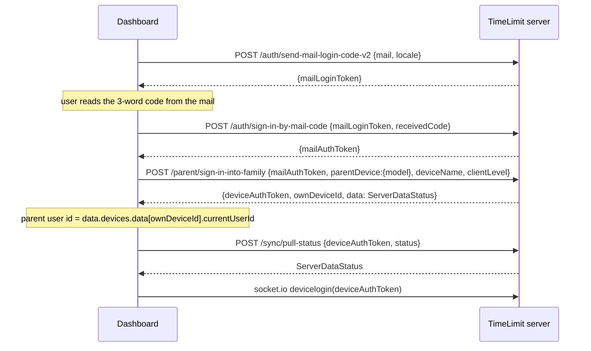
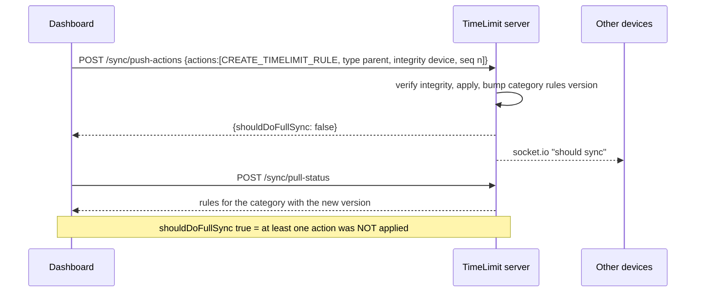

# ServerAPI.md - TimeLimit Server Protocol (as used by Dashboard V2)

This document is the reference for how Dashboard V2 talks to a TimeLimit server. **It is derived from the server implementation**, not from the Android app and not from assumptions. Server source files are named in the sections where they matter, so every statement can be re-checked.

> **Rule:** if the server code and this document disagree, the server code wins and this document must be fixed. Do not change client behaviour to match this document without checking the server first.

## Verification status

| Item | Value |
|------|-------|
| Verified on | 2026-11-03 |
| Server reference A | `eixel05/timelimit-server` @ `569e5ce` (2024-12-02), unmodified copy of upstream `timelimit-server`, `apiLevel` 7 |
| Server reference B | `MichaelSp/timelimit-server` @ `fe90617` (2026-10-21), declares `codeberg.org/timelimit/timelimit-server#master` as its upstream (`upstream.json`), `apiLevel` 9. **Used as the primary reference**, because it is the newer protocol level (the dashboard already handles `pings`, which only exists there) |
| A vs. B | Identical: routes, request schemas, password regexes, integrity algorithm, byte helpers. Different: `apiLevel` 7 vs 9, `pings` in `ServerDataStatus`, extra `clientLevel` gates (>=7, >=8), `type` optional in `can-do-purchase`, `e` (expiresAt) in time limit rules. Source layout and code style differ (refactor) |
| Not verified | The exact version of the server you deploy; the hosted `api.timelimit.io`; the current official Android app (only forks up to 2023 were available, and those send `clientLevel` 6) |
| Regenerating | The action reference (`docs/protocol/actions-reference.md`) is generated from the server sources: see [Action reference](#7-action-reference) |

## Table of Contents

1. [Overview and conventions](#1-overview-and-conventions)
2. [Server configuration](#2-server-configuration)
3. [Endpoints](#3-endpoints)
4. [Authorization of parent operations](#4-authorization-of-parent-operations)
5. [Sync protocol](#5-sync-protocol)
6. [WebSocket (Socket.IO)](#6-websocket-socketio)
7. [Action reference](#7-action-reference)
8. [Crypto](#8-crypto)
9. [Errors](#9-errors)
10. [Known deviations of Dashboard V2](#10-known-deviations-of-dashboard-v2)
11. [Dashboard internal endpoints](#dashboard-internal-endpoints)
12. [Time limit rules API (dashboard internal)](#time-limit-rules-api-endpoints)

---

## 1. Overview and conventions

### Transport

- HTTP(S), JSON request and response bodies (`Content-Type: application/json`).
- **There is no `/api/v1` prefix.** The server mounts its routers directly (`src/api/index.ts`): `/time`, `/auth`, `/child`, `/parent`, `/purchase`, `/sync`, `/admin`. The server listens on port 8080 by default.
- **Credentials are in the request body**, never in headers. The server has no header-based authentication (only `/admin` uses HTTP Basic). Headers such as `Authorization: Bearer ...` or `X-Request-ID`, which the dashboard adds, are ignored.
- **Requests are validated strictly**: every request body is checked against a JSON schema with `additionalProperties: false`. An unknown field, a missing required field or a wrong type gives `400 Bad Request`. Do not send "extra" fields.
- `POST /sync/push-actions` accepts bodies up to 5120 kB. All other endpoints use the body-parser default limit.
- The dashboard gzips `pull-status` requests; body-parser inflates compressed request bodies by default.
- Errors are returned with an HTTP status code and the **default Express error page (HTML)**, not JSON. See [Errors](#9-errors).

### Identifiers and formats

| Name | Format | Source |
|------|--------|--------|
| `deviceAuthToken`, `mailAuthToken`, `mailLoginToken` | 32 characters `[0-9a-zA-Z]` | `util/token.ts` |
| Id within a family (`deviceId`, `userId`, `categoryId`, `ruleId`) | exactly 6 characters `[0-9a-zA-Z]`; the client generates `userId`, `categoryId` and `ruleId` itself | `util/token.ts` (`assertIdWithinFamily`) |
| Version id (`deviceListVersion`, `userListVersion`, category versions, DH key id) | exactly 4 characters `[0-9a-zA-Z]`; opaque, compare for equality only | `util/token.ts` |
| Family id | 10 characters | `util/token.ts` |
| Mail login code (`receivedCode`) | 3 random words; compared ignoring spaces, `*` and case | `util/random-words.ts` |
| Add-device token (`registerToken`) | 5 random words; stored and compared in lower case | `function/parent/create-add-device-token.ts` |
| Parent password `hash`, `secondHash` | bcrypt string `^\$2a\$[123][0-9]\$[./A-Za-z0-9]{53}$` (60 characters) | `util/password.ts` |
| Parent password `secondSalt` | `^\$2a\$[123][0-9]\$[./A-Za-z0-9]{22}$` (29 characters: `$2a$` + cost + `$` + 22) | `util/password.ts` |

The bcrypt prefix **must be `$2a$`**. The Python `bcrypt` package produces `$2b$` by default; use `bcrypt.gensalt(rounds=12, prefix=b"2a")` (this is what `crypto_utils.generate_family_hashes` does). The dashboard uses cost 12; the server accepts any cost from 10 to 39.

### Token lifetimes

`mailLoginToken`, `mailAuthToken` and add-device tokens are deleted by a cleanup job once they are older than **3 hours** (`worker/delete-old-tokens.ts`, runs hourly, first run 7 minutes after start), so the effective lifetime is 3 to 4 hours. `mailAuthToken` is **single use** for `create-family`, `sign-in-into-family`, `recover-parent-password` and `link-mail-address`; `get-status-by-mail-address` does not consume it.

### Key concepts

| Name | Meaning |
|------|---------|
| `mailAuthToken` | Proof that the holder controls a mail address. Result of the mail login flow |
| `deviceAuthToken` | Secret of one registered device. Identifies the device and its family in all `/sync` and most `/parent` calls |
| `ownDeviceId` / `deviceId` | Id of the device within its family |
| parent user id | `id` of a user with `type: "parent"`. The device is "signed in" as this user (`currentUserId`) |
| `secondHash` / `secondSalt` | Second bcrypt hash of the parent password and the salt that produced it. Stored by the server per parent |
| `clientLevel` | Protocol level the client declares (see [clientLevel gates](#clientlevel-gates)) |
| `apiLevel` | Protocol level of the server, returned in every `ServerDataStatus` |

---

## 2. Server configuration

The dashboard can connect to different servers:

| Server Key | Name | URL |
|------------|------|-----|
| `local` | Lokaal | `http://192.168.68.30:8080` |
| `official` | Officieel | `https://api.timelimit.io` |
| `debug` | Debug Server | `http://192.168.68.30:8080` |

> **Warning:** the "debug server" used in manual tests (a FastAPI mock, see `test_results.md`) is **not** the official server and returns different fields, for example `status`, `mailServerBlacklisted: false` and `blockedForIntegrityReasons` in the mail-code response. Tests against it do not prove protocol compatibility. Use the schemas in this document for contract tests.

---

## 3. Endpoints

All endpoints use `POST` with a JSON body, except `GET /time` and the two `GET /admin` routes. "Required" fields are required by the server schema; fields marked "optional" may be omitted, all others must be present.

### 3.1 `GET /time`

Server time. Response: `{"ms": 1699900000000}` (milliseconds since epoch).

### 3.2 `POST /auth/send-mail-login-code-v2`

Sends a mail with a 3-word code. Source: `api/auth.ts`, `function/authentication/login-by-mail.ts`.

| Field | Type | Required |
|-------|------|----------|
| `mail` | string | yes |
| `locale` | string | yes |
| `deviceAuthToken` | string | optional (shows the device name in the mail if the address belongs to the same family) |

**Response (HTTP 200), exactly one of:**

```json
{ "mailLoginToken": "..." }
{ "mailAddressNotWhitelisted": true }
{ "mailServerBlacklisted": true }
```

The two flag responses are **HTTP 200**, so the client must check which key is present. Errors: `400` (invalid body or unparsable mail address), `401` (`deviceAuthToken` unknown), `429` (rate limit: per address 2 per 5 minutes and 6 per day; server wide 100 per minute, 500 per hour, 1000 per day).

### 3.3 `POST /auth/sign-in-by-mail-code`

| Field | Type | Required |
|-------|------|----------|
| `mailLoginToken` | string | yes |
| `receivedCode` | string | yes |

Response: `{"mailAuthToken": "..."}`. Errors: `403` wrong code, `410` token unknown, expired, or no attempts left. A login token allows **3 attempts**: the first two wrong codes give `403`, the third wrong code gives `410`.

### 3.4 `POST /parent/get-status-by-mail-address`

| Field | Type | Required |
|-------|------|----------|
| `mailAuthToken` | string | yes |

Response:

```json
{ "status": "with family", "mail": "user@example.com", "canCreateFamily": true, "alwaysPro": false }
```

`status` is `"with family"` or `"without family"`. The token is not consumed. Error: `401` invalid token.

### 3.5 `POST /parent/create-family`

Creates a family, its first parent user and the first device. Source: `function/parent/create-family.ts`.

| Field | Type | Required |
|-------|------|----------|
| `mailAuthToken` | string | yes (consumed) |
| `parentPassword` | `{hash, secondHash, secondSalt}` | yes, all three fields required, formats as in [Identifiers](#identifiers-and-formats) |
| `parentDevice` | `{model: string}` | yes |
| `deviceName` | string | yes |
| `timeZone` | string | yes |
| `parentName` | string | yes |
| `clientLevel` | number | optional |

`parentPassword` has **no `encrypted` field** here; sending one is rejected (`additionalProperties: false`).

Response:

```json
{ "deviceAuthToken": "...", "ownDeviceId": "...", "data": { "...ServerDataStatus..." } }
```

`data` is a complete `ServerDataStatus` (see [5.2](#52-pull-status)). The response contains **no `familyId` and no parent user id**; read the parent user id from `data` (see [4.2](#42-the-device-method-recommended-for-the-dashboard)). Errors: `400`, `401` (mail token invalid), `403` (sign-up disabled on this server, see `canCreateFamily`), `409` (a user with this mail already exists).

### 3.6 `POST /parent/sign-in-into-family`

Registers a **new parent device** for the user that owns the mail address. No password is involved. Source: `function/parent/sign-in-into-family.ts`.

| Field | Type | Required |
|-------|------|----------|
| `mailAuthToken` | string | yes (consumed) |
| `parentDevice` | `{model: string}` | yes |
| `deviceName` | string | yes |
| `clientLevel` | number | optional |

There is **no `parentPasswordSecondHash` field**; sending one is rejected. Response: same shape as `create-family`. The server registers the device with `currentUserId` = that parent and `isUserKeptSignedIn: true`, bumps the device list version, and sends a "device linked" mail to the parent. Errors: `400`, `401`, `409` (no user with this mail, so no family).

### 3.6a `POST /parent/recover-parent-password`

| Field | Type | Required |
|-------|------|----------|
| `mailAuthToken` | string | yes (consumed) |
| `password` | `{hash, secondHash, secondSalt}` | yes |

The field is `password`, **not** `newPassword`. Response: `{"ok": true}`. Errors: `400`, `401`, `409` (no user with this mail). Replaces the stored password hashes of the parent and notifies the clients.

### 3.7 `POST /parent/create-add-device-token`

| Field | Type | Required |
|-------|------|----------|
| `deviceAuthToken` | string | yes |
| `parentId` | string | **yes** |
| `parentPasswordSecondHash` | string | yes (a `secondHash`, or `"device"`, see [Section 4](#4-authorization-of-parent-operations)) |

Response: `{"token": "five random words", "deviceId": "abc123"}`. The token registers one child device and replaces any earlier add-device token of the family. The server has already chosen the `deviceId` the new device will get. Error: `401` (authorization failed).

### 3.8 `POST /child/add-device`

| Field | Type | Required |
|-------|------|----------|
| `registerToken` | string | yes |
| `childDevice` | `{model: string}` | **yes** |
| `deviceName` | string | **yes** |
| `clientLevel` | number | optional |

There is no flat `deviceModel` field. Response: `{"deviceAuthToken": "...", "ownDeviceId": "...", "data": {ServerDataStatus}}`. Error: `401` (unknown or expired token). The new device has `currentUserId = ""` and `isUserKeptSignedIn = false`. **Adding a device does not create a user**; users are created with the `ADD_USER` action ([Section 7](#7-action-reference)).

### 3.9 `POST /parent/remove-device`

| Field | Type | Required |
|-------|------|----------|
| `deviceAuthToken` | string | yes |
| `parentUserId` | string | yes |
| `parentPasswordSecondHash` | string | yes (`secondHash` or `"device"`) |
| `deviceId` | string | yes |

Response: `{"ok": true}`. Errors: `401`, `409` (device not in this family). Devices are removed with this endpoint; **there is no `REMOVE_DEVICE` action**.

### 3.10 Other endpoints (not used by the dashboard yet)

| Endpoint | Request fields | Response |
|----------|----------------|----------|
| `POST /parent/link-mail-address` | `mailAuthToken`, `deviceAuthToken`, `parentUserId`, `parentPasswordSecondHash` | `{ok: true}`; `409` on conflicts |
| `POST /parent/create-identity-token` | `deviceAuthToken`, `parentUserId`, `parentPasswordSecondHash`, `purpose: "purchase"` | `{token}`; `404` if the server has no signing secret |
| `POST /parent/delete-account` | `deviceAuthToken`, `mailAuthTokens: string[]` | HTTP 200, empty body |
| `POST /child/update-primary-device` | `action: "set this device" \| "unset this device"`, `currentUserId`, `authToken` | `{status}` |
| `POST /child/logout-at-primary-device` | `deviceAuthToken` | `{ok: true}` |
| `POST /sync/report-removed` | `deviceAuthToken` | `{ok: true}` |
| `POST /sync/is-device-removed` | `deviceAuthToken` | `{isDeviceRemoved: boolean}` |
| `POST /purchase/*`, `/admin/*` | see `api/purchase.ts`, `api/admin.ts` | not relevant for the dashboard |

`/sync/pull-status` and `/sync/push-actions` are described in [Section 5](#5-sync-protocol).

---

## 4. Authorization of parent operations

Operations that change family data need proof that the caller is a parent. There are two places where this proof is given, and they use the same methods:

- **REST** (`create-add-device-token`, `remove-device`, ...): fields `parentId` / `parentUserId` and `parentPasswordSecondHash`.
- **Sync actions** (`type: "parent"`): fields `userId` and `integrity` of the pushed action.

### 4.1 Methods

| Method | REST `parentPasswordSecondHash` | Action `integrity` | When the server accepts it |
|--------|--------------------------------|--------------------|----------------------------|
| **device** | `"device"` | `"device"` | The calling device has `isUserKeptSignedIn = true` and its `currentUserId` is a parent. For actions, `userId` must equal that `currentUserId` |
| **password** | the parent's `secondHash` string, compared for equality with the stored value | `"password:" + base64(HMAC-SHA256(...))`, see [5.4](#54-integrity-of-actions) | The caller knows the parent's `secondHash` |
| **u2f** | `"u2f:..."` | `"u2f:..."` | Valid hardware key response (premium feature) |
| legacy password | - | hex SHA-512 of `sequenceNumber + deviceId + secondHash + encodedAction` | Still accepted, do not use |
| `childDevice` | - | `"childDevice"` | Only for a child device adding limits to itself; needs the child flag `ALLOW_SELF_LIMIT_ADD` |

Source: `api/parent.ts` (`assertAuthValidAndReturnDetails`), `function/sync/apply-actions/integrity.ts`.

### 4.2 The device method (recommended for the dashboard)

`create-family` and `sign-in-into-family` register the new device as a parent device that stays signed in (`isUserKeptSignedIn: true`, `currentUserId` = the parent). The dashboard is such a device. It therefore **does not need the parent password** for parent operations:

- REST calls: `parentPasswordSecondHash: "device"`. `parentId` / `parentUserId` is still required by the schema, but the server takes the user from the device (`currentUserId`) and does not compare it.
- Actions: `type: "parent"`, `userId: <parent user id>`, `integrity: "device"`.

The parent user id is in the `ServerDataStatus` returned by `create-family` / `sign-in-into-family` and by every pull: find the entry of `ownDeviceId` in `data.devices.data` and use its `currentUserId`.

The device method stops working when the device is signed out of that user (`SET_DEVICE_USER`, `REMOVE_USER`) or `SET_KEEP_SIGNED_IN` is set to `false` for it. The server then answers REST calls with `401`, and pushed actions fail silently ([5.3](#53-push-actions)).

### 4.3 When the password is still needed

| Operation | What it needs |
|-----------|---------------|
| `REMOVE_USER` for a **parent** user | `authentication` field = first 16 hex characters of `sha512(userId + secondHash of that user + "remove")` |
| `CHANGE_PARENT_PASSWORD` | its own `integrity` and an encrypted second hash, see [Crypto](#8-crypto) |
| `SET_CHILD_PASSWORD`, `ADD_USER` with a `password` | password hashes in the payload (`EncryptableParentPassword`) |

### 4.4 Password hashes

Created by the client when a family is created or the password is recovered (`crypto_utils.generate_family_hashes`):

- `hash` = bcrypt(password, salt1) and `secondHash` = bcrypt(password, salt2), both `$2a$`, different random salts.
- `secondSalt` = salt2, the first 29 characters of `secondHash`.
- The server returns the user's `secondPasswordSalt` (not the hash) in `ServerDataStatus.users`. A client that knows the password recomputes `secondHash = bcrypt(password, secondSalt)` (`crypto_utils.regenerate_second_hash`).
- The password method uses the **`secondHash` string** (60 characters) as HMAC key, **not the salt**.

The first `hash` is used to verify a password at a child or parent device (client side). The server stores it but never checks a plaintext password.

---

## 5. Sync protocol

### 5.1 Model

Sync is **version based**, not CRDT/merge based. The server keeps the state of a family. Every list (devices, users, per-category base data, apps, rules, used times, tasks) carries an opaque 4-character *version id* that changes with every modification. The client reports the versions it has; the server answers only with the parts whose version differs. Clients change data by pushing **actions**; the server applies them in order and notifies other devices over [WebSocket](#6-websocket-socketio).

```
client                                   server
  | pull-status {token, status}            |
  |--------------------------------------->|  compare versions
  |<---------------------------------------|  ServerDataStatus (only what differs)
  | push-actions {token, actions[]}        |
  |--------------------------------------->|  verify + apply each action
  |<---------------------------------------|  {shouldDoFullSync}
  |                                        |--> other devices: "should sync"
```

### 5.2 Pull-status

`POST /sync/pull-status`

Request (source `api/schema.ts`, `object/clientdatastatus.ts`):

```json
{ "deviceAuthToken": "<32 chars>", "status": { "devices": "", "apps": {}, "categories": {}, "users": "", "clientLevel": 6 } }
```

| `status` field | Type | Required | Meaning |
|---|---|---|---|
| `devices` | string | yes | Last known `deviceListVersion`; `""` = unknown, send everything |
| `users` | string | yes | Last known `userListVersion` |
| `apps` | `{deviceId: version}` | yes | Known installed-apps version per device |
| `categories` | `{categoryId: {base, apps, rules, usedTime, tasks?}}` | yes | Known versions per category. **A category that is missing from this map is sent in full**; with an empty map the server sends *all* categories |
| `clientLevel` | number | no | See [clientLevel gates](#clientlevel-gates). Absent = 0 |
| `devicesDetail`, `kri`, `kr`, `dh`, `u2f` | various | no | Crypto/E2E app lists, key requests/responses, DH key and u2f versions. Not needed by the dashboard |

Response: `ServerDataStatus` (source `object/serverdatastatus.ts`). Every key except `fullVersion` and `apiLevel` is omitted when nothing changed.

| Key | Content |
|---|---|
| `devices` | `{version, data: ServerDeviceData[]}`: `deviceId`, `name`, `model`, `addedAt`, `currentUserId`, `isUserKeptSignedIn`, `networkTime`, protection/permission levels (`cProtectionLevel`, `hProtectionLevel`, ...), `cAppVersion`, `hAppVersion`, `pk`, `pLevel`, ... |
| `users` | `{version, data: ServerUserEntry[]}`: `id`, `name`, `type` (`parent`\|`child`), `password` (hash), `secondPasswordSalt`, `timeZone`, `mail`, `currentDevice`, `categoryForNotAssignedApps`, `flags`, `blockedTimes`, `llc`, `pbd`, ... |
| `categoryBase` | per category: `categoryId`, `childId`, `title`, `blockedTimes`, `extraTime`, `extraTimeDay`, `tempBlocked`, `tempBlockTime`, `parentCategoryId`, `version`, `dlu`, `flags`, ... |
| `categoryApp` | `{categoryId, apps: string[], version}`. App entries are package names; for activity-level assignments `packageName:activityName` |
| `rules` | `{categoryId, version, rules: ServerTimeLimitRule[]}`; see the shape note below |
| `usedTimes` | `{categoryId, times[], sessionDurations[], version}` |
| `tasks` | `{categoryId, version, tasks[]}` (needs `clientLevel >= 3`) |
| `apps` | `{deviceId, version, apps: SerializedInstalledApp[], activities[]}` |
| `rmCategories` | ids of categories that no longer exist |
| `pings` | `{deviceId, token, type: "ping"\|"pong"}` (`clientLevel >= 7`, `apiLevel >= 9` only) |
| `devices2`, `krq`, `kr`, `dh`, `u2f` | crypto features, gated by `clientLevel` |
| `fullVersion` | premium end timestamp (ms), `0` = none |
| `message` | optional message of the server operator |
| `apiLevel` | 7 (reference A) or 9 (reference B) |

#### clientLevel gates

Source `function/sync/get-server-data-status/index.ts`. The server only sends data a client declares it understands:

| `clientLevel` | Unlocks |
|---|---|
| >= 3 | `tasks` |
| >= 4 | `devices2`, `krq`, `kr` (crypto apps) |
| >= 5 | `dh` |
| >= 6 | `u2f` |
| >= 7 | `pings` (reference B only) |
| >= 8 | behaviour of "release 7.5.0 and newer" (reference B only) |

The dashboard currently sends 7 (`sync_manager.py`, `auth_client.py`). The dashboard does not implement the crypto features, so `devices2`/`krq`/`kr`/`dh`/`u2f` are received but ignored; that is harmless.

#### Rule shape differs between pull and push

| Direction | Fields |
|---|---|
| Pull (`rules[].rules[]`) | `id`, `extraTime`, `dayMask`, `maxTime`, `start`, `end`, `session`, `pause`, `perDay` |
| Push `CREATE_TIMELIMIT_RULE` | `{rule: {ruleId, categoryId, time, days, extraTime, start?, end?, dur?, pause?, perDay?, e?}}`: the fields are nested in `rule` |
| Push `UPDATE_TIMELIMIT_RULE` | **flat**, without `categoryId`: `ruleId`, `time`, `days`, `extraTime`, `start?`, `end?`, `dur?`, `pause?`, `perDay?`, `e?` |

So `maxTime`<->`time`, `dayMask`<->`days`, `session`<->`dur`, `id`<->`ruleId`. `start`/`end` are minutes of the day, `0..1439`, with `start <= end`. `dayMask`/`days` is a bit mask; the server stores it and does not interpret the bits (the meaning, bit 0 = Monday in the Android app, is not checked here). `e` (expiresAt) exists only in reference B. All ids are 6 characters.

### 5.3 Push-actions

`POST /sync/push-actions`

Request:

```json
{
  "deviceAuthToken": "<32 chars>",
  "actions": [
    { "encodedAction": "{\"type\":\"CREATE_TIMELIMIT_RULE\",\"rule\":{...}}",
      "sequenceNumber": 12, "integrity": "device", "type": "parent", "userId": "abc123" }
  ]
}
```

| Field | Notes |
|---|---|
| `encodedAction` | **A string containing JSON**, not a nested object. The integrity check is computed over exactly this string |
| `type` | Outer type: `parent`, `child` or `appLogic`. Decides how the action is verified and which `type` names are allowed inside |
| `userId` | Required for `parent` and `child`; id of the acting user |
| `integrity` | See [5.4](#54-integrity-of-actions). `appLogic` actions are not verified, send `""` |
| `sequenceNumber` | Per **device**, starts at 0 |

Rules (source `function/sync/apply-actions/index.ts`):

- At most **50 actions** per request, body at most 5120 kB, otherwise `400`.
- Unknown `deviceAuthToken`: `401`.
- Actions are applied **in order, each in its own sub-transaction**.
- `sequenceNumber` lower than the device's next expected number: the action is **ignored** as already received.
- The next expected number is set to `sequenceNumber + 1` **before** the action runs. **A failed action still consumes its sequence number.** Never reuse a number after a failure.
- **Failures are silent.** A bad `integrity`, an unknown `type`, a schema violation or a rejected change does not fail the request. The action is skipped and the response says `{"shouldDoFullSync": true}`. The HTTP status is still `200`.
- `shouldDoFullSync: true` is therefore the only signal that something was not applied. After it, do a pull-status and compare with what you intended.
- Applied changes trigger `should sync` for the other devices of the family; they do **not** trigger one for the sending device.

Sequence numbers: the dashboard must persist the next number per device and continue from it. The server's value is not exposed by any endpoint; if the dashboard loses it, actions with a too-low number are silently ignored (a higher number is always accepted).

### 5.4 Integrity of actions

| Outer `type` | Accepted `integrity` |
|---|---|
| `parent` | `"device"` (see [4.2](#42-the-device-method-recommended-for-the-dashboard)), `"password:<base64>"`, `"u2f:..."`, `"childDevice"` (self-limit-add only), legacy hex sha512 |
| `child` | legacy hex sha512 (child password hash) |
| `appLogic` | none |

**Password method** (source `function/sync/apply-actions/integrity.ts`):

```
key     = UTF-8 bytes of the parent's secondHash string (60 chars)
message = uint64_BE(sequenceNumber)
        || uint32_BE(len(deviceIdUtf8)) || deviceIdUtf8        # the SENDING device's id (ownDeviceId)
        || uint32_BE(len(encodedActionUtf8)) || encodedActionUtf8
integrity = "password:" + base64( HMAC-SHA256(key, message) )
```

Pitfalls: the id in the message is the id of the **device that pushes**, not the id of the user or child; the key is the `secondHash` string, not `secondSalt` and not the first `hash`; the length prefixes are 4-byte big-endian counts of **bytes**, not characters.

Test vectors (computed by the server algorithm and by `crypto_utils.calculate_hmac_sha256_binary`; identical):

| Key | seq | deviceId | encodedAction | Result |
|---|---|---|---|---|
| `$2a$12$abcdefghijklmnopqrstuuABCDEFGHIJKLMNOPQRSTUVWXYZ01234` | 7 | `dev123` | `{"type":"CREATE_TIMELIMIT_RULE","rule":{"ruleId":"r1"}}` | `password:n10GZyWfMKiUKda4gXQEWgvlFYpTnKC3OG6zM6Jl6ms=` |
| same | 0 | `äöü` | `{"a":"é"}` | `password:eC7BY0YnRSRFX8stS6q4iG32JSNSb1p6KU4X92BFsz0=` |

The key in these vectors is a made-up string, not a real password hash.

### 5.5 Typical flows

All with outer `type: "parent"`, `userId` = parent user id, `integrity: "device"`.

| Goal | `encodedAction` (JSON) |
|---|---|
| Add a rule | `{"type":"CREATE_TIMELIMIT_RULE","rule":{"ruleId":"<6>","categoryId":"<6>","time":3600000,"days":127,"extraTime":false,"start":0,"end":1439,"dur":0,"pause":0,"perDay":false}}` |
| Delete a rule | `{"type":"DELETE_TIMELIMIT_RULE","ruleId":"<6>"}` |
| Assign apps to a category | `{"type":"ADD_CATEGORY_APPS","categoryId":"<6>","packageNames":["com.example.app"]}` |
| Remove apps from a category | `{"type":"REMOVE_CATEGORY_APPS","categoryId":"<6>","packageNames":["com.example.app"]}` |
| Add a child user | `{"type":"ADD_USER","userId":"<6>","name":"Kid","userType":"child","timeZone":"Europe/Amsterdam", ...}` (full field list: [actions reference](#7-action-reference)) |

Always take the exact field names from the [actions reference](protocol/actions-reference.md); the rows above are examples. Note the nesting: `CREATE_TIMELIMIT_RULE` wraps the fields in `rule`, `UPDATE_TIMELIMIT_RULE` is flat.

`UPDATE_DEVICE_STATUS` (for example `appVersion`) is an `appLogic` action with `integrity: ""` and is sent by the device about itself.

Adding a **device** never creates a user; a child user is created with `ADD_USER`. A device is removed with `POST /parent/remove-device`; there is no `REMOVE_DEVICE` action.

### 5.6 Sequence diagrams

#### Sign in and first sync



The exact request fields are in [3.2-3.6](#3-endpoints); check them there, this diagram only shows the order.

#### Changing data (add a rule)



---

## 6. WebSocket (Socket.IO)

Source `websocket/index.ts`. Socket.IO is attached to the same HTTP server on the default path `/socket.io`, with `allowEIO3: true`.

| Direction | Event | Payload |
|---|---|---|
| client -> server | `devicelogin` | `(deviceAuthToken: string, ack: () => void)`. Joins the room of the device. Must be sent after every (re)connect. Leaves all other rooms first |
| server -> client | `should sync` | `{isImportant: boolean}`: do a pull-status. `isImportant` is also sent to all devices after server maintenance (delayed randomly up to one minute) |
| server -> client | `connected devices` | `string[]` of `deviceId`s of the family that currently have a socket open |
| server -> client | `sign out` | The device was removed; drop the credentials |

No authentication besides the token; an unknown token joins an empty room. Typical client behaviour: connect, `devicelogin`, pull once, then pull on every `should sync`. Fall back to polling when the socket is not connected.

---

## 7. Action reference

There are 68 action types: 50 `parent`, 2 `child`, 16 `appLogic`. The complete wire format (type name, required/optional fields, field types) is generated from the server sources:

- [`docs/protocol/actions-reference.md`](protocol/actions-reference.md): generated, do not edit by hand.
- [`docs/protocol/gen_actions.py`](protocol/gen_actions.py): the generator. Usage: `python3 -I gen_actions.py <path-to-timelimit-server>/src > actions-reference.md`. It only reads the server checkout.

Things to know that the table cannot show:

- The wire `type` is SCREAMING_SNAKE (`CREATE_TIMELIMIT_RULE`). The class-style names (`CreateTimeLimitRuleAction`) exist only in server error messages. Do not use them on the wire.
- A `parent` action sent as `appLogic` is rejected (the server cannot parse it as an app-logic action). This fails silently, see [5.3](#53-push-actions).
- Extra or missing fields make the action invalid; the server validates each action against its schema.

---

## 8. Crypto

| Item | Value |
|---|---|
| Device public key | 32-byte Curve25519 public key, uploaded with `UPLOAD_DEVICE_PUBLIC_KEY` (the server keeps the first value) |
| Server key agreement | ECDH on P-256 (`prime256v1`); keys exchanged as SPKI (public) / PKCS8 (private) DER |
| Shared secret | 32 bytes |
| Symmetric key | AES-128-GCM; the key is the **first 16 bytes** of the shared secret |
| IV / tag | 12 bytes / 16 bytes |
| Container format | `base64(iv \|\| ciphertext \|\| tag) "." base64(ownPublicKey) "." keyId` |
| AAD | `ParentPassword:{hash}:{secondSalt}` |

Used for `EncryptableParentPassword` (changing a parent password, adding a parent user). The dashboard does not need it for the flows in [5.5](#55-typical-flows). Earlier project notes said "first 32 bytes" and "secp25619"; both were wrong (16 bytes, secp256r1/prime256v1).

---

## 9. Errors

Errors are the default Express error page (HTML) with a status code. Do not parse the body.

| Status | Where / why |
|---|---|
| 400 | Schema violation (extra, missing or mistyped field), more than 50 actions, malformed token or id, bad password hash format |
| 401 | Unknown `deviceAuthToken`; REST parent authorization failed (wrong `parentPasswordSecondHash`, or `"device"` when the device is not signed in as a parent) |
| 403 | `sign-in-by-mail-code`: `receivedCode` is wrong. `create-family`: signup is disabled on this server (`config.disableSignup`) |
| 409 | `create-family`: a family already exists for this mail address. `sign-in-into-family` / `recover-parent-password`: no user for this mail address. `remove-device`: the device does not exist |
| 410 | `sign-in-by-mail-code`: `mailLoginToken` is invalid or expired |
| 429 | Too many mail login code requests (`send-mail-login-code-v2`) |

Details per endpoint are in [Section 3](#3-endpoints). **Not an error status:** failed actions in `push-actions` (see [5.3](#53-push-actions)).

---

## 10. Known deviations of Dashboard V2

Found by comparing the dashboard code with the server. These are bugs or risks in the client, listed so they can be fixed against this document. Line numbers refer to the code at commit `9a3f92f`.

| # | Where | Deviation | Fix |
|---|---|---|---|
| D1 | `auth_client.py` `add_time_limit_rule`, `remove_time_limit_rule`, `add_category_app`, `remove_category_app` | Wrong `type` names (class-style instead of `CREATE_TIMELIMIT_RULE`, `DELETE_TIMELIMIT_RULE`, `ADD_CATEGORY_APPS`, `REMOVE_CATEGORY_APPS`) | Use the wire names from the actions reference |
| D2 | same | Outer type `appLogic`; the server cannot parse these as app-logic actions, so every action is silently dropped (`shouldDoFullSync: true`) | Outer type `parent` |
| D3 | same | The child's `user_id` is used as the HMAC "device id" | Use the own device id (and prefer `integrity: "device"`) |
| D4 | `app.py` rule/app endpoints (~3621+) | `get_parent_password_second_salt` is used as the HMAC key; the key must be the `secondHash` string, and the device method makes it unnecessary | Use `integrity: "device"` with the parent user id from `devices.data[ownDeviceId].currentUserId` |
| D5 | `auth_client.py` `push_device_removal_action` | Sends a `REMOVE_DEVICE` action, which does not exist | Use `POST /parent/remove-device` |
| D6 | `auth_client.py` `create_add_device_token` | Missing `parentId`, which the schema requires | Add `parentId` (parent user id) and `parentPasswordSecondHash: "device"` |
| D7 | `auth_client.py` `add_device` | Flat `deviceModel`; check the schema for `child/add-device` in [3.8](#38-post-childadd-device) | Follow the schema |
| D8 | `app.py` `api_add_user_to_family` | Only registers a device; a user is created by `ADD_USER` | Push `ADD_USER` after (or instead of) add-device as appropriate |
| D9 | `auth_client.py` `_make_request` | Sends `Authorization: Bearer` and `X-Request-ID` headers; the server ignores both. The token must be in the body | Remove or keep for tracing only; never rely on them |
| D10 | `sync_manager.py` | `_build_client_data_status` sends empty `categories`, so all category data is sent on every pull; `_apply_server_data_status` ignores `rules`, `categoryApp`, `usedTimes`, `tasks`, `apps` | Store and send versions; apply these keys |
| D11 | everywhere that pushes actions | Sequence number handling must persist per device; failed actions consume numbers; `shouldDoFullSync` is ignored | Persist the counter; after a push, pull and verify |
| D12 | tests | Tests run against a mock (FastAPI debug server) with different fields | Contract tests against the schemas in this document |

Recommended order for the fixes: one `ActionBuilder` that produces the correct `parent`-type actions with `integrity: "device"`, then D1-D6, then D10/D11, then contract tests (D12).

---

> The sections below ([Dashboard internal endpoints](#dashboard-internal-endpoints), [Time limit rules API](#time-limit-rules-api-endpoints) and the local data model) describe the **dashboard's own** HTTP interface and database, not the TimeLimit server protocol. They were kept from the previous version and have not been re-verified against the dashboard code in this pass.

## Dashboard Internal Endpoints

These are internal endpoints used by the dashboard frontend for server-side rendered flows.

### GET /recover-parent-password

Render the recover parent password page with the appropriate step based on session state.

**Session State:**
- No `mail_login_token`: Step 1 - Enter email
- Has `mail_login_token`, no `mail_auth_token`: Step 2 - Enter verification code
- Has `mail_auth_token`: Step 3 - Enter new password
- Has `device_auth_token`: Redirect to dashboard

**Response:** Rendered HTML template with the appropriate step.

---

### POST /recover-parent-password

Process recover parent password form submission.

**Form Data:**
| Field | Description |
|-------|-------------|
| `step` | Current step (1, 2, or 3) |
| `mail` | Email address (step 1) |
| `receivedCode` | 3-word verification code (step 2) |
| `password` | New password (step 3) |
| `confirmPassword` | Confirm new password (step 3) |

**Flow:**
1. **Step 1**: Send mail login code to email address
2. **Step 2**: Verify the 3-word code received by email
3. **Step 3**: Hash password with bcrypt and call `/api/auth/recover-parent-password`

**Session Updates:**
- `mail_login_token`: Stored after step 1
- `mail_auth_token`: Stored after step 2
- `parent_password_second_hash`: Stored after step 3 (in session and database)

**Response:** Redirect to next step or success page.

---

---

## Time Limit Rules API Endpoints

The Time Limit Rules API allows parents to configure time limits for child users. These endpoints manage time-based restrictions on app usage for specific users and categories.

### Authentication

All Time Limit Rules API endpoints require authentication via the session's `device_auth_token`. The dashboard must be logged in to a family before these endpoints can be used.

---

### GET /api/dashboard/time-limit-rules

Retrieve all time limit rules for the authenticated family.

**Request:**
```http
GET /api/dashboard/time-limit-rules
Authorization: Bearer <device_auth_token>
```

**Response - Success (200):**
```json
{
    "status": "ok",
    "count": 2,
    "rules": [
        {
            "id": "rule_abc123def456",
            "device_auth_token": "device_token_xyz789",
            "user_id": "user_child_123",
            "category_id": "cat_games_456",
            "rule_type": 0,
            "start_time": "09:00",
            "end_time": "17:00",
            "days": 127,
            "limit_minutes": 120,
            "version": "v1",
            "created_at": "2026-09-10T10:30:00.000000Z",
            "last_updated": 1758000000000
        }
    ]
}
```

**Response Fields:**

| Field | Type | Description |
|-------|------|-------------|
| `status` | string | Response status ("ok" or "error") |
| `count` | integer | Number of rules returned |
| `rules` | array | Array of time limit rule objects |

**Rule Object Fields:**

| Field | Type | Description |
|-------|------|-------------|
| `id` | string | Unique rule identifier |
| `device_auth_token` | string | Device auth token this rule belongs to |
| `user_id` | string | ID of the user the rule applies to |
| `category_id` | string | ID of the category the rule applies to |
| `rule_type` | integer | Type of rule (0 = TIME_LIMIT, 1 = TIME_LIMIT_EXCEPTIONS) |
| `start_time` | string | Start time in HH:MM format (24-hour) |
| `end_time` | string | End time in HH:MM format (24-hour) |
| `days` | integer | Days bitmask (bit 0=Monday, bit 6=Sunday, 127 = all days) |
| `limit_minutes` | integer | Time limit duration in minutes |
| `version` | string | Optional version string |
| `created_at` | string | ISO 8601 timestamp when rule was created |
| `last_updated` | integer | Unix timestamp in milliseconds when rule was last updated |

**Error Responses:**

| Status Code | Error Response |
|-------------|----------------|
| 401 | `{"status": "error", "error": "Not authenticated"}` |
| 400 | `{"status": "error", "error": "No device auth token"}` |
| 500 | `{"status": "error", "error": "Failed to retrieve time limit rules"}` |

---

### POST /api/dashboard/time-limit-rules

Create a new time limit rule.

**Request:**
```http
POST /api/dashboard/time-limit-rules
Authorization: Bearer <device_auth_token>
Content-Type: application/json

{
    "userId": "user_child_123",
    "categoryId": "cat_games_456",
    "rule": {
        "type": 0,
        "startTime": "09:00",
        "endTime": "17:00",
        "days": 127,
        "limitMinutes": 120
    }
}
```

**Request Body Fields:**

| Field | Type | Required | Description |
|-------|------|----------|-------------|
| `userId` | string | Yes | ID of the user the rule applies to |
| `categoryId` | string | Yes | ID of the category the rule applies to |
| `rule` | object | Yes | Rule configuration object |
| `rule.type` | integer | No | Rule type (0 = TIME_LIMIT, default: 0) |
| `rule.startTime` | string | No | Start time in HH:MM format (24-hour) |
| `rule.endTime` | string | No | End time in HH:MM format (24-hour) |
| `rule.days` | integer | No | Days bitmask (0-127, default: 127) |
| `rule.limitMinutes` | integer | No | Time limit in minutes (default: 0) |
| `rule.version` | string | No | Optional version string |

**Response - Success (200):**
```json
{
    "status": "ok",
    "ruleId": "rule_abc123def456"
}
```

**Response Fields:**

| Field | Type | Description |
|-------|------|-------------|
| `status` | string | Response status ("ok" or "error") |
| `ruleId` | string | ID of the newly created rule |

**Error Responses:**

| Status Code | Error Response |
|-------------|----------------|
| 401 | `{"status": "error", "error": "Not authenticated"}` |
| 400 | `{"status": "error", "error": "No device auth token"}` |
| 400 | `{"status": "error", "error": "Missing userId"}` |
| 400 | `{"status": "error", "error": "Missing categoryId"}` |
| 400 | `{"status": "error", "error": "Missing rule"}` |
| 400 | `{"status": "error", "error": "Invalid startTime format. Use HH:MM (24-hour format)"}` |
| 400 | `{"status": "error", "error": "Invalid endTime format. Use HH:MM (24-hour format)"}` |
| 400 | `{"status": "error", "error": "Invalid days value. Must be an integer between 0 and 127"}` |
| 400 | `{"status": "error", "error": "Invalid limitMinutes. Must be a non-negative integer"}` |
| 500 | `{"status": "error", "error": "Failed to create time limit rule"}` |

---

### PUT /api/dashboard/time-limit-rules/{ruleId}

Update an existing time limit rule.

**Request:**
```http
PUT /api/dashboard/time-limit-rules/rule_abc123def456
Authorization: Bearer <device_auth_token>
Content-Type: application/json

{
    "rule": {
        "type": 0,
        "startTime": "08:00",
        "endTime": "18:00",
        "days": 63,
        "limitMinutes": 180
    }
}
```

**Request Body Fields:**

| Field | Type | Required | Description |
|-------|------|----------|-------------|
| `userId` | string | No | ID of the user the rule applies to |
| `categoryId` | string | No | ID of the category the rule applies to |
| `rule` | object | No | Rule configuration object (any field can be updated) |
| `rule.type` | integer | No | Rule type |
| `rule.startTime` | string | No | Start time in HH:MM format |
| `rule.endTime` | string | No | End time in HH:MM format |
| `rule.days` | integer | No | Days bitmask (0-127) |
| `rule.limitMinutes` | integer | No | Time limit in minutes |
| `rule.version` | string | No | Version string |

**Response - Success (200):**
```json
{
    "status": "ok",
    "message": "Rule updated successfully"
}
```

**Response Fields:**

| Field | Type | Description |
|-------|------|-------------|
| `status` | string | Response status ("ok" or "error") |
| `message` | string | Success message |

**Error Responses:**

| Status Code | Error Response |
|-------------|----------------|
| 401 | `{"status": "error", "error": "Not authenticated"}` |
| 400 | `{"status": "error", "error": "No device auth token"}` |
| 404 | `{"status": "error", "error": "Rule not found"}` |
| 400 | `{"status": "error", "error": "No updates provided"}` |
| 400 | `{"status": "error", "error": "Invalid startTime format. Use HH:MM (24-hour format)"}` |
| 400 | `{"status": "error", "error": "Invalid endTime format. Use HH:MM (24-hour format)"}` |
| 400 | `{"status": "error", "error": "Invalid days value. Must be an integer between 0 and 127"}` |
| 400 | `{"status": "error", "error": "Invalid limitMinutes. Must be a non-negative integer"}` |
| 500 | `{"status": "error", "error": "Failed to update time limit rule"}` |

---

### DELETE /api/dashboard/time-limit-rules/{ruleId}

Delete a time limit rule.

**Request:**
```http
DELETE /api/dashboard/time-limit-rules/rule_abc123def456
Authorization: Bearer <device_auth_token>
```

**Response - Success (200):**
```json
{
    "status": "ok",
    "message": "Rule deleted successfully"
}
```

**Response Fields:**

| Field | Type | Description |
|-------|------|-------------|
| `status` | string | Response status ("ok" or "error") |
| `message` | string | Success message |

**Error Responses:**

| Status Code | Error Response |
|-------------|----------------|
| 401 | `{"status": "error", "error": "Not authenticated"}` |
| 400 | `{"status": "error", "error": "No device auth token"}` |
| 404 | `{"status": "error", "error": "Rule not found"}` |
| 500 | `{"status": "error", "error": "Failed to delete time limit rule"}` |

---

### Rule Types

| Type Value | Type Name | Description |
|------------|-----------|-------------|
| 0 | TIME_LIMIT | Standard time limit rule |
| 1 | TIME_LIMIT_EXCEPTIONS | Time limit exception rule |

### Days Bitmask

The `days` field uses a bitmask to specify which days the rule applies to:

| Bit | Day | Value |
|-----|-----|-------|
| 0 | Monday | 1 |
| 1 | Tuesday | 2 |
| 2 | Wednesday | 4 |
| 3 | Thursday | 8 |
| 4 | Friday | 16 |
| 5 | Saturday | 32 |
| 6 | Sunday | 64 |

Common values:
- `127` (0x7F) = All days (1+2+4+8+16+32+64)
- `63` (0x3F) = Weekdays only (Mon-Fri)
- `96` (0x60) = Weekends only (Sat+Sun)

### Time Format

Times are specified in 24-hour format as `HH:MM`:
- Valid range: `00:00` to `23:59`
- Examples: `09:00`, `17:30`, `23:59`

---

### Rate Limiting

The Time Limit Rules API endpoints are subject to the following rate limits:

| Endpoint | Limit | Window |
|----------|-------|--------|
| GET /api/dashboard/time-limit-rules | 60 requests | per minute |
| POST /api/dashboard/time-limit-rules | 30 requests | per minute |
| PUT /api/dashboard/time-limit-rules/{ruleId} | 30 requests | per minute |
| DELETE /api/dashboard/time-limit-rules/{ruleId} | 30 requests | per minute |

Rate limit responses return HTTP 429 with:
```json
{
    "status": "error",
    "error": "Rate limit exceeded",
    "retry_after": 60
}
```

### Sync Protocol Integration

When a rule is created or deleted, the dashboard saves it locally and then pushes an action to the server. The correct flow (see [5.3](#53-push-actions), [5.4](#54-integrity-of-actions), [5.5](#55-typical-flows)):

1. The rule is saved to the local database.
2. An action with wire type `CREATE_TIMELIMIT_RULE` or `DELETE_TIMELIMIT_RULE` is built, wrapped as `{encodedAction, sequenceNumber, integrity: "device", type: "parent", userId: <parent user id>}`.
3. It is pushed with `POST /sync/push-actions`.
4. A pull-status follows; `shouldDoFullSync: true` means the server did not apply it.

> **Current code does not do this yet.** `auth_client.py` still uses class-style type names, outer type `appLogic`, and an HMAC with the wrong key and device id (deviations D1-D4 in [Section 10](#10-known-deviations-of-dashboard-v2)). Until they are fixed, rule and app changes are saved locally but silently dropped by the real server.

---

## Dashboard local data model

### User

```typescript
interface User {
    id: string;
    name: string;
    type: "parent" | "child";
    mail: string;
    time_zone: string;
    disable_limits_until: number | null;
    current_device: string;
    password: string;
    second_password_salt: string;
    category_for_not_assigned_apps: string;
    relax_primary_device: number;
    flags: number;
    limit_login_category: string;
    pre_block_duration: number;
    last_updated: number;
}
```

### Device

```typescript
interface Device {
    id: string;
    name: string;
    model: string;
    current_user_id: string;
    current_protection_level: number;
    highest_protection_level: number;
    current_app_version: string;
    highest_app_version: string;
    public_key: string;
    platform_type: string;
    platform_level: number;
    created_at: string;
}
```

### Category

```typescript
interface Category {
    id: string;
    title: string;
    blocked_times: string;
    extra_time: number;
    extra_time_day: number;
    temp_blocked: number;
    temp_block_time: number;
    version: string;
    parent_category_id: string | null;
    block_all_notifications: number;
    time_warnings: number;
    sort_order: number;
    flags: number;
    last_updated: number;
}
```

---

## Version History

| Version | Date | Changes |
|---------|------|---------|
| 1.0.0 | 2026-08-28 | Initial API specification for external server communication |
| 1.1.0 | 2026-08-29 | Added dashboard internal endpoints documentation (GET /api/dashboard/devices, POST /api/dashboard/devices/remove) |
| 1.2.0 | 2026-09-03 | Added Recover Parent Password endpoint documentation, fixed Sign In Into Family request format, added sequence diagrams |
| 1.3.1 | 2026-09-04 | Fixed Recover Parent Password API field name: changed `newPassword` to `password` to match server validator |
| 1.3.0 | 2026-09-03 | Added Recover Parent Password server-side rendered flow (GET/POST /recover-parent-password), added dashboard internal endpoints section |
| 1.4.0 | 2026-09-10 | Added Time Limit Rules API endpoints documentation (GET/POST/PUT/DELETE /api/dashboard/time-limit-rules) |

---

*This document serves as the basis/reference for all external server API changes. It should be extended as new features are added to the dashboard.*
| 2.0.0 | 2026-11-03 | Rewritten from the server implementation (see Verification status): no `/api/v1` prefix, credentials in body, strict schemas, device-integrity authorization, correct action wire format (`parent`, SCREAMING_SNAKE types), sync/push semantics, WebSocket, crypto (AES key = first 16 bytes), error table, known deviations D1-D12. Generated action reference added |
