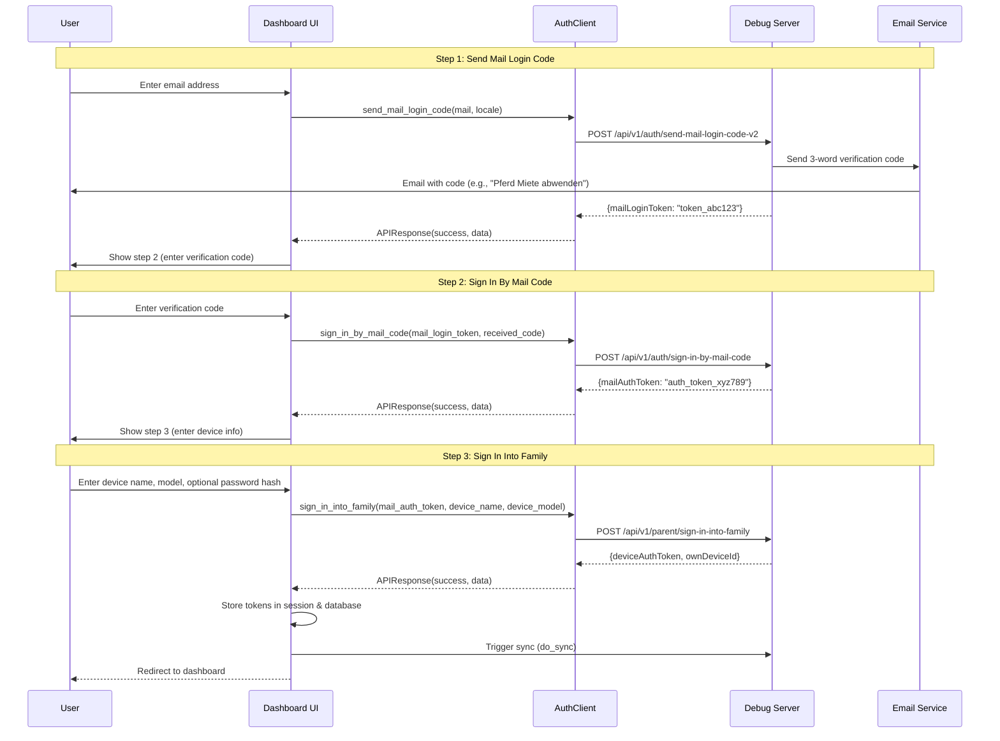
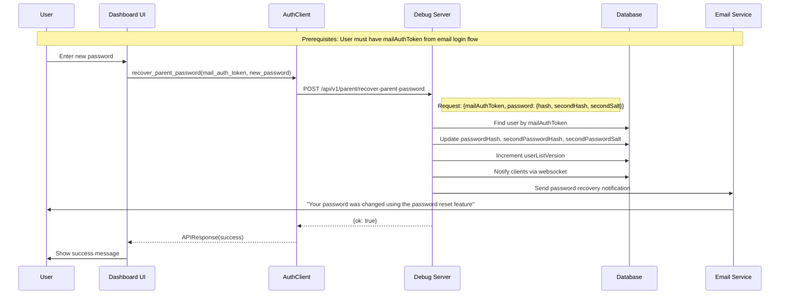

# ServerAPI.md - TimeLimit Dashboard V2 External Server API Interface Specification

This document describes all API interfaces between the TimeLimit Dashboard V2 and the external TimeLimit backend server. It serves as the definitive reference for all external server API endpoints, their request/response formats, and usage patterns.

---

## Table of Contents

1. [Overview](#overview)
2. [Server Configuration](#server-configuration)
3. [Authentication Flow](#authentication-flow)
4. [External Server API Endpoints](#external-server-api-endpoints)
5. [Dashboard Internal Endpoints](#dashboard-internal-endpoints)
6. [Sync Protocol](#sync-protocol)
7. [Data Models](#data-models)
8. [Error Handling](#error-handling)

---

## Overview

The TimeLimit Dashboard V2 communicates with the external TimeLimit backend server to manage families, devices, users, and categories. The dashboard acts as a client that:

- Authenticates users via email verification codes
- Creates and manages families
- Syncs device and user data
- Handles device registration and removal

### Key Concepts

- **device_auth_token**: Primary authentication token for all server requests
- **mail_auth_token**: Temporary token for email-based authentication
- **own_device_id**: Unique identifier for the dashboard device
- **parent_password_second_hash**: Second password hash for device removal operations
- **clientLevel**: Client version level (typically 7)

---

## Server Configuration

The dashboard can connect to different server endpoints:

| Server Key | Name | URL |
|------------|------|-----|
| `local` | 🏠 Lokaal | `http://192.168.68.30:8080` |
| `official` | 🌍 Officieel | `https://api.timelimit.io` |
| `debug` | 🐛 Debug Server | `http://192.168.68.30:8080` |

---

## Authentication Flow

### 1. Send Mail Login Code

Request a verification code to be sent to an email address.

**Endpoint:** `POST /api/v1/auth/send-mail-login-code-v2`

**Request:**
```json
{
    "mail": "user@example.com",
    "locale": "en",
    "deviceAuthToken": "optional_token"
}
```

**Response:**
```json
{
    "mailLoginToken": "token_abc123"
}
```

---

### 2. Sign In By Mail Code

Exchange the verification code for a mail auth token.

**Endpoint:** `POST /api/v1/auth/sign-in-by-mail-code`

**Request:**
```json
{
    "mailLoginToken": "token_abc123",
    "receivedCode": "Pferd Miete abwenden"
}
```

**Response:**
```json
{
    "mailAuthToken": "auth_token_xyz789"
}
```

---

### 3. Create Family

Create a new family with the parent account.

**Endpoint:** `POST /api/v1/parent/create-family`

**Request:**
```json
{
    "mailAuthToken": "auth_token_xyz789",
    "parentPassword": {
        "hash": "$2a$12$...",
        "secondHash": "$2a$12$...",
        "secondSalt": "salt...",
        "encrypted": false
    },
    "parentDevice": {
        "model": "Pixel 7"
    },
    "deviceName": "Parent's Phone",
    "timeZone": "Europe/Amsterdam",
    "parentName": "John Doe",
    "clientLevel": 7
}
```

**Response:**
```json
{
    "deviceAuthToken": "device_token_abc123",
    "ownDeviceId": "device_id_xyz789"
}
```

---

### 4. Sign In Into Family

Sign in to an existing family.

**Endpoint:** `POST /api/v1/parent/sign-in-into-family`

**Request:**
```json
{
    "mailAuthToken": "auth_token_xyz789",
    "parentDevice": {
        "model": "Pixel 7"
    },
    "deviceName": "Parent's Phone",
    "clientLevel": 7
}
```

**Note:** The `parentPasswordSecondHash` field is **optional** for email-based sign-in. It is only required for device removal operations.

**Response:**
```json
{
    "deviceAuthToken": "device_token_abc123",
    "ownDeviceId": "device_id_xyz789"
}
```

---

### 5. Recover Parent Password

Recover parent password using a mail auth token.

**Endpoint:** `POST /api/v1/parent/recover-parent-password`

**Request:**
```json
{
    "mailAuthToken": "auth_token_xyz789",
    "newPassword": {
        "hash": "$2a$12$...",
        "secondHash": "$2a$12$...",
        "secondSalt": "$2a$12$salt..."
    }
}
```

**Response:**
```json
{
    "ok": true
}
```

**Note:** The password must be pre-hashed using bcrypt with `$2a$` prefix and 12 rounds. The server sends a confirmation email after successful password recovery.

---

## Sequence Diagrams

### Authentication Flow Sequence Diagram



### Recover Parent Password Flow Sequence Diagram



---

## External Server API Endpoints

### GET /time

Get the current server time.

**Request:** None

**Response:**
```json
{
    "ms": 1699900000000
}
```

---

### POST /api/v1/auth/send-mail-login-code-v2

Send a mail login code to the specified email address.

**Request:**
```json
{
    "mail": "user@example.com",
    "locale": "en",
    "deviceAuthToken": "optional_token"
}
```

**Response:**
```json
{
    "mailLoginToken": "token_abc123"
}
```

---

### POST /api/v1/auth/sign-in-by-mail-code

Sign in using a mail login token and verification code.

**Request:**
```json
{
    "mailLoginToken": "token_abc123",
    "receivedCode": "Pferd Miete abwenden"
}
```

**Response:**
```json
{
    "mailAuthToken": "auth_token_xyz789"
}
```

---

### POST /api/v1/parent/create-family

Create a new family.

**Request:**
```json
{
    "mailAuthToken": "auth_token_xyz789",
    "parentPassword": {
        "hash": "$2a$12$...",
        "secondHash": "$2a$12$...",
        "secondSalt": "salt...",
        "encrypted": false
    },
    "parentDevice": {
        "model": "Pixel 7"
    },
    "deviceName": "Parent's Phone",
    "timeZone": "Europe/Amsterdam",
    "parentName": "John Doe",
    "clientLevel": 7
}
```

**Response:**
```json
{
    "deviceAuthToken": "device_token_abc123",
    "ownDeviceId": "device_id_xyz789"
}
```

---

### POST /api/v1/parent/sign-in-into-family

Sign in to an existing family.

**Request:**
```json
{
    "mailAuthToken": "auth_token_xyz789",
    "parentDevice": {
        "model": "Pixel 7"
    },
    "deviceName": "Parent's Phone",
    "clientLevel": 7
}
```

**Response:**
```json
{
    "deviceAuthToken": "device_token_abc123",
    "ownDeviceId": "device_id_xyz789"
}
```

---

### POST /api/v1/parent/recover-parent-password

Recover parent password.

**Request:**
```json
{
    "mailAuthToken": "auth_token_xyz789",
    "password": {
        "hash": "$2a$12$...",
        "secondHash": "$2a$12$...",
        "secondSalt": "$2a$12$salt..."
    }
}
```

**Response:**
```json
{
    "ok": true
}
```

---

### POST /api/v1/parent/create-add-device-token

Create a token for adding a child device to the family.

**Request:**
```json
{
    "deviceAuthToken": "device_token_abc123",
    "parentId": "parent_user_123",
    "parentPasswordSecondHash": "$2a$12$..."
}
```

**Request Fields:**

| Field | Type | Required | Description |
|-------|------|----------|-------------|
| `deviceAuthToken` | string | Yes | Device auth token for authentication |
| `parentId` | string | Yes | Parent user ID |
| `parentPasswordSecondHash` | string | Yes | Parent password second hash for verification |

**Response:**
```json
{
    "token": "register_token_xyz789",
    "deviceId": "device_id_123"
}
```

---

### POST /api/v1/child/add-device

Register a child device using the add-device token.

**Request:**
```json
{
    "registerToken": "register_token_xyz789",
    "deviceName": "Child's Phone",
    "childDevice": {
        "model": "Pixel 6"
    },
    "clientLevel": 7
}
```

**Request Fields:**

| Field | Type | Required | Description |
|-------|------|----------|-------------|
| `registerToken` | string | Yes | Token from `/parent/create-add-device-token` |
| `deviceName` | string | Yes | Name for the child's device (defaults to "Unknown Device" if not provided) |
| `childDevice` | object | Yes | Device info object containing `model` field (defaults to `{"model": "Unknown"}` if not provided) |
| `clientLevel` | integer | Yes | Client level/version (defaults to 7 if not provided) |

**Note:** All fields are required by the TimeLimit server. The client provides default values for optional fields:
- `deviceName` defaults to "Unknown Device"
- `childDevice.model` defaults to "Unknown"
- `clientLevel` defaults to 7 (matches Android app's `ClientDataStatus.CLIENT_LEVEL_VALUE`)

**Response:**
```json
{
    "deviceAuthToken": "child_device_token_abc123",
    "ownDeviceId": "child_device_id_xyz789"
}
```

---

### POST /api/v1/parent/get-status-by-mail-address

Get family status by mail auth token.

**Request:**
```json
{
    "mailAuthToken": "auth_token_xyz789"
}
```

**Response:**
```json
{
    "status": "existing",
    "mail": "user@example.com"
}
```

---

### POST /api/v1/parent/remove-device

Remove a device from the family.

**Request:**
```json
{
    "deviceAuthToken": "device_token_abc123",
    "parentUserId": "user_123",
    "parentPasswordSecondHash": "$2a$12$...",
    "deviceId": "device_id_to_remove"
}
```

**Response:**
```json
{
    "ok": true
}
```

---

## Dashboard Internal Endpoints

These are internal endpoints used by the dashboard frontend for server-side rendered flows.

### GET /recover-parent-password

Render the recover parent password page with the appropriate step based on session state.

**Session State:**
- No `mail_login_token`: Step 1 - Enter email
- Has `mail_login_token`, no `mail_auth_token`: Step 2 - Enter verification code
- Has `mail_auth_token`: Step 3 - Enter new password
- Has `device_auth_token`: Redirect to dashboard

**Response:** Rendered HTML template with the appropriate step.

---

### POST /recover-parent-password

Process recover parent password form submission.

**Form Data:**
| Field | Description |
|-------|-------------|
| `step` | Current step (1, 2, or 3) |
| `mail` | Email address (step 1) |
| `receivedCode` | 3-word verification code (step 2) |
| `password` | New password (step 3) |
| `confirmPassword` | Confirm new password (step 3) |

**Flow:**
1. **Step 1**: Send mail login code to email address
2. **Step 2**: Verify the 3-word code received by email
3. **Step 3**: Hash password with bcrypt and call `/api/auth/recover-parent-password`

**Session Updates:**
- `mail_login_token`: Stored after step 1
- `mail_auth_token`: Stored after step 2
- `parent_password_second_hash`: Stored after step 3 (in session and database)

**Response:** Redirect to next step or success page.

---

## Sync Protocol

The dashboard uses a CRDT (Conflict-free Replicated Data Types) based sync protocol with HMAC-SHA256 integrity signing.

### Sync Flow

1. **Pull Status**: Request current server state with version numbers
2. **Apply Changes**: Update local database with server data
3. **Push Actions**: Send local changes to server with integrity signatures

### Action Types

Actions are encoded and signed with HMAC-SHA256. Valid AppLogicAction types (per server schema at `C:/git/timelimit-server/src/function/sync/apply-actions/dispatch-app-logic-action/index.ts`):

- `UPDATE_DEVICE_STATUS` - Update device app version
- `ADD_USED_TIME` - Add used time to a category
- `ADD_USED_TIME_V2` - Add used time (v2)
- `ADD_INSTALLED_APPS` - Add installed apps
- `FINISH_KEY_REQUEST` - Finish a key request
- `FORCE_SYNC` - Force a sync
- `REPLY_TO_KEY_REQUEST` - Reply to a key request
- `MARK_TASK_PENDING` - Mark a task as pending
- `PING` - Ping action
- `UPDATE_INSTALLED_APPS` - Update installed apps
- `REMOVE_INSTALLED_APPS` - Remove installed apps
- `SEND_KEY_REQUEST` - Send a key request
- `SIGN_OUT_AT_DEVICE` - Sign out at a device
- `TRIED_DISABLING_DEVICE_ADMIN` - Tried disabling device admin
- `UPDATE_APP_ACTIVITIES` - Update app activities
- `UPLOAD_DEVICE_PUBLIC_KEY` - Upload device public key

**Note:** `REMOVE_DEVICE` is NOT a valid AppLogicAction type. Device removal must use the REST API endpoint `/parent/remove-device` directly.

### Integrity Signing

Each action includes:
- `encodedAction`: JSON-encoded action data
- `sequenceNumber`: Monotonically increasing number
- `integrity`: HMAC-SHA256 signature
- `type`: Action type (e.g., "appLogic")
- `userId`: User ID associated with the action

---

## Data Models

### User

```typescript
interface User {
    id: string;
    name: string;
    type: "parent" | "child";
    mail: string;
    time_zone: string;
    disable_limits_until: number | null;
    current_device: string;
    password: string;
    second_password_salt: string;
    category_for_not_assigned_apps: string;
    relax_primary_device: number;
    flags: number;
    limit_login_category: string;
    pre_block_duration: number;
    last_updated: number;
}
```

### Device

```typescript
interface Device {
    id: string;
    name: string;
    model: string;
    current_user_id: string;
    current_protection_level: number;
    highest_protection_level: number;
    current_app_version: string;
    highest_app_version: string;
    public_key: string;
    platform_type: string;
    platform_level: number;
    created_at: string;
}
```

### Category

```typescript
interface Category {
    id: string;
    title: string;
    blocked_times: string;
    extra_time: number;
    extra_time_day: number;
    temp_blocked: number;
    temp_block_time: number;
    version: string;
    parent_category_id: string | null;
    block_all_notifications: number;
    time_warnings: number;
    sort_order: number;
    flags: number;
    last_updated: number;
}
```

---

## Error Handling

### Error Response Format

```json
{
    "status": "error",
    "error_code": "error_type",
    "error_message": "Human-readable error message",
    "technical_detail": "Technical details for debugging"
}
```

### Common Error Codes

| Code | Description |
|------|-------------|
| `unauthorized` | Not authenticated |
| `timeout` | Request timed out |
| `unreachable` | Cannot connect to server |
| `invalid_token` | Invalid or expired token |
| `missing_field` | Required field missing |
| `sync_failed` | Sync operation failed |

---

## Time Limit Rules API Endpoints

The Time Limit Rules API allows parents to configure time limits for child users. These endpoints manage time-based restrictions on app usage for specific users and categories.

### Authentication

All Time Limit Rules API endpoints require authentication via the session's `device_auth_token`. The dashboard must be logged in to a family before these endpoints can be used.

---

### GET /api/dashboard/time-limit-rules

Retrieve all time limit rules for the authenticated family.

**Request:**
```http
GET /api/dashboard/time-limit-rules
Authorization: Bearer <device_auth_token>
```

**Response - Success (200):**
```json
{
    "status": "ok",
    "count": 2,
    "rules": [
        {
            "id": "rule_abc123def456",
            "device_auth_token": "device_token_xyz789",
            "user_id": "user_child_123",
            "category_id": "cat_games_456",
            "rule_type": 0,
            "start_time": "09:00",
            "end_time": "17:00",
            "days": 127,
            "limit_minutes": 120,
            "version": "v1",
            "created_at": "2026-09-10T10:30:00.000000Z",
            "last_updated": 1758000000000
        }
    ]
}
```

**Response Fields:**

| Field | Type | Description |
|-------|------|-------------|
| `status` | string | Response status ("ok" or "error") |
| `count` | integer | Number of rules returned |
| `rules` | array | Array of time limit rule objects |

**Rule Object Fields:**

| Field | Type | Description |
|-------|------|-------------|
| `id` | string | Unique rule identifier |
| `device_auth_token` | string | Device auth token this rule belongs to |
| `user_id` | string | ID of the user the rule applies to |
| `category_id` | string | ID of the category the rule applies to |
| `rule_type` | integer | Type of rule (0 = TIME_LIMIT, 1 = TIME_LIMIT_EXCEPTIONS) |
| `start_time` | string | Start time in HH:MM format (24-hour) |
| `end_time` | string | End time in HH:MM format (24-hour) |
| `days` | integer | Days bitmask (bit 0=Monday, bit 6=Sunday, 127 = all days) |
| `limit_minutes` | integer | Time limit duration in minutes |
| `version` | string | Optional version string |
| `created_at` | string | ISO 8601 timestamp when rule was created |
| `last_updated` | integer | Unix timestamp in milliseconds when rule was last updated |

**Error Responses:**

| Status Code | Error Response |
|-------------|----------------|
| 401 | `{"status": "error", "error": "Not authenticated"}` |
| 400 | `{"status": "error", "error": "No device auth token"}` |
| 500 | `{"status": "error", "error": "Failed to retrieve time limit rules"}` |

---

### POST /api/dashboard/time-limit-rules

Create a new time limit rule.

**Request:**
```http
POST /api/dashboard/time-limit-rules
Authorization: Bearer <device_auth_token>
Content-Type: application/json

{
    "userId": "user_child_123",
    "categoryId": "cat_games_456",
    "rule": {
        "type": 0,
        "startTime": "09:00",
        "endTime": "17:00",
        "days": 127,
        "limitMinutes": 120
    }
}
```

**Request Body Fields:**

| Field | Type | Required | Description |
|-------|------|----------|-------------|
| `userId` | string | Yes | ID of the user the rule applies to |
| `categoryId` | string | Yes | ID of the category the rule applies to |
| `rule` | object | Yes | Rule configuration object |
| `rule.type` | integer | No | Rule type (0 = TIME_LIMIT, default: 0) |
| `rule.startTime` | string | No | Start time in HH:MM format (24-hour) |
| `rule.endTime` | string | No | End time in HH:MM format (24-hour) |
| `rule.days` | integer | No | Days bitmask (0-127, default: 127) |
| `rule.limitMinutes` | integer | No | Time limit in minutes (default: 0) |
| `rule.version` | string | No | Optional version string |

**Response - Success (200):**
```json
{
    "status": "ok",
    "ruleId": "rule_abc123def456"
}
```

**Response Fields:**

| Field | Type | Description |
|-------|------|-------------|
| `status` | string | Response status ("ok" or "error") |
| `ruleId` | string | ID of the newly created rule |

**Error Responses:**

| Status Code | Error Response |
|-------------|----------------|
| 401 | `{"status": "error", "error": "Not authenticated"}` |
| 400 | `{"status": "error", "error": "No device auth token"}` |
| 400 | `{"status": "error", "error": "Missing userId"}` |
| 400 | `{"status": "error", "error": "Missing categoryId"}` |
| 400 | `{"status": "error", "error": "Missing rule"}` |
| 400 | `{"status": "error", "error": "Invalid startTime format. Use HH:MM (24-hour format)"}` |
| 400 | `{"status": "error", "error": "Invalid endTime format. Use HH:MM (24-hour format)"}` |
| 400 | `{"status": "error", "error": "Invalid days value. Must be an integer between 0 and 127"}` |
| 400 | `{"status": "error", "error": "Invalid limitMinutes. Must be a non-negative integer"}` |
| 500 | `{"status": "error", "error": "Failed to create time limit rule"}` |

---

### PUT /api/dashboard/time-limit-rules/{ruleId}

Update an existing time limit rule.

**Request:**
```http
PUT /api/dashboard/time-limit-rules/rule_abc123def456
Authorization: Bearer <device_auth_token>
Content-Type: application/json

{
    "rule": {
        "type": 0,
        "startTime": "08:00",
        "endTime": "18:00",
        "days": 63,
        "limitMinutes": 180
    }
}
```

**Request Body Fields:**

| Field | Type | Required | Description |
|-------|------|----------|-------------|
| `userId` | string | No | ID of the user the rule applies to |
| `categoryId` | string | No | ID of the category the rule applies to |
| `rule` | object | No | Rule configuration object (any field can be updated) |
| `rule.type` | integer | No | Rule type |
| `rule.startTime` | string | No | Start time in HH:MM format |
| `rule.endTime` | string | No | End time in HH:MM format |
| `rule.days` | integer | No | Days bitmask (0-127) |
| `rule.limitMinutes` | integer | No | Time limit in minutes |
| `rule.version` | string | No | Version string |

**Response - Success (200):**
```json
{
    "status": "ok",
    "message": "Rule updated successfully"
}
```

**Response Fields:**

| Field | Type | Description |
|-------|------|-------------|
| `status` | string | Response status ("ok" or "error") |
| `message` | string | Success message |

**Error Responses:**

| Status Code | Error Response |
|-------------|----------------|
| 401 | `{"status": "error", "error": "Not authenticated"}` |
| 400 | `{"status": "error", "error": "No device auth token"}` |
| 404 | `{"status": "error", "error": "Rule not found"}` |
| 400 | `{"status": "error", "error": "No updates provided"}` |
| 400 | `{"status": "error", "error": "Invalid startTime format. Use HH:MM (24-hour format)"}` |
| 400 | `{"status": "error", "error": "Invalid endTime format. Use HH:MM (24-hour format)"}` |
| 400 | `{"status": "error", "error": "Invalid days value. Must be an integer between 0 and 127"}` |
| 400 | `{"status": "error", "error": "Invalid limitMinutes. Must be a non-negative integer"}` |
| 500 | `{"status": "error", "error": "Failed to update time limit rule"}` |

---

### DELETE /api/dashboard/time-limit-rules/{ruleId}

Delete a time limit rule.

**Request:**
```http
DELETE /api/dashboard/time-limit-rules/rule_abc123def456
Authorization: Bearer <device_auth_token>
```

**Response - Success (200):**
```json
{
    "status": "ok",
    "message": "Rule deleted successfully"
}
```

**Response Fields:**

| Field | Type | Description |
|-------|------|-------------|
| `status` | string | Response status ("ok" or "error") |
| `message` | string | Success message |

**Error Responses:**

| Status Code | Error Response |
|-------------|----------------|
| 401 | `{"status": "error", "error": "Not authenticated"}` |
| 400 | `{"status": "error", "error": "No device auth token"}` |
| 404 | `{"status": "error", "error": "Rule not found"}` |
| 500 | `{"status": "error", "error": "Failed to delete time limit rule"}` |

---

### Rule Types

| Type Value | Type Name | Description |
|------------|-----------|-------------|
| 0 | TIME_LIMIT | Standard time limit rule |
| 1 | TIME_LIMIT_EXCEPTIONS | Time limit exception rule |

### Days Bitmask

The `days` field uses a bitmask to specify which days the rule applies to:

| Bit | Day | Value |
|-----|-----|-------|
| 0 | Monday | 1 |
| 1 | Tuesday | 2 |
| 2 | Wednesday | 4 |
| 3 | Thursday | 8 |
| 4 | Friday | 16 |
| 5 | Saturday | 32 |
| 6 | Sunday | 64 |

Common values:
- `127` (0x7F) = All days (1+2+4+8+16+32+64)
- `63` (0x3F) = Weekdays only (Mon-Fri)
- `96` (0x60) = Weekends only (Sat+Sun)

### Time Format

Times are specified in 24-hour format as `HH:MM`:
- Valid range: `00:00` to `23:59`
- Examples: `09:00`, `17:30`, `23:59`

---

### Rate Limiting

The Time Limit Rules API endpoints are subject to the following rate limits:

| Endpoint | Limit | Window |
|----------|-------|--------|
| GET /api/dashboard/time-limit-rules | 60 requests | per minute |
| POST /api/dashboard/time-limit-rules | 30 requests | per minute |
| PUT /api/dashboard/time-limit-rules/{ruleId} | 30 requests | per minute |
| DELETE /api/dashboard/time-limit-rules/{ruleId} | 30 requests | per minute |

Rate limit responses return HTTP 429 with:
```json
{
    "status": "error",
    "error": "Rate limit exceeded",
    "retry_after": 60
}
```

---

### Sync Protocol Integration

When a rule is created or deleted, the dashboard automatically syncs the change to the TimeLimit server using the sync protocol:

1. The rule is saved to the local database
2. An `AddTimeLimitRuleAction` or `RemoveTimeLimitRuleAction` is generated
3. The action is signed with HMAC-SHA256 using the parent's second password hash
4. The action is pushed to the server via `/sync/push-actions`

If the parent password hash is not set, the rule is still saved locally but not synced to the server.

---

## Version History

| Version | Date | Changes |
|---------|------|---------|
| 1.0.0 | 2026-08-28 | Initial API specification for external server communication |
| 1.1.0 | 2026-08-29 | Added dashboard internal endpoints documentation (GET /api/dashboard/devices, POST /api/dashboard/devices/remove) |
| 1.2.0 | 2026-09-03 | Added Recover Parent Password endpoint documentation, fixed Sign In Into Family request format, added sequence diagrams |
| 1.3.1 | 2026-09-04 | Fixed Recover Parent Password API field name: changed `newPassword` to `password` to match server validator |
| 1.3.0 | 2026-09-03 | Added Recover Parent Password server-side rendered flow (GET/POST /recover-parent-password), added dashboard internal endpoints section |
| 1.4.0 | 2026-09-10 | Added Time Limit Rules API endpoints documentation (GET/POST/PUT/DELETE /api/dashboard/time-limit-rules) |

---

*This document serves as the basis/reference for all external server API changes. It should be extended as new features are added to the dashboard.*