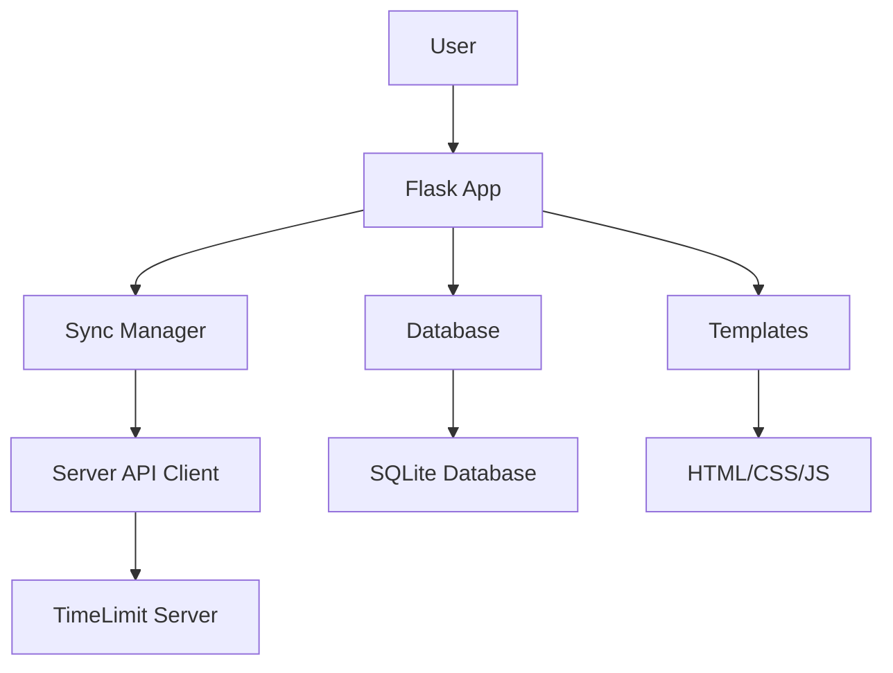

# Design Overview

## Table of Contents

1. [Overview](#overview)
2. [Architecture](#architecture)
3. [Key Design Principles](#key-design-principles)
4. [System Components](#system-components)
5. [Authentication Flow](#authentication-flow)
6. [Data Flow](#data-flow)
7. [Technical Stack](#technical-stack)
8. [Database Schema](#database-schema)
9. [API Documentation](#api-documentation)
10. [Key Files](#key-files)
11. [Environment Variables](#environment-variables)
12. [Server Selection](#server-selection)
13. [Security Considerations](#security-considerations)
14. [Logging Infrastructure](#logging-infrastructure)
15. [UI Patterns](#ui-patterns)
16. [Coding Standards](#coding-standards)
17. [Testing Guide](#testing-guide)
18. [User Guide](#user-guide)
19. [Requirements](#requirements)
20. [Password Hashing and Integrity](#password-hashing-and-integrity)
21. [Android App Architecture Reference](#android-app-architecture-reference)

---

## Overview

Dashboard V2 is a Flask-based web application that provides a modern interface for managing TimeLimit families and devices. The application follows a client-server architecture with local SQLite storage for offline capabilities.

### Key Features

- **Device Auth Token Authentication**: Primary authentication mechanism using device tokens
- **Offline-First Design**: Local SQLite database enables offline operation
- **CRDT Synchronization**: Conflict-free Replicated Data Type protocol with HMAC-SHA256 integrity signing
- **Server-Sent Events**: Real-time updates for connected devices
- **Time Limit Rules**: Configure time-based restrictions for child users

### System Architecture

```
┌─────────────────────────────────────────────────────────────────┐
│                        Dashboard V2 Application                  │
├─────────────────────────────────────────────────────────────────┤
│  ┌──────────────┐  ┌──────────────┐  ┌──────────────────────┐ │
│  │   Flask App  │  │   Database   │  │   Sync Manager       │ │
│  │   (Routes)   │  │   (SQLite)   │  │   (CRDT Protocol)    │ │
│  └──────────────┘  └──────────────┘  └──────────────────────┘ │
│         │                 │                     │              │
│         ▼                 ▼                     ▼              │
│  ┌──────────────┐  ┌──────────────┐  ┌──────────────────────┐ │
│  │   Templates  │  │   Tables     │  │   Server API Client  │ │
│  │   (HTML/CSS) │  │   (9 tables) │  │   (AuthClient)       │ │
│  └──────────────┘  └──────────────┘  └──────────────────────┘ │
└─────────────────────────────────────────────────────────────────┘
                                │
                                ▼
                      ┌──────────────────────┐
                      │   TimeLimit Server   │
                      │   (api.timelimit.io) │
                      └──────────────────────┘
```

---

## Architecture

### High-Level Architecture

```
┌─────────────────────────────────────────────────────────────────┐
│                        Dashboard V2 Application                  │
├─────────────────────────────────────────────────────────────────┤
│  ┌──────────────┐  ┌──────────────┐  ┌──────────────────────┐ │
│  │   Flask App  │  │   Database   │  │   Sync Manager       │ │
│  │   (Routes)   │  │   (SQLite)   │  │   (CRDT Protocol)    │ │
│  └──────────────┘  └──────────────┘  └──────────────────────┘ │
│         │                 │                     │              │
│         ▼                 ▼                     ▼              │
│  ┌──────────────┐  ┌──────────────┐  ┌──────────────────────┐ │
│  │   Templates  │  │   Tables     │  │   Server API Client  │ │
│  │   (HTML/CSS) │  │   (9 tables) │  │   (AuthClient)       │ │
│  └──────────────┘  └──────────────┘  └──────────────────────┘ │
└─────────────────────────────────────────────────────────────────┘
                                │
                                ▼
                      ┌──────────────────────┐
                      │   TimeLimit Server   │
                      │   (api.timelimit.io) │
                      └──────────────────────┘
```

### Component Interaction Diagram



---

## Key Design Principles

### 1. Device Auth Token as Primary Key

Using `device_auth_token` as the primary identifier instead of `family_id`, matching the official Android app's approach.

**Benefits:**
- Consistent authentication across platforms
- Simplified session management
- Better security with token-based auth

### 2. Offline-First Design

Local SQLite database enables offline operation with automatic sync when connectivity is restored.

**Implementation:**
- All data stored locally in SQLite
- Sync queue for pending changes
- Conflict resolution via CRDT protocol

### 3. Session Persistence

Authentication tokens persist across application restarts via file-based storage.

**Storage Location:**
- Windows: `%APPDATA%\DashboardV2\session.json`
- Linux: `~/.config/dashboardV2/session.json`
- Home Assistant: `/data/dashboardV2_session.json`

### 4. CRDT-Based Sync

Conflict-free Replicated Data Type (CRDT) synchronization protocol with HMAC-SHA256 integrity signing.

**Sync Process:**
1. Generate unique action ID
2. Create action with HMAC signature
3. Push to server via sync endpoint
4. Server validates and applies changes
5. Pull updated state from server

---

## System Components

### Frontend Components

| Component | Technology | Purpose |
|-----------|------------|---------|
| Templates | HTML5 | Server-rendered pages |
| Styles | CSS3 | Responsive styling |
| Scripts | JavaScript (ES6+) | Interactive functionality |

### Backend Components

| Component | Technology | Purpose |
|-----------|------------|---------|
| Flask App | Python 3.x | HTTP server and routing |
| Database | SQLite | Local data storage |
| Auth Client | Python | Server API communication |
| Sync Manager | Python | CRDT synchronization |
| Scheduler | APScheduler | Background tasks |
| Config | Python | Configuration management |

---

## Authentication Flow

### Complete Authentication Flow

```
1. Enter Email → 2. Verify Code → 3. Create Family / Sign In
       │               │                     │
       ▼               ▼                     ▼
   Send Mail     Verify Code          Create Family
   Login Code    to Server            or Sign In
                 with 3-word code
```

### Authentication Steps

#### Step 1: Send Mail Login Code
- User enters email address
- System sends 3-word verification code via email
- `mailLoginToken` received from server

#### Step 2: Verify Code
- User enters 3-word verification code
- System exchanges code for `mailAuthToken`
- Token stored in session

#### Step 3: Create Family / Sign In
- **Create Family**: Enter password, device info, name
- **Sign In**: Enter device info, optional password
- Server returns `deviceAuthToken` and `ownDeviceId`

---

## Data Flow

### Create Family Flow

1. User enters email → Mail login code sent
2. User enters verification code → Mail auth token received
3. User enters password → Family created on server
4. Device auth token stored locally
5. Initial sync pulls users, devices, categories

### Login as Parent Flow

1. User enters email → Mail login code sent
2. User enters verification code → Mail auth token received
3. User enters device info → Sign in to existing family
4. Optional: Set password for device removal
5. Sync pulls latest data

### Sync Flow

1. Pull changes from server
2. Push local changes to server
3. Update local database
4. Update connected devices list

### Time Limit Rules Flow

1. User creates rule in UI
2. Rule validated client-side
3. Rule sent to server via sync
4. Server validates and stores rule
5. Rule syncs to all connected devices

---

## Technical Stack

| Layer | Technology | Version |
|-------|------------|---------|
| Backend | Flask | 2.x |
| Database | SQLite | 3.x |
| Frontend | HTML5 | - |
| Frontend | CSS3 | - |
| Frontend | JavaScript | ES6+ |
| Authentication | bcrypt | 4.x |
| Sync Protocol | CRDT | - |
| Integrity | HMAC-SHA256 | - |
| Logging | structlog | 23.x |
| Scheduling | APScheduler | 3.x |

---

## Database Schema

Dashboard V2 uses SQLite with 9 tables for local data storage. All tables use `device_auth_token` as the primary key or foreign key, matching the official Android app's approach.

### Table Overview

| Table | Purpose | Primary Key |
|-------|---------|-------------|
| `server_checks` | Timechecker results | `id` (AUTOINCREMENT) |
| `families` | Family account information | `device_auth_token` |
| `devices` | Device registration data | `id` |
| `auth_tokens` | Authentication tokens | `id` (AUTOINCREMENT) |
| `users` | User data from TimeLimit sync | `id` |
| `sync_state` | Sync version tracking | `device_auth_token` |
| `categories` | TimeLimit categories | `id` |
| `connected_devices` | Real-time connected device tracking | `(device_auth_token, device_id)` |
| `time_limit_rules` | Local time limit rules | `id` |

### Table Definitions

#### server_checks

Stores historical server check results from the APScheduler timechecker.

```sql
CREATE TABLE server_checks (
    id INTEGER PRIMARY KEY AUTOINCREMENT,
    timestamp INTEGER NOT NULL,
    success INTEGER NOT NULL,
    error_code TEXT,
    user_message TEXT,
    technical_detail TEXT,
    server_time INTEGER,
    attempts INTEGER DEFAULT 0,
    server_url TEXT NOT NULL
)
```

#### families

Stores family account information, keyed by `device_auth_token`.

```sql
CREATE TABLE families (
    device_auth_token TEXT PRIMARY KEY,
    mail TEXT NOT NULL,
    created_at TEXT NOT NULL,
    parent_password_hash TEXT,
    parent_password_second_hash TEXT,
    parent_password_second_salt TEXT,
    parent_password_encrypted INTEGER DEFAULT 0,
    parent_user_id TEXT
)
```

#### devices

Stores device registration data for all devices in the family.

```sql
CREATE TABLE devices (
    id TEXT PRIMARY KEY,
    device_auth_token TEXT NOT NULL,
    name TEXT,
    model TEXT,
    created_at TEXT NOT NULL,
    current_user_id TEXT,
    current_protection_level INTEGER DEFAULT 0,
    highest_protection_level INTEGER DEFAULT 0,
    current_app_version TEXT,
    highest_app_version TEXT,
    public_key TEXT,
    platform_type TEXT,
    platform_level INTEGER DEFAULT 0,
    FOREIGN KEY (device_auth_token) REFERENCES families(device_auth_token)
)
```

#### auth_tokens

Stores authentication tokens for session management.

```sql
CREATE TABLE auth_tokens (
    id INTEGER PRIMARY KEY AUTOINCREMENT,
    token_type TEXT NOT NULL,
    token_value TEXT NOT NULL UNIQUE,
    device_id TEXT,
    mail TEXT,
    code TEXT,
    created_at TEXT NOT NULL,
    expires_at TEXT,
    FOREIGN KEY (device_id) REFERENCES devices(id)
)
```

#### users

Stores user data synchronized from the TimeLimit server.

```sql
CREATE TABLE users (
    id TEXT PRIMARY KEY,
    device_auth_token TEXT NOT NULL,
    name TEXT,
    password TEXT,
    second_password_salt TEXT,
    type TEXT,
    time_zone TEXT,
    disable_limits_until INTEGER,
    mail TEXT,
    current_device TEXT,
    category_for_not_assigned_apps TEXT,
    relax_primary_device INTEGER DEFAULT 0,
    flags INTEGER DEFAULT 0,
    limit_login_category TEXT,
    pre_block_duration INTEGER DEFAULT 0,
    last_updated INTEGER,
    FOREIGN KEY (device_auth_token) REFERENCES families(device_auth_token)
)
```

#### sync_state

Tracks sync version numbers and sequence numbers for CRDT synchronization.

```sql
CREATE TABLE sync_state (
    device_auth_token TEXT PRIMARY KEY,
    device_list_version TEXT,
    user_list_version TEXT,
    last_sync_timestamp INTEGER,
    last_sync_success INTEGER,
    next_sequence_number INTEGER DEFAULT 0,
    FOREIGN KEY (device_auth_token) REFERENCES families(device_auth_token)
)
```

#### categories

Stores TimeLimit category data.

```sql
CREATE TABLE categories (
    id TEXT PRIMARY KEY,
    device_auth_token TEXT NOT NULL,
    child_id TEXT,
    title TEXT,
    blocked_times TEXT,
    extra_time INTEGER,
    extra_time_day INTEGER,
    temp_blocked INTEGER DEFAULT 0,
    temp_block_time INTEGER,
    version TEXT,
    parent_category_id TEXT,
    block_all_notifications INTEGER DEFAULT 0,
    time_warnings INTEGER DEFAULT 0,
    sort_order INTEGER DEFAULT 0,
    flags INTEGER DEFAULT 0,
    last_updated INTEGER,
    FOREIGN KEY (device_auth_token) REFERENCES families(device_auth_token)
)
```

#### connected_devices

Tracks devices currently connected to the server.

```sql
CREATE TABLE connected_devices (
    device_auth_token TEXT NOT NULL,
    device_id TEXT NOT NULL,
    last_seen INTEGER,
    name TEXT,
    PRIMARY KEY (device_auth_token, device_id),
    FOREIGN KEY (device_auth_token) REFERENCES families(device_auth_token)
)
```

#### time_limit_rules

Stores local time limit rules for users.

```sql
CREATE TABLE time_limit_rules (
    id TEXT PRIMARY KEY,
    device_auth_token TEXT NOT NULL,
    user_id TEXT NOT NULL,
    category_id TEXT NOT NULL,
    rule_type INTEGER DEFAULT 0,
    start_time TEXT,
    end_time TEXT,
    days INTEGER DEFAULT 127,
    limit_minutes INTEGER DEFAULT 0,
    version TEXT,
    created_at TEXT NOT NULL,
    last_updated INTEGER,
    FOREIGN KEY (device_auth_token) REFERENCES families(device_auth_token),
    FOREIGN KEY (user_id) REFERENCES users(id),
    FOREIGN KEY (category_id) REFERENCES categories(id)
)
```

### Foreign Key Relationships

```
families (device_auth_token)
    │
    ├── devices (device_auth_token)
    ├── users (device_auth_token)
    ├── sync_state (device_auth_token)
    ├── categories (device_auth_token)
    └── connected_devices (device_auth_token)
        └── time_limit_rules (device_auth_token)
            ├── users.id (user_id)
            └── categories.id (category_id)
```

### Days Bitmask

Days are represented as a bitmask (0-127) in the `time_limit_rules` table:

| Bit | Day | Value |
|-----|-----|-------|
| 0 | Monday | 1 |
| 1 | Tuesday | 2 |
| 2 | Wednesday | 4 |
| 3 | Thursday | 8 |
| 4 | Friday | 16 |
| 5 | Saturday | 32 |
| 6 | Sunday | 64 |

**Examples:**
- `127` = Every day (1+2+4+8+16+32+64)
- `1` = Monday only
- `3` = Monday and Tuesday
- `62` = Tuesday through Saturday (2+4+8+16+32)
- `96` = Weekend only (32+64)

---

## API Documentation

### Authentication Endpoints

#### POST /api/auth/send-mail-login-code

Send a mail login code to the specified email.

**Request Body:**
```json
{
    "mail": "user@example.com",
    "locale": "en"
}
```

**Response:**
```json
{
    "status": "ok",
    "mailLoginToken": "token_string"
}
```

#### POST /api/auth/sign-in-by-mail-code

Sign in using a mail login token and verification code.

**Request Body:**
```json
{
    "mailLoginToken": "token_string",
    "receivedCode": "word1 word2 word3"
}
```

**Response:**
```json
{
    "status": "ok",
    "mailAuthToken": "auth_token"
}
```

#### POST /api/auth/sign-in-into-family

Sign in to an existing family.

**Request Body:**
```json
{
    "mailAuthToken": "auth_token",
    "parentPasswordSecondHash": "hash",
    "deviceName": "Device Name",
    "deviceModel": "Device Model",
    "clientLevel": 7
}
```

**Response:**
```json
{
    "status": "ok",
    "deviceAuthToken": "device_token",
    "ownDeviceId": "device_id"
}
```

#### POST /api/auth/create-family

Create a new family.

**Request Body:**
```json
{
    "mailAuthToken": "auth_token",
    "parentPassword": {
        "hash": "bcrypt_hash",
        "secondHash": "bcrypt_hash",
        "secondSalt": "salt",
        "encrypted": false
    },
    "parentDevice": {
        "model": "Device Model"
    },
    "deviceName": "Device Name",
    "timeZone": "Europe/Amsterdam",
    "parentName": "Parent Name",
    "locale": "en"
}
```

**Response:**
```json
{
    "status": "ok",
    "deviceAuthToken": "device_token",
    "ownDeviceId": "device_id"
}
```

### Dashboard API Endpoints

#### GET /api/dashboard/users

Get all users.

**Response:**
```json
{
    "status": "ok",
    "count": 2,
    "users": [...]
}
```

#### GET /api/dashboard/devices

Get all devices.

**Response:**
```json
{
    "status": "ok",
    "count": 2,
    "devices": [...],
    "own_device_id": "device_id",
    "has_parent_password_second_hash": true
}
```

#### GET /api/dashboard/categories

Get all categories.

**Response:**
```json
{
    "status": "ok",
    "count": 3,
    "categories": [...]
}
```

#### GET /api/dashboard/time-limit-rules

Get all time limit rules.

**Response:**
```json
{
    "status": "ok",
    "count": 1,
    "rules": [...]
}
```

#### POST /api/dashboard/time-limit-rules

Create a time limit rule.

**Request Body:**
```json
{
    "userId": "user_id",
    "categoryId": "category_id",
    "rule": {
        "type": 0,
        "startTime": "18:00",
        "endTime": "21:00",
        "days": 127,
        "limitMinutes": 120
    }
}
```

**Response:**
```json
{
    "status": "ok",
    "ruleId": "rule_id"
}
```

#### POST /api/dashboard/users/add

Add a user to the family.

**Request Body:**
```json
{
    "name": "User Name",
    "deviceName": "Device Name",
    "deviceModel": "Device Model"
}
```

**Response:**
```json
{
    "status": "ok",
    "userId": "user_id",
    "deviceAuthToken": "device_token",
    "ownDeviceId": "device_id"
}
```

### Sync Endpoints

#### POST /api/sync/pull

Trigger a sync pull from the server.

**Response:**
```json
{
    "status": "ok",
    "synced": true
}
```

### Session Endpoints

#### GET /api/session/status

Get current session status.

**Response:**
```json
{
    "authenticated": true,
    "server_url": "https://timeleap.org",
    "has_device_auth_token": true,
    "device_auth_token": "token",
    "own_device_id": "device_id",
    "has_parent_password_second_hash": true,
    "has_signing_key": true
}
```

#### POST /api/session/clear

Clear the current session.

**Response:**
```json
{
    "status": "ok"
}
```

---

## Key Files

| File | Purpose |
|------|---------|
| `app.py` | Main Flask application with all routes |
| `database.py` | SQLite database operations |
| `auth_client.py` | Server API client |
| `sync_manager.py` | CRDT synchronization |
| `scheduler.py` | Background server checks |
| `config.py` | Application configuration |
| `key_manager.py` | Signing key management |
| `persistence.py` | Persistence abstraction |
| `middleware/request_logging.py` | Request logging middleware |
| `utils/audit_log.py` | Audit logging |
| `utils/logging.py` | Logging configuration |
| `utils/sanitization.py` | Input sanitization |

---

## Environment Variables

| Variable | Description | Default |
|----------|-------------|---------|
| `FLASK_HOST` | Server host | 0.0.0.0 |
| `FLASK_PORT` | Server port | 8099 |
| `FLASK_DEBUG` | Debug mode | False |
| `LOG_LEVEL` | Logging level | INFO |
| `DATABASE_PATH` | SQLite database path | /data/timelimit_ui_storage.json |
| `SKIP_PORT_CHECK` | Skip port availability check | False |
| `DEBUG_SERVER_URL` | Debug-server API URL | http://localhost:8080 |
| `SECRET_KEY` | Session signing key | dev-secret-key-change-in-production |
| `PERSISTENCE_DIR` | Directory for persistence files | Platform-specific |

---

## Server Selection

The application supports multiple server endpoints:

| Key | Server | URL |
|-----|--------|-----|
| `local` | Local development | http://192.168.68.30:8080 |
| `official` | Official TimeLimit server | https://api.timelimit.io |
| `debug` | Debug server | http://localhost:8080 |

Server selection persists across restarts via file-based storage.

---

## Security Considerations

### Authentication Security

- **bcrypt Password Hashing**: All passwords hashed with bcrypt using `$2a$` prefix
- **Device Auth Tokens**: Primary authentication mechanism, stored securely
- **Session Management**: Tokens persist across restarts via encrypted storage

### Data Integrity

- **HMAC-SHA256 Signing**: All sync actions are signed for integrity
- **CRDT Protocol**: Ensures conflict-free data synchronization
- **Input Sanitization**: All user inputs are sanitized before processing

### Network Security

- **HTTPS Support**: Official server uses HTTPS
- **Token Transmission**: Tokens transmitted via secure headers
- **Request Validation**: All requests validated before processing

### Audit Logging

All sensitive operations are logged for security auditing:
- Authentication events
- Device management operations
- User management operations
- Sync operations

---

## Logging Infrastructure

Dashboard V2 uses structured JSON logging to provide comprehensive visibility into application behavior.

### Structured JSON Format

All log entries use structured JSON format for machine-parseability:

```json
{
  "timestamp": "2026-08-13T16:30:00.123456Z",
  "level": "INFO",
  "logger": "dashboardV2.app",
  "event": "Request completed",
  "request_id": "a1b2c3d4",
  "component": "app",
  "method": "POST",
  "path": "/api/auth/sign-in-by-mail-code",
  "status_code": 200,
  "duration_ms": 45,
  "response_size": 256
}
```

### Standard Fields

| Field | Description |
|-------|-------------|
| `timestamp` | ISO 8601 UTC timestamp with microsecond precision |
| `level` | Log level (DEBUG, INFO, WARNING, ERROR, CRITICAL) |
| `logger` | Logger name (module path) |
| `event` | Human-readable event description |
| `request_id` | UUID-based correlation ID for request tracing |
| `component` | Logical component name |

### Log File Locations

- **Development (Windows)**: `dashboardV2/logs/`
- **Home Assistant Ingress**: `/data/logs/`
- **Docker**: `/app/logs/`

### Log Rotation and Retention

- Maximum file size: 10MB (configurable via `LOG_MAX_BYTES`)
- Backup count: 5 files (configurable via `LOG_BACKUP_COUNT`)
- Uses Python's `RotatingFileHandler`
- New timestamped file created on each application startup

---

## UI Patterns

### Modal Dialogs

```html
<div id="modal-id" class="modal" style="display: none;">
    <div class="modal-content">
        <div class="modal-header">
            <h2 id="modal-title">Title</h2>
            <button class="close-btn" onclick="hideModal()">&times;</button>
        </div>
        <div class="modal-body">
            <!-- Form content -->
        </div>
        <div class="modal-footer">
            <button onclick="hideModal()">Cancel</button>
            <button class="primary-btn">Submit</button>
        </div>
    </div>
</div>
```

### Alert Messages

```html
<div id="alert-container"></div>
```

| Type | Class | Color |
|------|-------|-------|
| Success | `alert success` | Green (#4caf50) |
| Error | `alert error` | Red (#f44336) |
| Warning | `alert warning` | Orange (#ff9800) |
| Info | `alert info` | Blue (#2196f3) |

### Tables

```html
<div class="db-table-wrapper">
    <table class="dashboard-table">
        <thead>
            <tr>
                <th>Column 1</th>
                <th>Column 2</th>
                <th>Actions</th>
            </tr>
        </thead>
        <tbody id="table-body">
            <!-- Rows will be inserted here -->
        </tbody>
    </table>
</div>
```

### Form Handling

```javascript
async function submitForm() {
    const btn = document.getElementById('submit-btn');
    
    // Show loading state
    btn.classList.add('loading');
    btn.textContent = 'Submitting...';
    
    try {
        const response = await fetch('/api/endpoint', {
            method: 'POST',
            headers: { 'Content-Type': 'application/json' },
            body: JSON.stringify(formData)
        });
        const data = await response.json();
        
        if (data.status === 'ok') {
            showAlert('Success!', 'success');
        } else {
            showAlert('Error: ' + data.error, 'error');
        }
    } catch (error) {
        showAlert('Error: ' + error.message, 'error');
    } finally {
        btn.classList.remove('loading');
        btn.textContent = 'Submit';
    }
}
```

---

## Coding Standards

### Python Standards

- **Indentation**: 4 spaces (no tabs)
- **Line Length**: Maximum 100 characters
- **Naming Convention**: snake_case for functions/variables, PascalCase for classes
- **Docstrings**: Google-style docstrings for all public functions
- **Type Hints**: Use type hints for all function parameters and return values

### JavaScript Standards

- **Indentation**: 2 spaces
- **Line Length**: Maximum 100 characters
- **Naming Convention**: camelCase for variables/functions, PascalCase for constructors
- **Semicolons**: Required
- **Async/Await**: Use async/await for asynchronous operations

### HTML/CSS Standards

- Use semantic HTML5 elements
- Include proper labels for form inputs
- Use ARIA attributes for accessibility
- Use BEM naming convention for CSS
- Keep CSS specific to components
- Use CSS variables for colors and spacing

---

## Testing Guide

### Test Structure

Tests are organized by component:

```
tests/
├── conftest.py           # Pytest fixtures
├── pytest.ini            # Pytest configuration
├── test_create_family.py # Create family flow tests
├── test_login_as_parent.py # Login as parent tests
├── test_dashboard_api.py # Dashboard API tests
├── test_database.py      # Database operation tests
├── test_sync_manager.py  # Sync manager tests
├── test_auth_client.py   # Auth client tests
└── ...
```

### Test File Naming Convention

- `test_*.py` - Test files
- `Test*` - Test classes
- `test_*` - Test functions

### Pytest Configuration

```ini
[pytest]
testpaths = tests
python_files = test_*.py
python_classes = Test*
python_functions = test_*
addopts = -v --tb=short --timeout=30
```

### Running Tests

```bash
cd timelimit-ui/rootfs/usr/bin/dashboardV2
python -m pytest tests/ -v
```

### Test Statistics

- **Total Tests**: 1028 tests passing
- **Test Framework**: pytest
- **Coverage**: High coverage across all modules
- **Test Types**: Unit, Integration, and End-to-End tests

---

## User Guide

### Getting Started

1. Open your web browser
2. Navigate to `http://localhost:8099` (or your configured host:port)
3. You'll see the landing page with two options:
   - **Create Family** - For new users
   - **Login as Parent** - For existing families

### Creating a Family

1. Click **Create Family**
2. Enter your email address
3. Check your email for the verification code
4. Enter the 3-word verification code
5. Set your password (minimum 8 characters)
6. Enter your name and device information
7. Click **Create Family**

### Logging In as Parent

1. Click **Login as Parent**
2. Enter your email address
3. Check your email for the verification code
4. Enter the 3-word verification code
5. Enter your device info
6. Optionally set your password for device removal

### Dashboard Overview

The dashboard displays four main sections:

1. **Session Overview** - Server URL, Device Auth Token, Own Device ID, Parent Password Hash status
2. **Users** - Lists all users in your family (name, type, email, current device, time zone, limits disabled status)
3. **Devices** - Lists all devices in your family (name, model, current user, protection level, app version, platform info)
4. **Connected Devices** - Shows devices currently connected to the server

### Time Limit Rules

#### Adding a Rule

1. Navigate to the **Time Limit Rules** section
2. Click **Add Rule**
3. Select user and category
4. Set days (checkboxes for each day)
5. Set time range (start and end)
6. Set duration (minutes)
7. Click **Save**

#### Rule Types

| Type | Description |
|------|-------------|
| TIME_LIMIT | Standard time limit rule |
| TIME_LIMIT_EXCEPTIONS | Exception to existing rules |

### Adding a User to Family

**Prerequisites:**
- Parent password must be set
- You must be logged in as parent

**Steps:**
1. Click **Add User** button
2. Enter the child's name
3. Optionally enter device name and model
4. Click **Add**
5. Share the device auth token with the child

### Device Management

#### Removing a Device

**Prerequisites:** Parent password must be set.

1. Go to the **Devices** section
2. Find the device to remove
3. Click the trash can icon (🗑️)
4. Enter your password when prompted
5. Confirm removal

---

## Requirements

### Functional Requirements

#### FR-001: Dashboard Sync at Startup

**Requirement:** The dashboard must sync with the TimeLimit server at startup to ensure all user data (devices, users, categories, rules) is loaded and displayed correctly.

**Acceptance Criteria:**
1. Upon successful authentication, the dashboard automatically triggers a sync with the TimeLimit server
2. The sync retrieves all devices, users, categories, and rules associated with the family
3. The dashboard displays the correct count of devices and users after sync completes
4. The "Last sync" timestamp in the Family Overview section is updated after successful sync
5. If the initial sync returns empty data (due to stale version hashes), the client retries with empty versions to force a full sync

#### FR-002: Server Down Detection and Recovery

**Description:** When the Flask backend (`app.py`) is killed but the dashboard webpage remains open, the browser should detect the server is down and stop queuing events to prevent browser freezing.

**Acceptance Criteria:**
1. Dashboard checks server health on page load with a 3-second timeout
2. When server is unreachable, an offline banner is displayed to the user
3. All interactive UI elements (buttons, inputs) are disabled when server is down
4. SSE connections are closed when server goes offline
5. Health check polling with exponential backoff (10s → 30s max) is used to detect when server comes back online
6. Users can manually retry connection via a "Retry Connection" button
7. When server comes back online, UI is restored and data is refreshed

#### FR-003: User Must Be Immediately Visible After Adding

**Requirement:** After adding a user via the dashboard, the user must be immediately visible in the dashboard without requiring a manual sync.

**Implementation:**
- Modified `api_add_user_to_family()` to force a full sync with empty versions
- Added local user record creation as fallback when server doesn't return the user

### Non-Functional Requirements

#### NFR-001: Performance

Sync operations must complete within 5 seconds under normal network conditions.

#### NFR-002: Reliability

The dashboard must gracefully handle sync failures and retry with exponential backoff.

#### NFR-003: Security

All sync communications must use HTTPS and authentication tokens must be securely stored.

---

## Password Hashing and Integrity

### Password Hash Handling

Dashboard V2 uses bcrypt for password hashing with the `$2a$` prefix.

#### Hash Format

```
$2a$10$<22-character-salt><31-character-hash>
```

#### Password Hash Fields

| Field | Purpose |
|-------|---------|
| `parent_password_hash` | First hash, used for general authentication |
| `parent_password_second_hash` | Second hash, used for device removal operations |
| `parent_password_second_salt` | Salt for regenerating the second hash |

#### Hash Regeneration

When a parent sets their password:
1. Generate first hash: `bcrypt.hash(password)`
2. Generate second hash: `bcrypt.hash(password, salt=existing_salt)`
3. Store both hashes and the salt

This allows the same second hash to be regenerated from the same password and salt, enabling device removal operations.

### Integrity Calculation (apiLevel >= 6)

For each parent action:

- **sequenceNumber** (integer)
- **deviceId** (string)
- **encodedAction** (JSON string)
- **secondHash** (bcrypt hash string)

**Algorithm:**
- HMAC-SHA256
- Key: secondHash (UTF-8 bytes)
- Message: binary format (sequenceNumber + deviceId + encodedAction)
- Output: base64-encoded HMAC digest
- Final integrity string: "password:" + base64_digest

---

## Android App Architecture Reference

The TimeLimit Android app provides the reference implementation for the sync protocol and data structures.

### Key Concepts

- **device_auth_token**: Primary authentication token for all server requests
- **mail_auth_token**: Temporary token for email-based authentication
- **clientLevel**: Client version level (typically 7)
- **CRDT Protocol**: Action-based conflict-free replicated data types

### Sync Protocol

The sync system uses an action-based approach where all changes are serialized as JSON actions:

```
Action (sealed)
├── AppLogicAction (sealed) -- client-generated actions
│   ├── AddTimeLimitRuleAction
│   ├── RemoveTimeLimitRuleAction
│   ├── AddUserAction
│   ├── RemoveUserAction
│   └── ... (many more)
├── ParentAction (sealed) -- parent-initiated actions
└── ChildAction (sealed) -- child-initiated actions
```

### HTTP API Endpoints

| Method | Path | Purpose |
|--------|------|---------|
| GET | `/time` | Get server time in milliseconds |
| POST | `/auth/send-mail-login-code-v2` | Send email login code |
| POST | `/auth/sign-in-by-mail-code` | Sign in with email + code |
| POST | `/parent/create-family` | Create family |
| POST | `/parent/sign-in-into-family` | Sign in to existing family |
| POST | `/parent/create-add-device-token` | Create token for adding device |
| POST | `/child/add-device` | Register child device |
| POST | `/sync/push-actions` | Push pending actions |
| POST | `/sync/pull-status` | Pull server status |

### Data Models

#### User Model

```typescript
interface User {
    id: string;
    name: string;
    type: "parent" | "child";
    mail: string;
    time_zone: string;
    disable_limits_until: number | null;
    current_device: string;
    password: string;
    second_password_salt: string;
    flags: number;
    limit_login_category: string;
    pre_block_duration: number;
}
```

#### Category Model

```typescript
interface Category {
    id: string;
    title: string;
    blocked_times: string;
    extra_time: number;
    extra_time_day: number;
    temp_blocked: number;
    temp_block_time: number;
    version: string;
    parent_category_id: string | null;
    flags: number;
    last_updated: number;
}
```

---

## Version History

| Version | Date | Changes |
|---------|------|---------|
| 1.0.0 | 2024 | Initial documentation structure |
| 1.1.0 | 2026 | Consolidated documentation structure |
| 1.2.0 | 2026 | Updated with comprehensive documentation |
| 1.3.0 | 2026-09-27 | Merged all design-related documents |

---

## Related Documentation

- [API Reference](api/api-reference.md) - Complete API reference with examples
- [Data Models](architecture/data-models.md) - Complete database schema documentation
- [Server API](ServerAPI.md) - External server API endpoints
- [Internal API](api/internal-api.md) - Internal dashboard API endpoints
- [User Guide](guides/user-guide.md) - End-user documentation
- [Admin Guide](guides/admin-guide.md) - Administrator documentation
- [Deployment Guide](guides/deployment-guide.md) - Installation and deployment instructions
- [Testing Guide](development/testing-guide.md) - Testing patterns and practices
- [UI Patterns](development/ui-patterns.md) - UI component patterns
- [Coding Standards](development/coding-standards.md) - Code style and conventions
- [Logging](logging.md) - Logging infrastructure and analysis
- [Time Limit Rules User Guide](time-limit-rules-user-guide.md) - Time limit rules usage
- [Requirements](requirements/requirements.md) - Functional and non-functional requirements