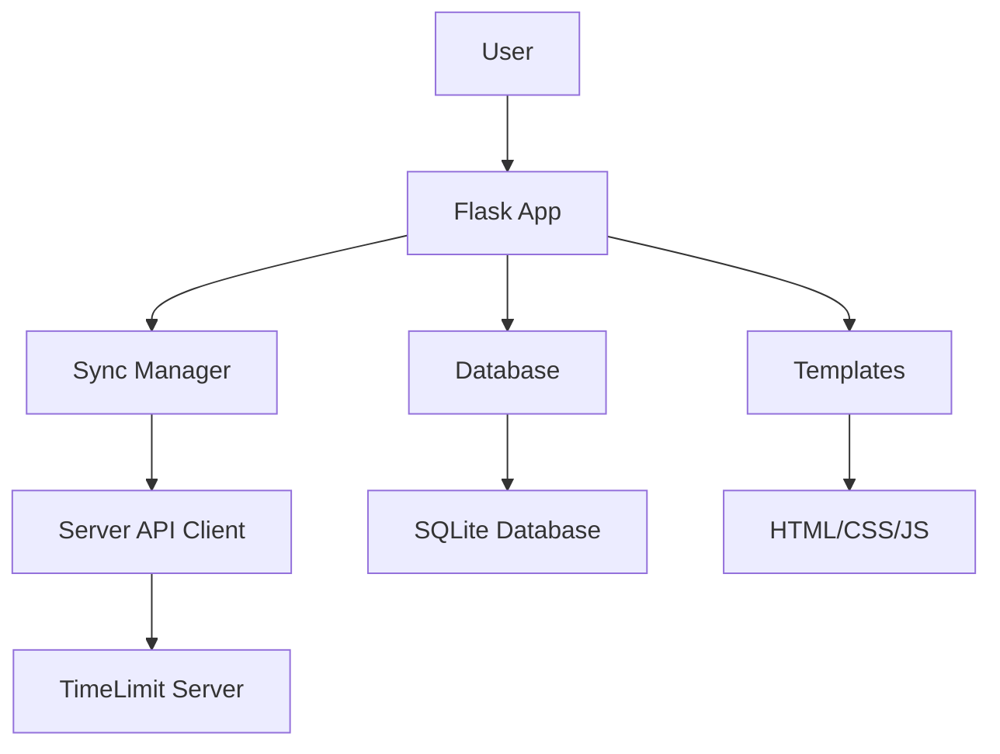

# Design Overview

## Table of Contents

1. [Overview](#overview)
2. [Architecture](#architecture)
3. [Key Design Principles](#key-design-principles)
4. [System Components](#system-components)
5. [Authentication Flow](#authentication-flow)
6. [Data Flow](#data-flow)
7. [Technical Stack](#technical-stack)
8. [Database Schema](#database-schema)
9. [Key Files](#key-files)
10. [Environment Variables](#environment-variables)
11. [Server Selection](#server-selection)
12. [Security Considerations](#security-considerations)

---

## Overview

Dashboard V2 is a Flask-based web application that provides a modern interface for managing TimeLimit families and devices. The application follows a client-server architecture with local SQLite storage for offline capabilities.

### Key Features

- **Device Auth Token Authentication**: Primary authentication mechanism using device tokens
- **Offline-First Design**: Local SQLite database enables offline operation
- **CRDT Synchronization**: Conflict-free Replicated Data Type protocol with HMAC-SHA256 integrity signing
- **Server-Sent Events**: Real-time updates for connected devices
- **Time Limit Rules**: Configure time-based restrictions for child users

---

## Architecture

### High-Level Architecture

```
┌─────────────────────────────────────────────────────────────────┐
│                        Dashboard V2 Application                  │
├─────────────────────────────────────────────────────────────────┤
│  ┌──────────────┐  ┌──────────────┐  ┌──────────────────────┐ │
│  │   Flask App  │  │   Database   │  │   Sync Manager       │ │
│  │   (Routes)   │  │   (SQLite)   │  │   (CRDT Protocol)    │ │
│  └──────────────┘  └──────────────┘  └──────────────────────┘ │
│         │                 │                     │              │
│         ▼                 ▼                     ▼              │
│  ┌──────────────┐  ┌──────────────┐  ┌──────────────────────┐ │
│  │   Templates  │  │   Tables     │  │   Server API Client  │ │
│  │   (HTML/CSS) │  │   (8 tables) │  │   (AuthClient)       │ │
│  └──────────────┘  └──────────────┘  └──────────────────────┘ │
└─────────────────────────────────────────────────────────────────┘
                               │
                               ▼
                     ┌──────────────────────┐
                     │   TimeLimit Server   │
                     │   (debug-server)     │
                     └──────────────────────┘
```

### Component Interaction Diagram



---

## Key Design Principles

### 1. Device Auth Token as Primary Key

Using `device_auth_token` as the primary identifier instead of `family_id`, matching the official Android app's approach.

**Benefits:**
- Consistent authentication across platforms
- Simplified session management
- Better security with token-based auth

### 2. Offline-First Design

Local SQLite database enables offline operation with automatic sync when connectivity is restored.

**Implementation:**
- All data stored locally in SQLite
- Sync queue for pending changes
- Conflict resolution via CRDT protocol

### 3. Session Persistence

Authentication tokens persist across application restarts via file-based storage.

**Storage Location:**
- Windows: `%APPDATA%\DashboardV2\session.json`
- Linux: `~/.config/dashboardV2/session.json`
- Home Assistant: `/data/dashboardV2_session.json`

### 4. CRDT-Based Sync

Conflict-free Replicated Data Type (CRDT) synchronization protocol with HMAC-SHA256 integrity signing.

**Sync Process:**
1. Generate unique action ID
2. Create action with HMAC signature
3. Push to server via sync endpoint
4. Server validates and applies changes
5. Pull updated state from server

---

## System Components

### Frontend Components

| Component | Technology | Purpose |
|-----------|------------|---------|
| Templates | HTML5 | Server-rendered pages |
| Styles | CSS3 | Responsive styling |
| Scripts | JavaScript (ES6+) | Interactive functionality |

### Backend Components

| Component | Technology | Purpose |
|-----------|------------|---------|
| Flask App | Python 3.x | HTTP server and routing |
| Database | SQLite | Local data storage |
| Auth Client | Python | Server API communication |
| Sync Manager | Python | CRDT synchronization |
| Scheduler | APScheduler | Background tasks |
| Config | Python | Configuration management |

---

## Authentication Flow

### Complete Authentication Flow

```
1. Enter Email → 2. Verify Code → 3. Create Family / Sign In
       │               │                     │
       ▼               ▼                     ▼
   Send Mail     Verify Code          Create Family
   Login Code    to Server            or Sign In
                 with 3-word code
```

### Authentication Steps

#### Step 1: Send Mail Login Code
- User enters email address
- System sends 3-word verification code via email
- `mailLoginToken` received from server

#### Step 2: Verify Code
- User enters 3-word verification code
- System exchanges code for `mailAuthToken`
- Token stored in session

#### Step 3: Create Family / Sign In
- **Create Family**: Enter password, device info, name
- **Sign In**: Enter device info, optional password
- Server returns `deviceAuthToken` and `ownDeviceId`

---

## Data Flow

### Create Family Flow

1. User enters email → Mail login code sent
2. User enters verification code → Mail auth token received
3. User enters password → Family created on server
4. Device auth token stored locally
5. Initial sync pulls users, devices, categories

### Login as Parent Flow

1. User enters email → Mail login code sent
2. User enters verification code → Mail auth token received
3. User enters device info → Sign in to existing family
4. Optional: Set password for device removal
5. Sync pulls latest data

### Sync Flow

1. Pull changes from server
2. Push local changes to server
3. Update local database
4. Update connected devices list

### Time Limit Rules Flow

1. User creates rule in UI
2. Rule validated client-side
3. Rule sent to server via sync
4. Server validates and stores rule
5. Rule syncs to all connected devices

---

## Technical Stack

| Layer | Technology | Version |
|-------|------------|---------|
| Backend | Flask | 2.x |
| Database | SQLite | 3.x |
| Frontend | HTML5 | - |
| Frontend | CSS3 | - |
| Frontend | JavaScript | ES6+ |
| Authentication | bcrypt | 4.x |
| Sync Protocol | CRDT | - |
| Integrity | HMAC-SHA256 | - |
| Logging | structlog | 23.x |
| Scheduling | APScheduler | 3.x |

---

## Database Schema

Dashboard V2 uses SQLite with 8 tables for local data storage. All tables use `device_auth_token` as the primary key or foreign key, matching the official Android app's approach.

### Table Overview

| Table | Purpose | Primary Key |
|-------|---------|-------------|
| `server_checks` | Timechecker results | `id` (AUTOINCREMENT) |
| `families` | Family account information | `device_auth_token` |
| `devices` | Device registration data | `id` |
| `auth_tokens` | Authentication tokens | `id` (AUTOINCREMENT) |
| `users` | User data from TimeLimit sync | `id` |
| `sync_state` | Sync version tracking | `device_auth_token` |
| `categories` | TimeLimit categories | `id` |
| `connected_devices` | Real-time connected device tracking | `(device_auth_token, device_id)` |
| `time_limit_rules` | Local time limit rules | `id` |

See [Data Models](data-models.md) for complete database schema documentation.

---

## Key Files

| File | Purpose |
|------|---------|
| `app.py` | Main Flask application with all routes |
| `database.py` | SQLite database operations |
| `auth_client.py` | Server API client |
| `sync_manager.py` | CRDT synchronization |
| `scheduler.py` | Background server checks |
| `config.py` | Application configuration |
| `key_manager.py` | Signing key management |
| `persistence.py` | Persistence abstraction |
| `middleware/request_logging.py` | Request logging middleware |
| `utils/audit_log.py` | Audit logging |
| `utils/logging.py` | Logging configuration |
| `utils/sanitization.py` | Input sanitization |

---

## Environment Variables

| Variable | Description | Default |
|----------|-------------|---------|
| `FLASK_HOST` | Server host | 0.0.0.0 |
| `FLASK_PORT` | Server port | 8099 |
| `FLASK_DEBUG` | Debug mode | False |
| `LOG_LEVEL` | Logging level | INFO |
| `DATABASE_PATH` | SQLite database path | /data/timelimit_ui_storage.json |
| `SKIP_PORT_CHECK` | Skip port availability check | False |
| `DEBUG_SERVER_URL` | Debug-server API URL | http://localhost:8080 |
| `SECRET_KEY` | Session signing key | dev-secret-key-change-in-production |
| `PERSISTENCE_DIR` | Directory for persistence files | Platform-specific |

---

## Server Selection

The application supports multiple server endpoints:

| Key | Server | URL |
|-----|--------|-----|
| `local` | Local development | http://192.168.68.30:8080 |
| `official` | Official TimeLimit server | https://api.timelimit.io |
| `debug` | Debug server | http://localhost:8080 |

Server selection persists across restarts via file-based storage.

---

## Security Considerations

### Authentication Security

- **bcrypt Password Hashing**: All passwords hashed with bcrypt using `$2a$` prefix
- **Device Auth Tokens**: Primary authentication mechanism, stored securely
- **Session Management**: Tokens persist across restarts via encrypted storage

### Data Integrity

- **HMAC-SHA256 Signing**: All sync actions are signed for integrity
- **CRDT Protocol**: Ensures conflict-free data synchronization
- **Input Sanitization**: All user inputs are sanitized before processing

### Network Security

- **HTTPS Support**: Official server uses HTTPS
- **Token Transmission**: Tokens transmitted via secure headers
- **Request Validation**: All requests validated before processing

### Audit Logging

All sensitive operations are logged for security auditing:
- Authentication events
- Device management operations
- User management operations
- Sync operations

See [Logging](logging.md) for detailed logging documentation.