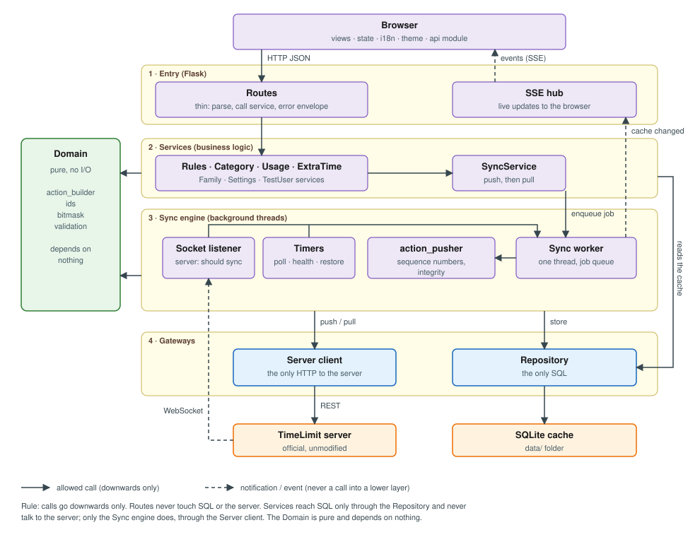

# TimeLimit Dashboard – Architecture and Design

| Item | Value |
|------|-------|
| Version | 3.1 (draft for approval; 3.0 plus the answers of 2026-11-07) |
| Based on | `docs/requirements/requirements.md` v3.0 and the architecture walkthrough of 2026-11-05/06 |
| Replaces | the 2026-09 design overview (kept as `docs/archive/design-v1-2026-09.md`; it describes a "CRDT" sync and an offline queue that do not exist) |
| Protocol | `docs/ServerAPI.md` (verified against the server and two Android clients) |

Every section says what the **target design** is and, where it differs, what the **current code** does ("Gap"). Gaps are work items; they are not described as done.

---

## 1. System context

```
 Browser (desktop / phone / tablet)
        │  HTTP + SSE (same origin)
        ▼
 ┌─────────────────────────────┐        HTTPS/HTTP         ┌──────────────────────┐
 │ Dashboard backend (Python)  │ ────────────────────────► │ TimeLimit server     │
 │  Flask + sync worker +      │  REST (sync, auth)        │ (official or own    │
 │  socket listener + SQLite   │ ◄──────────────────────── │   alternative)       │
 └─────────────────────────────┘  Socket.IO "should sync"  └──────────┬───────────┘
        ▲                                                             │
        │ HA ingress (later)                                          │ same family
        │                                                  Android app (child + parent)
```

- The dashboard is **one more device** of a family, signed in as its own parent user **"Dashboard"**. Other parents and children use the Android app.
- The **browser never talks to the TimeLimit server**. The backend holds the device token and the server WebSocket; the browser only sees the backend (HTTP and SSE).
- One **active server** at a time, chosen in settings (see §8.1); each server has its own link, cache and pending restores. One family per server. No dashboard login (single shared instance).
- The dashboard works against any TimeLimit server that speaks the protocol; it makes no assumption about how or where the server is hosted.
- Default port **8100**, configurable. Default listen address **127.0.0.1**; the HA add-on sets `0.0.0.0` for ingress.
- In Home Assistant the dashboard offers only its web UI through ingress (no sensors or services in v1).

Gap: the code listens on `0.0.0.0` and port 8099 by default.

## 2. Components and layers

### 2.1 Structure diagram



*(Source: `make_structure_svg.py`; regenerate with `python make_structure_svg.py structure.svg`.)*

How to read it:
- **Components do not talk to each other freely.** Every arrow is an allowed call and all of them point **downwards**. Anything not drawn is not allowed.
- **Three things own an outside world:** the **Server client** (the only HTTP to the TimeLimit server), the **Repository** (the only SQL, the only access to the SQLite file) and the **Domain** (pure logic, no I/O at all, depends on nothing).
- **Only one path changes server data:** Routes → Services → SyncService → Sync worker → action_pusher → Server client. Nothing else may push actions or pull from the server.
- **Everything upward is a notification, not a call:** the Sync worker tells the SSE hub that the cache changed, and the SSE hub pushes an event to the browser; the server's WebSocket only wakes the Socket listener, which enqueues a job.
- **The four triggers** (a user change through SyncService, the Socket listener, the timers: fallback poller, health check and the restore timer of "rule off for today" (FR-307)) all enqueue a job; the single Sync worker runs them one at a time, so two syncs never run at once.

| Component | May call | Must not call |
|-----------|----------|---------------|
| Browser (api module) | Routes (HTTP), SSE hub (listen) | the TimeLimit server directly |
| Routes | Services, SSE hub | Repository, Server client, SQL |
| Services (Rules, Category, …) | Domain, Repository, SyncService | Server client, Sync worker directly |
| SyncService | Sync worker (enqueue) | Server client |
| Socket listener, Timers (fallback poller, health check, restore timer) | Sync worker (enqueue), Server client (health only) | Repository, Services |
| Sync worker | action_pusher, Server client, Repository, Domain | Routes, Services |
| action_pusher | Domain, Server client, Repository (sequence numbers) | Services |
| Domain | nothing | everything (it is pure) |

Gap: today these boundaries do not exist; `app.py` calls the database, the server client and `do_sync` directly from about 58 routes.

### 2.2 Layers in short

```
 routes (Flask)      thin: parse input, call a service, return the error envelope
     │
 services            business logic, one module per domain
     │                  ├─ SyncService (push + pull, worker queue)
     │                  ├─ RulesService, CategoryService, UsageService,
     │                  │   ExtraTimeService, FamilyService, SettingsService, TestUserService
     ▼
 repository          the only layer that contains SQL (SQLite)
 server client       the only module that does HTTP to the TimeLimit server
 domain (pure)       actions, ids, bitmask, validation; no I/O (action_builder.py is the model)
```

Rules:
1. Routes contain no SQL and no HTTP calls to the server.
2. Only the repository modules touch SQLite.
3. All HTTP to the TimeLimit server goes through the server-client module (today `auth_client.py`).
4. Domain code (building and validating actions, bitmask, ids) has no I/O and is unit-tested without mocks.
5. Routes stay in `app.py` (no blueprints); logic moves to service modules.

| Module | Role |
|--------|------|
| `app.py` | routes, error handlers, startup |
| `action_builder.py` | domain: wire-correct actions (done) |
| `action_pusher.py` | push batches, integrity, sequence numbers (done) |
| `sync_manager.py` | pull and apply server data; becomes part of `SyncService` |
| `auth_client.py` | server client |
| `database.py` | schema and queries; to be split into repository modules |
| `persistence.py` | token/session file and settings (kept) |
| `scheduler.py` | periodic server check (APScheduler) |
| `config.py` | configuration |

Gap: `app.py` is 5526 lines with 58 routes and mixes routing, logic and SQL; `database.py` has 3232 lines; `auth_client.py` still contains legacy methods.

To remove: the legacy UI layer (`frontend.py`, `web_server.py`, `api_client.py`, `check_server.py` in `rootfs/usr/bin`), the one-off scripts (`add_time_limit_rules*.py`, `update_database.py`, `verify_bcrypt.py`, `test_hash_verify*.py`, loose `test_*.py` in the repo root). **Order matters:** the HA add-on still starts `web_server.py` through s6 (`web-server` service); the `dashboard-v2` service exists but is not enabled. Switch the s6 service first, then delete.

## 3. Synchronisation and push

**Change flow (user action):**
1. Route validates input and calls the service.
2. The service enqueues a job for the **single sync worker** (one thread, serial execution; routes never run a sync themselves).
3. Worker: build the action(s) with `action_builder`, push with `action_pusher` (device integrity, sequence numbers reserved and stored first, max 25 per request), then **immediately pull**.
4. The request waits until the pull is done and returns the resulting state. While it waits, the UI shows the item with the marker "waiting for server".
5. Confirmed = the server did not ask for a full sync. Not confirmed → rollback in the UI and an error with code `ACTION_NOT_CONFIRMED`.
6. When the cache changed, one SSE event goes to the browser.

**Pull:** `ClientDataStatus` carries the versions the dashboard holds (devices, users, per-category data, rules, apps, used times, tasks). The server returns only differing parts; all of them are applied to the cache. After `shouldDoFullSync` all versions are forgotten and the dashboard fully re-pulls, then shows a short notice.

**Live updates**
- Server → backend: a listener thread holds the Socket.IO connection (`devicelogin`, `should sync`, `sign out`) and reconnects with back-off. On `should sync` it asks the worker for a pull.
- **Polling fallback** (interval configurable) runs while the socket is down.
- Backend → browser: **SSE** (`/api/dashboard/stream`), kept.

Conflicts: last writer wins. If the data being edited changed on the server meanwhile, the UI warns before saving.

Gap: no version exchange (`ClientDataStatus` has no versions, D10); no pull after push (D11); sync is called from three places in `app.py`; `INSERT OR REPLACE` on `sync_state`; no worker queue; no server WebSocket.

## 4. Data and cache

- **SQLite**, one file per installation, in the data folder (section 8). The server is the source of truth; the file is a cache plus the link to the server.
- **Cache key:** the **server profile** (§8.1) plus the **family id** from the server (not the device token). The token is an ordinary column. Every server profile has its own link, cache, counter and pending restores.
- **Cache content (target):** devices, users, categories, category apps, rules, blocked times per category, used time per day (the dashboard builds its own daily totals so the history grows to 30 days; they are lost on a cache reset), installed apps of child devices, version ids per part. **Tasks are not stored** (no screen in v1).
- **Kept for the link (never dropped):** device token, own device id, family id, the sequence counter, settings, and the **pending restores** of "rule off for today" (FR-307): losing them would leave a rule switched off for good.
- **Schema changes:** no migration chain. On a schema change the cache is dropped and fully re-synced. **The sequence counter and the link must survive a reset**: a counter that goes back to 0 makes the server skip actions silently.
- Users and other entities the server no longer reports are kept and flagged "no longer on server" until cleaned up.
- No parent passwords are stored.

Gap: tables are keyed by `device_auth_token`; migrations are ad hoc `PRAGMA table_info`/`ALTER TABLE` checks; there are no tables for used time, tasks, blocked times or versions; the audit log retention is not enforced (30 days wanted).

## 5. Security

| Topic | Design |
|-------|--------|
| Exposure | `127.0.0.1` by default; no dashboard login; remote access only through HA ingress |
| Token | Stored on local disk only (database **and** session file with backup, both kept); never sent to the browser |
| Parent actions | Device integrity (no password) for rules, categories, extra time, blocking |
| Password prompts | Modal per action, only for server-required actions (change parent password, keep-signed-in); password never stored |
| `SECRET_KEY` | Generated randomly on first start and stored next to the database; environment variable overrides |
| Web attacks | No CSRF/Origin/DNS-rebinding protection in v1 (accepted; the only barrier is the localhost default) |
| Files | No extra protection of token files (user folder); data folder is gitignored |
| Logs | Secrets (tokens, hashes, typed password, second hash) are **masked at info level and higher**; only at **debug level** everything is unmasked, also in the debug export; the UI warns before sharing |
| Transport | HTTPS required when the server is not on the local network; HTTP allowed for localhost/LAN test servers |

Risks to revisit before the HA add-on: a debug-level log or export exposes the token; with `0.0.0.0` and no login anyone on that network can operate the dashboard.

Gap: `SECRET_KEY` has a fixed default (`dev-secret-key-change-in-production`).

## 6. Failure handling

- **One error envelope** for all API routes: `{status:"error", code, message, requestId}`; fixed codes; matching HTTP status (502/504 for server problems).
- **Error codes** (fixed list):

| Code | HTTP | Meaning |
|------|------|---------|
| `INVALID_INPUT` | 400 | invalid input (field message) |
| `SESSION_INVALID` | 401 | token invalid / device signed out ("link the device again") |
| `INVALID_PASSWORD` | 403 | parent password wrong |
| `NOT_FOUND` | 404 | unknown item |
| `NOT_LINKED` | 409 | no link with a server yet |
| `CONFLICT` | 409 | server data differs from the version being edited (the browser sends the version it started with) |
| `READ_ONLY_OFFLINE` | 503 | change refused: server unreachable |
| `SERVER_UNREACHABLE` | 502 | server not reachable |
| `SERVER_TIMEOUT` | 504 | server did not answer in time |
| `ACTION_NOT_CONFIRMED` | 502 | server did not accept the action (`shouldDoFullSync`) |
| `INTERNAL_ERROR` | 500 | unexpected error |
- **Timeouts everywhere:** browser `fetch` through `AbortController` (default 10 s); backend → server configurable, 3 s for the health check.
- **Server unreachable:** offline banner, read-only view from the cache, change controls disabled, no queued requests, reconnect polling with back-off (default 10 s → 30 s) plus a retry button; on recovery a sync runs.
- Timings are configurable; the old values are the defaults.

Gap: **the server-down logic does not exist in the JavaScript** (`checkServerHealth`, `handleServerDown`, `pollServerHealth`, `AbortController`, `retryConnection` are missing; only the banner markup is there); `apiRequest` is a bare `fetch`; there are 101 ad-hoc `jsonify({'error': ...})` responses. Restoring this is part of the first build step.

## 7. Frontend

- **Jinja templates + vanilla JavaScript in ES modules** (api, state, views, i18n). No build step, no npm.
- Screens: children overview, child detail (with a tab "Changes" showing the audit log), settings, test section. First-run linking and the parent-password actions live in settings and modals; the old form pages (create-family, login-as-parent, recover/set-parent-password) are removed. The test section (including the former `debug_database.html`) exists only when the "This is a test server" switch in settings is on; otherwise its menu item is absent and its routes answer 404.
- Navigation: fixed sidebar on desktop, hamburger menu on small screens.
- **Styling:** shared CSS with variables, no inline styles; the dark theme follows the system (`prefers-color-scheme`) with a manual override.
- **i18n:** `nl.json` and `en.json`; a missing key falls back to English; language chosen in settings. Default language: the browser language when it is Dutch or English, otherwise English. Default theme: the system.
- Layout works on desktop, phone and tablet. No WCAG target (basic ARIA only).

Gap: one 1865-line `dashboardV2.js`, 1626-line CSS, 128 inline styles in `dashboardV2.html`, separate `<style>` blocks per page, no theme, no i18n. `debug_database.html` moves into the test section or behind debug level.

## 8. Configuration and deployment

| | Windows | Home Assistant add-on |
|-|---------|-----------------------|
| Start | `py -3 app.py` (local, no build) | s6 service `dashboard-v2` |
| Data folder | `data/` next to the app (gitignored) | `/data` |
| Config | file/environment + settings screen | add-on options + settings screen |
| Build | none (a local script if ever needed) | GitHub Actions → image on `ghcr.io`, version from one source |
| Architecture | – | **aarch64** (his HA) |

- Add-on options: log level, listen address (set by the add-on). The server is chosen in the settings screen (§8.1), not in the add-on options.

### 8.1 Server selection
- Settings has a **dropdown**: **Official server** (`https://api.timelimit.io`) or **Alternative server**. For the alternative the user enters **protocol (http/https, default http), address and port**.
- The choice is stored persistently (in the settings table) and survives restarts and cache resets. On first start nothing is selected and the link screen asks for it.
- **Each server has its own profile:** link (device token, own device id, family id), cache, sequence counter and pending restores (FR-307). Switching the server activates another profile; switching back restores it untouched. Actions can never reach a server other than the active one.
- The "This is a test server" switch (FR-800) belongs to the profile of an alternative server.
- One code base for both; differences are configuration only (paths, listen address, options).
- Logging: configurable level, rotation (size and file count), debug export.
- Python 3.10+, `requirements.txt` with loose ranges.

Gap: `config.yaml` says `amd64` only and has a hard-coded server URL; the Dockerfile and s6 list start the legacy `web_server.py`; database and logs are in the module folder; the log path is relative.

## 9. Test strategy

- **Isolation:** every test gets its own temporary database and log folder (`tmp_path`); no shared files.
- **Layers:** pytest unit tests for domain, services and repositories; **contract tests** that validate every produced action against the schemas generated from the server; **Playwright** tests for the main screens (overview, child detail, rule dialog, hamburger menu, offline banner).
- Tests that only grep source text for a function name are replaced by behaviour tests.
- Speed: `pytest-xdist` in parallel, 30 s timeout per test, no automatic retries; tests of deleted code are removed.
- **Definition of done:** the complete suite is green, including unrelated tests. Run stops at the first failure (`-x`) during work.
- A live test against a real server is optional (local test server).

Gap: all tests share `test_isolation.db`; the last full run had 1325 tests, **29 failed** (24 isolation, 1 database isolation, 2 clear-all, 1 config, 1 landing), 369 s.

## 10. Build order (changes to the proposal in the requirements)

0. **Strategy (decided 2026-11-07):** the new dashboard is built **next to the old one** in a new package `dashboard/` (sub-folders `routes/`, `services/`, `repository/`, `domain/`, `sync/`, `client/`, `static/`, `templates/`). `action_builder`, `action_pusher` and `crypto_utils` are reused; the old `dashboardV2/` is deleted at the end (cut-over).
1. **Foundation:** per-test isolation and the 29 failing tests; error envelope; server-down handling and timeouts; settings/data folder; `SECRET_KEY`.
2. **Sync:** `SyncService` with worker, version exchange (D10/D11), full-sync handling, cache keyed by server profile and family id, sequence counter kept across resets.
3. **Cleanup:** switch the s6 service to `dashboard-v2`, then delete the legacy UI layer and scripts.
4. **Frontend base (decided 2026-11-07: before the features):** themes, i18n, sidebar/hamburger, dialogs, Playwright set-up.
5. **Features:** rules, blocked times (per category), categories and apps, extra time and temporary blocking, used time (own daily totals), settings and linking, password actions, test section, audit log.
6. **HA add-on:** aarch64 image, options, ingress, GitHub Actions.
7. **Cut-over:** make `dashboard/` the entry point and delete the old `dashboardV2/`.

## 11. Open points

1. Security before HA: no CSRF protection, and debug-level logs/exports are unmasked; revisit when the dashboard becomes reachable beyond the laptop.
2. Audit-log entries without a child (settings, test section): where they are shown.
