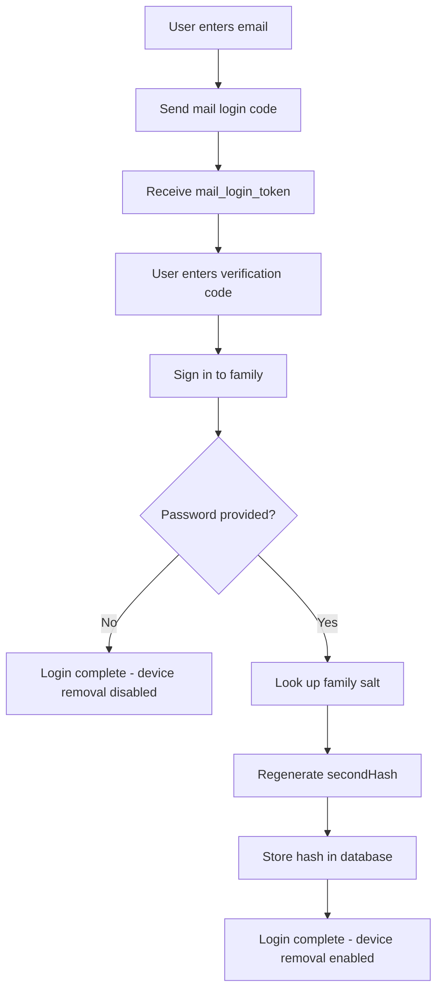

# 2-Step Login Flow Design

## Overview

This document describes the design for a 2-step login flow that allows users to:
1. Log in using mail login code to get all required data from the server
2. Optionally provide the password to regenerate the hash for device removal operations

## Current Flow (3 Steps)

### Step 1: Send Mail Login Code
- User enters email
- Server sends verification code
- Returns `mail_login_token`

### Step 2: Verify Code
- User enters 3-word verification code
- Server validates code
- Returns `mail_auth_token`

### Step 3: Sign In to Family
- User enters device info (model, name)
- User optionally enters password
- Server returns `device_auth_token` and `own_device_id`

**Problem**: Password is optional in step 3, but users may not know they need it for device removal.

## Proposed 2-Step Flow

### Step 1: Login with Mail Code
- User enters email
- User enters verification code
- Server returns `device_auth_token` and `own_device_id`
- User is now authenticated and can access the dashboard

### Step 2 (Optional): Set Password for Device Removal
- User enters password
- System regenerates the hash using existing salt from family record
- Hash is stored for device removal operations
- User can now remove devices

## Data Flow



## API Endpoints

### Current Endpoints (No Changes Required)

1. `POST /api/auth/send-mail-login-code` - Send verification code
2. `POST /api/auth/sign-in-by-mail-code` - Verify code
3. `POST /api/auth/sign-in-into-family` - Sign in to family

### New Endpoint (Optional)

4. `POST /api/auth/regenerate-password-hash` - Regenerate hash from password
   - Request: `{ mail_auth_token, password }`
   - Response: `{ success, secondHash, hash, secondSalt }`

## Session Data

After Step 1, the session should contain:
- `device_auth_token` - For server authentication
- `own_device_id` - Dashboard's device ID
- `mail` - User's email (for salt lookup)
- `mail_auth_token` - For optional hash regeneration

## Password Hash Regeneration

When user provides password in Step 2:

1. Look up family by email to get `parent_password_second_salt`
2. Use `regenerate_second_hash(password, existing_salt)` to generate matching hash
3. Store hash in session and database:
   - `parent_password_second_hash` in session
   - `parent_password_second_hash`, `parent_password_second_salt` in database

## Frontend Changes

### login_as_parent.html Template

#### Current Step 3:
```html
<!-- Device info fields -->
<input type="text" id="deviceModel" name="deviceModel">
<input type="text" id="deviceName" name="deviceName">

<!-- Password fields (optional) -->
<input type="password" id="password" name="password">
<input type="text" id="parentPasswordSecondHash" name="parentPasswordSecondHash">
```

#### Proposed Step 3:
```html
<!-- Device info fields (required) -->
<input type="text" id="deviceModel" name="deviceModel" required>
<input type="text" id="deviceName" name="deviceName" required>

<!-- No password fields - login completes here -->
```

#### New Step 4 (Optional):
```html
<!-- Password field for device removal -->
<div class="password-section">
    <h3>Enable Device Removal</h3>
    <p>Enter your password to enable device removal functionality.</p>
    <input type="password" id="password" name="password" placeholder="Enter password">
    <button type="submit">Save Password</button>
</div>
```

## Backend Changes

### app.py - post_login_as_parent()

#### Current Logic (Step 3):
```python
# Password is optional in step 3
if password:
    # Generate hash and send to server
    password_data = generate_family_hashes(password)
    # ...
```

#### Proposed Logic:
```python
# Step 3: Sign in to family (password not required)
response = client.sign_in_into_family(
    mail_auth_token=mail_auth_token,
    parent_password_second_hash=None,  # No password required
    device_name=device_name,
    device_model=device_model,
    client_level=7
)

if response.success:
    # Store device_auth_token in session
    session['device_auth_token'] = response.data.get('deviceAuthToken')
    session['own_device_id'] = response.data.get('ownDeviceId')
    
    # Sync with server
    # ...
    
    # Redirect to dashboard
    return redirect('/dashboardV2')
```

### New Endpoint: /api/auth/regenerate-hash

```python
@app.route('/api/auth/regenerate-hash', methods=['POST'])
def api_regenerate_hash():
    """Regenerate password hash from password and existing salt."""
    data = request.get_json() or {}
    mail = data.get('mail')
    password = data.get('password')
    
    if not mail or not password:
        return jsonify({'status': 'error', 'error': 'Missing required fields'}), 400
    
    db = get_database()
    family = get_family_by_mail(db, mail)
    
    if not family or not family.get('parent_password_second_salt'):
        return jsonify({'status': 'error', 'error': 'Password hash not available'}), 400
    
    existing_salt = family.get('parent_password_second_salt')
    second_hash = regenerate_second_hash(password, existing_salt)
    
    # Store in session and database
    session['parent_password_second_hash'] = second_hash
    upsert_family_password_hash(
        db=db,
        device_auth_token=session.get('device_auth_token'),
        parent_password_second_hash=second_hash,
        parent_password_second_salt=existing_salt
    )
    
    return jsonify({
        'status': 'ok',
        'secondHash': second_hash
    })
```

## Session Status API

The `/api/session/status` endpoint should return:
- `has_parent_password_second_hash` - Whether hash is set
- `parent_password_second_hash` - The hash (if set)
- `has_mail_auth_token` - Whether mail auth token is available
- `mail_auth_token` - The token (if available)

## Device Removal Flow

When user wants to remove a device:

1. Check if `parent_password_second_hash` is in session
2. If not, show prompt to enter password
3. Call `/api/auth/regenerate-hash` to get hash
4. Use hash for device removal

## Error Handling

### Missing Salt
If family record doesn't have `parent_password_second_salt`:
- Show error: "Password hash not available for this family"
- Suggest contacting support or using password recovery flow

### Invalid Password
If password doesn't match:
- Server will return 401 Unauthorized
- Show error: "Invalid password"

## Testing Considerations

1. Test login without password - should succeed
2. Test login with password - should succeed
3. Test device removal without password - should show prompt
4. Test device removal with password - should succeed
5. Test hash regeneration with wrong password - should fail
6. Test session persistence after restart

## Implementation Checklist

- [ ] Update `login_as_parent.html` template for 2-step flow
- [ ] Update `post_login_as_parent()` in `app.py`
- [ ] Add new `/api/auth/regenerate-hash` endpoint
- [ ] Update session status API to include hash fields
- [ ] Update frontend JavaScript to handle password prompt
- [ ] Add tests for new flow
- [ ] Update audit logging for new flow